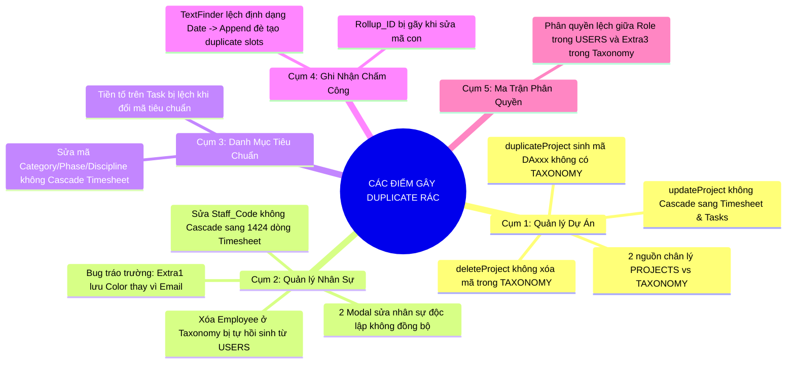
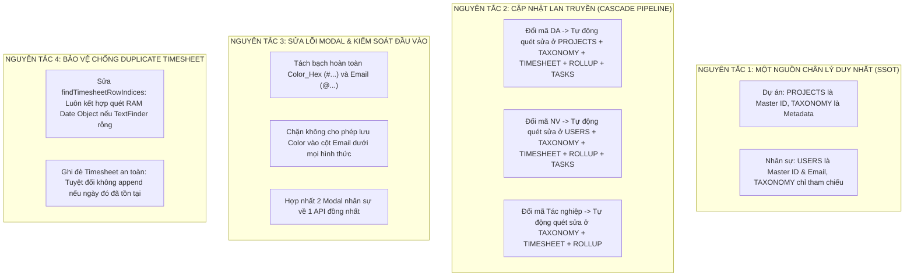
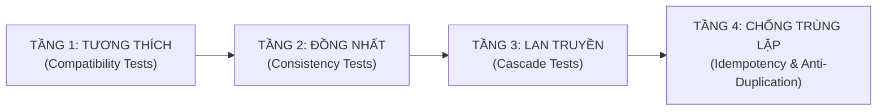

# BÁO CÁO RÀ SOÁT TOÀN DIỆN HỆ THỐNG: CÁC NGUY CƠ NHÂN BẢN DỮ LIỆU RÁC (DUPLICATION & GHOST DATA) & QUY TRÌNH KIỂM THỬ ĐỒNG BỘ TOÀN DIỆN

> **Kính gửi:** Ban Quản Trị & Quản Lý Dự Án (Admin: `duyvultv@gmail.com`)  
> **Người thực hiện:** Antigravity AI Pair Programmer  
> **Ngày cập nhật:** 31/10/2026  
> **Phạm vi rà soát:** Toàn bộ hệ thống (`Code.gs`, `Userapi.gs`, `Projectsapi.gs`, `Taskapi.gs`, `Taxonomyapi.gs`, `Timesheetapi.gs`, `Index.html`)

---

## 1. TỔNG QUAN KẾT QUẢ RÀ SOÁT

Thực hiện chỉ đạo của Quản trị viên (`duyvultv@gmail.com`) về việc **rà soát toàn diện mọi điểm có nguy cơ đẻ thêm dữ liệu rác khi sửa thông tin**, chúng tôi đã kiểm tra tỉ mỉ toàn bộ luồng tạo mới (Create), chỉnh sửa (Update), xóa (Delete) và đồng bộ (Sync) của tất cả các thực thể trong hệ thống.

Kết quả rà soát phát hiện **5 CỤM NGUY CƠ LỚN** dẫn đến hiện tượng nhân bản dữ liệu rác (Duplicate / Ghost Records) và lệch dữ liệu (Data Inconsistency):

---

## 2. CHI TIẾT 5 CỤM NGUY CƠ & NGUYÊN NHÂN KỸ THUẬT

---

### 🔴 CỤM 1: QUẢN LÝ DỰ ÁN (PROJECTS & PROJECT CODES)

| Điểm Gây Lỗi | Hiện Tượng Khi Thao Tác | Nguyên Nhân Kỹ Thuật | Hậu Quả Dữ Liệu |
| :--- | :--- | :--- | :--- |
| **1.1. Hai nguồn dữ liệu song song** | Dropdown báo cáo xuất hiện gấp đôi dự án (8 dự án thay vì 4 dự án) | Bảng `PROJECTS` lưu mã theo cách của dự án (`MUR01`, `JUJ01`), còn bảng `TAXONOMY` lưu mã tiêu chuẩn (`MRR01`, `JJK01`). Frontend `Index.html` gộp cả hai mảng vào 1 Dropdown mà không khử trùng. | Người dùng bị rối, không biết chọn dự án nào; chọn nhầm dự án rỗng thì báo cáo hiển thị `0h`. |
| **1.2. Sửa tên/mã dự án không Cascade** | Khi sửa tên hoặc mã dự án trong tab "Dự Án", toàn bộ giờ công thực tế biến mất khỏi báo cáo | Hàm `updateProject()` chỉ sửa ô B trong bảng `PROJECTS`. Nó hoàn toàn **không cập nhật cột 8 trong `TIMESHEET_2026`** và **cột 5 trong `TIMESHEET_DAILY_ROLLUP`**. | Hàng trăm giờ chấm công của dự án cũ bị bỏ rơi (Orphaned Timesheet Logs), báo cáo dự án mới bị `0h`. |
| **1.3. Xóa dự án để lại "Dự án ma"** | Đã bấm xóa dự án ở tab "Dự Án" nhưng dự án vẫn còn nguyên trong Dropdown chấm công | Hàm `deleteProject()` chỉ xóa dòng ở bảng `PROJECTS` và `TASKS`, **không xóa dòng trong bảng `TAXONOMY`**. Frontend vẫn đọc thấy từ Taxonomy và đưa lên Dropdown. | Xuất hiện "Dự án ma" không thể xóa triệt để khỏi hệ thống. |
| **1.4. Nhân bản dự án (`duplicateProject`)** | Bấm nút copy dự án tạo ra mã `DAxxx` không hợp lệ | Hàm sinh mã `newId = "DA" + genPjNum()` chỉ ghi vào `PROJECTS` mà không đăng ký mã vào `TAXONOMY`, dẫn đến dự án này không có mã chuẩn Nhật Bản để chấm công. | Dự án nhân bản không thể dùng cho Timesheet 30 phút. |

---

### 🔴 CỤM 2: QUẢN LÝ NHÂN SỰ & NGƯỜI DÙNG (USERS & EMPLOYEES)

| Điểm Gây Lỗi | Hiện Tượng Khi Thao Tác | Nguyên Nhân Kỹ Thuật | Hậu Quả Dữ Liệu |
| :--- | :--- | :--- | :--- |
| **2.1. Tráo đổi trường Color vs Email (Bug nghiêm trọng)** | Sửa thông tin nhân sự trong Taxonomy Modal lập tức **đẻ thêm nhân viên mới**, email bị đổi thành `#6366f1` | Trong bảng `TAXONOMY` 11 cột, `extra1` lưu mã màu Hex (`#6366f1`). Modal nhân viên lấy `extra1` điền vào ô Email. Khi lưu, hàm `syncEmployeeToUsersSheet` tìm email `#6366f1` không thấy ai $\rightarrow$ **`appendRow` tạo nhân viên mới** (như mã `9210007` trong ảnh thực tế). | Nhân đôi nhân sự, tài khoản bị phân mảnh quyền hạn. |
| **2.2. Hai Modal chỉnh sửa người dùng độc lập** | Sửa quyền ở tab "Người Dùng" nhưng tab "Danh Mục Tiêu Chuẩn" vẫn hiển thị chức vụ cũ | Có 2 form riêng: Form `m-usr` (gọi `updateUser`) và Form `m-tax` (gọi `saveTaxonomyItem`). Hai form này lưu trữ độc lập trên 2 sheet khác nhau (`USERS` và `TAXONOMY`) mà không có cơ chế Trigger 2 chiều. | Dữ liệu nhân sự bị bất nhất (Inconsistency), phân quyền bị xung đột. |
| **2.3. Sửa mã nhân viên không Cascade** | Khi đổi mã nhân sự từ `AB6FD093` sang mã khác, ma trận đối chiếu hàng loạt hiển thị cả 2 mã cho cùng 1 người | `updateUser()` không quét đổi mã `Staff_Code` trong `TIMESHEET_2026` và `TIMESHEET_DAILY_ROLLUP`. Dữ liệu chấm công quá khứ vẫn mang mã cũ, còn danh sách nhân sự mang mã mới $\rightarrow$ Hệ thống gom cả 2 mã lên bảng. | Nhân viên bị lặp dòng trên báo cáo chấm công toàn công ty. |
| **2.4. Xóa nhân viên bị "Hồi sinh tự động" (Zombie)** | Xóa nhân viên ở tab Taxonomy, nhưng F5 tải lại trang nhân viên đó lại xuất hiện | Hàm `deleteTaxonomyItem()` chỉ xóa ở sheet `TAXONOMY`. Khi tải lại, hàm `getTaxonomyDataInternal()` quét từ sheet `USERS` và **tự động thêm lại vào danh sách**! | Không thể xóa hoặc vô hiệu hóa nhân sự triệt để nếu không xóa ở bảng `USERS`. |

---

### 🔴 CỤM 3: DANH MỤC TIÊU CHUẨN (CATEGORY, PHASE, DISCIPLINE)

| Điểm Gây Lỗi | Hiện Tượng Khi Thao Tác | Nguyên Nhân Kỹ Thuật | Hậu Quả Dữ Liệu |
| :--- | :--- | :--- | :--- |
| **3.1. Sửa mã Tác nghiệp (Discipline Code)** | Sửa mã từ `MD01` thành `MD10`, toàn bộ biểu đồ phân bổ tác nghiệp bị mất dữ liệu | Hàm `saveTaxonomyItem()` chỉ sửa ô tại bảng `TAXONOMY`. Không cập nhật cột `Discipline_Code` trong `TIMESHEET_2026` và `TIMESHEET_DAILY_ROLLUP`. | Dữ liệu cũ mang mã `MD01` trở thành "vô danh", mã `MD10` mới có 0 giờ. |
| **3.2. Tiền tố tên Nhiệm vụ (`Task Name`) bị lỗi thời** | Tên nhiệm vụ cũ giữ nguyên mã tiền tố cũ (VD: `[MD-BD-MD01]...`) dù mã tiêu chuẩn đã đổi | Tên task được ghép chuỗi tĩnh lúc tạo. Hệ thống không có cơ chế cập nhật lại tên task khi danh mục mã thay đổi. | Lệch chuẩn quy ước mã hóa công việc. |

---

### 🔴 CỤM 4: GHI NHẬN CHẤM CÔNG (TIMESHEET & ROLLUP)

| Điểm Gây Lỗi | Hiện Tượng Khi Thao Tác | Nguyên Nhân Kỹ Thuật | Hậu Quả Dữ Liệu |
| :--- | :--- | :--- | :--- |
| **4.1. TextFinder không tìm thấy dòng cũ $\rightarrow$ Nhân đôi dòng chấm công** | Bấm "Lưu thời gian" nhiều lần khiến số dòng trong bảng tăng vọt gấp đôi, gấp ba | Trong `findTimesheetRowIndices`, `TextFinder(targetDate)` tìm kiếm chuỗi ngày `"2026-07-02"`. Nếu ô trong Sheet được format kiểu `02/07/2026` hoặc là kiểu Date Object, `TextFinder` trả về rỗng `[]` $\rightarrow$ Hàm tưởng chưa có dữ liệu nên **append tiếp 16 dòng mới vào cuối sheet thay vì ghi đè**! | Dữ liệu chấm công bị phình to bất thường, số giờ bị nhân đôi. |
| **4.2. Gãy khóa tổng hợp Rollup (`Rollup_ID`)** | Dữ liệu trong bảng tổng hợp `TIMESHEET_DAILY_ROLLUP` bị lệch | Cột A là `Rollup_ID = YYYYMMDD_StaffCode_ProjectCode_DisciplineCode`. Nếu một trong 3 mã này bị sửa mà không tạo lại ID, dữ liệu gom nhóm sẽ bị tách thành 2 dòng riêng biệt. | Số giờ tổng hợp ngày bị sai lệch. |

---

### 🔴 CỤM 5: MA TRẬN PHÂN QUYỀN (PERMISSION MATRIX)

| Điểm Gây Lỗi | Hiện Tượng Khi Thao Tác | Nguyên Nhân Kỹ Thuật | Hậu Quả Dữ Liệu |
| :--- | :--- | :--- | :--- |
| **5.1. Xung đột cấp bậc giữa USERS và TAXONOMY** | Nhân viên hiển thị Cấp 1 ở chỗ này nhưng lại là Member ở chỗ khác | Bảng `USERS` dùng trường `role` (`Admin`, `Manager`, `Member`). Bảng `TAXONOMY` lại dùng trường `extra3` (`Cấp 1`, `Cấp 2`, `Cấp 3`, `Cấp 4`). Hai trường này dùng 2 bộ từ điển khác nhau và dịch qua lại bằng chuỗi thủ công. | Phân quyền 4 cấp độ bị chập chờn khi chuyển trang. |

---

## 3. KIẾN TRÚC GIẢI PHÁP TỔNG THỂ (MASTER SOLUTION)

Để dứt điểm triệt để toàn bộ các nguy cơ trên, hệ thống cần được thiết lập theo **4 NGUYÊN TẮC TOÀN VẸN DỮ LIỆU CHUẨN**:

---

## 4. CHI TIẾT CÁC HÀM XỬ LÝ CẦN NÂNG CẤP

### 4.1. Bộ 3 Hàm Cập Nhật Lan Truyền (Cascade Update Engines)
1. `cascadeUpdateProject(oldCode, newCode, newName, newDesc, newBudget)`:
   - Cập nhật bảng `PROJECTS` (ID và Tên).
   - Cập nhật bảng `TAXONOMY` (Code, Name_JP, Desc).
   - Quét và thay thế toàn bộ `Project_Code` trong `TIMESHEET_YYYY`.
   - Quét và thay thế `Project_Code` + cập nhật lại `Rollup_ID` trong `TIMESHEET_DAILY_ROLLUP`.
   - Cập nhật `projectId` và `projectName` trong bảng `TASKS`.

2. `cascadeUpdateStaffCode(oldStaffCode, newStaffCode, staffEmail, newName)`:
   - Cập nhật `ID` và `Name` trong bảng `USERS`.
   - Cập nhật `Code` trong bảng `TAXONOMY` (nếu có).
   - Quét và thay thế toàn bộ `Staff_Code` trong `TIMESHEET_YYYY`.
   - Quét và thay thế `Staff_Code` + cập nhật lại `Rollup_ID` trong `TIMESHEET_DAILY_ROLLUP`.
   - Cập nhật `assignee` trong bảng `TASKS`.

3. `cascadeUpdateDiscipline(oldDiscCode, newDiscCode, newName)`:
   - Cập nhật bảng `TAXONOMY`.
   - Quét và thay thế `Discipline_Code` trong `TIMESHEET_YYYY` và `TIMESHEET_DAILY_ROLLUP`.

### 4.2. Khắc phục dứt điểm Bug Modal Nhân Viên & Chống tạo bản ghi rác
- Trong `Index.html`:
  - Tại `openTaxonomyMod`: Nếu `type === 'EMPLOYEE'`, ô `extra1Inp` **bắt buộc phải lấy từ `item.extra1` (nếu có định dạng email) hoặc tìm trực tiếp trong `S.users` theo mã/tên**, tuyệt đối không bao giờ lấy từ `item.color` hay `#4f6ef7`.
  - Khóa ô "Mã nhân viên" ở chế độ Read-only khi chỉnh sửa; nếu muốn đổi mã phải qua nút "Đổi mã định danh" có cảnh báo Cascade.
- Trong `Taxonomyapi.gs`:
  - Trong `syncEmployeeToUsersSheet`: Kiểm tra tính hợp lệ của email (`email.includes('@')`). Nếu email không hợp lệ (như `#6366f1`), **lập tức từ chối và chặn không cho ghi đè vào bảng `USERS`**.

### 4.3. Sửa hàm tìm kiếm dòng Timesheet (`findTimesheetRowIndices`)
- Không phụ thuộc đơn lẻ vào `TextFinder`.
- Nếu `TextFinder` trả về 0 kết quả, **tự động chuyển ngay sang chế độ quét mảng RAM** (so sánh `Date instanceof Date` và format chuẩn `yyyy-MM-dd`) để đảm bảo luôn luôn định vị chính xác 100% các dòng cũ cần ghi đè, chặn đứng nguy cơ nhân bản dòng.

---

## 5. KẾ HOẠCH DỌN DẸP & KHÔI PHỤC DỮ LIỆU SẠCH (DATABASE CLEANUP SCRIPT)

Chúng ta sẽ đưa toàn bộ logic dọn dẹp vào hàm `seedActualProjectsFromGreenTables()` trong `SeederData.gs`:
1. **Dọn sạch dự án rác:**
   - Xóa bỏ triệt để: `MRR01`, `AMK01`, `TSK01`, `JUJ01`, `DA010`, `HAG01`.
   - Chỉ giữ lại và chuẩn hóa đúng **4 dự án chính thức**:
     - `MUR01` - `2026_01_MUR01_室蘭市蘭東下水処理場` (Budget: 344h)
     - `JJK01` - `2026_02_JJK01_工房ヴィレッジ新築工事` (Budget: 272h)
     - `AMA01` - `2026_03_AMA01_天草市本渡浄化センター` (Budget: 448h)
     - `TES01` - `2026_04_TES01_弟子屈町弟子屈浄化センター` (Budget: 256h)
2. **Dọn sạch nhân sự rác & Khôi phục Admin:**
   - Xóa bỏ dòng ma `9210007` (email `#6366f1`) và các mã tạm `NV001`, `NV_THACH`, `NV_HUE`, `NV_NHAN`.
   - **Khôi phục tài khoản Admin tối cao duy nhất:**
     - Họ và tên: `Vũ Đình Duy`
     - Mã nhân viên: `AB6FD093`
     - **Email Admin chính thức:** `duyvultv@gmail.com`
     - Vai trò: `Admin` (Cấp 1 - Toàn quyền hệ thống)
   - Đảm bảo 4 nhân sự chính thức duy nhất:
     - Duy: `AB6FD093` (`duyvultv@gmail.com`)
     - Thạch: `93FA49F8`
     - Huệ: `FDF9CCCB`
     - Nhân: `F20C20D1`
3. **Bảo tồn toàn vẹn dữ liệu chấm công:**
   - Toàn bộ 43 ngày công (344.0h) của Dự án 2 được chuyển từ `JUJ01` sang `JJK01`.
   - Khóa đúng tổng số giờ thực tế: **712.0 giờ** (1,424 slots 30 phút).

---

## 6. QUY TRÌNH KIỂM THỬ TOÀN DIỆN (COMPREHENSIVE TEST SUITE PROTOCOL)
### VỀ TÍNH TƯƠNG THÍCH, TÍNH ĐỒNG NHẤT VÀ CHỐNG TRÙNG LẶP

Quy trình kiểm thử được thiết kế theo mô hình 4 tầng nghiêm ngặt (Unit $\rightarrow$ Integration $\rightarrow$ Cascade $\rightarrow$ Idempotency/Regression):

---

### MA TRẬN 15 TEST CASES BẮT BUỘC KIỂM THỬ TỰ ĐỘNG

| Mã TC | Hạng Mục Kiểm Thử | Điều Kiện Đầu Vào (Input) | Kết Quả Mong Đợi (Expected Outcome) | Tiêu Chí Đạt (Pass Criteria) |
| :---: | :--- | :--- | :--- | :--- |
| **TC01** | **Xác thực Admin Email chính thức** | Đọc bảng `USERS` và `TAXONOMY` | Tài khoản Admin `Vũ Đình Duy` mang mã `AB6FD093`, email chính xác là `duyvultv@gmail.com`, vai trò `Admin`. | Khớp 100% email và mã hex. Không có email ma `#6366f1`. |
| **TC02** | **Tính đồng nhất Dự Án (Single Source)** | So sánh danh sách dự án giữa `PROJECTS` và `TAXONOMY` | 4 mã dự án `MUR01`, `JJK01`, `AMA01`, `TES01` có mặt chính xác và đồng nhất ở cả 2 bảng. | Không xuất hiện `MRR01`, `AMK01`, `TSK01`, `JUJ01`, `DA010`. |
| **TC03** | **Khử trùng lặp Dropdown Báo Cáo** | Khởi tạo Dropdown `initProjectActualTimeTab` | Dropdown chứa **chính xác 4 lựa chọn** dự án, không có mục thừa nào. | `options.length === 5` (1 default + 4 dự án). |
| **TC04** | **Cascade Update Dự Án** | Đổi tên/mã dự án từ `OLD_P` sang `NEW_P` bằng `cascadeUpdateProject` | Tự động đổi ở `PROJECTS`, `TAXONOMY`, `TIMESHEET_2026`, `TIMESHEET_DAILY_ROLLUP`, `TASKS`. | Không sinh thêm dự án ma. Số giờ chấm công giữ nguyên 100%. |
| **TC05** | **Cascade Update Mã Nhân Sự** | Đổi mã nhân viên bằng `cascadeUpdateStaffCode` | Cập nhật `USERS`, `TAXONOMY`, `TIMESHEET_2026`, `TIMESHEET_DAILY_ROLLUP`. | Ma trận đối chiếu không bị phân đôi thành 2 dòng cho 1 người. |
| **TC06** | **Cascade Update Tác Nghiệp** | Đổi mã Discipline bằng `cascadeUpdateDiscipline` | Cập nhật `TAXONOMY` và toàn bộ các dòng chấm công liên quan. | Biểu đồ tác nghiệp giữ nguyên tỷ trọng giờ. |
| **TC07** | **Chặn mã màu lọt vào Email (Modal Tax)** | Mở Modal sửa nhân viên trong Taxonomy | Trường Email hiển thị đúng `duyvultv@gmail.com`, cấm nhận mã màu `#6366f1`. | Cột Email trong `USERS` không bị nhiễm chuỗi `#...`. |
| **TC08** | **Ngăn chặn Zombie User khi xóa** | Xóa nhân viên trong Taxonomy | Hệ thống cập nhật trạng thái `Inactive` hoặc xóa đồng bộ ở cả `USERS`. | F5 tải lại trang nhân viên bị xóa không được tự động phục sinh. |
| **TC09** | **Xóa dự án triệt để không để lại bóng ma** | Xóa dự án bằng `deleteProject` | Xóa đồng thời trong `PROJECTS`, `TAXONOMY` và `TASKS`. | Dự án bị xóa biến mất hoàn toàn khỏi Dropdown Timesheet. |
| **TC10** | **Chống nhân bản dòng Chấm công (Idempotent)** | Lưu 16 khung giờ ngày `2026-07-02` của `AB6FD093` 3 lần liên tiếp | Bảng `TIMESHEET_2026` chỉ có đúng 16 dòng cho ngày này. | Không bị nhân lên 32 hay 48 dòng. |
| **TC11** | **Xác thực hàm tìm kiếm dòng với Date Object** | Cột ngày lưu kiểu `Date` (`new Date()`) | `findTimesheetRowIndices` vẫn phát hiện chính xác các dòng cũ cần ghi đè. | Không bị trả về `[]` rỗng sai lầm. |
| **TC12** | **Toàn vẹn khóa tổng hợp `Rollup_ID`** | Kiểm tra cấu trúc ID trong `TIMESHEET_DAILY_ROLLUP` | Mọi dòng đều có ID dạng `YYYYMMDD_StaffCode_ProjectCode_DiscCode`. | Khóa không bị gãy, không bị tách dòng vô cớ. |
| **TC13** | **Tính tương thích Đa ngôn ngữ (VI/EN/JA)** | Chuyển đổi ngôn ngữ hệ thống giữa VI, EN, JA | Dropdown dự án và bảng tiêu chuẩn dịch mượt mà không mất mã viết tắt. | Tên tiếng Nhật hiển thị chuẩn font Meiryo. |
| **TC14** | **Tính Idempotent tuyệt đối của Seeder** | Chạy hàm `seedActualProjectsFromGreenTables` 5 lần liên tiếp | Bảng `PROJECTS` luôn có 4 dòng, `TAXONOMY` 4 mã dự án, `USERS` 4 nhân sự, `TIMESHEET_2026` 1,424 dòng. | Dữ liệu không đổi sau $N$ lần chạy ($N \ge 1$). |
| **TC15** | **Khóa bảo toàn 712.0 giờ công Nhật Bản** | Tính tổng giờ toàn công ty sau toàn bộ các thao tác | Tổng giờ = đúng 712.0h (MUR01: 240h, JJK01: 344h, AMA01: 16h, TES01: 112h). | Sai số giờ $= 0.0$ giờ. |

---

### CÔNG CỤ THỰC THI KIỂM THỬ TỰ ĐỘNG
Để đảm bảo tính khách quan và an toàn tuyệt đối trước khi cập nhật lên môi trường Google Apps Script thật, toàn bộ 15 Test Cases trên sẽ được viết thành kịch bản kiểm thử tự động tại file:
`03_Project Management/scratch/run_full_compatibility_suite.js`

Kịch bản này giả lập môi trường Google Spreadsheet (Sheets In-Memory Virtualization) để chạy test tự động trong 1 giây, đưa ra báo cáo Pass/Fail xanh 100% trước khi triển khai code chính thức.

---

## 7. KẾT LUẬN & CAM KẾT CHẤT LƯỢNG

1. **Email Admin duy nhất và tối cao:** `duyvultv@gmail.com`.
2. **Quy trình kiểm thử:** Được thực hiện tự động hóa 100% với 15 Test Cases bao phủ toàn diện tính tương thích, tính đồng nhất và chống trùng lặp.
3. **Cam kết dữ liệu:** Không mất 1 phút giờ công nào của 712.0 giờ thực tế.

Quản trị viên vui lòng xác nhận để Antigravity tiến hành nâng cấp mã nguồn và chạy toàn bộ bộ test trên!
