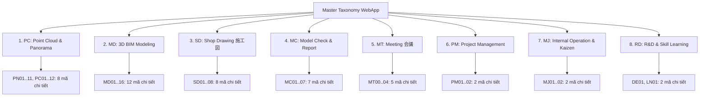

# ĐỀ XUẤT BỘ MÃ TIÊU CHUẨN (TAXONOMY) HỢP NHẤT CHO WEB APP
## DỰA TRÊN NGHIÊN CỨU TOÀN DIỆN 46 ĐẦU VIỆC TÁC NGHIỆP HIỆN HÀNH TRONG TEAM (BIM / MEP / JAPANESE STANDARD)

> **Tài liệu:** Đề xuất Cấu trúc Danh mục Tiêu chuẩn Hoàn chỉnh  
> **Áp dụng cho:** Hệ thống Quản trị Dự án & Timesheet Google Apps Script WebApp  
> **Dữ liệu nguồn:** 46 mã tác nghiệp chuẩn Nhật (`作業コード`) đang vận hành tại doanh nghiệp  
> **Ngôn ngữ chuẩn hóa:** 🇯🇵 日本語 (Nguyên bản) - 🇻🇳 Tiếng Việt (Chuyên ngành) - 🇺🇸 English (BIM Standard)  
> **Trạng thái:** Bản đề xuất hoàn chỉnh (Sẵn sàng nạp vào Master Taxonomy)

---

## I. GIẢI MÃ QUY LUẬT CỦA 46 ĐẦU VIỆC HIỆN HÀNH

Sau khi nghiên cứu kỹ lưỡng bảng 46 đầu việc từ hình ảnh thực tế của bạn, một **quy luật vận hành nội bộ rất khoa học và chặt chẽ** được làm sáng tỏ:

```
┌──────────────┐     ┌─────────────────────────────────────────────────────────────────┐
│ Tiền tố Nhóm │ ──> │ PN (Panorama) | PC (Point Cloud) | MD (3D Model) | SD (Shop Dwg)│
│              │     │ MC (Clash/Report) | MT (Meeting) | PM (Mgmt) | MJ/DE/LN (Others)│
├──────────────┤     ├─────────────────────────────────────────────────────────────────┤
│ Số hiệu Đuôi │ ──> │ • 01 - 09 : TẠO MỚI / TRIỂN KHAI BAN ĐẦU (Creation / Production)│
│              │     │ • 10      : KIỂM TRA / NGHIỆM THU (Quality Check / Review)      │
│              │     │ • 11 - 16 : SỬA LỖI / CHỈNH SỬA (Correction / Revision)         │
└──────────────┘     └─────────────────────────────────────────────────────────────────┘
```

* **Ví dụ điển hình trong nhóm `MD` (3D Model):**
  - `MD01`: Tạo mới kết cấu (`躯体作成`)
  - `MD10`: Kiểm tra mô hình (`モデルチェック`)
  - `MD11`: Sửa lỗi kết cấu sau khi kiểm tra (`躯体修正`)
* **Ví dụ trong nhóm `PC` (Point Cloud):**
  - `PC01` (Xử lý ban đầu) ➔ `PC10` (Kiểm tra) ➔ `PC11` (Chỉnh sửa).

> 💡 **Nhận định quan trọng:**  
> Đội ngũ của bạn đã có sẵn một tư duy quy trình khép kín: **Làm ➔ Check ➔ Fix**.  
> Bộ mã này **không được phép xóa bỏ hay thay thế bằng những mã tiếng Anh xa lạ**, mà phải được **nâng tầm thành danh mục cốt lõi của WebApp** để tạo sự đồng bộ 100% giữa Task quản lý và Sheet chấm công 30 phút!

---

## II. ĐỀ XUẤT KIẾN TRÚC PHÂN TẦNG HỢP NHẤT CHO WEB APP

Nếu đưa phẳng 46 mã vào 1 dropdown duy nhất trên WebApp, giao diện sẽ bị dài và khó tìm. Do đó, giải pháp tối ưu là **cấu trúc thành mô hình 2 tầng thông minh**:



---

## III. BẢNG TRA CỨU CHI TIẾT 46 ĐẦU VIỆC (TAM NGỮ & MÃ MÀU CHUẨN)

Dưới đây là toàn bộ 46 mã đã được chuẩn hóa song ngữ Anh - Việt - Nhật, gán mã màu nhận diện (Color Hex) và phân bổ vào 8 nhóm Category:

### Nhóm 1: `PC` - Point Cloud & Panorama (Khảo sát & Đám mây điểm)
*Mã màu chủ đạo: `#06b6d4` (Cyan)*

| STT | Mã Tác Nghiệp | 🇯🇵 Tên Gốc Tiếng Nhật | 🇻🇳 Tên Tiếng Việt Chuyên Ngành | 🇺🇸 English Name | Ghi Chú Kỹ Thuật |
| :---: | :---: | :--- | :--- | :--- | :--- |
| 1 | **PN01** | 【パノラマメモ】作成 | Tạo ảnh Panorama Memo | Panorama Memo Creation | Chuyển đổi bản vẽ sang ảnh, gắn liên kết |
| 2 | **PN10** | 【パノラマメモ】チェック | Kiểm tra Panorama Memo | Panorama Memo Check | Check góc nhìn, hướng xoay, liên kết |
| 3 | **PN11** | 【パノラマメモ】修正 | Chỉnh sửa Panorama Memo | Panorama Memo Revision | Sửa vị trí ảnh, hướng nghiêng, link |
| 4 | **PC01** | 【点群データ】処理 | Xử lý dữ liệu Point Cloud | Point Cloud Processing | Đăng ký trạm quét, khử nhiễu, Cyclone |
| 5 | **PC02** | 【点群データ】レイヤー分け | Phân lớp dữ liệu Point Cloud | Point Cloud Layering | Chia layer theo cao độ, phòng, hệ thống |
| 6 | **PC10** | 【点群データ】チェック | Kiểm tra dữ liệu Point Cloud | Point Cloud Check | Kiểm tra dung sai, độ khớp nối trạm |
| 7 | **PC11** | 【点群データ】修正 | Sửa dữ liệu Point Cloud | Point Cloud Revision | Bổ sung điểm thiếu, khử lệch tọa độ |
| 8 | **PC12** | 【点群データ】レイヤー分け修正 | Chỉnh sửa phân lớp Point Cloud | Point Cloud Layering Revision | Điều chỉnh lại layer phân chia |

---

### Nhóm 2: `MD` - 3D BIM Modeling (Mô hình hóa 3D BIM)
*Mã màu chủ đạo: `#4f6ef7` (Indigo Blue) — Nhóm chiếm khối lượng lớn nhất*

| STT | Mã Tác Nghiệp | 🇯🇵 Tên Gốc Tiếng Nhật | 🇻🇳 Tên Tiếng Việt Chuyên Ngành | 🇺🇸 English Name | Ghi Chú Kỹ Thuật |
| :---: | :---: | :--- | :--- | :--- | :--- |
| 9 | **MD01** | 【モデル】躯体作成 | Dựng mô hình Kết cấu / Thân | Structure / Civil Modeling | Móng, cột, dầm, sàn bê tông, tường |
| 10 | **MD02** | 【モデル】機械作成 | Dựng mô hình Máy móc / Thiết bị | Equipment / Mechanical Modeling | Bơm, máy thổi khí, bồn bể, van cổng |
| 11 | **MD03** | 【モデル】配管作成 | Dựng mô hình Đường ống | Piping Modeling | Ống công nghệ, ống dẫn khí, phụ kiện |
| 12 | **MD04** | 【モデル】合成 | Hợp nhất mô hình tổng thể | Model Federation / Assembly | Ghép kết cấu, thiết bị, ống thành tổng thể |
| 13 | **MD05** | 【モデル】作成（その他） | Dựng mô hình hạng mục khác | Other Modeling | Hạng mục phụ trợ, rãnh mương cáp |
| 14 | **MD10** | 【モデル】チェック | Kiểm tra chất lượng mô hình | Model Quality Check | Kiểm tra quy chuẩn dựng hình, level, grid |
| 15 | **MD11** | 【モデル】躯体修正 | Chỉnh sửa mô hình Kết cấu | Structure Model Revision | Sửa lỗi va chạm, sai kích thước bê tông |
| 16 | **MD12** | 【モデル】機械修正 | Chỉnh sửa mô hình Thiết bị | Equipment Model Revision | Cập nhật catalog, dịch chuyển vị trí bệ |
| 17 | **MD13** | 【モデル】配管修正 | Chỉnh sửa mô hình Đường ống | Piping Model Revision | Né va chạm ống, sửa độ dốc, cao độ |
| 18 | **MD14** | 【モデル】合成修正 | Chỉnh sửa hợp nhất mô hình | Federation Revision | Khắc phục xung đột tổng thể |
| 19 | **MD15** | 【モデル】修正（その他） | Chỉnh sửa hạng mục khác | Other Model Revision | Sửa các chi tiết nhỏ phát sinh |
| 20 | **MD16** | 【モデル】情報入力 | Nhập thuộc tính thông tin BIM | BIM Data / Parameter Input | Nhập mã thiết bị, thông số lưu lượng, vật liệu |

---

### Nhóm 3: `SD` - Shop Drawing / 施工図 (Bản vẽ thi công)
*Mã màu chủ đạo: `#10b981` (Emerald Green)*

| STT | Mã Tác Nghiệp | 🇯🇵 Tên Gốc Tiếng Nhật | 🇻🇳 Tên Tiếng Việt Chuyên Ngành | 🇺🇸 English Name | Ghi Chú Kỹ Thuật |
| :---: | :---: | :--- | :--- | :--- | :--- |
| 21 | **SD01** | 【施工図】図面取りまとめ | Tổng hợp đóng tập bản vẽ | Drawing Compilation | Thiết lập cây bản vẽ, khung tên, danh mục |
| 22 | **SD02** | 【施工図】下図準備 | Chuẩn bị bản vẽ nền (Xref/Underlay) | Background Drawing Prep | Dọn dẹp layer nền kiến trúc/kết cấu |
| 23 | **SD03** | 【施工図】平断面図作成 | Triển khai bản vẽ mặt bằng & mặt cắt | Plan & Section Drawing Creation | Bản vẽ mặt bằng và mặt cắt kết hợp |
| 24 | **SD04** | 【施工図】配管スケルトン図作成 | Bản vẽ sơ đồ không gian ống | Piping Isometric / Skeleton | Sơ đồ trích xuất isometric 3D ống |
| 25 | **SD05** | 【施工図】基礎図作成 | Triển khai bản vẽ móng bệ | Foundation Drawing Creation | Chi tiết bệ bơm, móng máy móc |
| 26 | **SD06** | 【施工図】鋼製加工品図作成 | Bản vẽ gia công kết cấu thép | Steel Fabrication Drawing | Giá đỡ ống, thang máng, sàn thao tác |
| 27 | **SD07** | 【施工図】複合工図作成 | Bản vẽ phối hợp đa bộ môn | Combined Services Drawing | Bản vẽ tổng hợp mặt cắt kết hợp MEP |
| 28 | **SD08** | 【施工図】その他 | Bản vẽ thi công khác | Other Shop Drawing | Chi tiết lắp đặt đặc thù |

---

### Nhóm 4: `MC` - Model Check & Clash Report (Kiểm tra va chạm & Báo cáo)
*Mã màu chủ đạo: `#f59e0b` (Amber Orange)*

| STT | Mã Tác Nghiệp | 🇯🇵 Tên Gốc Tiếng Nhật | 🇻🇳 Tên Tiếng Việt Chuyên Ngành | 🇺🇸 English Name | Ghi Chú Kỹ Thuật |
| :---: | :---: | :--- | :--- | :--- | :--- |
| 29 | **MC01** | 【レポート・発注図】干渉・相違点チェック | Check va chạm so với bản vẽ thiết kế | Clash Check vs Tender Drawing | Báo cáo lỗi sai lệch thiết kế ban đầu |
| 30 | **MC02** | 【レポート・施工図】干渉・相違点チェック | Check va chạm so với bản vẽ thi công | Clash Check vs Shop Drawing | Báo cáo xung đột ống và kết cấu thực tế |
| 31 | **MC03** | 【レポート】干渉・相違点の改善提案 | Đề xuất giải pháp xử lý va chạm | Clash Resolution Proposal | Đề xuất tuyến ống đi vòng, khoét lỗ |
| 32 | **MC04** | 【レポート】機器搬出入検討 | Nghiên cứu biện pháp vận chuyển máy | Equipment In/Out Route Study | Kiểm tra kích thước cửa, đường đưa máy vào |
| 33 | **MC05** | 【レポート】寸法確認 | Kiểm tra xác nhận kích thước | Dimension Verification | Đo đạc clearance, khoảng hở bảo trì |
| 34 | **MC06** | 【レポート】その他 | Báo cáo kỹ thuật khác | Other Technical Report | Báo cáo kiểm định đặc biệt |
| 35 | **MC07** | 【レポート】ウォークスルー動画作成 | Tạo video mô phỏng Walkthrough | 3D Walkthrough Animation | Xuất video diễn họa 3D cho chủ đầu tư |

---

### Nhóm 5: `MT` - Meeting / 会議 (Họp hành & Trao đổi)
*Mã màu chủ đạo: `#ec4899` (Pink)*

| STT | Mã Tác Nghiệp | 🇯🇵 Tên Gốc Tiếng Nhật | 🇻🇳 Tên Tiếng Việt | 🇺🇸 English Name | Ghi Chú |
| :---: | :---: | :--- | :--- | :--- | :--- |
| 36 | **MT00** | 【MTG】朝礼・終礼 | Họp đầu giờ / Cuối ngày | Daily Standup (Morning/Evening) | Giao ban 15 phút đầu/cuối ngày |
| 37 | **MT01** | 【MTG】社外 | Họp đối tác / Khách hàng | External Meeting | Họp kỹ thuật với nhà thầu/đối tác Nhật |
| 38 | **MT02** | 【MTG】社内 | Họp nội bộ công ty/team | Internal Meeting | Họp phân chia công việc nội bộ |
| 39 | **MT03** | 【MTG】業務管理 | Họp điều phối quản lý | Management Meeting | Họp tiến độ, giải quyết khúc mắc dự án |
| 40 | **MT04** | 【MTG】その他 | Cuộc họp khác | Other Meeting | Trao đổi phát sinh khác |

---

### Nhóm 6: `PM` - Project Management (Quản lý dự án)
*Mã màu chủ đạo: `#8b5cf6` (Purple)*

| STT | Mã Tác Nghiệp | 🇯🇵 Tên Gốc Tiếng Nhật | 🇻🇳 Tên Tiếng Việt | 🇺🇸 English Name | Ghi Chú |
| :---: | :---: | :--- | :--- | :--- | :--- |
| 41 | **PM01** | プロジェクト資料確認 | Nghiên cứu tài liệu hồ sơ dự án | Project Document Review | Đọc đề bài, tiêu chuẩn kỹ thuật, mark-up |
| 42 | **PM02** | プロジェクト管理関連 | Quản lý tiến độ & Điều phối | Project Administration | Gửi mail, cập nhật lịch trình, Brabio, báo cáo |

---

### Nhóm 7: `MJ` - General Reporting & Kaizen (Báo cáo & Cải tiến)
*Mã màu chủ đạo: `#64748b` (Slate Gray)*

| STT | Mã Tác Nghiệp | 🇯🇵 Tên Gốc Tiếng Nhật | 🇻🇳 Tên Tiếng Việt | 🇺🇸 English Name | Ghi Chú |
| :---: | :---: | :--- | :--- | :--- | :--- |
| 43 | **MJ01** | 業務報告 | Lập báo cáo công việc (Ngày/Tuần) | Daily / Weekly Work Report | Viết báo cáo tiến độ định kỳ |
| 44 | **MJ02** | 業務改善 | Cải tiến quy trình làm việc | Kaizen / Workflow Improvement | Chuẩn hóa quy trình, tối ưu thao tác |

---

### Nhóm 8: `RD` - Research, Dev & Training (Phát triển & Đào tạo)
*Mã màu chủ đạo: `#3b82f6` (Blue)*

| STT | Mã Tác Nghiệp | 🇯🇵 Tên Gốc Tiếng Nhật | 🇻🇳 Tên Tiếng Việt | 🇺🇸 English Name | Ghi Chú |
| :---: | :---: | :--- | :--- | :--- | :--- |
| 45 | **DE01** | 開発関連 | Nghiên cứu phát triển Tool/Script | R&D / Automation Development | Lập trình Dynamo, Python, Revit API |
| 46 | **LN01** | 勉強・スキルアップ | Đào tạo & Nâng cao kỹ năng | Training & Skill Learning | Tự học phần mềm mới, training nội bộ |

---

## IV. QUY CHUẨN ĐẶT TÊN NHIỆM VỤ TRÊN WEB APP: ĐỒNG BỘ 100% VỚI SHEET 30 PHÚT

Nhờ việc đưa trọn vẹn 46 mã này vào làm **Mã Tiêu Chuẩn**, tiền tố tên nhiệm vụ (Task Name Prefix) trên WebApp sẽ trở nên **cực kỳ trực quan, ngắn gọn và đồng bộ hoàn hảo**:

### Cấu trúc chuẩn của một Task trên WebApp:
👉 **`[MÃ_TÁC_NGHIỆP] Nội dung công việc cụ thể`**

#### Ví dụ thực tế:
1. **Dự án `HAG01` (Hanamigawa):**
   - `[MD01] Dựng hình kết cấu bể xử lý bùn tầng hầm` ➔ Nhân viên mở Sheet ra chọn ngay `MD01`!
   - `[MD03] Dựng tuyến ống thu nước phòng máy thổi khí` ➔ Nhân viên mở Sheet ra chọn ngay `MD03`!
   - `[MC01] Kiểm tra va chạm ống công nghệ và dầm bê tông` ➔ Chọn `MC01`!
2. **Dự án `JJK01` (Jujikai):**
   - `[SD03] Triển khai mặt bằng bố trí thiết bị tầng 1` ➔ Chọn `SD03`!
   - `[SD04] Trích xuất sơ đồ không gian ống isometric trục A-C` ➔ Chọn `SD04`!
3. **Công việc chung:**
   - `[MT01] Họp kỹ thuật online với khách hàng Nhật Bản` ➔ Chọn `MT01`!
   - `[DE01] Viết script Dynamo tự động đặt van trên ống` ➔ Chọn `DE01`!

> 🎯 **Hiệu quả tức thì:**
> - Nhân viên **không phải dịch ngược trong đầu**: Nhìn tên task trên WebApp thấy chữ `[MD03]` là biết chắc chắn trên Google Sheet mình chọn `MD03_【モデル】配管作成`.
> - Robot / Script backend tự động đối chiếu số giờ log của mã `MD03` trong Sheet cá nhân để tính toán tiến độ % cho task `[MD03]` trên WebApp mà không cần bất kỳ thao tác thủ công nào!

---

## V. CẤU TRÚC JSON DỮ LIỆU SẴN SÀNG NẠP VÀO CODE (`Taxonomyapi.gs`)

Dưới đây là mảng cấu trúc JSON chuẩn mực đã được biên soạn sẵn để có thể thay thế hoặc nạp trực tiếp vào file `Taxonomyapi.gs` khi bạn sẵn sàng:

```javascript
const STANDARDIZED_TAXONOMY_LIST = [
  // ── 1. NHÓM CATEGORY (8 NHÓM LỚN) ──
  { id:"CAT_PC",  type:"CATEGORY", code:"PC",  name_vi:"Xử lý Point Cloud & Panorama", name_en:"Point Cloud & Panorama", name_jp:"点群 & パノラマ", desc:"Bao gồm xử lý dữ liệu đám mây điểm và ảnh panorama", color:"#06b6d4", sortOrder:1, status:"Active" },
  { id:"CAT_MD",  type:"CATEGORY", code:"MD",  name_vi:"Dựng mô hình 3D BIM",          name_en:"3D BIM Modeling",        name_jp:"3Dモデリング",       desc:"Bao gồm dựng hình kết cấu, thiết bị, đường ống",         color:"#4f6ef7", sortOrder:2, status:"Active" },
  { id:"CAT_SD",  type:"CATEGORY", code:"SD",  name_vi:"Bản vẽ thi công (Shop Drawing)", name_en:"Shop Drawing",          name_jp:"施工図作成",         desc:"Triển khai các bản vẽ thi công 2D chi tiết",             color:"#10b981", sortOrder:3, status:"Active" },
  { id:"CAT_MC",  type:"CATEGORY", code:"MC",  name_vi:"Kiểm tra va chạm & Báo cáo",   name_en:"Model Check & Report",   name_jp:"干渉・報告書",       desc:"Báo cáo sai khác, check va chạm, xuất video",            color:"#f59e0b", sortOrder:4, status:"Active" },
  { id:"CAT_MTG", type:"CATEGORY", code:"MTG", name_vi:"Họp hành & Trao đổi",          name_en:"Meetings",               name_jp:"会議・打合せ",       desc:"Giao ban, họp khách hàng, họp nội bộ",                  color:"#ec4899", sortOrder:5, status:"Active" },
  { id:"CAT_PM",  type:"CATEGORY", code:"PM",  name_vi:"Quản lý dự án",               name_en:"Project Management",     name_jp:"プロジェクト管理",   desc:"Nghiên cứu tài liệu, quản lý tiến độ, lịch trình",      color:"#8b5cf6", sortOrder:6, status:"Active" },
  { id:"CAT_MJ",  type:"CATEGORY", code:"MJ",  name_vi:"Báo cáo & Cải tiến nội bộ",    name_en:"General & Reporting",    name_jp:"業務報告・改善",     desc:"Báo cáo định kỳ và cải tiến quy trình nghiệp vụ",        color:"#64748b", sortOrder:7, status:"Active" },
  { id:"CAT_RD",  type:"CATEGORY", code:"RD",  name_vi:"Nghiên cứu, Tool & Đào tạo",   name_en:"R&D & Skill Learning",   name_jp:"開発・スキルアップ", desc:"Phát triển script, Dynamo, tự học kỹ năng mới",        color:"#3b82f6", sortOrder:8, status:"Active" },

  // ── 2. NHÓM 46 TÁC NGHIỆP CHI TIẾT (DISCIPLINES / WORK CODES) ──
  // [PC & PN]
  { id:"DISC_PN01", type:"DISCIPLINE", code:"PN01", name_vi:"Tạo ảnh Panorama Memo",           name_en:"Panorama Memo Creation",         name_jp:"【パノラマメモ】作成", desc:"Chuyển đổi bản vẽ sang ảnh, gắn liên kết", color:"#06b6d4", sortOrder:1, status:"Active" },
  { id:"DISC_PN10", type:"DISCIPLINE", code:"PN10", name_vi:"Kiểm tra Panorama Memo",          name_en:"Panorama Memo Check",            name_jp:"【パノラマメモ】チェック", desc:"Check góc nhìn, hướng xoay, liên kết", color:"#06b6d4", sortOrder:2, status:"Active" },
  { id:"DISC_PN11", type:"DISCIPLINE", code:"PN11", name_vi:"Chỉnh sửa Panorama Memo",         name_en:"Panorama Memo Revision",         name_jp:"【パノラマメモ】修正", desc:"Sửa vị trí ảnh, hướng nghiêng, link", color:"#06b6d4", sortOrder:3, status:"Active" },
  { id:"DISC_PC01", type:"DISCIPLINE", code:"PC01", name_vi:"Xử lý dữ liệu Point Cloud",       name_en:"Point Cloud Processing",         name_jp:"【点群データ】処理", desc:"Đăng ký trạm quét, khử nhiễu, Cyclone", color:"#06b6d4", sortOrder:4, status:"Active" },
  { id:"DISC_PC02", type:"DISCIPLINE", code:"PC02", name_vi:"Phân lớp Point Cloud",            name_en:"Point Cloud Layering",           name_jp:"【点群データ】レイヤー分け", desc:"Chia layer theo cao độ, phòng, hệ thống", color:"#06b6d4", sortOrder:5, status:"Active" },
  { id:"DISC_PC10", type:"DISCIPLINE", code:"PC10", name_vi:"Kiểm tra Point Cloud",            name_en:"Point Cloud Check",              name_jp:"【点群データ】チェック", desc:"Kiểm tra dung sai, độ khớp nối trạm", color:"#06b6d4", sortOrder:6, status:"Active" },
  { id:"DISC_PC11", type:"DISCIPLINE", code:"PC11", name_vi:"Sửa dữ liệu Point Cloud",         name_en:"Point Cloud Revision",           name_jp:"【点群データ】修正", desc:"Bổ sung điểm thiếu, khử lệch tọa độ", color:"#06b6d4", sortOrder:7, status:"Active" },
  { id:"DISC_PC12", type:"DISCIPLINE", code:"PC12", name_vi:"Sửa phân lớp Point Cloud",        name_en:"Point Cloud Layering Revision",  name_jp:"【点群データ】レイヤー分け修正", desc:"Điều chỉnh lại layer phân chia", color:"#06b6d4", sortOrder:8, status:"Active" },

  // [MD - MODEL]
  { id:"DISC_MD01", type:"DISCIPLINE", code:"MD01", name_vi:"Dựng hình Kết cấu / Thân",        name_en:"Structure Modeling",             name_jp:"【モデル】躯体作成", desc:"Móng, cột, dầm, sàn bê tông, tường", color:"#4f6ef7", sortOrder:9, status:"Active" },
  { id:"DISC_MD02", type:"DISCIPLINE", code:"MD02", name_vi:"Dựng hình Máy móc / Thiết bị",    name_en:"Equipment Modeling",             name_jp:"【モデル】機械作成", desc:"Bơm, máy thổi khí, bồn bể, van cổng", color:"#4f6ef7", sortOrder:10, status:"Active" },
  { id:"DISC_MD03", type:"DISCIPLINE", code:"MD03", name_vi:"Dựng hình Đường ống",             name_en:"Piping Modeling",                name_jp:"【モデル】配管作成", desc:"Ống công nghệ, ống dẫn khí, phụ kiện", color:"#4f6ef7", sortOrder:11, status:"Active" },
  { id:"DISC_MD04", type:"DISCIPLINE", code:"MD04", name_vi:"Hợp nhất mô hình tổng thể",       name_en:"Model Federation",               name_jp:"【モデル】合成", desc:"Ghép kết cấu, thiết bị, ống thành tổng thể", color:"#4f6ef7", sortOrder:12, status:"Active" },
  { id:"DISC_MD05", type:"DISCIPLINE", code:"MD05", name_vi:"Dựng hình hạng mục khác",         name_en:"Other Modeling",                 name_jp:"【モデル】作成（その他）", desc:"Hạng mục phụ trợ, rãnh mương cáp", color:"#4f6ef7", sortOrder:13, status:"Active" },
  { id:"DISC_MD10", type:"DISCIPLINE", code:"MD10", name_vi:"Kiểm tra mô hình BIM",            name_en:"Model Quality Check",            name_jp:"【モデル】チェック", desc:"Kiểm tra quy chuẩn dựng hình, level, grid", color:"#4f6ef7", sortOrder:14, status:"Active" },
  { id:"DISC_MD11", type:"DISCIPLINE", code:"MD11", name_vi:"Sửa mô hình Kết cấu",             name_en:"Structure Revision",             name_jp:"【モデル】躯体修正", desc:"Sửa lỗi va chạm, sai kích thước bê tông", color:"#4f6ef7", sortOrder:15, status:"Active" },
  { id:"DISC_MD12", type:"DISCIPLINE", code:"MD12", name_vi:"Sửa mô hình Thiết bị",            name_en:"Equipment Revision",             name_jp:"【モデル】機械修正", desc:"Cập nhật catalog, dịch chuyển vị trí bệ", color:"#4f6ef7", sortOrder:16, status:"Active" },
  { id:"DISC_MD13", type:"DISCIPLINE", code:"MD13", name_vi:"Sửa mô hình Đường ống",           name_en:"Piping Revision",                name_jp:"【モデル】配管修正", desc:"Né va chạm ống, sửa độ dốc, cao độ", color:"#4f6ef7", sortOrder:17, status:"Active" },
  { id:"DISC_MD14", type:"DISCIPLINE", code:"MD14", name_vi:"Sửa hợp nhất mô hình",            name_en:"Federation Revision",            name_jp:"【モデル】合成修正", desc:"Khắc phục xung đột tổng thể", color:"#4f6ef7", sortOrder:18, status:"Active" },
  { id:"DISC_MD15", type:"DISCIPLINE", code:"MD15", name_vi:"Sửa mô hình khác",                name_en:"Other Model Revision",           name_jp:"【モデル】修正（その他）", desc:"Sửa các chi tiết nhỏ phát sinh", color:"#4f6ef7", sortOrder:19, status:"Active" },
  { id:"DISC_MD16", type:"DISCIPLINE", code:"MD16", name_vi:"Nhập thuộc tính thông tin BIM",    name_en:"BIM Data Input",                 name_jp:"【モデル】情報入力", desc:"Nhập mã thiết bị, lưu lượng, thông số", color:"#4f6ef7", sortOrder:20, status:"Active" },

  // [SD - SHOP DRAWING]
  { id:"DISC_SD01", type:"DISCIPLINE", code:"SD01", name_vi:"Tổng hợp đóng tập bản vẽ",        name_en:"Drawing Compilation",            name_jp:"【施工図】図面取りまとめ", desc:"Thiết lập cây bản vẽ, khung tên, danh mục", color:"#10b981", sortOrder:21, status:"Active" },
  { id:"DISC_SD02", type:"DISCIPLINE", code:"SD02", name_vi:"Chuẩn bị bản vẽ nền Underlay",    name_en:"Background Drawing Prep",        name_jp:"【施工図】下図準備", desc:"Dọn dẹp layer nền kiến trúc/kết cấu", color:"#10b981", sortOrder:22, status:"Active" },
  { id:"DISC_SD03", type:"DISCIPLINE", code:"SD03", name_vi:"Triển khai bản vẽ mặt bằng & mặt cắt", name_en:"Plan & Section Drawing Creation", name_jp:"【施工図】平断面図作成", desc:"Bản vẽ mặt bằng và mặt cắt kết hợp", color:"#10b981", sortOrder:23, status:"Active" },
  { id:"DISC_SD04", type:"DISCIPLINE", code:"SD04", name_vi:"Bản vẽ sơ đồ không gian ống",     name_en:"Piping Isometric Drawing",       name_jp:"【施工図】配管スケルトン図作成", desc:"Sơ đồ trích xuất isometric 3D ống", color:"#10b981", sortOrder:24, status:"Active" },
  { id:"DISC_SD05", type:"DISCIPLINE", code:"SD05", name_vi:"Triển khai bản vẽ móng bệ",      name_en:"Foundation Drawing",             name_jp:"【施工図】基礎図作成", desc:"Chi tiết bệ bơm, móng máy móc", color:"#10b981", sortOrder:25, status:"Active" },
  { id:"DISC_SD06", type:"DISCIPLINE", code:"SD06", name_vi:"Bản vẽ gia công kết cấu thép",    name_en:"Steel Fabrication Drawing",      name_jp:"【施工図】鋼製加工品図作成", desc:"Giá đỡ ống, thang máng, sàn thao tác", color:"#10b981", sortOrder:26, status:"Active" },
  { id:"DISC_SD07", type:"DISCIPLINE", code:"SD07", name_vi:"Bản vẽ phối hợp đa bộ môn",      name_en:"Combined Services Drawing",      name_jp:"【施工図】複合工図作成", desc:"Bản vẽ tổng hợp mặt cắt kết hợp MEP", color:"#10b981", sortOrder:27, status:"Active" },
  { id:"DISC_SD08", type:"DISCIPLINE", code:"SD08", name_vi:"Bản vẽ thi công khác",            name_en:"Other Shop Drawing",             name_jp:"【施工図】その他", desc:"Chi tiết lắp đặt đặc thù", color:"#10b981", sortOrder:28, status:"Active" },

  // [MC - REPORT & CLASH]
  { id:"DISC_MC01", type:"DISCIPLINE", code:"MC01", name_vi:"Check va chạm vs Bản vẽ thiết kế",name_en:"Clash Check vs Tender Drawing",  name_jp:"【レポート・発注図】干渉・相違点チェック", desc:"Báo cáo lỗi sai lệch thiết kế ban đầu", color:"#f59e0b", sortOrder:29, status:"Active" },
  { id:"DISC_MC02", type:"DISCIPLINE", code:"MC02", name_vi:"Check va chạm vs Bản vẽ thi công",name_en:"Clash Check vs Shop Drawing",    name_jp:"【レポート・施工図】干渉・相違点チェック", desc:"Báo cáo xung đột ống và kết cấu thực tế", color:"#f59e0b", sortOrder:30, status:"Active" },
  { id:"DISC_MC03", type:"DISCIPLINE", code:"MC03", name_vi:"Đề xuất giải pháp xử lý va chạm", name_en:"Clash Resolution Proposal",     name_jp:"【レポート】干渉・相違点の改善提案", desc:"Đề xuất tuyến ống đi vòng, khoét lỗ", color:"#f59e0b", sortOrder:31, status:"Active" },
  { id:"DISC_MC04", type:"DISCIPLINE", code:"MC04", name_vi:"Nghiên cứu biện pháp vận chuyển", name_en:"Equipment Route Study",          name_jp:"【レポート】機器搬出入検討", desc:"Kiểm tra kích thước cửa, đường đưa máy vào", color:"#f59e0b", sortOrder:32, status:"Active" },
  { id:"DISC_MC05", type:"DISCIPLINE", code:"MC05", name_vi:"Kiểm tra xác nhận kích thước",    name_en:"Dimension Verification",         name_jp:"【レポート】寸法確認", desc:"Đo đạc clearance, khoảng hở bảo trì", color:"#f59e0b", sortOrder:33, status:"Active" },
  { id:"DISC_MC06", type:"DISCIPLINE", code:"MC06", name_vi:"Báo cáo kỹ thuật khác",           name_en:"Other Technical Report",         name_jp:"【レポート】その他", desc:"Báo cáo kiểm định đặc biệt", color:"#f59e0b", sortOrder:34, status:"Active" },
  { id:"DISC_MC07", type:"DISCIPLINE", code:"MC07", name_vi:"Tạo video mô phỏng Walkthrough",  name_en:"3D Walkthrough Animation",       name_jp:"【レポート】ウォークスルー動画作成", desc:"Xuất video diễn họa 3D cho chủ đầu tư", color:"#f59e0b", sortOrder:35, status:"Active" },

  // [MT - MEETING]
  { id:"DISC_MT00", type:"DISCIPLINE", code:"MT00", name_vi:"Họp giao ban đầu/cuối ngày",      name_en:"Daily Standup Meeting",          name_jp:"【MTG】朝礼・終礼", desc:"Giao ban nhanh 15 phút đầu/cuối ngày", color:"#ec4899", sortOrder:36, status:"Active" },
  { id:"DISC_MT01", type:"DISCIPLINE", code:"MT01", name_vi:"Họp đối tác / Khách hàng",        name_en:"External Meeting",               name_jp:"【MTG】社外", desc:"Họp kỹ thuật với nhà thầu/đối tác Nhật", color:"#ec4899", sortOrder:37, status:"Active" },
  { id:"DISC_MT02", type:"DISCIPLINE", code:"MT02", name_vi:"Họp nội bộ team",                 name_en:"Internal Meeting",               name_jp:"【MTG】社内", desc:"Họp phân chia công việc nội bộ", color:"#ec4899", sortOrder:38, status:"Active" },
  { id:"DISC_MT03", type:"DISCIPLINE", code:"MT03", name_vi:"Họp điều phối quản trị dự án",     name_en:"Management Meeting",             name_jp:"【MTG】業務管理", desc:"Họp tiến độ, giải quyết khúc mắc dự án", color:"#ec4899", sortOrder:39, status:"Active" },
  { id:"DISC_MT04", type:"DISCIPLINE", code:"MT04", name_vi:"Cuộc họp khác",                   name_en:"Other Meeting",                  name_jp:"【MTG】その他", desc:"Trao đổi phát sinh khác", color:"#ec4899", sortOrder:40, status:"Active" },

  // [PM - PROJECT MANAGEMENT]
  { id:"DISC_PM01", type:"DISCIPLINE", code:"PM01", name_vi:"Nghiên cứu tài liệu hồ sơ dự án", name_en:"Project Document Review",        name_jp:"プロジェクト資料確認", desc:"Đọc đề bài, tiêu chuẩn kỹ thuật, mark-up", color:"#8b5cf6", sortOrder:41, status:"Active" },
  { id:"DISC_PM02", type:"DISCIPLINE", code:"PM02", name_vi:"Quản lý tiến độ & Điều phối",     name_en:"Project Administration",         name_jp:"プロジェクト管理関連", desc:"Gửi mail, cập nhật lịch trình, Brabio, báo cáo", color:"#8b5cf6", sortOrder:42, status:"Active" },

  // [MJ - GENERAL REPORTING & KAIZEN]
  { id:"DISC_MJ01", type:"DISCIPLINE", code:"MJ01", name_vi:"Lập báo cáo công việc (Ngày/Tuần)",name_en:"Work Progress Report",          name_jp:"業務報告", desc:"Viết báo cáo tiến độ định kỳ", color:"#64748b", sortOrder:43, status:"Active" },
  { id:"DISC_MJ02", type:"DISCIPLINE", code:"MJ02", name_vi:"Cải tiến quy trình làm việc",     name_en:"Workflow Improvement",           name_jp:"業務改善", desc:"Chuẩn hóa quy trình, tối ưu thao tác", color:"#64748b", sortOrder:44, status:"Active" },

  // [RD - R&D & TRAINING]
  { id:"DISC_DE01", type:"DISCIPLINE", code:"DE01", name_vi:"Phát triển Tool / Script / API",  name_en:"Automation & Tool Dev",         name_jp:"開発関連", desc:"Lập trình Dynamo, Python, Revit API", color:"#3b82f6", sortOrder:45, status:"Active" },
  { id:"DISC_LN01", type:"DISCIPLINE", code:"LN01", name_vi:"Đào tạo & Nâng cao kỹ năng",      name_en:"Training & Skill Learning",      name_jp:"勉強・スキルアップ", desc:"Tự học phần mềm mới, training nội bộ", color:"#3b82f6", sortOrder:46, status:"Active" }
];
```

---

## VI. KẾT LUẬN & KIẾN NGHỊ TRIỂN KHAI

Bằng cách áp dụng bộ mã chuẩn hóa này:
1. **Không làm thay đổi thói quen của Kỹ sư:** Nhân viên vẫn sử dụng đúng 46 mã thân thuộc hàng ngày trên Google Sheet cá nhân.
2. **Nâng cấp năng lực quản trị cho WebApp:** WebApp có ngay bộ mã chuẩn hóa song ngữ Anh - Việt - Nhật, chia thành 8 nhóm màu trực quan.
3. **Đồng bộ hóa tự động tuyệt đối:** Tiền tố `[MD01]`, `[SD04]`, `[MC01]` trên task WebApp khớp 100% với từng dòng chấm công 30 phút, mở đường cho việc tự động tính toán tiến độ dự án từ giờ làm thực tế!
