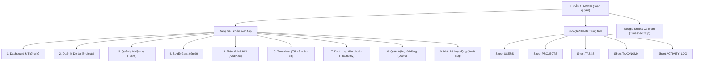
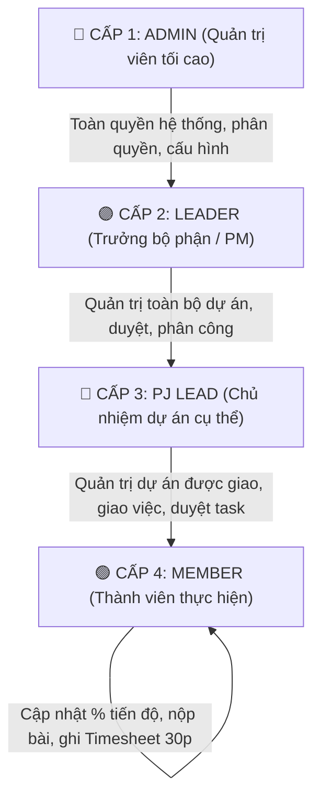
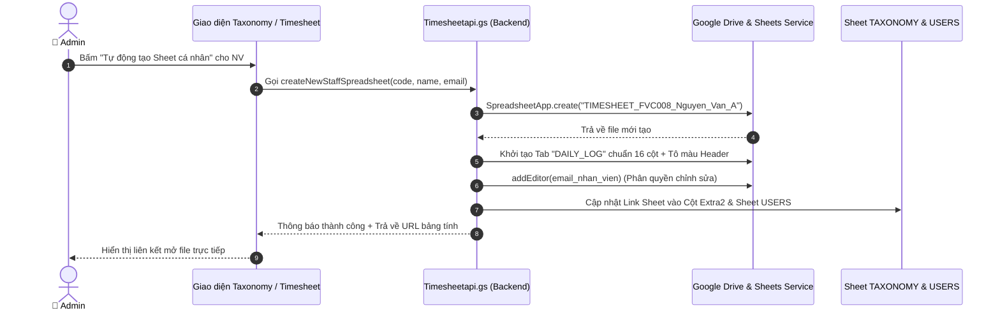
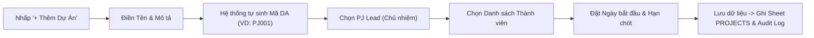
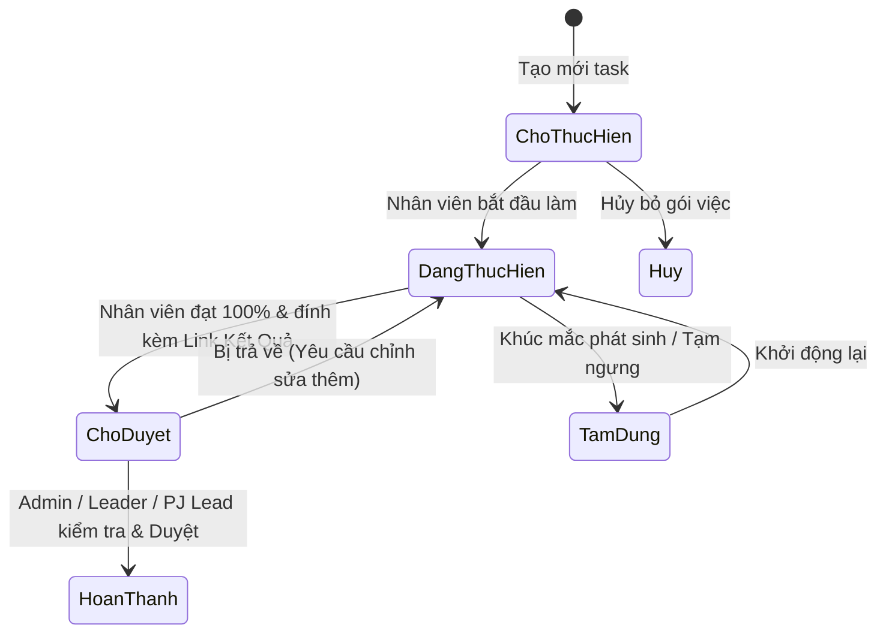

# SỔ TAY HƯỚNG DẪN SỬ DỤNG HỆ THỐNG DÀNH CHO CẤP ĐỘ QUẢN TRỊ VIÊN (ADMINISTRATOR GUIDE)
## HỆ THỐNG QUẢN LÝ DỰ ÁN & QUẢN LÝ THỜI GIAN TOÀN DIỆN (v3.0 / v4.0 RBAC)

> **Tài liệu:** Hướng Dẫn Vận Hành & Quản Trị Hệ Thống Dành Cho Cấp 1 (Root Admin)  
> **Nền tảng:** Google Apps Script WebApp + Google Sheets Engine  
> **Ngôn ngữ hỗ trợ:** 🇻🇳 Tiếng Việt | 🇬🇧 English | 🇯🇵 日本語  
> **Phiên bản tài liệu:** v4.0 Enterprise Edition  
> **Thời gian cập nhật:** Tháng 10/2026  

---

## MỤC LỤC CHI TIẾT

1. [TỔNG QUAN HỆ THỐNG & ĐẶC QUYỀN ADMIN (CẤP 1)](#1-tổng-quan-hệ-thống--đặc-quyền-admin-cấp-1)
2. [CÀI ĐẶT BAN ĐẦU, BẢNG TÍNH & HẠ TẦNG KỸ THUẬT](#2-cài-đặt-ban-đầu-bảng-tính--hạ-tầng-kỹ-thuật)
3. [MA TRẬN PHÂN QUYỀN ĐỘNG 4 CẤP BẬC (RBAC MATRIX)](#3-ma-trận-phân-quyền-động-4-cấp-bậc-rbac-matrix)
4. [QUẢN TRỊ NGƯỜI DÙNG & TÀI KHOẢN NHÂN SỰ](#4-quản-trị-người-dùng--tài-khoản-nhân-sự)
5. [QUẢN TRỊ ĐỘNG CƠ DANH MỤC TIÊU CHUẨN (TAXONOMY ENGINE)](#5-quản-trị-động-cơ-danh-mục-tiêu-chuẩn-taxonomy-engine)
6. [QUẢN LÝ DỰ ÁN TOÀN CÔNG TY (PROJECT MANAGEMENT)](#6-quản-lý-dự-án-toàn-công-ty-project-management)
7. [QUẢN TRỊ NHIỆM VỤ, WBS & LUỒNG PHÊ DUYỆT (TASKS & WORKFLOW)](#7-quản-trị-nhiệm-vụ-wbs--luồng-phê-duyệt-tasks--workflow)
8. [ĐIỀU PHỐI SƠ ĐỒ GANTT & PHÂN TÍCH BÁO CÁO (ANALYTICS)](#8-điều-phối-sơ-đồ-gantt--phân-tích-báo-cáo-analytics)
9. [QUẢN LÝ THỜI GIAN & HỢP NHẤT BẢNG CHẤM CÔNG (TIMESHEET ENGINE)](#9-quản-lý-thời-gian--hợp-nhất-bảng-chấm-công-timesheet-engine)
10. [NHẬT KÝ HỆ THỐNG, ĐA NGÔN NGỮ & XỬ LÝ SỰ CỐ (TROUBLESHOOTING)](#10-nhật-ký-hệ-thống-đa-ngôn-ngữ--xử-lý-sự-cố-troubleshooting)

---

## 1. TỔNG QUAN HỆ THỐNG & ĐẶC QUYỀN ADMIN (CẤP 1)

### 1.1. Giới thiệu Kiến trúc Hợp nhất (Unified Architecture)
Hệ thống kết hợp hoàn hảo giữa 2 triết lý quản trị cốt lõi:
1. **Quản trị Đầu ra (Outcome-Driven):** Quản lý Dự án, Gói việc (WBS), Thẻ nhiệm vụ Kanban, Lịch trình trực quan Gantt, Luồng gửi & Phê duyệt sản phẩm kèm link kết quả.
2. **Quản trị Đầu vào (Input-Driven):** Quản lý Thời gian chi tiết từng Block 30 phút (Slot-based Timesheet), đối soát 46 mã tác nghiệp chuẩn Nhật Bản (BIM/Civil), lưu trữ an toàn trên từng Google Sheet cá nhân của nhân sự để tránh xung đột ghi đồng thời.



---

### 1.2. Cơ chế Bảo vệ Tài khoản Admin Tối thượng (Root Admin Persistence Guarantee)
Nhằm ngăn ngừa triệt để các rủi ro hệ thống (như ghi nhầm vai trò, thao tác sai từ modal hoặc phân quyền đè), hệ thống tích hợp **Cơ chế Bảo vệ Kép**:
- **Nguyên tắc nhận diện Admin:**
  1. Tài khoản là **Chủ sở hữu bảng tính (Owner)** hoặc **Người chạy Script (Effective User)**.
  2. Họ tên hoặc Email có chứa định danh quản trị gốc (Ví dụ: `Vũ Đình Duy` / `vudinhduy`).
  3. Được thiết lập quyền `Admin` trong Sheet `USERS` hoặc Cấp 1 trong Sheet `TAXONOMY`.
- **Cơ chế tự sửa lỗi (Self-Healing):** Khi Admin đăng nhập, hàm `ensureAdminPersistence()` sẽ tự động kiểm tra. Nếu phát hiện dòng tài khoản trên Google Sheet bị mất cờ `Admin`, hệ thống sẽ **ngay lập tức phục hồi lại quyền Cấp 1** mà không làm gián đoạn quyền quản trị.
- **Rào chắn chống hạ cấp:** Bất kỳ thao tác phân quyền nào cố tình chuyển đổi tài khoản Admin tối thượng thành vai trò thấp hơn sẽ bị hệ thống tự động khóa và từ chối.

---

## 2. CÀI ĐẶT BAN ĐẦU, BẢNG TÍNH & HẠ TẦNG KỸ THUẬT

### 2.1. Cấu trúc 5 Sheet Trung tâm (Database Schemas)

Admin cần nắm rõ cấu trúc dữ liệu của Spreadsheet trung tâm:

| Tên Sheet | Vai trò chính | Các cột dữ liệu quan trọng |
| :--- | :--- | :--- |
| **`USERS`** | Danh sách tài khoản đăng nhập & liên kết Sheet cá nhân | `ID`, `Email`, `Họ Tên`, `Vai Trò` (Admin/Leader/PJ_Lead/Member), `Trạng Thái`, `Ngày Tạo`, `Cấp Bậc/Ghi Chú`, `Link Bảng Tính` |
| **`PROJECTS`** | Hồ sơ toàn bộ dự án công ty | `ID`, `Mã DA`, `Tên Dự Án`, `Mô Tả`, `Leader`, `Thành Viên`, `Ngày Bắt Đầu`, `Hạn Chót`, `Trạng Thái`, `% Tiến Độ`, `Số Task` |
| **`TASKS`** | Danh sách toàn bộ nhiệm vụ công ty | `ID`, `Mã DA`, `Tên Task`, `Người Thực Hiện`, `Giai Đoạn`, `Hạn Chót`, `Trạng Thái`, `Mức Ưu Tiên`, `% Tiến Độ`, `Link Kết Quả`, `Ghi Chú` |
| **`TAXONOMY`** | Từ điển chuẩn hóa 6 nhóm dữ liệu | `ID`, `Type` (CATEGORY/PHASE/DISCIPLINE/PROJECT_CODE/EMPLOYEE), `Code`, `Name_VI`, `Name_EN`, `Name_JP`, `Color_Hex`, `Extra1` (Email), `Extra2` (Sheet URL), `Extra3` (Cấp bậc) |
| **`ACTIVITY_LOG`** | Nhật ký kiểm toán bảo mật (Audit Trail) | `Thời Gian`, `Email Người Dùng`, `Vai Trò`, `Hành Động`, `Chi Tiết Hành Động` |

---

### 2.2. Menu Tiện ích Quản trị trên Google Sheets
Khi Admin mở Google Sheet trung tâm trên trình duyệt, thanh công cụ sẽ xuất hiện Menu đặc quyền: **`🚀 Project Manager v3`**.

```
[🚀 Project Manager v3]
   ├── 📊 Mở Webapp           -> Khởi chạy nhanh giao diện WebApp trên tab mới
   ├── --------------------
   ├── ⚙️ Khởi tạo Sheets      -> Tạo mới/khôi phục toàn bộ bảng tính nếu bị thiếu
   ├── 🔔 Setup Trigger        -> Đăng ký tiến trình chạy tự động 08:00 hàng ngày
   └── 🗑️ Xóa Cache           -> Xóa sạch CacheService để ép hệ thống nạp dữ liệu mới
```

> [!IMPORTANT]
> **Thao tác Khởi tạo (Init) lần đầu:**  
> Nếu bạn clone mã nguồn sang một Google Spreadsheet mới, hãy bấm **`⚙️ Khởi tạo Sheets`**. Hàm sẽ tự động tạo đủ các Sheet, đặt màu Header và nạp dữ liệu mẫu ban đầu.

---

### 2.3. Cài đặt Tiến trình Kích hoạt Tự động (Triggers Setup)
Để hệ thống tự động quét và gửi **Email nhắc hạn công việc (Deadline Reminders)** cho nhân viên:
1. Trên Menu `🚀 Project Manager v3`, nhấp chọn **`🔔 Setup Trigger`**.
2. Hệ thống sẽ tự động gỡ bỏ các Trigger cũ và đăng ký mới tiến trình:
   - **Hàm thực thi:** `sendDeadlineReminders()`
   - **Tần suất:** Mỗi ngày 1 lần vào khung giờ **08:00 - 09:00 sáng** (`Asia/Ho_Chi_Minh`).
   - **Nghiệp vụ:** Quét các task có hạn chót trong vòng 24h hoặc quá hạn mà chưa `Hoàn thành`, gửi email trực tiếp đến hộp thư của nhân sự phụ trách.

---

### 2.4. Quản trị Bộ nhớ đệm (CacheService Management)
Nhằm đạt tốc độ mở trang dưới **1.5 giây**, hệ thống ứng dụng bộ nhớ đệm `CacheService` với thời gian sống `TTL = 300 giây` (5 phút).
- Khi có các thao tác Thêm/Sửa/Xóa qua giao diện WebApp, Cache sẽ tự động xóa sạch cho Sheet tương ứng (`invalidateCache`).
- **Trường hợp can thiệp:** Nếu Admin trực tiếp chỉnh sửa thủ công hàng loạt dòng trên giao diện Google Sheets, hãy bấm nút **`🗑️ Xóa Cache`** trên menu `🚀 Project Manager v3` để dữ liệu mới nhất hiển thị ngay lập tức lên WebApp.

---

## 3. MA TRẬN PHÂN QUYỀN ĐỘNG 4 CẤP BẬC (RBAC MATRIX)

### 3.1. Phân định Trách nhiệm 4 Cấp bậc (RACI Roles)



| Cấp bậc | Vai trò kỹ thuật | Phạm vi thẩm quyền chính |
| :---: | :--- | :--- |
| **Cấp 1: Admin** | `Admin` | Toàn quyền kiểm soát toàn bộ 9 phân hệ; Quản trị người dùng; Cấu hình ma trận phân quyền; Tạo file Sheet cho nhân sự; Khôi phục dữ liệu. |
| **Cấp 2: Leader** | `Leader` | Quản trị và giám sát toàn bộ dự án của công ty; Tạo dự án mới; Phân công PJ Lead; Xem toàn bộ Timesheet; Không can thiệp phân quyền/User/Log. |
| **Cấp 3: PJ Lead** | `PJ_Lead` | Xem toàn cảnh tiến độ công ty (Read-All); Toàn quyền tạo task, sửa task, giao việc, duyệt task và xem Timesheet **trong phạm vi các dự án mình làm chủ nhiệm**. |
| **Cấp 4: Member** | `Member` | Chỉ xem và xử lý các task được giao cho bản thân; Nhập bảng chấm công cá nhân 30 phút; Không can thiệp task của đồng nghiệp. |

---

### 3.2. Bảng Ma trận Quyền hạn Chi tiết Hệ thống

| Phân hệ chức năng | Chức năng chi tiết | Cấp 1 (Admin) | Cấp 2 (Leader) | Cấp 3 (PJ Lead) | Cấp 4 (Member) |
| :--- | :--- | :---: | :---: | :---: | :---: |
| **1. Tổng quan** | Xem Dashboard toàn công ty | 🟢 FULL | 🟢 FULL | ⚪ VIEW_ALL | 🔵 OWN |
| | Lọc thống kê theo dự án | 🟢 FULL | 🟢 FULL | ⚪ VIEW_ALL | ❌ DENY |
| **2. Dự án** | Xem danh sách dự án | 🟢 FULL | 🟢 FULL | ⚪ VIEW_ALL (Gắn Badge) | 🔵 Dự án tham gia |
| | Tạo dự án mới | 🟢 FULL | 🟢 FULL | ❌ DENY | ❌ DENY |
| | Sửa thông tin dự án | 🟢 FULL | 🟢 FULL | 🟡 LEAD_SCOPE | ❌ DENY |
| | Xóa / Lưu trữ dự án | 🟢 FULL | ❌ DENY | ❌ DENY | ❌ DENY |
| **3. Nhiệm vụ** | Xem danh sách & Kanban | 🟢 FULL | 🟢 FULL | ⚪ VIEW_ALL | 🔵 OWN |
| | Tạo nhiệm vụ (Đơn / Hàng loạt) | 🟢 FULL | 🟢 FULL | 🟡 LEAD_SCOPE | ❌ DENY |
| | Sửa Deadline, Gán người | 🟢 FULL | 🟢 FULL | 🟡 LEAD_SCOPE | ❌ DENY |
| | Duyệt hoàn thành task | 🟢 FULL | 🟢 FULL | 🟡 LEAD_SCOPE | ❌ DENY |
| | Xóa nhiệm vụ | 🟢 FULL | 🟢 FULL | 🟡 LEAD_SCOPE | ❌ DENY |
| **4. Sơ đồ Gantt** | Xem dòng thời gian toàn bộ dự án | 🟢 FULL | 🟢 FULL | ⚪ VIEW_ALL | ❌ DENY |
| | Kéo thả đổi ngày trên Gantt | 🟢 FULL | 🟢 FULL | 🟡 LEAD_SCOPE | ❌ DENY |
| **5. Phân tích** | Báo cáo hiệu suất & KPI | 🟢 FULL | 🟢 FULL | ⚪ VIEW_ALL | ❌ DENY |
| **6. Timesheet** | Nhập công cá nhân (Slot 30p) | 🟢 FULL | 🟢 FULL | 🟢 FULL | 🟢 FULL |
| | Xem Timesheet nhân sự khác | 🟢 FULL | 🟢 FULL | 🟡 LEAD_SCOPE | ❌ DENY |
| **7. Danh mục** | Quản lý Category, Phase, Discipline | 🟢 FULL | 🟢 FULL | ⚪ VIEW_ALL | ⚪ VIEW_ALL |
| | Cấu hình Ma trận phân quyền | 🟢 FULL | ❌ DENY | ❌ DENY | ❌ DENY |
| **8. Người dùng** | Thêm, sửa, cấp quyền, khóa tài khoản | 🟢 FULL | ⚪ VIEW_ALL | ⚪ VIEW_ALL | ❌ DENY |
| **9. Nhật ký** | Xem lịch sử kiểm toán hệ thống | 🟢 FULL | ⚪ VIEW_ALL | ❌ DENY | ❌ DENY |

---

### 3.3. Hướng dẫn Cấu hình Ma trận Động (Tab 6 - Taxonomy)
Hệ thống cho phép Admin tùy chỉnh trực tiếp quyền hạn của từng cấp bậc mà không cần đụng vào code:
1. Vào phân hệ **Danh mục tiêu chuẩn** trên Sidebar ➔ Nhấp chọn Tab **`6. Ma trận phân quyền`**.
2. Giao diện bảng phân quyền tương tác (Interactive RBAC Matrix) sẽ hiển thị:
   - Cột **Cấp 1 (Admin)** được khóa cứng cố định ở mức `🟢 FULL`.
   - Cột **Cấp 2, Cấp 3, Cấp 4** hiển thị các Dropdown lựa chọn:
     * `🟢 FULL`: Toàn quyền.
     * `🟡 LEAD_SCOPE`: Chỉ áp dụng trong dự án do người đó làm chủ nhiệm (PJ Lead).
     * `⚪ VIEW_ALL`: Chỉ xem thông tin để tham chiếu, không có nút sửa/xóa.
     * `🔵 OWN`: Chỉ được thao tác với công việc của chính mình.
     * `❌ DENY`: Không có quyền (ẩn nút bấm, chặn API phía server).
3. Sau khi chỉnh sửa, nhấp nút **`💾 Lưu cấu hình ma trận`**. Cấu hình sẽ được lưu vào `PropertiesService` và kích hoạt hiệu lực tức thì cho toàn bộ người dùng đang trực tuyến.
4. Nếu muốn khôi phục về cấu hình tiêu chuẩn ban đầu của nhà phát triển, nhấp nút **`↺ Khôi phục mặc định`**.

---

## 4. QUẢN TRỊ NGƯỜI DÙNG & TÀI KHOẢN NHÂN SỰ

### 4.1. Cơ chế Đồng bộ 2 Chiều: Sheet `USERS` và Tab `Nhân sự` (`TAXONOMY`)
Hệ thống quản lý thông tin nhân sự thông qua 2 thành phần liên kết chặt chẽ:
- **Sheet `USERS`:** Chịu trách nhiệm xác thực đăng nhập Google, quản lý vai trò hệ thống (`role`) và trạng thái kích hoạt (`Active`/`Inactive`).
- **Sheet `TAXONOMY` (Type = `EMPLOYEE`):** Chịu trách nhiệm lưu trữ Mã nhân viên (`code`), Họ tên hiển thị (`Name_VI`), Email (`Extra1`), Đường dẫn Google Sheet cá nhân (`Extra2`), Cấp bậc phân quyền (`Extra3`).
- **Cơ chế tự động đồng bộ (Auto-Sync):** Khi Admin tạo hoặc cập nhật nhân viên tại Danh mục tiêu chuẩn, hàm `syncEmployeeToUsersSheet()` sẽ tự động tìm kiếm và đồng bộ sang Sheet `USERS`, đảm bảo không bao giờ xảy ra tình trạng lệch dữ liệu.

---

### 4.2. Hướng dẫn Thêm Mới Người Dùng (Add User)
Admin có thể cấp tài khoản cho 2 trường hợp:

#### Trường hợp 1: Nhân viên có tài khoản Google / Gmail (Đăng nhập trực tiếp)
1. Truy cập trang **Người dùng** (Sidebar `👥 Người dùng`) hoặc Tab **Nhân sự** trong Danh mục.
2. Nhấp nút **`+ Thêm người dùng`** (hoặc `+ Thêm nhân sự`).
3. Điền các trường thông tin:
   - **Họ và tên:** Nhập tên đầy đủ (Ví dụ: `Nguyễn Văn A`).
   - **Email:** Nhập chính xác địa chỉ Gmail / Google Workspace (Ví dụ: `nguyenvana@gmail.com`).
   - **Mã nhân viên:** Nhập theo quy chuẩn (Ví dụ: `FVC008`).
   - **Phân quyền (Cấp bậc):** Chọn 1 trong 4 cấp (`Cấp 1 - Admin`, `Cấp 2 - Leader`, `Cấp 3 - PJ Lead`, `Cấp 4 - Member`).
   - **Trạng thái:** Để mặc định `Active`.
4. Bấm **`Lưu`**. Hệ thống tự động ghi nhận vào cả 2 bảng.

#### Trường hợp 2: Nhân viên nội bộ chưa có Gmail (Chế độ định danh nội bộ)
- Nếu nhân sự làm việc tại xưởng hoặc bộ phận chưa được cấp email Google, Admin chỉ cần nhập **Họ tên** và chọn **Vai trò**.
- Hệ thống sẽ tự động gán mã định danh nội bộ: `member_<MÃ_TỰ_SINH>@internal.local`. Nhân sự này vẫn có tên trong danh sách phân công nhiệm vụ và bảng chấm công.

---

### 4.3. Cấp phát & Tự Động Khởi Tạo Google Sheet Cá Nhân Cho Nhân Viên
Mỗi nhân viên cần 1 file Google Sheet riêng biệt để lưu trữ các slot chấm công 30 phút. Admin có thể tạo file tự động chỉ bằng 1 cú nhấp:



> [!TIP]
> **Tự động cấp quyền chia sẻ (Auto-Share):**  
> Khi tạo file mới, hàm `createNewStaffSpreadsheet` sẽ tự động cấp quyền **Chỉnh sửa (Editor)** cho địa chỉ email của nhân viên đó. Nhân viên có thể mở file từ Google Drive cá nhân mà không cần Admin share thủ công.

---

### 4.4. Khóa & Kích hoạt Tài khoản (Account Lockout)
Khi nhân sự nghỉ phép dài hạn hoặc rời công ty:
1. Vào trang **`👥 Người dùng`**.
2. Tìm tài khoản cần thao tác, nhấp nút **`Khóa`** (Toggle Status).
3. Trạng thái tài khoản lập tức chuyển sang `Inactive`.
4. Khi nhân sự này truy cập WebApp, hệ thống sẽ phát hiện trạng thái khóa và hiển thị thông báo: *"Tài khoản của bạn đã bị tạm khóa. Vui lòng liên hệ Quản trị viên."* Toàn bộ các API ghi dữ liệu đều bị chặn.
5. Để mở lại tài khoản, Admin chỉ cần bấm nút **`Kích hoạt`** (Active).

---

## 5. QUẢN TRỊ ĐỘNG CƠ DANH MỤC TIÊU CHUẨN (TAXONOMY ENGINE)

Hệ thống được chuẩn hóa toàn diện theo cấu trúc **Taxonomy 6 Nhóm**. Đây là "trái tim" dữ liệu định hình toàn bộ các dropdown và bộ lọc trên hệ thống.

```
TAXONOMY (Danh Mục Tiêu Chuẩn)
  ├── 1. Category (8 Nhóm nghiệp vụ lớn: PC, MD, SD, MC, MTG, PM, MJ, RD)
  ├── 2. Phase (3 Giai đoạn dự án: BD - Thiết kế cơ sở, DD - Kỹ thuật, IS - Nghiệm thu)
  ├── 3. Discipline (46 Tác nghiệp chi tiết BIM/Civil: MD01, PC01, SD03...)
  ├── 4. Project Code (Mã dự án chuẩn hóa: HAG01, JJK01, 1GE00...)
  ├── 5. Nhân sự (Danh bạ nhân viên, liên kết Sheet, cấp bậc 1-4)
  └── 6. Ma trận phân quyền (Bảng cấu hình RBAC động)
```

### 5.1. Bảng 8 Nhóm Category Lớn
1. `PC`: Xử lý Point Cloud & Panorama (Màu Cyan: `#06b6d4`)
2. `MD`: Dựng mô hình 3D BIM (Màu Xanh dương: `#4f6ef7`)
3. `SD`: Bản vẽ thi công Shop Drawing (Màu Xanh lá: `#10b981`)
4. `MC`: Kiểm tra va chạm & Báo cáo kỹ thuật (Màu Vàng cam: `#f59e0b`)
5. `MTG`: Họp hành & Trao đổi nghiệp vụ (Màu Hồng: `#ec4899`)
6. `PM`: Quản trị dự án & Điều phối (Màu Tím: `#8b5cf6`)
7. `MJ`: Báo cáo định kỳ & Cải tiến Kaizen (Màu Xám ghi: `#64748b`)
8. `RD`: Nghiên cứu phát triển Tool & Đào tạo nội bộ (Màu Lam: `#3b82f6`)

---

### 5.2. Khởi Tạo Bộ 46 Mã Tác Nghiệp Tiêu Chuẩn (BIM Disciplines)
Để thiết lập hoặc khôi phục trọn bộ 46 mã tác nghiệp chuẩn Nhật Bản cho hệ thống:
1. Vào mục **`📐 Danh mục tiêu chuẩn`** ➔ Chọn tab **`3. Discipline`**.
2. Nếu danh mục đang trống hoặc bị thiếu mã, Admin chỉ cần bấm nút **`Khởi tạo 46 mã chuẩn`** (hoặc gọi hàm backend `setupTaxonomy46Codes()`).
3. Toàn bộ 46 mã (từ `PN01` tạo panorama, `PC01` xử lý điểm quét, `MD01-MD05` dựng hình bê tông/máy/ống, `SD01-SD08` triển khai bản vẽ, đến `MC01-MC07` báo cáo va chạm) sẽ được tự động điền đầy đủ tên tiếng Việt, tiếng Anh, tiếng Nhật và mã màu nhận diện.

---

### 5.3. Chuẩn Hóa Tiền Tố Nhiệm Vụ Cũ Hàng Loạt (Batch Standardize Tasks)
Trước khi nâng cấp hệ thống, nhiều task cũ chỉ có tên thuần túy mà thiếu tiền tố chuẩn `[Category - Phase - Discipline]`. Admin có thể chuẩn hóa hàng loạt:
1. Trong màn hình Danh mục, nhấp chọn công cụ **`Chuẩn hóa tên Task cũ`**.
2. Hệ thống sẽ quét qua các task cũ, tự động ghép tiền tố phù hợp dựa trên thông tin dự án.
3. Bấm **`Thực hiện cập nhật`** (`batchUpdateLegacyTasks`) để đồng bộ hàng trăm task chỉ trong vài giây.

---

## 6. QUẢN LÝ DỰ ÁN TOÀN CÔNG TY (PROJECT MANAGEMENT)

### 6.1. Quy trình Tạo Mới Dự Án
Chỉ **Admin (Cấp 1)** và **Leader (Cấp 2)** mới có thẩm quyền tạo dự án mới:



> [!NOTE]
> **Quy tắc Sinh Mã Tự Động:**  
> Hàm `genPjNum()` sẽ quét danh sách dự án hiện tại trong sheet `PROJECTS` để xác định số thứ tự kế tiếp, tự động sinh mã dạng `PJ001`, `PJ002`... đảm bảo tính duy nhất và không bị trùng lặp.

---

### 6.2. Phân Quyền Quản Trị Dự Án & Chỉ Định PJ Lead
- Mỗi dự án bắt buộc phải chỉ định **1 PJ Lead (Chủ nhiệm dự án)**.
- **Hiệu lực đối với PJ Lead:**
  * Nhân sự được chọn làm PJ Lead sẽ tự động nhận quyền `🟡 LEAD_SCOPE` cho riêng dự án đó.
  * PJ Lead này có toàn quyền tạo task, giao việc, đổi deadline và duyệt hoàn thành cho toàn bộ thành viên trong dự án.
  * Khi vào màn hình Dự án, hệ thống hiển thị huy hiệu vàng `👑 Tôi phụ trách` cho PJ Lead dễ dàng quản lý.

---

### 6.3. Giám Sát Tiến Độ Tự Động & Đóng / Xóa Dự Án
- **Tự động tính toán % Tiến độ:** Mỗi khi một task trong dự án thay đổi trạng thái hoặc % tiến độ, hàm `updateProjectProgress(projectId)` sẽ tự động tính lại giá trị trung bình có trọng số và cập nhật ngược lại vào cột `% Tiến độ` của dự án.
- **Xóa / Lưu trữ dự án:**
  * **Chỉ duy nhất Admin** có thẩm quyền bấm nút `Xóa dự án` (`pj_delete = FULL`).
  * Khi xóa, hệ thống sẽ yêu cầu xác nhận hộp thoại để tránh thao tác vô tình gây mất dữ liệu.

---

## 7. QUẢN TRỊ NHIỆM VỤ, WBS & LUỒNG PHÊ DUYỆT (TASKS & WORKFLOW)

### 7.1. Tạo Nhiệm Vụ Hàng Loạt (Bulk Add Tasks)
Để giải phóng thời gian cho quản lý khi bắt đầu dự án mới, Admin có thể nạp hàng loạt 20 - 50 task cùng lúc:
1. Tại màn hình **Nhiệm vụ**, bấm nút **`+ Thêm hàng loạt (Bulk Add)`**.
2. Chọn **Dự án mục tiêu**, **Giai đoạn (Phase)** và **Hạn chót mặc định**.
3. Dán danh sách tên task từ Excel hoặc Google Sheets vào khung nhập liệu (mỗi dòng một task).
4. Hệ thống sẽ phân tích cú pháp, tự động gán tiền tố Taxonomy và tạo đồng loạt các bản ghi vào Sheet `TASKS`.

---

### 7.2. Luồng Trạng Thái & Quy Trình Duyệt Hoàn Thành (Review Workflow)



> [!WARNING]
> **Quy định Kiểm duyệt Nghiêm ngặt:**  
> Thành viên Cấp 4 (Member) **không thể tự ý chuyển task sang trạng thái `Hoàn thành`**. Khi làm xong, Member cập nhật tiến độ lên 100%, dán Link sản phẩm (bản vẽ CAD, link Drive, model Revit) và chuyển sang `Chờ duyệt`. Chỉ có Admin, Leader hoặc PJ Lead của dự án mới có nút bấm **`Duyệt hoàn thành`**.

---

### 7.3. Thiết Lập Nhắc Việc Tự Động (Reminders & Email Alerts)
- Tại modal chi tiết của từng Task, Admin có thể cấu hình nhắc việc trước: **1 ngày**, **2 ngày** hoặc **3 ngày** trước khi đến Deadline.
- Khi người dùng được gán vào task mới, hàm `sendAssignmentEmail()` sẽ lập tức gửi một email thông báo với đầy đủ tên dự án, tiêu đề task, hạn chót và đường link trực tiếp để nhân viên bấm vào xem ngay.

---

## 8. ĐIỀU PHỐI SƠ ĐỒ GANTT & PHÂN TÍCH BÁO CÁO (ANALYTICS)

### 8.1. Điều Phối Trực Quan Trên Sơ Đồ Gantt
Sơ đồ Gantt là công cụ mạnh mẽ nhất giúp Admin điều hành tiến độ toàn công ty:
1. Truy cập **`📅 Sơ đồ Gantt`** trên Sidebar.
2. Hệ thống hiển thị thanh Timeline của tất cả các dự án và task đang triển khai theo trục ngày/tháng.
3. **Kéo thả điều chỉnh ngày (Interactive Drag-and-Drop):**
   - Admin có thể kéo thanh tiến độ sang trái hoặc phải để gia hạn/đẩy nhanh ngày bắt đầu và kết thúc.
   - Thao tác kéo thả sẽ gửi lệnh `tk_edit` về Server và cập nhật ngày trực tiếp vào Sheet `TASKS`.
4. **Bộ lọc nhân sự (Staff Filter):** Admin có thể lọc riêng một nhân sự để kiểm tra xem nhân sự đó có đang bị giao trùng lịch (Overbooking) ở 2 dự án khác nhau cùng một thời điểm hay không.

---

### 8.2. Phân Tích Hiệu Suất & Biểu Đồ Chuyên Sâu (Analytics)
Trang Phân tích (Sidebar `📈 Phân tích`) cung cấp 4 góc nhìn dữ liệu thời gian thực:
- **Biểu đồ Trạng thái Task (Doughnut Chart):** Tỷ lệ phần trăm task Hoàn thành, Đang làm, Quá hạn và Chờ duyệt.
- **Biểu đồ Tiến độ Dự án (Horizontal Bar Chart):** So sánh tiến độ thực tế giữa các dự án đang chạy.
- **Bảng Xếp Hạng Đóng Góp (Leaderboard):** Thống kê số task đã hoàn thành và số giờ công thực tế của từng nhân viên.
- **Xuất Báo Cáo:** Bấm nút **`Xuất báo cáo (CSV/Excel)`** để tải về toàn bộ dữ liệu thống kê phục vụ họp giao ban định kỳ.

---

## 9. QUẢN LÝ THỜI GIAN & HỢP NHẤT BẢNG CHẤM CÔNG (TIMESHEET ENGINE)

### 9.1. Cơ Chế Quản Lý Slot 30 Phút
Khác với các phần mềm quản lý dự án thông thường chỉ đếm task chung chung, phân hệ Timesheet cho phép quản lý chi tiết từng **Block 30 phút** của một ngày làm việc:
- **Khung giờ tiêu chuẩn:** Từ `08:00 - 08:30` đến `17:00 - 17:30` (16 slot).
- **Khung giờ làm thêm (Overtime):**
  * Tăng ca sáng sớm: `06:00 - 08:00` (4 slot).
  * Tăng ca tối: `17:30 - 22:00` (9 slot).
- **Cấu trúc mỗi dòng chấm công (DAILY_LOG):**
  * `Mã dự án`: Chọn từ danh mục dự án.
  * `Mã tác nghiệp (Activity Code)`: Chọn từ bộ 46 mã (`MD01`, `PC01`, `SD03`...).
  * `Loại giờ`: `Normal` (Chính khóa), `Morning OT` (Tăng ca sáng), `Night OT` (Tăng ca tối).
  * `Ghi chú chi tiết & Phát hiện (詳細・気付き)`: Ghi lại cụ thể kết quả đã làm được trong 30 phút.

---

### 9.2. Chế Độ Xem Bảng Chấm Công Của Tất Cả Nhân Viên (Admin View)
- Với vai trò Cấp 1 (Admin), khi truy cập **`⏱️ Quản lý thời gian`**, bạn có một Dropdown danh sách: **`👤 Chọn nhân sự cần xem`**.
- Bạn có thể chuyển đổi giữa các nhân sự (Duy, Tuấn, Nam...) và chọn ngày bất kỳ trên lịch.
- WebApp sẽ kết nối trực tiếp đến Google Sheet cá nhân của nhân sự đó, đọc tab `DAILY_LOG` và hiển thị trực quan lên màn hình chỉ trong **0.8 giây**.
- Admin có thể can thiệp duyệt, bổ sung hoặc hiệu chỉnh slot cho nhân viên nếu có sai sót.

---

### 9.3. Xử Lý Sự Cố Bảng Tính Cá Nhân Nhân Sự
Nếu nhân viên báo lỗi *"Không thể tải bảng tính Timesheet"*:
1. Kiểm tra cột `Link Bảng Tính` trong sheet `USERS` hoặc tab `Nhân sự` trong `TAXONOMY`.
2. Đảm bảo URL có dạng chuẩn: `https://docs.google.com/spreadsheets/d/<SPREADSHEET_ID>/edit`.
3. Kiểm tra xem quyền truy cập của Google Sheet đó đã được cấp cho tài khoản Google chạy WebApp hay chưa.
4. Nếu file bị lỗi format, Admin chỉ cần bấm nút **`Tạo lại Sheet chuẩn`** (`createNewStaffSpreadsheet`), hệ thống sẽ tạo file mới và liên kết lại ngay lập tức.

---

## 10. NHẬT KÝ HỆ THỐNG, ĐA NGÔN NGỮ & XỬ LÝ SỰ CỐ (TROUBLESHOOTING)

### 10.1. Kiểm Tra Nhật Ký Kiểm Toán (Audit Trail)
Mọi hành vi trọng yếu trên hệ thống đều được ghi vết tự động vào Sheet `ACTIVITY_LOG`:
- Đăng nhập, Thêm/Sửa/Xóa người dùng.
- Thêm/Xóa dự án, Cập nhật trạng thái task.
- Lưu ma trận phân quyền, Khôi phục cấu hình.
- Lưu bảng chấm công và tạo file Google Sheet mới.
- Admin truy cập trang **`📜 Nhật ký`** để xem danh sách lịch sử có bộ lọc theo Thời gian, Email và Hành động.

---

### 10.2. Cấu Hình Ngôn Ngữ Hệ Thống (I18N Engine)
Hệ thống hỗ trợ song ngữ hoàn chỉnh: **🇻🇳 Tiếng Việt**, **🇬🇧 English**, và **🇯🇵 日本語**:
- **Ngôn ngữ người dùng:** Mỗi nhân sự có thể tự bấm vào cờ ngôn ngữ ở góc trên bên phải để đổi giao diện cá nhân. Lựa chọn được lưu vào `localStorage`.
- **Ngôn ngữ mặc định toàn hệ thống:** Admin có thể thiết lập ngôn ngữ chuẩn khi người dùng mới truy cập lần đầu thông qua hàm backend `setSystemDefaultLanguage('vi' | 'en' | 'jp')`.

---

### 10.3. Bảng Xử Lý Sự Cố Thường Gặp (Admin Troubleshooting Guide)

| Tình huống sự cố | Nguyên nhân gốc rễ | Quy trình Admin khắc phục |
| :--- | :--- | :--- |
| **1. Nhân viên không vào được WebApp (Màn hình trắng / Báo lỗi quyền)** | Email nhân viên chưa được thêm vào Sheet `USERS`, hoặc trạng thái đang là `Inactive`. | Vào trang `👥 Người dùng`, kiểm tra xem email Gmail của nhân viên đã có chưa. Nếu chưa có, thêm mới và đặt trạng thái là `Active`. |
| **2. PJ Lead không sửa được task của dự án mình** | Dự án chưa được gán đúng tên PJ Lead, hoặc tên trong dự án không khớp với Họ tên tài khoản của PJ Lead. | Mở modal sửa dự án, tại trường `Chủ nhiệm dự án (PJ Lead)`, chọn đúng tên tài khoản của nhân sự đó từ dropdown. |
| **3. Dữ liệu sửa trên Sheet không hiện lên WebApp** | Dữ liệu cũ đang được lưu trong bộ nhớ đệm `CacheService`. | Trên Menu Google Sheet `🚀 Project Manager v3`, nhấp chọn **`🗑️ Xóa Cache`**. Sau đó tải lại WebApp. |
| **4. Không nhận được email nhắc hạn Task** | Tiến trình Trigger của Google Apps Script chưa được khởi tạo hoặc bị ngắt quyền truy cập. | Trên Menu Google Sheet `🚀 Project Manager v3`, nhấp chọn **`🔔 Setup Trigger`** và cấp quyền khi hộp thoại phân quyền Google xuất hiện. |
| **5. Nhân viên báo lỗi khi bấm Lưu Timesheet** | Google Sheet cá nhân của nhân sự bị xóa, bị đổi tên tab khác với `DAILY_LOG`, hoặc mất quyền Editor. | Bấm nút tạo lại Sheet mới cho nhân sự trong trang Quản lý Timesheet, hệ thống sẽ tự động gán tab `DAILY_LOG` chuẩn. |
| **6. Giao diện bị đè chữ / Lỗi font tiếng Nhật** | Trình duyệt lưu cache file CSS/JS cũ. | Nhấn tổ hợp phím **`Ctrl + Shift + R`** (hoặc `Cmd + Shift + R` trên Mac) để xóa sạch cache trình duyệt và tải lại giao diện mới nhất. |

---

## 11. KHUYẾN NGHỊ VẬN HÀNH DÀNH CHO QUẢN TRỊ VIÊN (BEST PRACTICES)

1. **Sao lưu định kỳ (Weekly Backup):**
   - Vào cuối mỗi tuần, Admin nên tạo một bản sao lưu (Make a copy) của Spreadsheet trung tâm để lưu trữ lịch sử dữ liệu an toàn.
2. **Quy định giờ chốt công (Timesheet Cut-off):**
   - Yêu cầu toàn bộ nhân viên hoàn thành việc chấm công 30 phút của ngày hôm đó trước **18:00 hàng ngày** hoặc trước **09:00 sáng hôm sau**.
   - Admin kiểm tra nhanh màn hình Dashboard và Timesheet để nhắc nhở các nhân sự còn thiếu slot.
3. **Tuân thủ luồng duyệt (Zero-Bypass Review):**
   - Không cho phép nhân viên tự đánh dấu hoàn thành task nếu chưa có Link kiểm chứng sản phẩm.
   - PJ Lead và Leader phải trực tiếp mở link bản vẽ/model để nghiệm thu chất lượng trước khi bấm duyệt.
4. **Giữ gìn tính toàn vẹn của Bộ từ điển 46 mã:**
   - Hạn chế tối đa việc tùy tiện xóa hoặc thay đổi mã tác nghiệp (`MD01`, `PC01`...) vì sẽ làm ảnh hưởng đến các công thức báo cáo và dữ liệu lịch sử của đối tác Nhật Bản.

---

> 🎯 **KẾT LUẬN:**  
> Tài liệu này cung cấp toàn bộ quy chuẩn và cẩm nang vận hành cho Quản trị viên Cấp 1. Mọi thắc mắc kỹ thuật sâu hơn về mã nguồn backend Apps Script hoặc kiến trúc mở rộng hệ thống, vui lòng tham chiếu các file phân tích kỹ thuật:
> - [`KE_HOACH_PHAN_QUYEN_4_CAP_DO_VA_MA_TRAN.md`](file:///c:/Users/95053/Desktop/Hello%20World/Google-Appscript/03_Project%20Management/KE_HOACH_PHAN_QUYEN_4_CAP_DO_VA_MA_TRAN.md)
> - [`DE_XUAT_BO_MA_TAXONOMY_46_DAU_VIEC.md`](file:///c:/Users/95053/Desktop/Hello%20World/Google-Appscript/03_Project%20Management/DE_XUAT_BO_MA_TAXONOMY_46_DAU_VIEC.md)
> - [`SO_SANH_PHAN_BIEN_QUAN_LY_DAU_VIEC_TIMESHEET.md`](file:///c:/Users/95053/Desktop/Hello%20World/Google-Appscript/03_Project%20Management/SO_SANH_PHAN_BIEN_QUAN_LY_DAU_VIEC_TIMESHEET.md)

