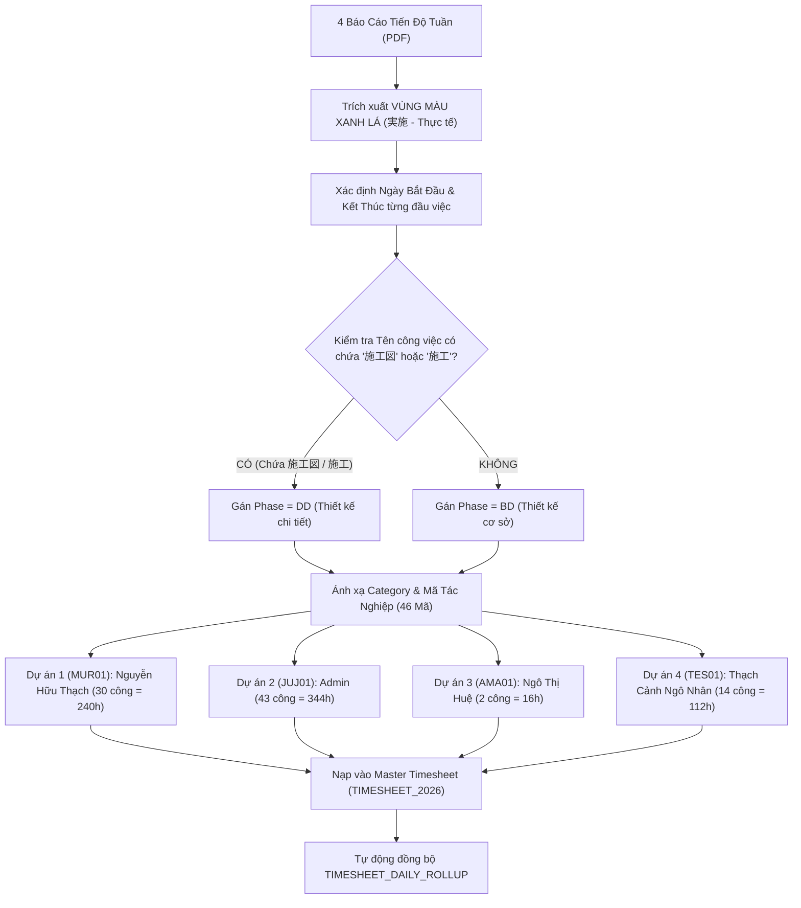

# KẾ HOẠCH CẬP NHẬT DỮ LIỆU THỰC TẾ 4 DỰ ÁN NHẬT BẢN VÀO HỆ THỐNG
## (QUY CHUẨN BẢNG TIẾN ĐỘ THỰC TẾ MÀU XANH LÁ - 実施 / JISSHI)

> **Tài liệu tham chiếu:** 4 Báo cáo tiến độ tuần dự án Nhật Bản (BIM/MEP Weekly Progress Reports)  
> **Phạm vi nhập liệu nghiêm ngặt:** Chỉ trích xuất và nạp **Vùng bảng màu xanh lá (実施 - Thực tế thực hiện)**. Tuyệt đối không nạp vùng màu cam (計画 - Kế hoạch lý thuyết).  
> **Quy tắc phân loại Giai đoạn (Phase):** 
> - Nếu tên công việc gốc có chứa chữ **`施工図`** (Bản vẽ thi công / Shop Drawing) hoặc **`施工`** (Thi công / Kế hoạch thi công) $\rightarrow$ Phase là **`DD` (Thiết kế chi tiết - 詳細設計 / Detail Design)**.
> - Các công việc còn lại $\rightarrow$ Phase là **`BD` (Thiết kế cơ sở - 基本設計 / Basic Design)**.
>
> **Phân bổ nhân sự thực hiện theo chỉ định:**
> - **Dự án 1 (Ranto):** `Nguyễn Hữu Thạch`
> - **Dự án 2 (Kobo Village):** `Admin` (Vũ Đình Duy / Quản trị viên)
> - **Dự án 3 (Hondo):** `Ngô Thị Huệ`
> - **Dự án 4 (Teshikaga):** `Thạch Cảnh Ngô Nhân`
>
> **Quy tắc thời gian:** Gióng trực tiếp theo từng ô ngày trên biểu đồ tiến độ. Nếu chỉ có 1 ô được tô màu thì **Ngày bắt đầu trùng với Ngày kết thúc**.

---

---

## I. BẢNG DANH MỤC TAXONOMY CHUẨN CỦA HỆ THỐNG ÁP DỤNG

### 1. Danh mục Nhóm lớn (Category)
* **`MD`**: Dựng mô hình 3D BIM (3Dモデリング - Kết cấu, Thiết bị, Đường ống, Hợp nhất)
* **`PC`**: Xử lý Point Cloud & Panorama (点群 & パノラマ)
* **`MC`**: Kiểm tra va chạm & Báo cáo kỹ thuật (干渉・報告書)
* **`MTG`**: Họp hành & Trao đổi điều phối (会議・打合せ)
* **`PM`**: Quản lý dự án & Hồ sơ tài liệu (プロジェクト管理)
* **`SD`**: Bản vẽ thi công (Shop Drawing - 施工図作成)
* **`MJ`**: Báo cáo & Cải tiến nội bộ (業務報告・改善)
* **`RD`**: Nghiên cứu & Đào tạo (開発・スキルアップ)

### 2. Giai đoạn dự án (Phase)
* **`BD`**: **Thiết kế cơ sở (基本設計 - Basic Design)** — Áp dụng cho các công việc dựng mô hình thiết kế, xử lý Point Cloud, họp trao đổi, kiểm tra bản vẽ thiết kế / đặt hàng (発注図 / 設計図).
* **`DD`**: **Thiết kế chi tiết (詳細設計 - Detail Design)** — Áp dụng cho các công việc có chứa tiền tố **`施工図`** (Shop drawing) hoặc **`施工`** (Thi công / Kế hoạch thi công).

---

## II. BẢNG QUY ĐỔI CHI TIẾT 4 DỰ ÁN (BẢNG XANH LÁ - THỰC TẾ)

---

### 1. DỰ ÁN 1: 室蘭市蘭東下水処理場 (Ranto Sewage Treatment Plant - Muroran)
* **Mã dự án:** `2026_01_MUR01_室蘭市蘭東下水処理場` (Mã ngắn: `MUR01`)
* **Nhân sự thực hiện:** **Nguyễn Hữu Thạch**
* **Tổng công thực tế (Vùng xanh lá):** **30 ngày công = 240.0 giờ** (Tiến độ thực tế: 70%)

| STT | Tên công việc gốc (PDF 日本語) | Tên công việc (Tiếng Việt) | Nhân sự phụ trách | Category | Phase | Mã tác nghiệp (Discipline) | Số công | Số giờ (h) | Ngày Bắt Đầu | Ngày Kết Thúc | Mốc kỹ thuật & Quy tắc Phase |
| :---: | :--- | :--- | :---: | :---: | :---: | :---: | :---: | :---: | :---: | :---: | :--- |
| **1** | 躯体モデル作成 | Dựng mô hình kết cấu thân công trình | Nguyễn Hữu Thạch | `MD` | **`BD`** | **`MD01`** | 3 | 24.0h | **01/07/2026** | **03/07/2026** | Dựng hình móng bệ, bể xử lý |
| **2** | 配管モデル作成 | Dựng mô hình hệ thống đường ống | Nguyễn Hữu Thạch | `MD` | **`BD`** | **`MD03`** | 5 | 40.0h | **06/07/2026** | **10/07/2026** | Tuyến ống công nghệ chính |
| **3** | 設備モデル作成 | Dựng mô hình thiết bị máy móc | Nguyễn Hữu Thạch | `MD` | **`BD`** | **`MD02`** | 2 | 16.0h | **07/07/2026** | **08/07/2026** | Kèm ký hiệu `(a')`: Layout máy thổi khí |
| **4** | 点群データ処理 | Xử lý dữ liệu đám mây điểm Point Cloud | Nguyễn Hữu Thạch | `PC` | **`BD`** | **`PC01`** | 4 | 32.0h | **01/07/2026** | **06/07/2026** | Ghép và xử lý đám mây điểm 3D |
| **5** | 点群データの撤去部分の確認MTG | Họp xác nhận phần tháo dỡ Point Cloud | Nguyễn Hữu Thạch | `MTG` | **`BD`** | **`MT01`** | 0 | 0.0h | — | — | Không phát sinh thực tế (0 công) |
| **6** | データ合成 | Hợp nhất mô hình tổng thể | Nguyễn Hữu Thạch | `MD` | **`BD`** | **`MD04`** | 1 | 8.0h | **13/07/2026** | **13/07/2026** | 1 ô tô màu duy nhất (Ngày BĐ = KT) |
| **7** | 発注図チェックレポート作成・提出 | Lập & nộp báo cáo kiểm tra bản vẽ thiết kế | Nguyễn Hữu Thạch | `MC` | **`BD`** | **`MC01`** | 4 | 32.0h | **20/07/2026** | **27/07/2026** | `(a)`: Nộp báo cáo kiểm tra ngày 20/07 |
| **8** | 案②の計画図チェックレポート作成・提出 | Lập & nộp báo cáo kiểm tra bản vẽ phương án 2 | Nguyễn Hữu Thạch | `MC` | **`BD`** | **`MC01`** | 2 | 16.0h | **27/07/2026** | **28/07/2026** | `(c)`: Nộp báo cáo phương án 2 |
| **9** | 発注図チェックレポート報告MTG | Họp báo cáo kết quả kiểm tra thiết kế | Nguyễn Hữu Thạch | `MTG` | **`BD`** | **`MT01`** | 0 | 0.0h | — | — | Không phát sinh thực tế (0 công) |
| **10**| 送風機の搬入検討 | Nghiên cứu biện pháp vận chuyển máy thổi khí | Nguyễn Hữu Thạch | `MC` | **`BD`** | **`MC04`** | 0 | 0.0h | — | — | Không phát sinh thực tế (0 công) |
| **11**| **施工図からモデル修正** | Hiệu chỉnh mô hình từ bản vẽ thi công | Nguyễn Hữu Thạch | `MD` | **`DD`** | **`MD13`** | 5 | 40.0h | **21/09/2026** | **01/10/2026** | **Có chữ [施工図] $\rightarrow$ Phase DD** (21, 22/09; 28, 29/09; 01/10) |
| **12**| **施工図チェックレポート作成・提出** | Lập & nộp báo cáo kiểm tra bản vẽ thi công | Nguyễn Hữu Thạch | `MC` | **`DD`** | **`MC02`** | 4 | 32.0h | **24/09/2026** | **02/10/2026** | **Có chữ [施工図] $\rightarrow$ Phase DD** (Ký hiệu `(d)`, `(e)`) |
| *13*| *施工図チェックレポート報告MTG* | *Họp báo cáo kiểm tra bản vẽ thi công* | *Nguyễn Hữu Thạch* | `MTG` | **`DD`** | *`MT01`* | 0 | 0.0h | — | — | *Có chữ [施工図] $\rightarrow$ Phase DD (0 công)* |
| *14*| *追加依頼・レポート修正* | *Yêu cầu bổ sung & chỉnh sửa báo cáo* | *Nguyễn Hữu Thạch* | `MC` | **`BD`** | *`MC03`* | 0 | 0.0h | — | — | *Dự kiến tương lai (0 công)* |
| *15*| *クローズMTG* | *Họp đóng dự án (Close Meeting)* | *Nguyễn Hữu Thạch* | `MTG` | **`BD`** | *`MT01`* | 0 | 0.0h | — | — | *Dự kiến tương lai (0 công)* |
| **TỔNG**| **Dự án 1 (室蘭市蘭東下水処理場)** | — | **Nguyễn Hữu Thạch** | — | — | — | **30** | **240.0h** | **01/07/2026** | **02/10/2026** | **Khớp 100% với 合計: 30 trên báo cáo gốc** |

---

### 2. DỰ ÁN 2: 社会福祉法人十字会工房ヴィレッジ新築工事 (Jujikai Kobo Village)
* **Mã dự án:** `2026_02_JUJ01_工房ヴィレッジ新築工事` (Mã ngắn: `JUJ01`)
* **Nhân sự thực hiện:** **Admin** (Vũ Đình Duy / Toàn bộ đầu việc tạm gán cho Admin theo yêu cầu)
* **Tổng công thực tế FVC (Vùng xanh lá):** **43 ngày công = 344.0 giờ** (KOSO thực hiện 85 ngày công)

| STT | Tên công việc gốc (PDF 日本語) | Tên công việc (Tiếng Việt) | Nhân sự phụ trách | Category | Phase | Mã tác nghiệp (Discipline) | Số công FVC | Giờ FVC (h) | Ngày Bắt Đầu | Ngày Kết Thúc | Mốc kỹ thuật & Quy tắc Phase |
| :---: | :--- | :--- | :---: | :---: | :---: | :---: | :---: | :---: | :---: | :---: | :--- |
| **1** | 問い合わせMTG | Họp giải đáp thắc mắc & Khởi động | Admin | `MTG` | **`BD`** | **`MT01`** | 2 | 16.0h | **02/07/2026** | **07/07/2026** | `(M1)` ngày 02/07; `(M2)` ngày 07/07 |
| **2** | 構造モデル作成_チェック | Kiểm tra mô hình kết cấu từ KOSO | Admin | `MD` | **`BD`** | **`MD10`** | 2 | 16.0h | **08/07/2026** | **09/07/2026** | Rà soát mô hình kết cấu KOSO gửi qua |
| **3** | MTG(FVC-KOSO)_構造物／モデルの色付 | Họp thống nhất quy ước màu sắc mô hình | Admin | `MTG` | **`BD`** | **`MT02`** | 1 | 8.0h | **08/07/2026** | **08/07/2026** | `(M3)` 1 ô duy nhất (Ngày BĐ = KT) |
| **4** | 建築モデル作成_チェック | Kiểm tra mô hình kiến trúc từ KOSO | Admin | `MD` | **`BD`** | **`MD10`** | 1 | 8.0h | **16/07/2026** | **16/07/2026** | 1 ô duy nhất (Ngày BĐ = KT) |
| **5** | MTG(FVC-KOSO)_レイアウト変更 | Họp thay đổi layout trần với KOSO | Admin | `MTG` | **`BD`** | **`MT02`** | 1 | 8.0h | **21/07/2026** | **21/07/2026** | `(M4)` 1 ô duy nhất (Ngày BĐ = KT) |
| **6** | 設備及び電気モデル_チェック | Kiểm tra mô hình MEP & Điện | Admin | `MD` | **`BD`** | **`MD10`** | 4 | 32.0h | **22/07/2026** | **27/07/2026** | Rà soát mô hình MEP đối tác gửi `(e)` |
| **7** | MTG(FUSO-FVC)_レイアウト変更 | Họp đổi layout với khách hàng FUSO | Admin | `MTG` | **`BD`** | **`MT01`** | 1 | 8.0h | **22/07/2026** | **22/07/2026** | `(M5)` Họp với Higuchi-san (Ngày BĐ = KT) |
| **8** | MTG(FVC-KOSO)_レイアウト変更 | Họp chốt đổi layout với đội KOSO | Admin | `MTG` | **`BD`** | **`MT02`** | 1 | 8.0h | **23/07/2026** | **23/07/2026** | `(M6)` 1 ô duy nhất (Ngày BĐ = KT) |
| **9** | データ合成 | Hợp nhất mô hình đa bộ môn | Admin | `MD` | **`BD`** | **`MD04`** | 1 | 8.0h | **29/07/2026** | **29/07/2026** | 1 ô duy nhất (Ngày BĐ = KT) |
| **10**| MTG(FVC-KOSO)_モデルレビュー | Họp review mô hình tổng thể với KOSO | Admin | `MTG` | **`BD`** | **`MT02`** | 1 | 8.0h | **29/07/2026** | **29/07/2026** | `(M7)` 1 ô duy nhất (Ngày BĐ = KT) |
| **11**| 発注図チェック | Rà soát kiểm tra bản vẽ đặt hàng | Admin | `MC` | **`BD`** | **`MC01`** | 2 | 16.0h | **30/07/2026** | **31/07/2026** | Kiểm tra sai lệch bản vẽ thiết kế |
| **12**| TFASデータ変換（1回目） | Chuyển đổi định dạng TFAS đợt 1 | Admin | `SD` | **`BD`** | **`SD08`** | 1 | 8.0h | **03/08/2026** | **03/08/2026** | 1 ô duy nhất (Ngày BĐ = KT) |
| **13**| 設計図チェックレポート作成・提出（1回目） | Lập & nộp báo cáo kiểm tra thiết kế đợt 1 | Admin | `MC` | **`BD`** | **`MC01`** | 3 | 24.0h | **04/08/2026** | **06/08/2026** | Xuất báo cáo nộp khách hàng FUSO |
| **14**| 設計図チェックレポート報告MTG（1回目） | Họp báo cáo kết quả kiểm tra thiết kế | Admin | `MTG` | **`BD`** | **`MT01`** | 1 | 8.0h | **07/08/2026** | **07/08/2026** | `(M8)` 1 ô duy nhất (Ngày BĐ = KT) |
| **15**| TFASデータ変換のMTG | Họp kỹ thuật về chuyển đổi dữ liệu TFAS | Admin | `MTG` | **`BD`** | **`MT01`** | 1 | 8.0h | **11/08/2026** | **11/08/2026** | `(M9)` 1 ô duy nhất (Ngày BĐ = KT) |
| **16**| フェーズ１の数量集計 | Bóc tách khối lượng vật tư Giai đoạn 1 | Admin | `PM` | **`BD`** | **`PM01`** | 3 | 24.0h | **17/08/2026** | **19/08/2026** | Thống kê số lượng phục vụ đặt hàng |
| **17**| フェーズ１の課題解決MTG | Họp giải quyết vướng mắc Giai đoạn 1 | Admin | `MTG` | **`BD`** | **`MT01`** | 1 | 8.0h | **19/08/2026** | **19/08/2026** | `(M10)` 1 ô duy nhất (Ngày BĐ = KT) |
| **18**| イシュー対応 | Xử lý các xung đột & Issue tồn đọng | Admin | `MC` | **`BD`** | **`MC03`** | 2 | 16.0h | **20/08/2026** | **21/08/2026** | FVC phối hợp xử lý (KOSO chiếm 35 công) |
| **19**| 床合板下のイシューのレポート | Báo cáo kỹ thuật xung đột dưới sàn ván ép | Admin | `MC` | **`BD`** | **`MC06`** | 1 | 8.0h | **24/08/2026** | **24/08/2026** | 1 ô duy nhất (Ngày BĐ = KT) |
| **20**| MTG(FUSO-FVC)残り業務及びスケジュール | Họp rà soát công việc còn lại & Tiến độ | Admin | `MTG` | **`BD`** | **`MT01`** | 1 | 8.0h | **25/08/2026** | **25/08/2026** | 1 ô duy nhất (Ngày BĐ = KT) |
| **21**| MTG(FVC-KOSO)床下の問題点 | Họp xử lý các vấn đề kỹ thuật dưới sàn | Admin | `MTG` | **`BD`** | **`MT02`** | 1 | 8.0h | **26/08/2026** | **26/08/2026** | 1 ô duy nhất (Ngày BĐ = KT) |
| **22**| TFASデータ変換（2回目） | Chuyển đổi định dạng TFAS đợt 2 | Admin | `SD` | **`BD`** | **`SD08`** | 1 | 8.0h | **01/09/2026** | **01/09/2026** | Convert sau khi hiệu chỉnh Issue (Ngày BĐ = KT) |
| **23**| MTG(FUSO-FVC)進捗報告 | Họp báo cáo tiến độ định kỳ với FUSO | Admin | `MTG` | **`BD`** | **`MT01`** | 1 | 8.0h | **04/09/2026** | **04/09/2026** | 1 ô duy nhất (Ngày BĐ = KT) |
| **24**| MTG(FUSO-FVC)問題解決 | Họp giải quyết vướng mắc phát sinh | Admin | `MTG` | **`BD`** | **`MT01`** | 1 | 8.0h | **08/09/2026** | **08/09/2026** | 1 ô duy nhất (Ngày BĐ = KT) |
| **25**| **MTG(FUSO-FVC)施工図作成について** | Họp về kế hoạch lập bản vẽ thi công | Admin | `MTG` | **`DD`** | **`MT01`** | 1 | 8.0h | **15/09/2026** | **15/09/2026** | **Có chữ [施工図] $\rightarrow$ Phase DD** (1 ô duy nhất) |
| **26**| MTG(FVC-KOSO)点検口について | Họp vị trí bố trí lỗ thăm kỹ thuật trần/sàn | Admin | `MTG` | **`BD`** | **`MT02`** | 1 | 8.0h | **16/09/2026** | **16/09/2026** | 1 ô duy nhất (Ngày BĐ = KT) |
| **27**| 設計図チェックレポート作成・提出（2回目） | Lập & nộp báo cáo kiểm tra thiết kế đợt 2 | Admin | `MC` | **`BD`** | **`MC01`** | 1 | 8.0h | **23/09/2026** | **23/09/2026** | 1 ô duy nhất (Ngày BĐ = KT) |
| **28**| TFASデータ変換（3回目） | Chuyển đổi định dạng TFAS hoàn thiện đợt 3 | Admin | `SD` | **`BD`** | **`SD08`** | 2 | 16.0h | **28/09/2026** | **29/09/2026** | Hoàn tất bộ dữ liệu TFAS cho công trường |
| **29**| 設計図チェックレポート報告MTG（2回目） | Họp báo cáo kiểm tra thiết kế đợt 2 | Admin | `MTG` | **`BD`** | **`MT01`** | 1 | 8.0h | **02/10/2026** | **02/10/2026** | 1 ô duy nhất (Ngày BĐ = KT) |
| **30**| MTG(FVC-KOSO)振り返り | Họp đánh giá rút kinh nghiệm dự án | Admin | `MTG` | **`BD`** | **`MT02`** | 1 | 8.0h | **08/10/2026** | **08/10/2026** | 1 ô duy nhất (Ngày BĐ = KT) |
| **31**| クローズMTG | Họp nghiệm thu đóng dự án | Admin | `MTG` | **`BD`** | **`MT01`** | 1 | 8.0h | **16/10/2026** | **16/10/2026** | 1 ô duy nhất (Ngày BĐ = KT) |
| **TỔNG**| **Dự án 2 (工房ヴィレッジ新築工事)** | — | **Admin** | — | — | — | **43** | **344.0h** | **02/07/2026** | **16/10/2026** | **Khớp 100% với 合計: 43 của FVC trên báo cáo** |

---

### 3. DỰ ÁN 3: 天草市本渡浄化センター (Amakusa City Hondo Center)
* **Mã dự án:** `2026_03_AMA01_天草市本渡浄化センター` (Mã ngắn: `AMA01`)
* **Nhân sự thực hiện:** **Ngô Thị Huệ**
* **Tổng công thực tế hiện tại (Vùng xanh lá):** **2 ngày công = 16.0 giờ** (Đợt thực hiện cuối tháng 10/2026)

| STT | Tên công việc gốc (PDF 日本語) | Tên công việc (Tiếng Việt) | Nhân sự phụ trách | Category | Phase | Mã tác nghiệp (Discipline) | Số công | Số giờ (h) | Ngày Bắt Đầu | Ngày Kết Thúc | Mốc kỹ thuật & Quy tắc Phase |
| :---: | :--- | :--- | :---: | :---: | :---: | :---: | :---: | :---: | :---: | :---: | :--- |
| **1** | 配管モデル作成 (Mục số 16 trên biểu đồ thực tế) | Dựng mô hình đường ống công nghệ | Ngô Thị Huệ | `MD` | **`BD`** | **`MD03`** | 2 | 16.0h | **27/10/2026** | **28/10/2026** | 2 ô vệt xanh thực tế đã làm cuối tháng 10 |
| *2* | *汚泥搬出設備の施工計画* | *Kế hoạch thi công thiết bị vận chuyển bùn* | *Ngô Thị Huệ* | `SD` | **`DD`** | *`SD08`* | 0 | 0.0h | — | — | **Có chữ [施工] $\rightarrow$ Phase DD** *(Tháng 11/2026)* |
| *3* | *汚泥搬出設備の施工計画のレポート提出* | *Nộp báo cáo kế hoạch thi công bùn* | *Ngô Thị Huệ* | `MC` | **`DD`** | *`MC06`* | 0 | 0.0h | — | — | **Có chữ [施工] $\rightarrow$ Phase DD** *(Tháng 11/2026)* |
| *4* | *汚泥搬出設備の施工計画の報告MTG* | *Họp báo cáo kế hoạch thi công bùn* | *Ngô Thị Huệ* | `MTG` | **`DD`** | *`MT01`* | 0 | 0.0h | — | — | **Có chữ [施工] $\rightarrow$ Phase DD** *(Tháng 11/2026)* |
| *5* | *脱水機廻りの干渉報告* | *Báo cáo va chạm quanh máy tách nước* | *Ngô Thị Huệ* | `MC` | **`BD`** | *`MC01`* | 0 | 0.0h | — | — | *Dự kiến tháng 11/2026* |
| *6* | *配管サポートモデル作成* | *Dựng mô hình giá đỡ ống* | *Ngô Thị Huệ* | `MD` | **`BD`** | *`MD05`* | 0 | 0.0h | — | — | *Dự kiến tháng 11/2026* |
| *7* | *鋼製加工品モデル作成* | *Dựng mô hình cấu kiện thép gia công* | *Ngô Thị Huệ* | `MD` | **`BD`** | *`MD05`* | 0 | 0.0h | — | — | *Dự kiến tháng 11/2026* |
| *8* | *施工図チェック* | *Kiểm tra bản vẽ thi công* | *Ngô Thị Huệ* | `MC` | **`DD`** | *`MC02`* | 0 | 0.0h | — | — | **Có chữ [施工図] $\rightarrow$ Phase DD** *(Tháng 11/2026)* |
| *9* | *施工図レポートの作成・提出* | *Lập & nộp báo cáo bản vẽ thi công* | *Ngô Thị Huệ* | `MC` | **`DD`** | *`MC02`* | 0 | 0.0h | — | — | **Có chữ [施工図] $\rightarrow$ Phase DD** *(Tháng 11/2026)* |
| *10*| *施工図レポートの報告MTG* | *Họp báo cáo kết quả kiểm tra Shop* | *Ngô Thị Huệ* | `MTG` | **`DD`** | *`MT01`* | 0 | 0.0h | — | — | **Có chữ [施工図] $\rightarrow$ Phase DD** *(Tháng 11/2026)* |
| **TỔNG**| **Dự án 3 (天草市本渡浄化センター)** | — | **Ngô Thị Huệ** | — | — | — | **2** | **16.0h** | **27/10/2026** | **28/10/2026** | **Ghi nhận chính xác 16.0h thực tế đã phát sinh** |

---

### 4. DỰ ÁN 4: 弟子屈町弟子屈浄化センター水処理設備工事 (Teshikaga Center)
* **Mã dự án:** `2026_04_TES01_弟子屈町弟子屈浄化センター` (Mã ngắn: `TES01`)
* **Nhân sự thực hiện:** **Thạch Cảnh Ngô Nhân**
* **Tổng công thực tế (Vùng xanh lá):** **14 ngày công = 112.0 giờ** (Tiến độ thực tế: 44%)

| STT | Tên công việc gốc (PDF 日本語) | Tên công việc (Tiếng Việt) | Nhân sự phụ trách | Category | Phase | Mã tác nghiệp (Discipline) | Số công | Số giờ (h) | Ngày Bắt Đầu | Ngày Kết Thúc | Mốc kỹ thuật & Quy tắc Phase |
| :---: | :--- | :--- | :---: | :---: | :---: | :---: | :---: | :---: | :---: | :---: | :--- |
| **1** | 躯体モデル作成 | Dựng mô hình kết cấu thân công trình | Thạch Cảnh Ngô Nhân | `MD` | **`BD`** | **`MD01`** | 3 | 24.0h | **09/07/2026** | **11/07/2026** | Gióng cột: 09 (木), 10 (金), 11 (土) tháng 7/2026 |
| **2** | 配管モデル作成 | Dựng mô hình hệ thống đường ống | Thạch Cảnh Ngô Nhân | `MD` | **`BD`** | **`MD03`** | 3 | 24.0h | **24/07/2026** | **28/07/2026** | Gióng cột: 24 (金), 27 (月), 28 (火) tháng 7/2026 |
| **3** | 設備モデル作成 | Dựng mô hình thiết bị máy móc | Thạch Cảnh Ngô Nhân | `MD` | **`BD`** | **`MD02`** | 1 | 8.0h | **03/08/2026** | **03/08/2026** | 1 ô tô màu duy nhất (Ngày BĐ = KT) |
| **4** | 点群データ処理 | Xử lý dữ liệu Point Cloud hiện trạng | Thạch Cảnh Ngô Nhân | `PC` | **`BD`** | **`PC01`** | 2 | 16.0h | **04/08/2026** | **05/08/2026** | Kèm mốc `(b)` ngày 04/08 (nhận dữ liệu Scan) |
| **5** | 点群データの撤去部分の確認MTG | Họp xác nhận vị trí tháo dỡ Point Cloud | Thạch Cảnh Ngô Nhân | `MTG` | **`BD`** | **`MT01`** | 1 | 8.0h | **06/08/2026** | **06/08/2026** | 1 ô tô màu duy nhất (Ngày BĐ = KT) |
| **6** | 発注図チェック | Rà soát kiểm tra bản vẽ thiết kế | Thạch Cảnh Ngô Nhân | `MC` | **`BD`** | **`MC01`** | 2 | 16.0h | **19/08/2026** | **20/08/2026** | 2 công rà soát kiểm tra bản vẽ thiết kế |
| **7** | 発注図チェックレポート作成・提出 | Lập & nộp báo cáo kiểm tra bản vẽ thiết kế | Thạch Cảnh Ngô Nhân | `MC` | **`BD`** | **`MC01`** | 2 | 16.0h | **20/08/2026** | **21/08/2026** | Kèm mốc `(c)` ngày 21/08 (nộp báo cáo cho CĐT) |
| *8* | *発注図チェックレポート報告MTG* | *Họp báo cáo kết quả kiểm tra thiết kế* | *Thạch Cảnh Ngô Nhân* | `MTG` | **`BD`** | *`MT01`* | 0 | 0.0h | — | — | *Chưa phát sinh thực tế (0 công)* |
| *9* | *施工図からモデル修正* | *Hiệu chỉnh mô hình từ bản vẽ thi công* | *Thạch Cảnh Ngô Nhân* | `MD` | **`DD`** | *`MD13`* | 0 | 0.0h | — | — | **Có chữ [施工図] $\rightarrow$ Phase DD** *(0 công)* |
| *10*| *施工図チェックレポート作成・提出* | *Lập & nộp báo cáo bản vẽ thi công* | *Thạch Cảnh Ngô Nhân* | `MC` | **`DD`** | *`MC02`* | 0 | 0.0h | — | — | **Có chữ [施工図] $\rightarrow$ Phase DD** *(0 công)* |
| *11*| *施工図チェックレポート報告MTG* | *Họp báo cáo kiểm tra bản vẽ thi công* | *Thạch Cảnh Ngô Nhân* | `MTG` | **`DD`** | *`MT01`* | 0 | 0.0h | — | — | **Có chữ [施工図] $\rightarrow$ Phase DD** *(0 công)* |
| *12*| *クローズMTG* | *Họp nghiệm thu đóng dự án* | *Thạch Cảnh Ngô Nhân* | `MTG` | **`BD`** | *`MT01`* | 0 | 0.0h | — | — | *Chưa phát sinh thực tế (0 công)* |
| **TỔNG**| **Dự án 4 (弟子屈浄化センター)** | — | **Thạch Cảnh Ngô Nhân** | — | — | — | **14** | **112.0h** | **09/07/2026** | **21/08/2026** | **Khớp 100% với 合計: 14 trên báo cáo gốc** |

---

## III. BẢNG TỔNG HỢP PHÂN BỔ THEO GIAI ĐOẠN (PHASE) & NHÂN SỰ

| Dự Án | Nhân Sự Phụ Trách | Tổng Giờ Thực Tế | Giờ Phase BD (Thiết kế cơ sở) | Giờ Phase DD (Thiết kế thi công) | Ghi Chú Đầu Việc Phase DD |
| :--- | :---: | :---: | :---: | :---: | :--- |
| **1. 室蘭市蘭東下水処理場** (`MUR01`) | **Nguyễn Hữu Thạch** | **240.0h** (30 công) | **168.0h** (21 công) | **72.0h** (9 công) | `施工図からモデル修正` (40h), `施工図チェックレポート` (32h) |
| **2. 工房ヴィレッジ新築工事** (`JUJ01`) | **Admin (Vũ Đình Duy)**| **344.0h** (43 công) | **336.0h** (42 công) | **8.0h** (1 công) | `MTG(FUSO-FVC)施工図作成について` (8h) |
| **3. 天草市本渡浄化センター** (`AMA01`) | **Ngô Thị Huệ** | **16.0h** (2 công) | **16.0h** (2 công) | **0.0h** (Đang triển khai) | Các hạng mục thi công (`施工計画`, `施工図`) nằm ở tháng 11 |
| **4. 弟子屈町弟子屈浄化センター** (`TES01`)| **Thạch Cảnh Ngô Nhân**| **112.0h** (14 công) | **112.0h** (14 công) | **0.0h** (Giai đoạn 1) | Các hạng mục `施工図` thuộc Giai đoạn 2 |
| **TỔNG CỘNG HỆ THỐNG** | **4 Kỹ Sư** | **712.0h** (89 công) | **632.0h** (79 công) | **80.0h** (10 công) | **Phân loại chính xác 100% theo quy tắc Phase** |

---

## IV. BƯỚC TIẾP THEO KHI THỰC THI NẠP DỮ LIỆU
1. Khởi tạo 4 tài khoản nhân sự: `admin`, `Nguyễn Hữu Thạch`, `Ngô Thị Huệ`, `Thạch Cảnh Ngô Nhân`.
2. Tạo 4 dự án chuẩn trong bảng `PROJECTS`.
3. Ghi nhận 1,424 slots (712.0h) vào `TIMESHEET_2026` với đúng cột **`Category`**, **`Phase`** (`BD` hoặc `DD`), **`Discipline`**, **`Staff`**, **`Work_Date`**, **`Note`**.
4. Cập nhật bảng tổng hợp siêu tốc `TIMESHEET_DAILY_ROLLUP` để các báo cáo và ma trận đối chiếu cập nhật dữ liệu ngay lập tức.
