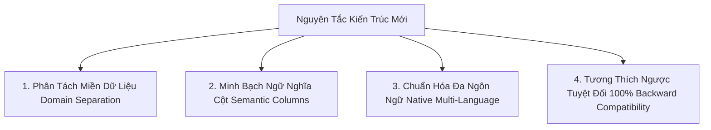
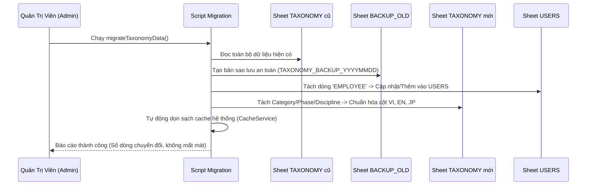

# KẾ HOẠCH NÂNG CẤP & CHUẨN HÓA DANH MỤC TIÊU CHUẨN (TAXONOMY) ĐA NGÔN NGỮ

> **Dự án:** Quản Lý Dự Án & Tiến Độ Google Apps Script WebApp  
> **Tài liệu:** Kế hoạch kiến trúc & Chuẩn hóa cơ sở dữ liệu danh mục  
> **Phiên bản:** v3.8  
> **Ngôn ngữ hỗ trợ:** 🇻🇳 Tiếng Việt (`vi`), 🇺🇸 Tiếng Anh (`en`), 🇯🇵 Tiếng Nhật (`ja`)  
> **Trạng thái:** Bản kế hoạch chi tiết (Chờ duyệt trước khi triển khai code)

---

## I. BỐI CẢNH & SỰ CẦN THIẾT PHẢI NÂNG CẤP

### 1. Hiện trạng kiến trúc cũ
Hiện tại, toàn bộ dữ liệu danh mục quản trị từ `Taxonomyapi.gs` đang được dồn vào **duy nhất 1 worksheet** (`TAXONOMY`) với các cột chung:
`[ID, Type, Code, Name, Description, Extra1, Extra2, Status, CreatedAt, Extra3]`

### 2. Các rủi ro và "mùi code" (Technical Debts) đã xác định:
1. **Hội chứng "Cột vô danh" (`Extra1`, `Extra2`, `Extra3`):**
   - Cột `Extra1`: Chứa Mã màu HEX cho Category/Discipline, chứa Năm (`2026`) cho Project Code, chứa Email cho Employee.
   - Cột `Extra2`: Chứa Tên tiếng Nhật cho Category/Phase/Discipline, chứa link bảng tính cá nhân cho Employee, chứa Tên rút gọn cho Project Code.
   - Cột `Extra3`: Chứa Phân quyền (`Admin`/`Member`) cho Employee, chứa Tháng/STT cho Project Code.
   - 👉 *Hậu quả:* Người dùng mở Google Sheet không thể hiểu ý nghĩa cột, cực kỳ dễ ghi đè sai lệch dữ liệu.
2. **Xung đột ngôn ngữ (Language Inconsistency):**
   - Cột `Name` đang bị "lai tạp": Hàng thì ghi tiếng Anh (`General`, `Basic Design`), hàng thì ghi tiếng Việt (`Dựng hình kiến trúc`), hàng lại ghi tiếng Anh (`Point cloud processing`).
   - Tiếng Nhật bị giấu dưới cột mang tên `Extra2`.
   - Khi chuyển đổi giao diện sang Tiếng Anh (`en`) hay Tiếng Nhật (`ja`), hệ thống không thể tự động map nhãn chuẩn xác hoặc phải hardcode ở frontend.
3. **Vi phạm ranh giới dữ liệu & Rủi ro bảo mật:**
   - Dữ liệu nhân sự nhạy cảm (`EMPLOYEE`: email, link sheet cá nhân, quyền Admin) nằm chung với dữ liệu danh mục công khai (`CATEGORY`, `DISCIPLINE`).
   - Hệ thống vốn có sheet `USERS`, nhưng lại nhét thêm `EMPLOYEE` vào `TAXONOMY` rồi phải viết hàm đồng bộ `syncEmployeeToUsersSheet()`, tạo ra **"2 nguồn chân lý"** dễ lệch pha.

---

## II. NGUYÊN TẮC THIẾT KẾ KIẾN TRÚC MỚI

Nhằm khắc phục triệt để các vấn đề trên mà vẫn giữ được hiệu năng cao của Google Apps Script, hệ thống tuân thủ **4 nguyên tắc vàng**:



1. **Phân tách miền dữ liệu (Domain Separation):**
   - **`TAXONOMY`**: Chỉ giữ đúng bản chất là Danh mục công việc kỹ thuật (`CATEGORY`, `PHASE`, `DISCIPLINE`).
   - **`USERS`**: Đưa toàn bộ nhân sự, email, quyền hạn, link sheet về duy nhất một bảng `USERS`. Xóa bỏ vĩnh viễn type `EMPLOYEE` khỏi `TAXONOMY`.
   - **`PROJECT_CODES`**: Tách thành danh mục mã dự án độc lập hoặc tích hợp trực tiếp vào module Dự án.
2. **Minh bạch ngữ nghĩa (Semantic Columns):**
   - Khai tử hoàn toàn các cột `Extra1`, `Extra2`, `Extra3`. Thay bằng các cột có tên rõ ràng: `Name_VI`, `Name_EN`, `Name_JP`, `Color_Hex`, `Order`.
3. **Chuẩn hóa đa ngôn ngữ (Native Multi-Language Architecture):**
   - Hỗ trợ song song 3 ngôn ngữ chính thống: Tiếng Việt (Bản ngữ đội ngũ), Tiếng Anh (Tiêu chuẩn kỹ thuật quốc tế), Tiếng Nhật (Khách hàng & Đối tác dự án).
   - Cơ chế Fallback tự động: Nếu một ngôn ngữ chưa kịp điền, hệ thống sẽ tự động hiển thị theo thứ tự ưu tiên: `Ngôn ngữ chọn` ➔ `Name_VI` ➔ `Name_EN` ➔ `Code`.
4. **Tương thích ngược tuyệt đối (100% Backward Compatibility):**
   - Giữ nguyên toàn bộ mã khóa chính (`ID` và `Code` như `CAT_M3`, `PH_BD`, `DISC_AR`, tiền tố `[M3-BD-AR]`).
   - Mọi Task cũ, Timesheet cũ và Dự án cũ không bị ảnh hưởng.

---

## III. THIẾT KẾ CƠ SỞ DỮ LIỆU CHUẨN HÓA

### 1. Bảng `TAXONOMY` (Danh mục Phân loại Công việc Chuẩn)

Sheet này chỉ phục vụ cho việc phân loại Task, báo cáo năng suất, và tiền tố tên nhiệm vụ.

#### Cấu trúc bảng (Schema):
| STT | Tên Cột | Tên Thuộc Tính API | Kiểu Dữ Liệu | Bắt Buộc | Mô Tả & Ví Dụ |
| :---: | :--- | :--- | :---: | :---: | :--- |
| **A** | `ID` | `id` | String | Có | Khóa chính duy nhất (VD: `CAT_M3`, `PH_BD`, `DISC_AR`) |
| **B** | `Type` | `type` | String | Có | Phân loại: `CATEGORY`, `PHASE`, `DISCIPLINE` |
| **C** | `Code` | `code` | String | Có | Mã viết tắt (VD: `M3`, `BD`, `AR`, `STR`) |
| **D** | `Name_VI` | `name_vi` | String | Có | Tên Tiếng Việt (VD: `Dựng hình kiến trúc`) |
| **E** | `Name_EN` | `name_en` | String | Có | Tên Tiếng Anh (VD: `Architecture Modeling`) |
| **F** | `Name_JP` | `name_jp` | String | Tùy chọn | Tên Tiếng Nhật (VD: `建築モデリング`) |
| **G** | `Description`| `desc` | String | Tùy chọn | Diễn giải chi tiết nội dung công việc |
| **H** | `Color_Hex` | `color` | String | Tùy chọn | Mã màu hiển thị Badge/Tag (VD: `#4f6ef7`) |
| **I** | `Sort_Order` | `sortOrder` | Number | Có | Thứ tự hiển thị trên Dropdown (1, 2, 3...) |
| **J** | `Status` | `status` | String | Có | Trạng thái: `Active` hoặc `Inactive` |
| **K** | `UpdatedAt` | `updatedAt` | DateTime | Có | Thời gian cập nhật gần nhất |

#### Bảng dữ liệu mẫu sau khi chuẩn hóa:
```
+----------+------------+------+----------------------+-------------------------+----------------------+---------+-------+--------+
| ID       | Type       | Code | Name_VI              | Name_EN                 | Name_JP              | Color   | Order | Status |
+----------+------------+------+----------------------+-------------------------+----------------------+---------+-------+--------+
| CAT_GE   | CATEGORY   | GE   | Công việc chung      | General                 | 全般・一般業務        | #64748b | 1     | Active |
| CAT_DE   | CATEGORY   | DE   | Phát triển & Tool    | Development             | 開発・自動化          | #8b5cf6 | 2     | Active |
| CAT_PC   | CATEGORY   | PC   | Xử lý Point Cloud    | Point Cloud             | 点群処理              | #06b6d4 | 3     | Active |
| CAT_M3   | CATEGORY   | M3   | Dựng hình 3D BIM     | 3D Modeling             | 3Dモデリング          | #4f6ef7 | 4     | Active |
| PH_BD    | PHASE      | BD   | Thiết kế cơ sở       | Basic Design            | 基本設計              | #3b82f6 | 1     | Active |
| PH_DD    | PHASE      | DD   | Thiết kế chi tiết    | Detail Design           | 詳細設計              | #10b981 | 2     | Active |
| PH_IS    | PHASE      | IS   | Nghiệm thu & Kiểm tra| Inspection              | 検査・検収            | #f59e0b | 3     | Active |
| DISC_AR  | DISCIPLINE | AR   | Dựng hình kiến trúc  | Architecture Modeling   | 建築モデリング        | #4f6ef7 | 1     | Active |
| DISC_STR | DISCIPLINE | STR  | Dựng hình kết cấu    | Structure Modeling      | 構造モデリング        | #06b6d4 | 2     | Active |
| DISC_MP  | DISCIPLINE | MP   | Dựng hình cơ điện    | Mechanical & Piping     | 設備・配管モデリング  | #8b5cf6 | 3     | Active |
| DISC_ELE | DISCIPLINE | ELE  | Dựng hình hệ điện    | Electrical Modeling     | 電気設備モデリング    | #f59e0b | 4     | Active |
| DISC_PCP | DISCIPLINE | PCP  | Xử lý dữ liệu point  | Point cloud processing  | 点群データ処理        | #10b981 | 5     | Active |
+----------+------------+------+----------------------+-------------------------+----------------------+---------+-------+--------+
```

---

### 2. Bảng `PROJECT_CODES` (Danh mục Mã Dự Án Chuẩn Hóa)

Tách riêng khỏi `TAXONOMY` để quản lý danh sách công trình theo quy chuẩn `[NĂM]-[STT]-[MÃ_TÊN]`.

#### Cấu trúc bảng:
| Cột | Tên Trường | Kiểu Dữ Liệu | Diễn Giải | Ví Dụ |
| :---: | :--- | :---: | :--- | :--- |
| **A** | `ID` | String | Khóa chính | `PJC_2026_01_HAG01` |
| **B** | `Year` | Number | Năm triển khai | `2026` |
| **C** | `OrderNo` | String | Số thứ tự trong năm (2 số) | `01`, `02`, `03` |
| **D** | `Code` | String | Mã dự án viết tắt | `HAG01`, `JJK01` |
| **E** | `Name_VI` | String | Tên tiếng Việt công trình | `Trạm xử lý nước thải Hanamigawa` |
| **F** | `Name_JP` | String | Tên tiếng Nhật công trình | `花見川終末処理場` |
| **G** | `FullDisplay`| String | Tên ghép hoàn chỉnh hiển thị | `2026-01-HAG01_花見川終末処理場` |
| **H** | `Status` | String | Trạng thái | `Active`, `Closed` |

---

### 3. Bảng `USERS` (Quản Lý Nhân Sự Tập Trung & Bảo Mật)

Toàn bộ dữ liệu nhân viên từ `TAXONOMY` (Type `EMPLOYEE`) sẽ được di chuyển sang bảng này, chấm dứt hoàn toàn tình trạng 2 bảng nhân sự.

#### Cấu trúc bảng `USERS` chuẩn:
| Cột | Tên Cột | Kiểu Dữ Liệu | Ý Nghĩa |
| :---: | :--- | :---: | :--- |
| **A** | `EmpCode` | String | Mã nhân viên (VD: `V01007`, `NV001`) |
| **B** | `Email` | String | Email Google đăng nhập (Primary Key) |
| **C** | `FullName` | String | Họ và tên nhân viên |
| **D** | `Role` | String | Phân quyền 4 cấp: `Admin`, `Leader`, `PJ_Lead`, `Member` |
| **E** | `Position` | String | Chức danh chuyên môn (VD: `Sub Lead`, `BIM Modeler`) |
| **F** | `SheetUrl` | String | Link Google Sheet bảng chấm công cá nhân |
| **G** | `Status` | String | `Active`, `Inactive` |
| **H** | `CreatedAt`| DateTime | Ngày tạo hồ sơ |

---

## IV. CƠ CHẾ HIỂN THỊ ĐA NGÔN NGỮ (I18N COMPATIBILITY)

### 1. Hàm Getter thông minh tại Frontend (`Index.html`)
Khi render giao diện hoặc nạp dropdown, WebApp sử dụng hàm resolver thống nhất:

```javascript
/**
 * Lấy tên hiển thị theo ngôn ngữ hiện tại của người dùng
 * @param {Object} item - Đối tượng Taxonomy
 * @param {string} lang - Ngôn ngữ đang chọn ('vi', 'en', 'ja')
 * @returns {string} Tên hiển thị chuẩn xác
 */
function getTaxonomyName(item, lang) {
  if (!item) return "";
  const currentLang = lang || S.currentLang || "vi";

  // Thứ tự ưu tiên Fallback:
  if (currentLang === "ja") {
    return item.name_jp || item.name_en || item.name_vi || item.name || item.code;
  }
  if (currentLang === "en") {
    return item.name_en || item.name_vi || item.name_jp || item.name || item.code;
  }
  // Mặc định là Tiếng Việt:
  return item.name_vi || item.name_en || item.name || item.code;
}
```

### 2. Tương thích với các bản ghi Task hiện có
* Trong bảng `TASKS`, tên nhiệm vụ đang lưu tiền tố: `[M3-BD-AR] Dựng hình sàn tầng 2`.
* Tiền tố này dùng **`Code`** cố định (`M3`, `BD`, `AR`), đây là các mã định danh trung lập ngôn ngữ (Language-agnostic).
* Dù giao diện chuyển sang Tiếng Việt, Tiếng Anh hay Tiếng Nhật, tiền tố `[M3-BD-AR]` vẫn giữ nguyên, nhưng nhãn tooltip hoặc badge trên Task Card sẽ đổi theo ngôn ngữ:
  - Khi xem bằng 🇻🇳: `[Dựng hình 3D - Thiết kế cơ sở - Kiến trúc]`
  - Khi xem bằng 🇺🇸: `[3D Modeling - Basic Design - Architecture]`
  - Khi xem bằng 🇯🇵: `[3Dモデリング - 基本設計 - 建築]`

---

## V. KẾ HOẠCH DI CHUYỂN DỮ LIỆU TỰ ĐỘNG (DATA MIGRATION)

Để đảm bảo chuyển đổi an toàn 100%, một hàm di trú dữ liệu (`migrateTaxonomyData()`) sẽ được chạy ngầm tự động trong Google Apps Script:

### 1. Quy trình thực hiện:


### 2. Quy tắc ánh xạ dữ liệu (Field Mapping Rules):
* **Nếu dòng là `EMPLOYEE`:**
  - `Code` ➔ `EmpCode`
  - `Extra1` ➔ `Email`
  - `Name` ➔ `FullName`
  - `Description` ➔ `Position`
  - `Extra2` ➔ `SheetUrl`
  - `Extra3` ➔ `Role` (`Admin`, `Leader`, `PJ_Lead`, `Member`)
  - Chuyển hẳn sang sheet `USERS`.
* **Nếu dòng là `CATEGORY`, `PHASE`, `DISCIPLINE`:**
  - `ID`, `Type`, `Code` ➔ Giữ nguyên 100%.
  - `Extra2` ➔ Chuyển thành `Name_JP`.
  - `Extra1` ➔ Chuyển thành `Color_Hex`.
  - `Name` & `Description` ➔ Được phân bổ thông minh vào `Name_VI` và `Name_EN`:
    - Với Category (`General`, `Develop`...): `Name` cũ là tiếng Anh ➔ Đưa vào `Name_EN`, dịch nghĩa chuẩn đưa vào `Name_VI`.
    - Với Phase (`Basic Design`...): `Name` cũ là tiếng Anh ➔ Đưa vào `Name_EN`, `Desc` cũ (`Thiết kế cơ sở`) ➔ Đưa vào `Name_VI`.
    - Với Discipline (`Dựng hình kiến trúc`...): `Name` cũ là tiếng Việt ➔ Đưa vào `Name_VI`, chuẩn hóa tiếng Anh tương ứng ➔ Đưa vào `Name_EN`.

---

## VI. CẬP NHẬT CÁC MODULE CODE LIÊN QUAN

### 1. File `Taxonomyapi.gs`
* Cập nhật hàm `initTaxonomySheet()`: Tạo sheet mới với 11 cột chuẩn thay vì 10 cột có `Extra1/2/3`.
* Cập nhật hàm `getTaxonomyDataInternal()`: Đọc các cột `name_vi`, `name_en`, `name_jp`, `color`, `order`.
* Cập nhật hàm `saveTaxonomyItem()`: Nhận payload gồm cả 3 trường ngôn ngữ và mã màu. Bỏ hẳn đoạn code `syncEmployeeToUsersSheet()`.
* Bổ sung cơ chế phân quyền: **Chỉ có Admin mới có quyền Thêm/Sửa/Xóa** danh mục Master Taxonomy.

### 2. File `Index.html` (Giao diện Quản trị & Nhập liệu)
* Cập nhật Modal Thêm/Sửa Taxonomy (`#m-tax-item`):
  - Form nhập liệu có 3 ô ngôn ngữ rõ ràng:
    + 🇻🇳 **Tên Tiếng Việt** (`input#tax-name-vi`)
    + 🇺🇸 **Tên Tiếng Anh** (`input#tax-name-en`)
    + 🇯🇵 **Tên Tiếng Nhật** (`input#tax-name-jp`)
  - Ô chọn bảng màu trực quan (`input[type="color"]` hoặc palette màu có sẵn).
* Tab **Nhân sự** trong giao diện: Chuyển hướng nạp dữ liệu trực tiếp từ `S.users` thay vì lấy từ `S.taxonomy.employees`.

---

## VII. LỘ TRÌNH THỰC HIỆN TỪNG BƯỚC

| Giai Đoạn | Công Việc Cụ Thể | Thời Gian Dự Kiến | Kết Quả Đầu Ra |
| :--- | :--- | :---: | :--- |
| **Giai đoạn 1: Duyệt kế hoạch** | Xem xét kế hoạch kiến trúc và xác nhận cấu trúc bảng mới | 0.5 ngày | Bản kế hoạch được phê duyệt |
| **Giai đoạn 2: Migration Script** | Viết script sao lưu tự động & chuyển đổi dữ liệu an toàn | 0.5 ngày | Hàm `runMigrationTaxonomy()` chạy kiểm thử trên sheet backup |
| **Giai đoạn 3: Cập nhật Backend** | Cập nhật `Taxonomyapi.gs`, tối ưu hóa đọc/ghi cache | 1 ngày | API trả về JSON chuẩn đa ngôn ngữ |
| **Giai đoạn 4: Cập nhật Frontend** | Sửa modal quản trị, cập nhật hàm hiển thị theo ngôn ngữ chọn | 1 ngày | Giao diện hiển thị mượt mà trên cả 3 cờ VI, EN, JA |
| **Giai đoạn 5: Kiểm thử & Bàn giao** | Kiểm thử tạo Task mới, sửa Task cũ, đổi ngôn ngữ, xuất báo cáo | 0.5 ngày | Hệ thống vận hành hoàn hảo, không còn cột "Extra" |

---

## VIII. KẾT LUẬN

Việc chuẩn hóa này giải quyết dứt điểm 3 điểm nghẽn lớn nhất của hệ thống:
1. **Xóa bỏ hoàn toàn "cột rác" `Extra1/2/3`**: Dữ liệu trên Google Sheet trở nên minh bạch, chuyên nghiệp và tự giải thích (self-explanatory).
2. **Chuẩn hóa đa ngôn ngữ triệt để**: Phục vụ hoàn hảo cho mô hình cộng tác đa quốc gia (Kỹ sư Việt Nam - Tiêu chuẩn quốc tế Tiếng Anh - Khách hàng Nhật Bản).
3. **Bảo mật & Tinh gọn**: Trả nhân sự về đúng sheet `USERS`, trả danh mục kỹ thuật về `TAXONOMY`, chấm dứt tình trạng dữ liệu phân tán.
