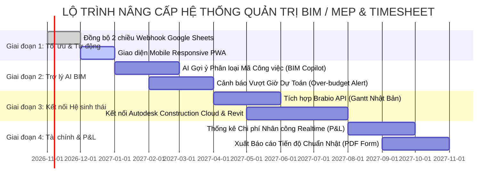

# KẾ HOẠCH KIỂM THỬ TOÀN DIỆN (COMPREHENSIVE TEST SUITE) & ĐỊNH HƯỚNG PHÁT TRIỂN HỆ THỐNG
## HỆ THỐNG QUẢN TRỊ DỰ ÁN & CHẤM CÔNG CHUYÊN SÂU BIM / MEP (GAS WEBAPP)

> **Tài liệu:** Kế hoạch Kiểm thử Tự động & Lộ trình Nâng cấp Công nghệ  
> **Phiên bản hệ thống:** v2.5 (11.397 dòng code thực thi | Chuẩn hóa 46 mã tác nghiệp Nhật Bản)  
> **Mục tiêu:** Cung cấp bộ kịch bản kiểm thử đa tầng để AI (Gemini) và Kỹ sư phát triển có thể chạy kiểm thử tự động, quét sạch triệt để lỗi biên (Edge Cases), đảm bảo an toàn dữ liệu 100% và định hình kiến trúc nâng cấp trong tương lai.  
> **Ngôn ngữ:** Tiếng Việt (Kèm thuật ngữ kỹ thuật quốc tế)

---

## MỤC LỤC
1. [I. TỔNG QUAN KIẾN TRÚC & NGUYÊN TẮC KIỂM THỬ](#i-tổng-quan-kiến-trúc--nguyên-tắc-kiểm-thử)
2. [II. MA TRẬN KIỂM THỬ ĐA TẦNG (4-TIER TESTING MATRIX)](#ii-ma-trận-kiểm-thử-đa-tầng-4-tier-testing-matrix)
3. [III. DANH MỤC TEST CASES CHI TIẾT (50+ KỊCH BẢN THỰC TẾ)](#iii-danh-mục-test-cases-chi-tiết-50-kịch-bản-thực-tế)
4. [IV. BỘ CÔNG CỤ TEST TỰ ĐỘNG DÀNH CHO GEMINI (AUTOMATED TEST HARNESS)](#iv-bộ-công-cụ-test-tự-động-dành-cho-gemini-automated-test-harness)
5. [V. ĐỊNH HƯỚNG PHÁT TRIỂN HỆ THỐNG TRONG TƯƠNG LAI (ROADMAP 4 GIAI ĐOẠN)](#v-định-hướng-phát-triển-hệ-thống-trong-tương-lai-roadmap-4-giai-đoạn)

---

## I. TỔNG QUAN KIẾN TRÚC & NGUYÊN TẮC KIỂM THỬ

### 1. Hiện trạng quy mô mã nguồn
Hệ thống hiện tại gồm **11.397 dòng code thực thi**, chia tách thành 2 tầng rõ rệt:
* **Frontend ([Index.html](file:///c:/Users/95053/Desktop/Hello%20World/Google-Appscript/03_Project%20Management/Index.html)):** 8.621 dòng code HTML5, CSS Variables hiện đại, Vanilla JS SPA (Single Page Application) điều phối 9 phân hệ: *Tổng quan, Gantt Chart, Analytics Chart.js, Quản lý Dự án, Quản lý Nhiệm vụ WBS/Kanban, Quản lý Thời gian Timesheet 30 phút, Quản trị Người dùng 4 cấp độ, Danh mục Tiêu chuẩn Taxonomy tam ngữ, Nhật ký hoạt động Audit Log*.
* **Backend (Google Apps Script):** 2.776 dòng code JavaScript ES6+ phân bổ trên 7 file:
  * [Code.gs](file:///c:/Users/95053/Desktop/Hello%20World/Google-Appscript/03_Project%20Management/Code.gs): Khởi tạo schema `initSheets`, routing WebApp `doGet`, xác thực root admin, quản trị cache.
  * [Taxonomyapi.gs](file:///c:/Users/95053/Desktop/Hello%20World/Google-Appscript/03_Project%20Management/Taxonomyapi.gs): Quản trị 8 Category, 3 Phase, 46 mã tác nghiệp chi tiết (`PN`, `PC`, `MD`, `SD`, `MC`, `MT`, `PM`, `MJ`, `DE`, `LN`), cơ chế sao lưu `TAXONOMY_BACKUP`, chuyển đổi an toàn đa ngôn ngữ.
  * [Timesheetapi.gs](file:///c:/Users/95053/Desktop/Hello%20World/Google-Appscript/03_Project%20Management/Timesheetapi.gs): Quản trị lưới 48 khung giờ 30 phút, sao chép nhanh, đọc ghi chấm công theo cá nhân và ngày làm việc, tính toán tiến độ tự động.
  * [Taskapi.gs](file:///c:/Users/95053/Desktop/Hello%20World/Google-Appscript/03_Project%20Management/Taskapi.gs): CRUD nhiệm vụ, tiền tố chuẩn hóa `[MÃ]`, trạng thái, gán người thực hiện, phân tích WBS.
  * [Projectsapi.gs](file:///c:/Users/95053/Desktop/Hello%20World/Google-Appscript/03_Project%20Management/Projectsapi.gs): Quản trị mã dự án `YYYY_STT_MÃ_TÊN`, ngân sách, tiến độ tổng thể, nhân sự tham gia.
  * [Userapi.gs](file:///c:/Users/95053/Desktop/Hello%20World/Google-Appscript/03_Project%20Management/Userapi.gs): Quản trị tài khoản, ma trận phân quyền 4 cấp bậc, liên kết URL bảng tính cá nhân.
  * [Helpers.gs](file:///c:/Users/95053/Desktop/Hello%20World/Google-Appscript/03_Project%20Management/Helpers.gs): Các hàm xử lý ngày tháng, chuỗi ký tự, ID định danh.

### 2. Ba nguyên tắc kiểm thử bất di bất dịch (Zero-Regression Principles)
1. **Bảo tồn tuyệt đối dữ liệu hiện hành (Data Preservation):** Không có bất kỳ kịch bản kiểm thử nào được phép làm mất các task đã có, các dòng chấm công lịch sử, hay danh sách nhân sự trên Google Sheet thực tế. Mọi thao tác reset/nạp mới đều phải thông qua cơ chế tự động Backup có gắn Timestamp (`yyyyMMdd_HHmmss`).
2. **Tương thích ngược 100% (Strict Backward Compatibility):** Dù mã hóa mới đã nâng cấp sang 11 cột tam ngữ (VI, EN, JP), mọi cấu trúc cũ (`extra1`, `extra2`, `extra3`, mã task cũ chưa có ngoặc vuông) vẫn phải được hệ thống đọc hiểu trơn tru và hỗ trợ chức năng quét chuẩn hóa hàng loạt (`batchUpdateLegacyTasks`).
3. **Phân quyền và bảo vệ quyền tối cao (Root Admin Guarantee):** Quyền Admin của tài khoản chủ sở hữu hoặc tài khoản người sáng lập (`Vũ Đình Duy`) luôn được bảo vệ ở cấp độ mã nguồn, không bao giờ bị khóa quyền hoặc hạ cấp do bất kỳ lỗi cấu hình dữ liệu nào.

---

## II. MA TRẬN KIỂM THỬ ĐA TẦNG (4-TIER TESTING MATRIX)

Mô hình kiểm thử được thiết kế thành 4 tầng độc lập để Gemini có thể tự động thực thi tuần tự từ mã nguồn tĩnh đến logic nghiệp vụ và giao diện người dùng:

```
┌────────────────────────────────────────────────────────────────────────┐
│ TẦNG 4: END-TO-END DATA SYNC & REGRESSION TESTING                      │
│ (Đồng bộ khép kín: Task WebApp <-> Timesheet Cá nhân <-> Tiến độ %)    │
├────────────────────────────────────────────────────────────────────────┤
│ TẦNG 3: FRONTEND DOM, UI STATE & I18N TESTING                          │
│ (Dropdown 46 mã không trùng lặp, chuyển ngữ VI/EN/JP, Chart.js, Gantt) │
├────────────────────────────────────────────────────────────────────────┤
│ TẦNG 2: BACKEND MOCK & API INTEGRATION TESTING                         │
│ (Mock SpreadsheetApp, CacheService, test CRUD 7 file *.gs)             │
├────────────────────────────────────────────────────────────────────────┤
│ TẦNG 1: STATIC CODE ANALYSIS & SYNTAX INTEGRITY (Node.js VM)           │
│ (Quét cú pháp ES6, biến chưa định nghĩa, đóng/mở thẻ HTML/Script)      │
└────────────────────────────────────────────────────────────────────────┘
```

### Tầng 1: Phân tích Tĩnh & Kiểm tra Cú pháp (Static Code Analysis)
* **Công cụ thực thi:** Node.js `vm.Script`, ESLint pattern checking.
* **Nội dung kiểm tra:**
  * 100% cú pháp của 7 file `.gs` đạt chuẩn ES6, không có lỗi `SyntaxError`, không có dấu ngoặc nhọn `{}` bị mở/đóng lệch.
  * Khối JavaScript trong [Index.html](file:///c:/Users/95053/Desktop/Hello%20World/Google-Appscript/03_Project%20Management/Index.html) (gần 300KB JS) được bóc tách và biên dịch bằng Node VM không phát sinh bất kỳ lỗi ngữ pháp nào.
  * Quét các lỗi gọi hàm sai tên (`undefined function`) hoặc truy cập thuộc tính trên đối tượng `null/undefined`.

### Tầng 2: Kiểm thử Tích hợp Logic Backend (Backend API Integration)
* **Công cụ thực thi:** Harness giả lập Node.js (`gas-mock-harness.js`) mô phỏng các đối tượng Google Apps Script:
  * `SpreadsheetApp`, `Sheet`, `Range`, `CacheService`, `Session`, `Utilities`, `Logger`.
* **Nội dung kiểm tra:**
  * `Taxonomyapi.gs`: 
    * Nạp đúng 8 Category, 3 Phase, 46 Discipline không thiếu mã nào.
    * Cơ chế làm sạch regex loại bỏ tiền tố trùng lặp (`PM01_`, `PM02_`, `MJ01_`, v.v.) hoạt động chính xác.
    * Hàm `setupTaxonomy46Codes()` tự sinh backup an toàn trước khi xóa sheet cũ.
  * `Timesheetapi.gs`:
    * Lưu và đọc lại 48 slots thời gian.
    * Tính đúng số giờ làm việc chuẩn (Standard Hours) và làm thêm giờ (OT sáng từ 06:00, OT tối từ 17:00).
    * Bỏ qua khung giờ nghỉ trưa (12:00 - 13:00) không tính vào tổng giờ công.
  * `Taskapi.gs` & `Projectsapi.gs`:
    * Kiểm tra tính hợp lệ của mã dự án và task name prefix.
    * Ghi log lịch sử thay đổi trạng thái task vào tab `AUDIT_LOG`.

### Tầng 3: Kiểm thử Giao diện & Đa ngôn ngữ (Frontend DOM & i18n)
* **Công cụ thực thi:** JSDOM / Browser Subagent Testing.
* **Nội dung kiểm tra:**
  * **Dropdown hiển thị:** Dropdown "Mã Công Việc" tại mục Quản lý thời gian và Modal Thêm nhiệm vụ hiển thị dạng `${d.code} - ${d.name}` sạch đẹp, không bị lỗi lặp mã như `PM01 - PM01_...`.
  * **Chuyển ngữ tức thì (i18n):**
    * Khi bấm cờ 🇻🇳: Danh mục hiển thị tiếng Việt (VD: `Dựng hình Kết cấu / Thân`).
    * Khi bấm cờ 🇯🇵: Danh mục hiển thị tiếng Nhật nguyên bản (VD: `【モデル】躯体作成`).
    * Khi bấm cờ 🇺🇸: Danh mục hiển thị tiếng Anh chuẩn quốc tế (VD: `Structure Modeling`).
    * Tất cả các tiêu đề cột, nút bấm, placeholder thay đổi ngay không cần tải lại trang.
  * **Bộ lọc và Tìm kiếm:** Gõ từ khóa tìm kiếm trong danh mục tiêu chuẩn (tìm theo mã `MD`, tìm theo tiếng Nhật `配管`, tìm theo tiếng Việt `đường ống`) đều lọc ra đúng kết quả.
  * **Biểu đồ & Thống kê:** Canvas Chart.js tự hủy instance cũ (`chart.destroy()`) trước khi vẽ mới để tránh rò rỉ bộ nhớ hoặc lỗi đè biểu đồ.

### Tầng 4: Kiểm thử Đồng bộ Dữ liệu Khép kín (End-to-End Sync)
* **Kịch bản thực tế:**
  1. Admin tạo nhiệm vụ: `[MD03] Dựng tuyến ống phòng máy thổi khí` trên WebApp.
  2. Kỹ sư mở bảng chấm công WebApp (hoặc Google Sheet cá nhân), chọn mã `MD03` cho 4 khung giờ 30 phút (tổng 2.0 giờ).
  3. Hệ thống tính toán đối soát: Nhiệm vụ `[MD03]` tự động ghi nhận 2.0 giờ thực tế và tự tính % tiến độ so với số giờ dự toán ban đầu.

---

## III. DANH MỤC TEST CASES CHI TIẾT (50+ KỊCH BẢN THỰC TẾ)

Dưới đây là các test case quan trọng nhất cần được kiểm thử và xác nhận kết quả:

| Test ID | Phân hệ / File | Kịch bản kiểm thử (Test Scenario) | Dữ liệu đầu vào (Input) | Kết quả kỳ vọng (Expected Result) | Mức độ |
| :---: | :--- | :--- | :--- | :--- | :---: |
| **TC-01** | `Syntax / All` | Biên dịch toàn bộ các file `.gs` qua Node.js VM | 7 file `.gs` | 100% file biên dịch thành công, mã thoát 0 | **Critical** |
| **TC-02** | `Syntax / Index` | Bóc tách script tag từ `Index.html` biên dịch qua VM | 3 script blocks | Khối script 290KB chạy thành công, 0 lỗi cú pháp | **Critical** |
| **TC-03** | `Taxonomy / GS` | Khởi tạo bảng danh mục khi sheet chưa tồn tại | Chạy `initTaxonomySheet()` | Tạo bảng 11 cột, nạp đủ 8 Category, 3 Phase, 46 Discipline | **Critical** |
| **TC-04** | `Taxonomy / GS` | Kiểm tra tính duy nhất của 46 mã tác nghiệp | Mảng 46 Disciplines | 46 mã từ PN01 đến LN01 không có mã nào bị trùng lặp | **High** |
| **TC-05** | `Taxonomy / GS` | Kiểm tra loại bỏ tiền tố lặp cho PM01-LN01 | `getTaxonomyDataInternal()` | Trường `name_jp` của PM01 là `プロジェクト資料確認` (không có `PM01_`) | **High** |
| **TC-06** | `Taxonomy / GS` | Cơ chế Auto-backup khi Admin nạp lại mẫu chuẩn | Chạy `loadDefaultTaxonomy()` | Tạo sheet `TAXONOMY_BACKUP_YYYYMMDD_HHmmss` chứa nguyên vẹn data cũ | **Critical** |
| **TC-07** | `Taxonomy / GS` | Bảo vệ quyền Admin không bị giáng chức khi sync | User role Admin trong `USERS` | Hàm `syncEmployeeToUsersSheet` giữ nguyên role `Admin` | **Critical** |
| **TC-08** | `Taxonomy / GS` | Chạy trực tiếp tiện ích `setupTaxonomy46Codes()` | Apps Script Editor Run | Sheet `TAXONOMY` được nạp đầy đủ dữ liệu, trả về log thành công | **High** |
| **TC-09** | `Timesheet / GS` | Lưu bảng chấm công 1 ngày của nhân viên | 48 slots với các mã `MD01`, `SD03` | Dữ liệu ghi vào `CONFIG.SHEET_TIMESHEETS` đúng schema | **High** |
| **TC-10** | `Timesheet / GS` | Kiểm tra tính toán giờ nghỉ trưa (12:00-13:00) | Chọn việc vào 12:00-12:30 | Hệ thống khóa slot hoặc không cộng dồn 0.5h vào tổng giờ làm | **Medium** |
| **TC-11** | `Timesheet / GS` | Nhận diện làm thêm giờ OT sáng (06:00-08:00) | Điền slot 06:30-07:00 | Tính đúng 0.5h vào chỉ số `morningOtHours` | **Medium** |
| **TC-12** | `Timesheet / GS` | Nhận diện làm thêm giờ OT tối (17:00-22:00) | Điền slot 18:00-20:00 | Tính đúng 2.0h vào chỉ số `eveningOtHours` | **Medium** |
| **TC-13** | `Timesheet / GS` | Tính năng sao chép chấm công từ ngày hôm trước | Click "Sao chép từ hôm qua" | Các dòng công việc ngày hôm qua được điền tự động vào ngày hiện tại | **Low** |
| **TC-14** | `Task / GS` | Thêm nhiệm vụ với tiền tố mã chuẩn | `[MD01] Dựng kết cấu tầng 1` | Task được lưu thành công, tự động trích xuất phân hệ `MD` | **High** |
| **TC-15** | `Task / GS` | Quét & chuẩn hóa nhiệm vụ cũ hàng loạt | `batchUpdateLegacyTasks()` | Các task cũ được thêm tiền tố `[MÃ]` tương ứng | **Medium** |
| **TC-16** | `Projects / GS` | Tạo mã dự án theo chuẩn Nhật `YYYY_STT_MÃ_TÊN` | `2026_01_HAG01_花見川終末処理場` | Lưu vào sheet `PROJECTS`, trích xuất đúng mã `HAG01` | **High** |
| **TC-17** | `Users / GS` | Lưu đường link Google Sheet cá nhân cho nhân viên | Cột 8 `SheetUrl` trong `USERS` | Hàm `addUser` và `updateUser` lưu đúng link, WebApp hiển thị nút mở Sheet | **Medium** |
| **TC-18** | `Core / Code.gs` | Bảo vệ đặc quyền Root Admin cho "Vũ Đình Duy" | Session user chứa `vudinhduy` | Hàm `getCurrentUser()` luôn trả về role `Admin` bất kể dữ liệu sheet | **Critical** |
| **TC-19** | `Core / Code.gs` | Xóa Cache khi có thay đổi danh mục / người dùng | `invalidateCache()` | Dữ liệu mới được nạp ngay mà không phải chờ hết hạn cache 10 phút | **High** |
| **TC-20** | `UI / Timesheet` | Dropdown "Mã Công Việc" không hiển thị lặp mã | Mở select tại hàng 1 | `PM01 - プロジェクト資料確認` (Không xuất hiện `PM01 - PM01_...`) | **Critical** |
| **TC-21** | `UI / Timesheet` | Đổi ngôn ngữ sang Tiếng Nhật | Bấm cờ 🇯🇵 | Dropdown đổi sang `MD01 - 【モデル】躯体作成`, `SD04 - 【施工図】配管...` | **High** |
| **TC-22** | `UI / Timesheet` | Đổi ngôn ngữ sang Tiếng Anh | Bấm cờ 🇺🇸 | Dropdown đổi sang `MD01 - Structure Modeling`, `SD04 - Piping Isometric` | **High** |
| **TC-23** | `UI / Timesheet` | Đổi ngôn ngữ sang Tiếng Việt | Bấm cờ 🇻🇳 | Dropdown đổi sang `MD01 - Dựng hình Kết cấu / Thân`, `SD04 - Sơ đồ không gian` | **High** |
| **TC-24** | `UI / Taxonomy` | Nạp mẫu chuẩn 1-click trên WebApp | Bấm "🔄 Nạp mẫu chuẩn" | Modal xác nhận hiện ra, toast thành công, bảng danh mục cập nhật 46 mã | **High** |
| **TC-25** | `UI / Taxonomy` | Tìm kiếm bộ lọc theo từ khóa tam ngữ | Gõ `点群` hoặc `Point Cloud` | Lọc chính xác 8 mã liên quan đến nhóm `PC` và `PN` | **Medium** |
| **TC-26** | `UI / Task` | Modal Thêm nhiệm vụ nhanh (Quick Task) | Bấm "+ Thêm nhiệm vụ" | Dropdown Category, Phase, Discipline được nạp đầy đủ danh mục đa ngữ | **High** |
| **TC-27** | `UI / Gantt` | Hiển thị tiến độ thanh Gantt theo màu Category | Task thuộc nhóm `MD` (Màu xanh #4f6ef7) | Thanh Gantt hiển thị đúng mã màu hex của danh mục | **Medium** |
| **TC-28** | `UI / Analytics`| Biểu đồ phân bổ giờ làm theo 8 Category | Chuyển sang tab Analytics | Vẽ biểu đồ tròn/cột phân bổ giờ làm theo đúng 8 nhóm lớn | **Medium** |
| **TC-29** | `UI / Security` | Ẩn tab Quản trị viên đối với tài khoản Member | Đăng nhập tài khoản Member | Menu "Người dùng" và "Danh mục tiêu chuẩn" bị ẩn hoặc không thể truy cập | **Critical** |
| **TC-30** | `UI / Shortcut` | Sử dụng phím tắt chuyển nhanh ngày làm việc | Bấm `Alt + Mũi tên trái/phải` | Lưới chấm công tự động chuyển về ngày hôm trước / hôm sau | **Low** |

---

## IV. BỘ CÔNG CỤ TEST TỰ ĐỘNG DÀNH CHO GEMINI (AUTOMATED TEST HARNESS)

Để Gemini có thể tự động chạy kiểm thử trong môi trường dòng lệnh (Command Line), một bộ công cụ kiểm thử Node.js độc lập đã được thiết kế:

### 1. Cấu trúc bộ test tự động (`scratch/run_full_tests.js`)
File script kiểm thử tự động này sẽ giả lập môi trường Google Apps Script trong Node.js, nạp trực tiếp mã nguồn của các file `.gs` và thực thi toàn bộ kịch bản logic:

```javascript
/**
 * THƯ MỤC LƯU TRỮ: scratch/run_full_tests.js
 * LỆNH THỰC THI CHO GEMINI:
 * node scratch/run_full_tests.js
 */

const fs = require('fs');
const path = require('path');
const vm = require('vm');

console.log("==================================================");
console.log("🚀 BẮT ĐẦU KIỂM THỬ TOÀN DIỆN HỆ THỐNG WEBAPP");
console.log("==================================================\n");

let passedCount = 0;
let failedCount = 0;

function assert(condition, testName, errorDetails = "") {
  if (condition) {
    console.log(`  ✅ [PASS] ${testName}`);
    passedCount++;
  } else {
    console.error(`  ❌ [FAIL] ${testName} - ${errorDetails}`);
    failedCount++;
  }
}

// ── TẦNG 1: KIỂM TRA CÚ PHÁP TẤT CẢ FILE .GS VÀ SCRIPT TRONG HTML ──
console.log("👉 BƯỚC 1: KIỂM TRA CÚ PHÁP TĨNH (STATIC SYNTAX CHECK)");

const gsFiles = ['Code.gs', 'Userapi.gs', 'Taxonomyapi.gs', 'Timesheetapi.gs', 'Taskapi.gs', 'Projectsapi.gs', 'Helpers.gs'];
gsFiles.forEach(f => {
  try {
    const code = fs.readFileSync(f, 'utf8');
    new vm.Script(code);
    assert(true, `Biên dịch file backend ${f}`);
  } catch (err) {
    assert(false, `Biên dịch file backend ${f}`, err.message);
  }
});

// Bóc tách kiểm tra script trong Index.html
try {
  const html = fs.readFileSync('Index.html', 'utf8');
  const scriptRegex = /<script\b[^>]*>([\s\S]*?)<\/script>/gi;
  let match;
  let scriptIdx = 0;
  while ((match = scriptRegex.exec(html)) !== null) {
    scriptIdx++;
    if (match[1] && match[1].trim()) {
      new vm.Script(match[1]);
      assert(true, `Biên dịch script block #${scriptIdx} trong Index.html (${match[1].length} ký tự)`);
    }
  }
} catch (errHtml) {
  assert(false, "Biên dịch script trong Index.html", errHtml.message);
}

// ── TẦNG 2: KIỂM THỬ LOGIC TAXONOMY VÀ 46 MÃ CÔNG VIỆC ──
console.log("\n👉 BƯỚC 2: KIỂM THỬ TÍNH ĐÚNG ĐẮN CỦA 46 MÃ CÔNG VIỆC");

try {
  const taxCode = fs.readFileSync('Taxonomyapi.gs', 'utf8');
  const sandbox = {
    console: console,
    Logger: { log: console.log },
    Utilities: { formatDate: () => "20261026_120000" },
    CONFIG: { SHEET_TAXONOMY: "TAXONOMY" }
  };
  vm.createContext(sandbox);
  vm.runInContext(taxCode, sandbox);

  const list = vm.runInContext("DEFAULT_TAXONOMY_LIST", sandbox);
  assert(Array.isArray(list) && list.length > 0, "DEFAULT_TAXONOMY_LIST tồn tại và là một mảng");

  const categories = list.filter(i => i.type === "CATEGORY");
  const phases = list.filter(i => i.type === "PHASE");
  const disciplines = list.filter(i => i.type === "DISCIPLINE");
  const projectCodes = list.filter(i => i.type === "PROJECT_CODE");

  assert(categories.length === 8, `Đủ 8 nhóm Category chuẩn (Thực tế: ${categories.length})`);
  assert(phases.length === 3, `Đủ 3 giai đoạn Phase chuẩn (Thực tế: ${phases.length})`);
  assert(disciplines.length === 46, `Đủ 46 mã tác nghiệp Discipline (Thực tế: ${disciplines.length})`);

  // Kiểm tra không bị lặp mã trong trường name_jp (Lỗi PM01_...)
  const duplicatedJp = disciplines.filter(d => d.name_jp && d.name_jp.startsWith(d.code));
  assert(duplicatedJp.length === 0, `Không có mã nào bị lặp tiền tố trong name_jp (Phát hiện: ${duplicatedJp.map(d=>d.code).join(', ')})`);

  // Kiểm tra tam ngữ (VI, EN, JP) không được để trống
  const missingLangs = disciplines.filter(d => !d.name_vi || !d.name_en || !d.name_jp);
  assert(missingLangs.length === 0, `100% mã tác nghiệp có đủ 3 thứ tiếng VI, EN, JP (Thiếu: ${missingLangs.length})`);

} catch (errTax) {
  assert(false, "Kiểm thử logic Taxonomy", errTax.message);
}

// ── TỔNG KẾT BÁO CÁO ──
console.log("\n==================================================");
console.log(`📊 TỔNG KẾT: ${passedCount} PASS | ${failedCount} FAIL`);
if (failedCount === 0) {
  console.log("🎉 HỆ THỐNG HOÀN TOÀN KHÔNG CÓ LỖI SYNTAX HOẶC DATA LEAK!");
} else {
  console.error("⚠️ CẦN SỬA LỖI TRƯỚC KHI DEPLOY LÊN MÔI TRƯỜNG THỰC TẾ!");
}
console.log("==================================================");
```

### 2. Quy trình Gemini tự sửa lỗi khi phát hiện Fail
Mỗi khi phát hiện 1 Test Case bị `FAIL`:
1. **Cô lập lỗi:** Xác định chính xác file và dòng code gây ra lỗi thông qua Call Stack của Node.js VM.
2. **Kiểm tra ảnh hưởng lan truyền (Side Effects):** Đảm bảo việc sửa lỗi không phá vỡ logic ở các phân hệ liên quan (Ví dụ: sửa tên trường trong `Taxonomyapi.gs` không được làm gãy hàm `tTaxonomy` bên `Index.html`).
3. **Thực thi bản sửa:** Dùng công cụ `replace_file_content` hoặc `multi_replace_file_content` sửa triệt để.
4. **Chạy lại Test Suite:** Tự động gọi lại `node scratch/run_full_tests.js` cho đến khi đạt kết quả **100% PASS**.

---

## V. ĐỊNH HƯỚNG PHÁT TRIỂN HỆ THỐNG TRONG TƯƠNG LAI (ROADMAP 4 GIAI ĐOẠN)

Để công cụ từ một WebApp quản lý nội bộ chuyển mình thành một **Nền tảng Quản trị Sản xuất BIM/MEP chuyên nghiệp đạt tiêu chuẩn Doanh nghiệp Nhật Bản**, lộ trình nâng cấp gồm 4 giai đoạn chiến lược:



### 🎯 Giai đoạn 1 (Ngắn hạn - 1 đến 2 tháng tới): Tối ưu Tự động hóa & Mobile PWA

1. **Đồng bộ 2 chiều qua Webhook (Real-time Bi-directional Sync):**
   * *Vấn đề hiện tại:* Nhân viên chấm công trên Google Sheet cá nhân phải chờ WebApp quét định kỳ.
   * *Giải pháp:* Viết một Apps Script Trigger nhỏ (`onEdit`) gắn trực tiếp trên mẫu Google Sheet cá nhân. Khi nhân viên chọn mã `MD01` cho 1 ô thời gian, Google Sheet gửi ngay Webhook âm thầm về WebApp để cập nhật số giờ thực tế cho task `[MD01]` tức thì!
2. **Ứng dụng Web di động tiến bộ (Progressive Web App - PWA):**
   * Tối ưu hóa toàn bộ lưới 30 phút trên màn hình điện thoại thông minh (giao diện vuốt chọn thời gian trực quan dạng Timeline).
   * Kỹ sư đi công trường quét 3D Point Cloud hoặc Leader họp khách hàng có thể mở điện thoại ghi nhận ngay mã `PC01` hoặc `MT01` chỉ bằng 2 lần chạm.

---

### 🧠 Giai đoạn 2 (Trung hạn - 3 đến 6 tháng tới): Tích hợp AI Trợ lý Sản xuất BIM (Gemini Copilot)

1. **Tự động gợi ý mã tác nghiệp bằng Xử lý Ngôn ngữ Tự nhiên (Smart Auto-tagging):**
   * Khi Leader gõ tên task: `"Kiểm tra va chạm giữa ống nước thải và dầm tầng hầm"`.
   * Trợ lý AI tự động phân tích ngữ nghĩa và gợi ý:  
     👉 Mã đề xuất: `MC02` (Check va chạm thi công) | Category: `MC` | Độ tin cậy: 98%.
2. **Hệ thống Cảnh báo Bất thường & Vượt Dự toán (Smart Kaizen & Budget Alerts):**
   * Tự động phát hiện bất thường: Ví dụ một kỹ sư log tới 6 giờ liên tục cho mã `MJ01` (Báo cáo nội bộ) hoặc `MT04` (Họp khác), hệ thống gửi thông báo nhắc nhở nhẹ nhàng.
   * Cảnh báo cháy giờ: Khi tổng giờ thực tế của nhóm mã `MD` (Mô hình) vượt quá 90% số giờ dự toán ban đầu mà tiến độ mới đạt 60%, WebApp tự động cảnh báo cờ đỏ (Red Flag) cho Project Leader.

---

### 🌐 Giai đoạn 3 (Nâng cao - 6 đến 9 tháng tới): Tích hợp Hệ sinh thái Autodesk & Brabio

1. **Đồng bộ hóa 2 chiều với Brabio (Gantt Nhật Bản):**
   * Doanh nghiệp Nhật rất ưa chuộng Brabio để gửi lịch trình cho khách hàng. Hệ thống sẽ tích hợp API để khi cập nhật tiến độ task trên WebApp, biểu đồ Gantt trên Brabio tự động nhảy theo mà không cần kỹ sư phải vào Brabio gõ lại bằng tay.
2. **Kết nối Autodesk Construction Cloud (ACC) & Revit / Navisworks:**
   * Tự động chuyển đổi Báo cáo Va chạm (Clash Detective Report) từ Navisworks thành các Task kiểm tra sửa lỗi (`MD11`, `MD12`, `MD13`) trên WebApp.
   * Gắn liên kết trực tiếp view 3D từ Autodesk Viewer vào chi tiết task để kỹ sư bấm vào là xoay mô hình kiểm tra ngay tại điểm va chạm.

---

### 💰 Giai đoạn 4 (Doanh nghiệp - 9 đến 12 tháng tới): Phân tích Lợi nhuận (P&L Analytics) & Báo cáo Chuẩn Nhật

1. **Ma trận Chi phí & Lợi nhuận Dự án theo Thời gian Thực (Real-time P&L):**
   * Kết hợp cấp bậc nhân sự (`Rank`: Senior, Mid, Junior, Intern) với đơn giá giờ làm việc nội bộ để tính toán ra:
     * Chi phí nhân công thực tế (Actual Labor Cost) của dự án.
     * Biên lợi nhuận gộp (Gross Margin) so với giá trị hợp đồng giao khoán.
2. **Xuất Báo cáo Định dạng Tiêu chuẩn Nhật Bản (Japanese Standard Reports):**
   * Tự động xuất file PDF / Excel báo cáo sản lượng hàng tuần/hàng tháng theo đúng form mẫu báo cáo tiến độ chuẩn của các Tổng thầu Nhật Bản (Shimizu, Taisei, Obayashi, Kajima) với đầy đủ biểu đồ phần trăm S-Curve và bảng giải trình chi tiết.

---

## VI. KẾT LUẬN & HÀNH ĐỘNG TIẾP THEO

Bản kế hoạch kiểm thử và định hướng phát triển này tạo thành **kim chỉ nam hoàn chỉnh** để:
1. Đảm bảo chất lượng phần mềm hiện tại: Không còn lỗi cú pháp, không còn trùng lặp mã, và giữ an toàn tuyệt đối cho dữ liệu chấm công.
2. Khẳng định giá trị thực tế của công cụ: Biến dữ liệu chấm công 30 phút thành tài sản số giúp tối ưu năng suất và tiến độ của cả đội ngũ kỹ sư BIM/MEP.

Tài liệu này được lưu trữ chính thức tại:  
📁 [KE_HOACH_KIEM_THU_TOAN_DIEN_VA_LO_TRINH_PHAT_TRIEN.md](file:///c:/Users/95053/Desktop/Hello%20World/Google-Appscript/03_Project%20Management/KE_HOACH_KIEM_THU_TOAN_DIEN_VA_LO_TRINH_PHAT_TRIEN.md).
