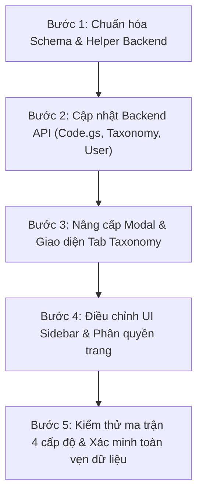

# KẾ HOẠCH NÂNG CẤP PHÂN QUYỀN 4 CẤP ĐỘ VÀ MA TRẬN PHÂN QUYỀN TOÀN HỆ THỐNG

> **Dự án:** Quản Lý Dự Án & Quản Lý Thời Gian (Google Apps Script WebApp)  
> **Phiên bản:** v4.0 RBAC (Role-Based Access Control)  
> **Ngày lập:** 25/10/2026  
> **Tác giả:** Antigravity Engineering  
> **Trạng thái:** Kế hoạch chi tiết trình duyệt  

---

## 1. TỔNG QUAN YÊU CẦU & BỐI CẢNH

Hệ thống hiện tại đang sử dụng mô hình phân quyền sơ khai (`Admin`, `Manager`, `Member`, `Viewer` và `Level2`). Khi quy mô nhân sự phát triển lên **30 - 40 nhân sự** với nhiều dự án chạy song song, cơ chế phân quyền cần được tổ chức lại một cách khoa học thành **4 Cấp độ chuẩn hóa**:

1. **Cấp 1: Admin (Quản trị viên tối cao)**
2. **Cấp 2: Leader (Trưởng bộ phận / Quản lý cấp cao)**
3. **Cấp 3: PJ Lead (Chủ nhiệm dự án / Project Leader)**
4. **Cấp 4: Member (Thành viên / Nhân viên thực hiện)**

Mục tiêu của kế hoạch này là:
- Chuẩn hóa định danh 4 cấp bậc trong cả 2 nguồn: **USERS Sheet** và **TAXONOMY Sheet (Tab Nhân sự)**.
- Xây dựng **Ma trận phân quyền (RACI / Permission Matrix)** chi tiết đến từng nút bấm, API và trường dữ liệu.
- Đảm bảo tương thích ngược 100%, bảo vệ an toàn quyền của Root Admin (không bao giờ bị mất quyền).
- Tích hợp liền mạch với hỗ trợ đa ngôn ngữ (**VI / EN / JA**).

---

## 2. MA TRẬN PHÂN QUYỀN TOÀN HỆ THỐNG (PERMISSION MATRIX)

### Ký hiệu quyền:
- 🟢 **Toàn quyền (Full)**: Xem, tạo, sửa, xóa tất cả dữ liệu trên toàn công ty.
- 🟡 **Quản trị phạm vi (Lead Scope)**: Toàn quyền tạo, sửa, phân công, duyệt trong dự án mà mình được giao làm PJ Lead.
- ⚪ **Xem toàn cảnh (View-only / Read All)**: Được xem đầy đủ tiến độ, danh sách task, sơ đồ Gantt của tất cả các dự án trong công ty để phối hợp liên phòng ban nhưng KHÔNG được sửa/xóa.
- 🔵 **Cá nhân (Own)**: Chỉ áp dụng cho các nhiệm vụ, dữ liệu hoặc bảng tính Timesheet của chính mình.
- ❌ **Không có quyền (Deny)**: Nút bấm và trang bị ẩn hoàn toàn, API từ chối xử lý (`403 Forbidden`).

---

### BẢNG MA TRẬN PHÂN QUYỀN CHI TIẾT (ĐÃ NÂNG CẤP TÍNH CHỦ ĐỘNG CHO PJ LEAD)

| Phân hệ chức năng | Chức năng chi tiết / Thao tác | Cấp 1: Admin | Cấp 2: Leader | Cấp 3: PJ Lead | Cấp 4: Member |
|:---|:---|:---:|:---:|:---:|:---:|
| **1. Tổng quan (Dashboard)** | Xem Dashboard toàn công ty | 🟢 Full | 🟢 Full | ⚪ Xem toàn cảnh | 🔵 Task của mình |
| | Lọc thống kê theo Dự án | 🟢 Full | 🟢 Full | 🟢 Xem mọi dự án | ❌ Deny |
| | Lọc theo khoảng thời gian (Ngày/Tuần/Tháng) | 🟢 Full | 🟢 Full | 🟢 Có | 🔵 Có |
| **2. Quản lý Dự án** | Xem danh sách tất cả dự án công ty | 🟢 Full | 🟢 Full | ⚪ Xem toàn cảnh (Có Badge phân biệt) | 🟡 Dự án tham gia |
| | Thêm mới dự án | 🟢 Full | 🟢 Full | ❌ Deny | ❌ Deny |
| | Sửa thông tin dự án (Tên, ngày, mô tả) | 🟢 Full | 🟢 Full | 🟡 Dự án mình Lead | ❌ Deny |
| | Gán / Đổi PJ Lead cho dự án | 🟢 Full | 🟢 Full | ❌ Deny | ❌ Deny |
| | Thêm / Bớt thành viên trong dự án | 🟢 Full | 🟢 Full | 🟡 Dự án mình Lead | ❌ Deny |
| | Xóa / Lưu trữ dự án | 🟢 Full | ❌ Deny | ❌ Deny | ❌ Deny |
| **3. Quản lý Nhiệm vụ** | Xem danh sách / Kanban mọi dự án | 🟢 Full | 🟢 Full | ⚪ Xem toàn cảnh | 🔵 Task được giao |
| | Tạo nhiệm vụ đơn lẻ | 🟢 Full | 🟢 Full | 🟡 Trong dự án Lead | ❌ Deny |
| | Tạo nhiệm vụ hàng loạt (Bulk Add) | 🟢 Full | 🟢 Full | 🟡 Trong dự án Lead | ❌ Deny |
| | Phân công người làm (Assignee) | 🟢 Full | 🟢 Full | 🟡 Thành viên dự án Lead | ❌ Deny |
| | Sửa Deadline, Độ ưu tiên, Kế hoạch | 🟢 Full | 🟢 Full | 🟡 Trong dự án Lead | ❌ Deny |
| | Cập nhật % tiến độ, Ghi chú, Link kết quả | 🟢 Full | 🟢 Full | 🟡 Trong dự án Lead | 🔵 Task của mình |
| | Duyệt hoàn thành / Chuyển trạng thái | 🟢 Full | 🟢 Full | 🟡 Trong dự án Lead | 🔵 Chỉ gửi duyệt |
| | Xóa nhiệm vụ | 🟢 Full | 🟢 Full | 🟡 Trong dự án Lead | ❌ Deny |
| | Thêm / Xóa nhắc việc (Reminders) | 🟢 Full | 🟢 Full | 🟡 Trong dự án Lead | 🔵 Nhắc việc cá nhân |
| **4. Biểu đồ Gantt** | Xem tiến độ Gantt toàn công ty | 🟢 Full | 🟢 Full | ⚪ Xem toàn bộ Timeline | ❌ Deny |
| | Lọc Gantt theo nhân sự / dự án | 🟢 Full | 🟢 Full | 🟢 Lọc tự do | ❌ Deny |
| | Kéo thả / Đổi ngày trực tiếp trên Gantt | 🟢 Full | 🟢 Full | 🟡 Chỉ kéo task dự án mình Lead | ❌ Deny |
| **5. Báo cáo Phân tích (Analytics)** | Xem biểu đồ & KPI toàn công ty | 🟢 Full | 🟢 Full | ⚪ Xem tổng quan công ty | ❌ Deny |
| | Xem hiệu suất & bảng xếp hạng nhân sự | 🟢 Full | 🟢 Full | ⚪ Xem đánh giá chung | ❌ Deny |
| | Xuất dữ liệu báo cáo | 🟢 Full | 🟢 Full | 🟡 Xuất dự án mình Lead | ❌ Deny |
| **6. Quản lý Thời gian (Timesheet)** | Nhập giờ hàng ngày (Slot 30p, OT sáng/tối) | 🟢 Full | 🟢 Full | 🟢 Full | 🟢 Full |
| | Tự tạo bảng tính Google Sheet cá nhân | 🟢 Full | 🟢 Full | 🟢 Full | 🟢 Full |
| | Xem Timesheet của thành viên khác | 🟢 Full | 🟢 Full | 🟡 Thành viên dự án Lead | ❌ Deny |
| | Khóa / Mở khóa công nhập liệu quá hạn | 🟢 Full | 🟢 Full | ❌ Deny | ❌ Deny |
| | Xuất bảng tổng hợp công | 🟢 Full | 🟢 Full | 🟡 Dự án mình Lead | ❌ Deny |
| **7. Danh mục tiêu chuẩn (Taxonomy)** | Xem Category, Phase, Discipline, Project | 🟢 Full | 🟢 Full | ⚪ Xem tra cứu mã | ⚪ Xem tra cứu mã |
| | Thêm / Sửa / Xóa Category, Phase, Discipline | 🟢 Full | 🟢 Full | ❌ Deny | ❌ Deny |
| | Thêm / Sửa Mã dự án (Project Code) | 🟢 Full | 🟢 Full | ❌ Deny | ❌ Deny |
| | Quản lý Nhân viên & Gán cấp bậc (1, 2, 3, 4)| 🟢 Full | 🟢 Full | ❌ Deny | ❌ Deny |
| | Chuẩn hóa tiền tố Task cũ hàng loạt | 🟢 Full | 🟢 Full | ❌ Deny | ❌ Deny |
| **8. Quản trị Người dùng (Users)** | Xem danh sách người dùng hệ thống | 🟢 Full | ⚪ Xem | ⚪ Xem danh sách & Email | ❌ Deny |
| | Thêm người dùng mới | 🟢 Full | ❌ Deny | ❌ Deny | ❌ Deny |
| | Phân quyền vai trò (Role/Permission) | 🟢 Full | ❌ Deny | ❌ Deny | ❌ Deny |
| | Khóa / Kích hoạt / Xóa tài khoản | 🟢 Full | ❌ Deny | ❌ Deny | ❌ Deny |
| **9. Nhật ký & Hệ thống (Logs/Config)**| Xem Nhật ký hoạt động (Audit Trail) | 🟢 Full | ⚪ Xem | ❌ Deny | ❌ Deny |
| | Đổi ngôn ngữ mặc định hệ thống | 🟢 Full | ❌ Deny | ❌ Deny | ❌ Deny |
| | Đổi ngôn ngữ cá nhân (VI/EN/JA) | 🟢 Full | 🟢 Full | 🟢 Full | 🟢 Full |

---

### 2.1. ĐẶC TẢ CƠ CHẾ: "XEM TOÀN CẢNH - SỬA ĐÚNG THẨM QUYỀN" (READ ALL - WRITE OWN) CHO PJ LEAD

Nhằm giải quyết triệt để tình trạng "cô lập thông tin" (Siloed Vision) khiến PJ Lead rơi vào thế thụ động, hệ thống được thiết kế theo nguyên tắc:

1. **Bộ lọc thông minh 2 chế độ (Toggle Scope View):**
   - Mặc định khi vào trang Dự án hoặc Nhiệm vụ: Tự động hiển thị `📌 Dự án tôi phụ trách (Lead)` để PJ Lead tập trung vào việc quản trị trực tiếp.
   - Bổ sung nút chuyển đổi: `🌐 Xem toàn bộ dự án công ty` để PJ Lead tra cứu tổng thể bất kỳ lúc nào.
2. **Nhận diện trực quan bằng Huy hiệu (Visual Badge Differentiation):**
   - Đối với dự án do PJ Lead làm chủ: Có huy hiệu vàng `👑 Tôi phụ trách` (Đầy đủ nút Sửa, Giao việc, Duyệt task, Thêm thành viên).
   - Đối với dự án của PJ Lead khác: Có huy hiệu xám `👁️ Chế độ tham chiếu / Chỉ xem` (Các nút chỉnh sửa, xóa, duyệt bị ẩn hoặc chuyển sang màu xám mờ).
3. **Phối hợp liên dự án trên Sơ đồ Gantt (Cross-Project Timeline):**
   - PJ Lead xem được toàn bộ thanh tiến độ của các dự án khác trên cùng dòng thời gian Gantt.
   - Giúp PJ Lead nhận biết:
     * Dự án tiền đề (Dependency) đã hoàn thành chưa để triển khai giai đoạn kế tiếp.
     * Tình trạng quá tải nhân sự (Resource Contention): Thành viên chuyên môn (ví dụ chuyên gia dựng hình AR, MP) đang bận ở dự án nào để lên lịch làm việc không bị chồng chéo.

---

## 3. THIẾT KẾ DỮ LIỆU & ĐỒNG BỘ 4 CẤP BẬC

### 3.1. Chuẩn hóa Mã cấp bậc và Tên hiển thị (Đa ngôn ngữ)

| Cấp độ | Mã vai trò (Role Code) | Tên tiếng Việt | English | 日本語 | Màu nhận diện |
|:---:|:---:|:---|:---|:---|:---:|
| **Cấp 1** | `Admin` | Quản trị viên (Cấp 1) | Administrator (Level 1) | システム管理者 (第1階層) | `#ea4335` (Đỏ) |
| **Cấp 2** | `Leader` | Trưởng bộ phận (Cấp 2) | Department Leader (Level 2) | 部門リーダー (第2階層) | `#8b5cf6` (Tím) |
| **Cấp 3** | `PJ_Lead` | Quản lý dự án (Cấp 3) | Project Lead (Level 3) | PJリーダー (第3階層) | `#4f6ef7` (Xanh dương) |
| **Cấp 4** | `Member` | Thành viên (Cấp 4) | Team Member (Level 4) | 一般メンバー (第4階層) | `#10b981` (Xanh lá) |

### 3.2. Cấu trúc lưu trữ trên Google Sheets

1. **Sheet `USERS`:**
   - Cột 4 (`Vai Trò`): Lưu giá trị chuẩn `Admin` | `Leader` | `PJ_Lead` | `Member`.
   - Cột 7 (`Cấp Bậc / Ghi Chú`): Lưu cấp bậc bổ sung (`Cấp 1`, `Cấp 2`, `Cấp 3`, `Cấp 4`).

2. **Sheet `TAXONOMY` (Nhóm `EMPLOYEE`):**
   - Cột 10 (`Extra3`): Lưu giá trị phân quyền:
     * `Admin` (hoặc `Cấp 1`)
     * `Leader` (hoặc `Cấp 2`)
     * `PJ_Lead` (hoặc `Cấp 3`)
     * `Member` (hoặc `Cấp 4`)

3. **Cơ chế tương thích ngược (Backward Compatibility):**
   - Tài khoản có giá trị cũ `Manager` $\rightarrow$ Tự động map sang `Leader` (Cấp 2).
   - Tài khoản có giá trị cũ `Level2` hoặc `Viewer` $\rightarrow$ Tự động map sang `Member` (Cấp 4).
   - Spreadsheet Owner & Script Effective User $\rightarrow$ **Luôn luôn là Cấp 1 (Admin)**.

---

## 4. CHI TIẾT CẢI TIẾN TRÊN DANH MỤC TIÊU CHUẨN (TAXONOMY)

Danh mục tiêu chuẩn được nâng cấp từ 5 nhóm lên **6 Nhóm tiêu chuẩn**, tích hợp trực tiếp công cụ quản trị ma trận phân quyền:
- `1. Category` (Nhóm việc)
- `2. Phase` (Giai đoạn dự án)
- `3. Discipline` (Chi tiết chuyên môn BIM)
- `4. Project Code` (Mã dự án chuẩn)
- `5. Nhân sự` (Mã NV, Họ tên, Sheet cá nhân, Cấp bậc)
- `6. Ma trận phân quyền` ⭐ **(MỚI - Cấu hình phân quyền động bằng Dropdown)**

---

### 4.1. Bổ sung Tab 6: "Ma trận phân quyền" vào Danh mục tiêu chuẩn

Tại màn hình Danh mục tiêu chuẩn, khi Admin chọn tab **"6. Ma trận phân quyền"**, một bảng ma trận phân quyền tương tác trực tiếp (Interactive RBAC Matrix) sẽ hiển thị:

1. **Giao diện bảng cấu hình ma trận:**
   - Cột 1: **Phân hệ chức năng & Hành động** (Được gom nhóm trực quan: *Tổng quan, Dự án, Nhiệm vụ, Gantt, Phân tích, Timesheet, Danh mục, Người dùng, Nhật ký*).
   - Cột 2: **Cấp 1 - Admin**: Luôn hiển thị `🟢 Toàn quyền (Full)` cố định (khóa bảo vệ không cho sửa để tránh vô tình tước quyền admin).
   - Cột 3: **Cấp 2 - Leader**: Cung cấp Dropdown chỉnh sửa linh hoạt.
   - Cột 4: **Cấp 3 - PJ Lead**: Cung cấp Dropdown chỉnh sửa linh hoạt.
   - Cột 5: **Cấp 4 - Member**: Cung cấp Dropdown chỉnh sửa linh hoạt.

2. **Các mức quyền chuẩn hóa trong Dropdown từng ô:**
   - 🟢 `FULL` - Toàn quyền (Full Access)
   - 🟡 `LEAD_SCOPE` - Quản trị phạm vi dự án phụ trách (Lead Scope)
   - ⚪ `VIEW_ALL` - Xem toàn cảnh / Chỉ xem (Read All / View Only)
   - 🔵 `OWN` - Chỉ tác động việc của mình (Own Items)
   - ❌ `DENY` - Không có quyền / Ẩn (Forbidden / Hidden)

3. **Thanh công cụ thao tác:**
   - 💾 **Nút "Lưu cấu hình ma trận" (`btn_save_matrix`)**: Gửi cấu hình tùy biến về Backend, lưu trực tiếp vào bảng tính và kích hoạt hiệu lực tức thì cho toàn hệ thống.
   - ↺ **Nút "Khôi phục mặc định" (`btn_reset_matrix_default`)**: Đưa toàn bộ các ô ma trận về giá trị chuẩn mặc định mà chúng ta đã thống nhất ở Mục 2.
   - 🛡️ **Huy hiệu trạng thái**: Hiển thị rõ đang dùng *Cấu hình chuẩn hệ thống* hay *Cấu hình tùy biến Admin*.

---

### 4.2. Cải tiến Tab 5: Quản lý Nhân sự trong Danh mục
- Thêm cột hiển thị rõ ràng: **Mã NV**, **Họ Tên**, **Email**, **Chức danh**, **Cấp bậc phân quyền (Badge màu 4 cấp)**, **Link Google Sheet cá nhân**, **Trạng thái**.
- Tại Modal Thêm/Sửa Nhân viên (`m-tax`):
  Dropdown **Phân quyền** cung cấp 4 lựa chọn trực quan:
  ```html
  <select class="fc" id="mtax-extra3">
    <option value="Admin">Cấp 1 - Quản trị viên (Toàn quyền hệ thống)</option>
    <option value="Leader">Cấp 2 - Trưởng bộ phận (Quản lý toàn bộ dự án)</option>
    <option value="PJ_Lead">Cấp 3 - PJ Lead (Chủ nhiệm dự án cụ thể)</option>
    <option value="Member" selected>Cấp 4 - Thành viên (Làm task & Nhập giờ)</option>
  </select>
  ```

---

### 4.3. Khắc phục triệt để lỗi mất quyền Admin & Chống hạ cấp
- Khi lưu nhân sự Cấp 1, hệ thống lưu `extra3 = "Admin"` và đồng bộ sang sheet `USERS` là `role = "Admin"`.
- Bổ sung rào chắn bảo vệ kép:
  ```javascript
  // BẢO VỆ ADMIN TỐI THƯỢNG:
  // 1. Nếu là Chủ sở hữu bảng tính hoặc Script Effective User -> Luôn là Admin
  // 2. Không cho phép bất kỳ thao tác nào hạ cấp Admin xuống cấp thấp hơn
  if (existingRole === "Admin" && newRole !== "Admin") {
    newRole = "Admin";
  }
  ```

---

### 4.4. NGUYÊN TẮC BẤT BIẾN: ĐẢM BẢO TƯƠNG THÍCH ĐA NGÔN NGỮ (VI / EN / JA)

Tất cả các thành phần trong bảng Ma trận phân quyền và cấu hình Dropdown đều được khai báo vào từ điển `I18N`:

| Khóa từ điển (I18N Key) | Tiếng Việt (VI) | English (EN) | 日本語 (JA) |
|:---|:---|:---|:---|
| `tax_tab_matrix` | 6. Ma trận phân quyền | 6. Permission Matrix | 6. 権限マトリクス |
| `matrix_btn_save` | 💾 Lưu ma trận phân quyền | 💾 Save Permission Matrix | 💾 権限マトリクスを保存 |
| `matrix_btn_reset` | ↺ Khôi phục mặc định | ↺ Reset to Default | ↺ デフォルトに戻す |
| `perm_full` | 🟢 Toàn quyền | 🟢 Full Access | 🟢 フル権限 |
| `perm_lead_scope` | 🟡 Quản lý dự án Lead | 🟡 Lead Project Scope | 🟡 担当PJ管理 |
| `perm_view_all` | ⚪ Xem toàn cảnh công ty | ⚪ View All (Read Only) | ⚪ 全体参照のみ |
| `perm_own` | 🔵 Chỉ việc cá nhân | 🔵 Own Items Only | 🔵 自身の業務のみ |
| `perm_deny` | ❌ Không có quyền (Ẩn) | ❌ Denied (Hidden) | ❌ 権限なし (非表示) |
| `matrix_saved_success`| Đã lưu cấu hình ma trận phân quyền thành công! | Permission matrix saved successfully! | 権限マトリクスが正常に保存されました！ |
| `matrix_reset_confirm`| Bạn có chắc muốn khôi phục ma trận về thiết lập mặc định chuẩn? | Are you sure you want to reset the matrix to default settings? | 権限マトリクスをデフォルト設定に初期化しますか？ |

---

## 5. TÁC ĐỘNG GIAO DIỆN THANH BÊN (SIDEBAR NAVIGATION)

Tùy theo cấp bậc đăng nhập, thanh điều hướng bên trái sẽ tự động thích ứng thông minh:

| Tab chức năng | Cấp 1 (Admin) | Cấp 2 (Leader) | Cấp 3 (PJ Lead) | Cấp 4 (Member) |
|:---|:---:|:---:|:---:|:---:|
| 📊 **Tổng quan (Dashboard)** | ✅ Hiển thị | ✅ Hiển thị | ✅ Hiển thị | ✅ Hiển thị (Thu gọn) |
| 📁 **Dự án (Projects)** | ✅ Hiển thị | ✅ Hiển thị | ✅ Hiển thị | ✅ Hiển thị (Dự án tham gia) |
| 📝 **Nhiệm vụ (Tasks)** | ✅ Hiển thị | ✅ Hiển thị | ✅ Hiển thị | ✅ Hiển thị (Task của tôi) |
| 📅 **Sơ đồ Gantt** | ✅ Hiển thị | ✅ Hiển thị | ✅ Hiển thị | ❌ Ẩn |
| 📈 **Phân tích (Analytics)** | ✅ Hiển thị | ✅ Hiển thị | ❌ Ẩn | ❌ Ẩn |
| ⏱️ **Quản lý thời gian (Timesheet)** | ✅ Hiển thị | ✅ Hiển thị | ✅ Hiển thị | ✅ Hiển thị (Ưu tiên mặc định) |
| 👥 **Người dùng (Users)** | ✅ Hiển thị | ❌ Ẩn | ❌ Ẩn | ❌ Ẩn |
| 📐 **Danh mục tiêu chuẩn (Taxonomy)** | ✅ Hiển thị | ✅ Hiển thị | ❌ Ẩn | ❌ Ẩn |
| 📜 **Nhật ký hoạt động (Audit Log)** | ✅ Hiển thị | ❌ Ẩn | ❌ Ẩn | ❌ Ẩn |

---

## 6. LỘ TRÌNH TRIỂN KHAI (5 BƯỚC AN TOÀN)



### Bước 1: Chuẩn hóa Schema & Helper Backend (`Code.gs`, `Helpers.gs`)
- Định nghĩa lại `CONFIG.ROLES = ["Admin", "Leader", "PJ_Lead", "Member"]`.
- Viết hàm chuẩn hóa vai trò `normalizeUserRole(role, extra3)` map tương thích ngược mọi dữ liệu cũ.
- Viết lại hàm kiểm tra quyền chi tiết: `hasPermission(user, action, context)`.

### Bước 2: Cập nhật Backend API (`Taxonomyapi.gs`, `Projectsapi.gs`, `Taskapi.gs`, `Timesheetapi.gs`)
- Đảm bảo khi tạo/sửa Employee trong `Taxonomyapi.gs`, giá trị 4 cấp độ được lưu và đồng bộ chính xác sang `USERS` sheet.
- Chặn không cho PJ Lead sửa task của dự án khác ngoài dự án mình phụ trách.
- Cho phép PJ Lead và Leader xem Timesheet của thành viên thuộc dự án quản lý.

### Bước 3: Nâng cấp Modal & Giao diện Tab Taxonomy (`Index.html`)
- Cập nhật dropdown `mtax-extra3` trong Modal `m-tax` với 4 cấp độ.
- Hiển thị badge màu tương ứng trên bảng danh mục nhân sự.

### Bước 4: Điều chỉnh UI Sidebar & Phân quyền View (`Index.html`)
- Cập nhật hàm `updateSbUser(u)` để ẩn/hiện chính xác các tab theo Ma trận phân quyền ở Mục 2.
- Thêm từ điển đa ngôn ngữ cho cả 3 thứ tiếng (**VI / EN / JA**) cho 4 cấp bậc.

### Bước 5: Kiểm thử ma trận 4 cấp độ & Nghiệm thu
- Kiểm thử tài khoản Admin: Kiểm tra toàn quyền, không bao giờ bị mất quyền.
- Kiểm thử tài khoản Leader: Xem toàn bộ dự án, không sửa user/log.
- Kiểm thử tài khoản PJ Lead: Quản lý đúng dự án mình làm chủ, không can thiệp dự án khác.
- Kiểm thử tài khoản Member: Nhập timesheet mượt mà, chỉ thấy task cá nhân.

---

## 7. KẾT LUẬN & ĐỀ NGHỊ

Bảng kế hoạch trên giải quyết trọn vẹn yêu cầu phân cấp **4 Cấp độ**, cung cấp **Ma trận phân quyền khoa học**, giúp hệ thống vận hành trơn tru cho đội ngũ 30 - 40 người mà không bị phân quyền chồng chéo hay rò rỉ dữ liệu.

*Kế hoạch đã được lưu thành tệp [KE_HOACH_PHAN_QUYEN_4_CAP_DO_VA_MA_TRAN.md](file:///c:/Users/Laptop/OneDrive/Desktop/Hello%20World/Google-Appscript/03_Project%20Management/KE_HOACH_PHAN_QUYEN_4_CAP_DO_VA_MA_TRAN.md). Xin mời bạn duyệt kế hoạch để tiến hành triển khai mã nguồn!*
