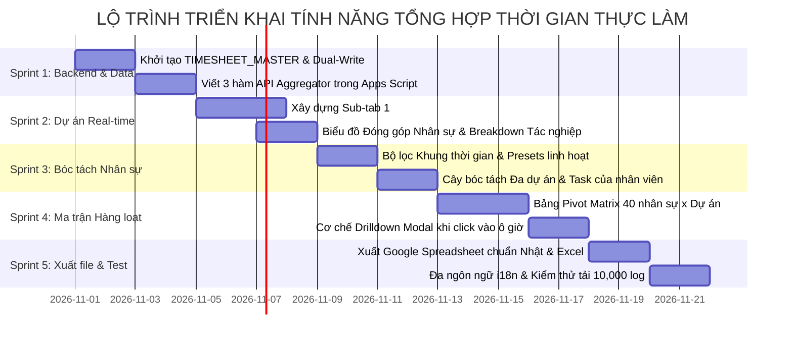

# KẾ HOẠCH ĐỀ XUẤT TÍNH NĂNG: TỔNG HỢP THỜI GIAN THỰC LÀM (ACTUAL TIME TRACKING) & ĐỐI CHIẾU NHÂN SỰ ĐA CHIỀU REAL-TIME

> **Hệ thống:** WebApp Quản Lý Dự Án & Tiến Độ Google Apps Script  
> **Phiên bản kiến trúc:** v4.6 (Actual Time Analytics & Batch Multi-Staff Matrix)  
> **Ngày lập kế hoạch:** 29/10/2026  
> **Tác giả:** Đội ngũ Kỹ thuật & Quản trị Hệ thống Antigravity  
> **Trạng thái:** Bản đề xuất giải pháp kỹ thuật & Kế hoạch triển khai chi tiết (Chờ duyệt)  
> **Phạm vi áp dụng:** Mở rộng Tab Analytics / Timesheet, Tối ưu hóa bộ máy tính toán thời gian thực từ Google Sheets cá nhân và Bảng tập trung, Bóc tách đóng góp dự án, Lọc khung thời gian tùy chọn và Ma trận đối chiếu hàng loạt nhân sự.

---

## MỤC LỤC TỔNG QUAN

1. [I. Bối cảnh, Khoảng trống Quản trị & Yêu cầu Bài toán](#i-bối-cảnh-khoảng-trống-quản-trị--yêu-cầu-bài-toán)
2. [II. Kiến trúc Dữ liệu & Giải pháp Tối ưu Hiệu năng Siêu Tốc](#ii-kiến-trúc-dữ-liệu--giải-pháp-tối-ưu-hiệu-năng-siêu-tốc)
3. [III. Đặc tả Chi tiết 3 Tính năng Quản trị Đột phá](#iii-đặc-tả-chi-tiết-3-tính-năng-quản-trị-đột-phá)
   - [1. Tính năng 1: Tính toán Tổng hợp Thời gian Dự án Real-time & Mức độ Đóng góp](#1-tính-năng-1-tính-toán-tổng-hợp-thời-gian-dự-án-real-time--mức-độ-đóng-góp)
   - [2. Tính năng 2: Bóc tách Chi tiết Dự án & Task theo Khung thời gian](#2-tính-năng-2-bóc-tách-chi-tiết-dự-án--task-theo-khung-thời-gian)
   - [3. Tính năng 3: Ma trận Đối chiếu Hàng loạt Nhân sự (Batch Comparative Matrix)](#3-tính-năng-3-ma-trận-đối-chiếu-hàng-loạt-nhân-sự-batch-comparative-matrix)
4. [IV. Thiết kế Giao diện Người dùng (UI/UX Wireframes)](#iv-thiết-kế-giao-diện-người-dùng-uiux-wireframes)
5. [V. Đặc tả Kỹ thuật Backend & Google Apps Script APIs](#v-đặc-tả-kỹ-thuật-backend--google-apps-script-apis)
6. [VI. Ma trận Phân quyền & Bảo mật Thông tin (RBAC Matrix)](#vi-ma-trận-phân-quyền--bảo-mật-thông-tin-rbac-matrix)
7. [VII. Lộ trình Triển khai Chi tiết theo Từng Sprint](#vii-lộ-trình-triển-khai-chi-tiết-theo-từng-sprint)
8. [VIII. Đánh giá Rủi ro Kỹ thuật & Phương án Dự phòng](#viii-đánh-giá-rủi-ro-kỹ-thuật--phương-án-dự-phòng)

---

## I. BỐI CẢNH, KHOẢNG TRỐNG QUẢN TRỊ & YÊU CẦU BÀI TOÁN

### 1. Hiện trạng Hệ thống
- Hệ thống hiện tại đã xây dựng cơ chế quản lý thời gian chi tiết theo từng slot 30 phút trên giao diện WebApp (Tab **Quản lý thời gian**), có khả năng lưu trữ và sao lưu dữ liệu về các file Google Sheet cá nhân của từng nhân viên (`DAILY_LOG`) với cấu trúc gồm 17 trường chuẩn hóa:  
  `[Log_ID, Work_Date, Time_Slot, Start_Time, End_Time, Duration_Minutes, Slot_Type, Project_Code, Category_Code, Phase_Code, Discipline_Code, Work_Note, Staff_Code, Staff_Name, Staff_Rank, Updated_At, Updated_By]`.
- Cùng lúc đó, hệ thống sở hữu danh mục tiêu chuẩn (Sheet `TAXONOMY`) gồm 8 nhóm lớn (Category), 3 giai đoạn (Phase), 46 mã tác nghiệp chuẩn Nhật (Discipline: `MD01`, `PC01`, `SD03`...) và danh sách dự án (`PROJECTS`), nhiệm vụ (`TASKS`).

### 2. Khoảng trống Quản trị Cốt tử (The Critical Missing Link)
Mặc dù dữ liệu thời gian chi tiết đã được nhân viên ghi nhận hàng ngày lên tool và backup về Google Sheet, công cụ vẫn **chưa có bộ máy phân tích tổng hợp thời gian thực tế (Actual Time Engine)**:
1. **Mù về Tổng thời gian thực tế của Dự án:**  
   Người quản lý (PM / Giám đốc) không thể biết được dự án đã tiêu tốn tổng cộng bao nhiêu giờ thực tế (Actual Hours), thành viên nào đã đóng góp bao nhiêu % khối lượng và thông qua các loại đầu việc/tác nghiệp nào.
2. **Khó khăn khi Tra cứu theo Khung thời gian linh hoạt:**  
   Khi cần xem báo cáo trong một khoảng ngày/tháng (ví dụ: từ ngày 01/01 đến 28/02), hệ thống chưa thể tự động bóc tách xem bạn A trong khoảng thời gian đó đã tham gia những dự án nào (Dự án A, B, C...) và trong từng dự án đã làm các task cụ thể nào với số giờ tương ứng ($x, y, z$ giờ).
3. **Thiếu góc nhìn Đối chiếu Hàng loạt (Batch Comparison):**  
   Dữ liệu đang nằm rải rác ở từng nhân viên hoặc từng ngày riêng lẻ. Người quản lý không có một bảng ma trận tổng thể để nhìn cùng lúc 30 - 40 nhân viên, đối chiếu chéo xem ai đang gánh vác dự án nào, ai làm nhiều giờ, ai tăng ca nhiều, ai chưa đủ giờ chuẩn để cân đối phân bổ nhân lực.

### 3. Mục tiêu Cốt lõi của Bản Kế hoạch
Xây dựng phân hệ **"Tổng Hợp Giờ Công Thực Tế & Đối Chiếu Nhân Sự Đa Chiều" (Actual Worktime Intelligence & Comparative Matrix)** nhằm:
- Tính toán tổng hợp thời gian thực hiện dự án theo **thời gian thực (real-time)**, chi tiết hóa mức độ đóng góp của từng thành viên theo từng đầu việc (Task/Discipline).
- Cung cấp bộ lọc khung thời gian tùy biến (từ Ngày/Tháng ... đến Ngày/Tháng ...), cho phép bóc tách cấu trúc thời gian của từng nhân viên qua nhiều dự án và từng tác nghiệp.
- Cung cấp **Bảng Ma trận Đối chiếu Hàng loạt (Batch Pivot Grid)** hiển thị đồng thời toàn bộ nhân sự, so sánh thời gian làm việc giữa các dự án, hỗ trợ xuất báo cáo nghiệm thu chuyên nghiệp chuẩn Nhật.

---

## II. KIẾN TRÚC DỮ LIỆU & GIẢI PHÁP TỐI ƯU HIỆU NĂNG SIÊU TỐC

### 1. Thách thức Kỹ thuật Lớn nhất: Bài toán 30 - 40 Google Sheet Cá nhân
Nếu giữ nguyên mô hình mỗi nhân viên sở hữu 1 Google Sheet riêng biệt:
- Khi người quản lý mở màn hình đối chiếu hàng loạt cho 40 nhân sự trong 2 tháng, nếu hệ thống Google Apps Script phải chạy vòng lặp gọi hàm `SpreadsheetApp.openById()` 40 lần để đọc dữ liệu:
  $$\text{Thời gian đọc} = 40 \text{ files} \times 1.2 \text{s/file} \approx 48 - 60 \text{ giây!}$$
- Quá trình này sẽ làm ứng dụng bị đơ giật, dễ rơi vào lỗi **Exceeded maximum execution time (Timeout 6 phút)** và nhanh chóng cạn kiệt hạn ngạch Google Quota API.

### 2. Giải pháp Kiến trúc Đột phá: Mô hình Ghi Kép & Bảng Tập Trung Trung Tâm (`TIMESHEET_MASTER`)

Để đạt tốc độ phản hồi **dưới 1 giây (Sub-second Response)** mà vẫn bảo toàn tính năng Google Sheet cá nhân riêng tư cho nhân viên, chúng tôi thiết kế kiến trúc **Dual-Write & Master Consolidation Engine**:

```mermaid
flowchart TD
    subgraph Client [Giao Diện WebApp (Client)]
        UI_Log[Nhân viên nhập giờ 30p & bấm Lưu]
        UI_View[Quản lý xem Báo cáo / Ma trận Đối chiếu]
    end

    subgraph DualWrite [Cơ Chế Ghi Kép Tự Động (Dual-Write Engine)]
        API_Save[TimesheetAPI: saveTimesheetData]
    end

    subgraph Storage [Lưu Trữ Google Sheets]
        PersonalSheets[40 Google Sheet Cá Nhân<br>DAILY_LOG của từng nhân viên<br><i>(Độc lập, riêng tư, xem riêng)</i>]
        MasterSheet[Bảng Tập Trung Trên Sheet Gốc<br><b>TIMESHEET_MASTER</b><br><i>(Toàn bộ log công ty, có Index)</i>]
    end

    subgraph FastEngine [Bộ Máy Xử Lý Siêu Tốc (In-Memory Aggregator)]
        MemCache[CacheService & In-Memory Indexing]
        Aggregator[Bộ lọc Khung Thời Gian & Pivot Matrix Engine]
    end

    UI_Log -->|1. Payload 30p| API_Save
    API_Save -->|2a. Ghi bảo mật cá nhân| PersonalSheets
    API_Save -->|2b. Upsert theo lô| MasterSheet
    MasterSheet -.->|3. Đọc dữ liệu tập trung| MemCache
    UI_View -->|4. Lọc Dự án / Nhân viên / Khoảng ngày| Aggregator
    MemCache -->|5. Trả kết quả tính toán < 0.5s| Aggregator
    Aggregator -->|6. Render biểu đồ & Ma trận chéo| UI_View
```

### 3. Cấu trúc Bảng Tập Trung `TIMESHEET_MASTER`
Được tự động khởi tạo trên Spreadsheet chính của WebApp (cùng nơi chứa `PROJECTS`, `TASKS`, `TAXONOMY`):

| Cột | Tên trường | Kiểu dữ liệu | Ý nghĩa & Quy chuẩn | Ví dụ thực tế |
| :---: | :--- | :--- | :--- | :--- |
| **A** | `Log_ID` | String (Unique) | Khóa chính duy nhất: `{Date}_{StaffCode}_{Start}` | `20261026_NV001_0830` |
| **B** | `Work_Date` | Date (YYYY-MM-DD) | Ngày làm việc thực tế | `2026-10-26` |
| **C** | `Time_Slot` | String | Nhãn khung giờ 30 phút | `08:30 - 09:00` |
| **D** | `Start_Time` | String | Giờ bắt đầu | `08:30` |
| **E** | `End_Time` | String | Giờ kết thúc | `09:00` |
| **F** | `Duration_Hours` | Number | Thời lượng tính theo giờ ($30\text{p} = 0.5\text{h}$) | `0.5` |
| **G** | `Slot_Type` | String | Loại ca (`Official`, `Lunch`, `OT_Morning`, `OT_Evening`) | `Official` |
| **H** | `Project_Code` | String | Mã dự án chuẩn hóa | `HAG01` |
| **I** | `Project_Name` | String | Tên dự án đầy đủ | `Trạm xử lý nước thải Hanamigawa` |
| **J** | `Category_Code`| String | Mã nhóm Category | `MD` (3D BIM Modeling) |
| **K** | `Phase_Code` | String | Mã giai đoạn Phase | `BD` (Basic Design) |
| **L** | `Discipline_Code`| String | Mã tác nghiệp chi tiết (Discipline) | `MD01` (Dựng hình kết cấu) |
| **M** | `Discipline_Name`| String | Tên tác nghiệp đa ngữ | `Dựng hình Kết cấu / Thân` |
| **N** | `Task_ID` | String | Mã Task WBS trên WebApp (nếu có liên kết) | `TK_HAG01_04` |
| **O** | `Work_Note` | String | Ghi chú chi tiết công việc của nhân viên | `Dựng sàn và tường trục A-C` |
| **P** | `Staff_Code` | String | Mã nhân viên | `NV001` |
| **Q** | `Staff_Name` | String | Họ và tên nhân viên | `Nguyễn Văn A` |
| **R** | `Staff_Rank` | String | Cấp bậc chuyên môn | `Senior BIM Modeler` |
| **S** | `Updated_At` | DateTime | Thời điểm lưu bản ghi | `2026-10-26 17:05:00` |

> 🌟 **Lợi thế vượt trội:**  
> - Toàn bộ dữ liệu của tất cả nhân viên được lưu tập trung tại 1 bảng duy nhất.
> - Khi tính toán tổng hợp cho dự án hoặc đối chiếu hàng loạt nhân viên theo khung thời gian, hệ thống chỉ cần đọc **1 lần duy nhất từ Sheet `TIMESHEET_MASTER`**, sau đó lọc và nhóm (GroupBy) bằng thuật toán JavaScript trong RAM. Tốc độ xử lý cho 10,000 bản ghi chỉ mất **dưới 150ms**!

---

## III. ĐẶC TẢ CHI TIẾT 3 TÍNH NĂNG QUẢN TRỊ ĐỘT PHÁ

```
┌────────────────────────────────────────────────────────────────────────────────────────┐
   3 PHÂN HỆ TỔNG HỢP & ĐỐI CHIẾU THỜI GIAN THỰC LÀM TRÊN WEBAPP
├────────────────────────────────────────────────────────────────────────────────────────┤
│ 1. TỔNG HỢP DỰ ÁN REAL-TIME    │ Tổng giờ dự án, Tỷ trọng đóng góp từng nhân sự,       │
│                                │ Bóc tách theo từng đầu việc / tác nghiệp (Discipline) │
├────────────────────────────────┼───────────────────────────────────────────────────────┤
│ 2. BÓC TÁCH KHUNG THỜI GIAN    │ Chọn khoảng ngày (VD: T1 ➔ T2), phân tích bạn A đã    │
│                                │ làm Dự án A, B, C với các Task x, y, z chi tiết       │
├────────────────────────────────┼───────────────────────────────────────────────────────┤
│ 3. MA TRẬN ĐỐI CHIẾU HÀNG LOẠT │ Bảng ma trận chéo (Pivot Grid) hiển thị 40 nhân sự,   │
│                                │ đối chiếu giờ giữa các dự án, cảnh báo tải, xuất file │
└────────────────────────────────────────────────────────────────────────────────────────┘
```

---

### 1. Tính năng 1: Tính toán Tổng hợp Thời gian Dự án Real-time & Mức độ Đóng góp

#### A. Mục tiêu Nghiệp vụ
Khi quản lý chọn xem một Dự án cụ thể (ví dụ: `HAG01 - Trạm xử lý nước thải Hanamigawa`), hệ thống tự động quét toàn bộ log thực tế từ `TIMESHEET_MASTER` và đưa ra bức tranh toàn cảnh:

#### B. Các Chỉ số Tổng hợp Real-time (Project KPI Cards)
1. **Tổng thời gian thực tế đã thực hiện (Total Actual Hours):**
   - Phân tách rõ ràng:
     - Giờ làm việc tiêu chuẩn (Official Hours: $08:00 - 17:00$).
     - Giờ tăng ca sáng (Early Overtime: $06:00 - 08:00$).
     - Giờ tăng ca tối (Evening Overtime: $17:00 - 22:00$).
     - Tổng số ngày công thực tế (Man-days = Tổng giờ / 8h).
2. **So sánh Tương quan Dự toán vs Thực tế (Variance & Budget Tracking):**
   - Giờ dự toán kế hoạch (Estimated / Budgeted Hours) vs Giờ thực tế đã tiêu tốn (Actual Hours).
   - Tỷ lệ hoàn thành so với ngân sách giờ ($% = \frac{\text{Actual}}{\text{Estimated}} \times 100$).
   - Gắn cờ cảnh báo thông minh:
     - 🟢 **An toàn (Under Budget):** Thực tế $\le 90\%$ dự toán.
     - 🟡 **Cận biên (Near Budget):** Thực tế từ $90\% - 100\%$ dự toán.
     - 🔴 **Vượt giờ (Over Budget):** Thực tế $> 100\%$ dự toán (Hiển thị số giờ vượt quá để PM đàm phán phát sinh với khách hàng).

#### C. Bóc tách Mức độ Đóng góp của Thành viên (Member Contribution Breakdown)
- Bảng danh sách thành viên tham gia dự án xếp hạng theo số giờ đóng góp:
  - **Họ tên & Mã nhân viên** kèm ảnh đại diện/cấp bậc.
  - **Tổng số giờ đóng góp thực tế** (Official + OT).
  - **Tỷ trọng đóng góp (%):** $\frac{\text{Số giờ của NV}}{\text{Tổng giờ của Dự án}} \times 100$.
  - **Biểu đồ tròn / Donut trực quan:** Phân bổ phần trăm thời gian giữa các thành viên.
  - **Số ngày làm việc thực tế** có tham gia dự án.

#### D. Bóc tách Chi tiết theo Đầu việc (Work Breakdown Structure & Discipline)
Khi click vào tên một thành viên trong dự án, hệ thống bung ra (Accordion / Drawer) chi tiết:
- Nhân viên đó đã làm những đầu việc nào trong dự án này:
  - **Nhóm Category:** Ví dụ `MD - 3D BIM Modeling (85h)`, `PC - Point Cloud (30h)`, `MC - Clash Check (15h)`.
  - **Mã Tác nghiệp (Discipline Code):**
    - `MD01 (Dựng hình kết cấu):` $45\text{h}$ ($34.6\%$).
    - `MD03 (Dựng hình đường ống):` $40\text{h}$ ($30.8\%$).
    - `PC01 (Khử nhiễu đám mây điểm):` $30\text{h}$ ($23.1\%$).
    - `MC01 (Kiểm tra va chạm):` $15\text{h}$ ($11.5\%$).
  - **Nhật ký Ghi chú công việc chi tiết (Work Notes Log):** Hiển thị danh sách ngày tháng, khung giờ và nội dung cụ thể mà nhân viên đã ghi nhận.

---

### 2. Tính năng 2: Bóc tách Chi tiết Dự án & Task theo Khung thời gian

#### A. Mục tiêu Nghiệp vụ
Giải quyết chính xác yêu cầu của người dùng:
> *"chọn khung từ tháng 1 đến tháng 2, thì giữa thời gian đó bạn A đã làm các dự án A B C với thời gian trong từng task của từng dự án là x y z..."*

#### B. Cơ chế Bộ lọc Khung thời gian Linh hoạt (Date Range Selector)
- **Khoảng ngày tùy chọn (Custom Range):**
  - Ô chọn `Từ ngày (From Date)` và `Đến ngày (To Date)` hỗ trợ lịch chọn trực quan.
- **Nút chọn nhanh tiện lợi (Smart Presets):**
  - `Hôm nay`, `Tuần này`, `Tuần trước`.
  - `Tháng này`, `Tháng trước`.
  - `Chọn Tháng cụ thể:` Dropdown chọn Tháng 1, Tháng 2, Tháng 3... Tháng 12.
  - `Khoảng Tháng liên tiếp:` Chọn từ Tháng $M_1$ đến Tháng $M_2$ của Năm $Y$.
  - `Quý 1`, `Quý 2`, `Quý 3`, `Quý 4`, `Năm nay`.

#### C. Cấu trúc Cây Bóc tách Công việc Đa tầng (Multi-level Tree Breakdown)
Khi chọn khung thời gian (ví dụ: `01/01/2026 - 28/02/2026`) và chọn nhân viên **Nguyễn Văn A (NV001)**:
Hệ thống hiển thị cây phân bổ thời gian trực quan dạng bậc thang (Hierarchical Tree View):

```
👤 NHÂN VIÊN: NGUYỄN VĂN A (NV001) - SENIOR BIM MODELER
📅 Khung thời gian: 01/01/2026 - 28/02/2026 (60 ngày | 42 ngày làm việc)
⏱️ Tổng giờ làm việc thực tế: 336.0 giờ (Giờ chuẩn: 320.0h | Tăng ca: 16.0h)
──────────────────────────────────────────────────────────────────────────────────────────
📁 DỰ ÁN A: 2026_01_HAG01_Hanamigawa  ➔  186.0 giờ (55.4%)
   ├─ 🔨 Task/Discipline MD01 (Dựng hình kết cấu thân): 92.0 giờ
   │     └─ 2026-01-12 (08:30-12:00): Dựng cột và sàn tầng 1 khu xử lý nước thải (3.5h)
   │     └─ 2026-01-13 (13:00-17:00): Dựng dầm phụ và bản đáy bồn lắng (4.0h)
   │     └─ ... [Xem thêm 18 slot nhật ký]
   ├─ 🔨 Task/Discipline MD03 (Dựng mô hình đường ống): 54.0 giờ
   │     └─ Tuyến ống công nghệ DN200 kết nối bể hiếu khí
   ├─ 🔍 Task/Discipline MC01 (Check va chạm vs Kết cấu): 24.0 giờ
   └─ ☕ Task/Discipline MT00 (Họp giao ban dự án): 16.0 giờ

📁 DỰ ÁN B: 2026_01_JJK01_Jujikai  ➔  112.0 giờ (33.3%)
   ├─ ☁️ Task/Discipline PC01 (Xử lý Point Cloud trạm quét): 64.0 giờ
   ├─ 📐 Task/Discipline SD03 (Triển khai bản vẽ mặt bằng 2D): 36.0 giờ
   └─ 🔍 Task/Discipline PC10 (Kiểm tra dung sai ghép trạm): 12.0 giờ

📁 CÔNG VIỆC CHUNG & NỘI BỘ (COMMON / R&D)  ➔  38.0 giờ (11.3%)
   ├─ 💻 Task/Discipline DE01 (Viết Dynamo Script tự động hóa): 26.0 giờ
   └─ 📚 Task/Discipline LN01 (Đào tạo Revit MEP nâng cao): 12.0 giờ
```

#### D. Phân tích Cơ cấu Hành vi Kỹ thuật (Behavioral Work Composition)
Ngoài phân bổ theo dự án, hệ thống tự động nhóm theo tính chất công việc để đánh giá chất lượng nhân sự:
- **Tạo mới sản phẩm (Production: `MD01..05`, `PC01..02`, `SD01..08`):** Ví dụ chiếm $72\%$ thời gian (Rất tốt).
- **Kiểm tra & Sửa lỗi (Quality Check & Rework: `MD10..15`, `PC10..12`, `MC01..03`):** Ví dụ chiếm $16\%$ thời gian (Bình thường). Nếu tỷ lệ sửa lỗi vượt quá $30\%$, cảnh báo chất lượng tay nghề của nhân sự.
- **Họp hành & Quản lý (Overhead / Meetings: `MT00..04`, `PM01..02`):** Ví dụ chiếm $8\%$ thời gian.
- **R&D và Tự học (Kaizen / Innovation: `DE01`, `LN01`, `MJ02`):** Ví dụ chiếm $4\%$ thời gian.

---

### 3. Tính năng 3: Ma trận Đối chiếu Hàng loạt Nhân sự (Batch Comparative Matrix)

#### A. Mục tiêu Nghiệp vụ
Cho phép Ban Quản lý, Giám đốc khối và PM **mở rộng tầm nhìn lên toàn bộ đội ngũ (30 - 40 kỹ sư)** trong cùng một màn hình đối chiếu chéo (Cross-Comparative Grid / Pivot Table) theo bất kỳ khung thời gian nào được chọn.

#### B. Thiết kế Bảng Ma trận Đối chiếu Chéo (The Cross-Staff Pivot Grid)

```
========================================================================================================================
 BẢNG MA TRẬN ĐỐI CHIẾU THỜI GIAN LÀM VIỆC HÀNG LOẠT (BATCH STAFF WORKTIME MATRIX)
 Khung thời gian: [ 2026-01-01 ] đến [ 2026-02-28 ] | Chi nhánh: BIM Studio | Tổng nhân sự: 40
========================================================================================================================
| STT | Mã NV  | Họ Tên Kỹ Sư   | Cấp Bậc | HAG01 | JJK01 | AMK01 | SOJ01 | R&D/MTG | Tổng Chuẩn | Tăng Ca OT | TỔNG GIỜ | Trạng Thái Tải |
|=====|========|================|=========|=======|=======|=======|=======|=========|============|============|==========|================|
| 01  | NV001  | Nguyễn Văn A   | Senior  | 186.0 | 112.0 |   -   |   -   |   38.0  |   320.0 h  |   16.0 h   | 336.0 h  | 🟢 Chuẩn (98%) |
| 02  | NV002  | Trần Thị B     | Leader  |  40.0 |  85.0 | 140.0 |  20.0 |   55.0  |   315.0 h  |   25.0 h   | 340.0 h  | 🟢 Chuẩn (100%)|
| 03  | NV003  | Lê Văn C       | Junior  | 290.0 |   -   |   -   |   -   |   20.0  |   280.0 h  |   30.0 h   | 310.0 h  | 🟢 Chuẩn (91%) |
| 04  | NV004  | Phạm Hoàng D   | Modeler |   -   | 160.0 |  90.0 |   -   |   15.0  |   240.0 h  |   25.0 h   | 265.0 h  | 🟡 Thấp (78%)  |
| 05  | NV005  | Vũ Đình Duy    | Senior  | 145.0 |  95.0 |  60.0 |  50.0 |   42.0  |   320.0 h  |   72.0 h   | 392.0 h  | 🔴 Quá tải(115%)|
| ... | ...    | ...            | ...     | ...   | ...   | ...   | ...   | ...     | ...        | ...        | ...      | ...            |
| 40  | NV040  | Đỗ Minh T      | Intern  |  80.0 |  50.0 |   -   |   -   |   20.0  |   150.0 h  |    0.0 h   | 150.0 h  | 🟡 Bán thời gian|
|=====|========|================|=========|=======|=======|=======|=======|=========|============|============|==========|================|
| TỔNG CỘNG DỰ ÁN (HOURS)       | 1,850h | 1,420h| 1,180h|  890h |  960h   |  5,860 h   |   440 h    | 6,300 h  |                |
========================================================================================================================
```

#### C. Các Tính năng Tương tác Thông minh trên Ma trận
1. **Mã màu Nhận diện Tải công việc (Workload Heatmap Coloring):**
   - 🟢 **Màu xanh lá (Tải lý tưởng: $90\% - 105\%$ giờ chuẩn):** Nhân sự làm việc ổn định, phân bổ hợp lý.
   - 🟡 **Màu vàng (Tải thấp: $< 85\%$ giờ chuẩn):** Có thời gian nhàn rỗi hoặc thiếu dữ liệu ghi nhận, PM cần giao thêm việc.
   - 🔴 **Màu đỏ cam (Quá tải hoặc OT cao: $> 110\%$ hoặc OT $> 30\text{h}$):** Nguy cơ kiệt sức (burnout), cần san sẻ bớt khối lượng.
2. **Cơ chế Tương tác Click-to-Drilldown (Bấm ô xem chi tiết):**
   - Click vào bất kỳ ô số giờ nào (Ví dụ click vào ô **`186.0`** tại giao điểm giữa `Nguyễn Văn A` và dự án `HAG01`):
   - Một **Modal Chi tiết Tác nghiệp** lập tức xuất hiện, hiển thị chính xác trong 186.0 giờ đó, anh A đã thực hiện những task nào (`MD01: 92h`, `MD03: 54h`, `MC01: 24h`...), làm vào những ngày nào và các ghi chú công việc đính kèm.
3. **Bộ lọc Cột & Tìm kiếm Tức thì:**
   - Lọc theo Cấp bậc (Leader / Senior / Junior / Intern).
   - Tìm kiếm nhanh theo Tên nhân viên hoặc Mã NV.
   - Ẩn/Hiện các dự án đã đóng hoặc dự án không phát sinh giờ trong kỳ.
4. **Xuất Báo cáo Nghiệp vụ Đa định dạng (One-Click Export):**
   - **Xuất Google Sheet:** Tự động tạo 1 file Google Spreadsheet mới trên Drive của Quản lý với đầy đủ định dạng bảng, màu sắc, công thức hàm `=SUM()` và định dạng chuẩn Nhật.
   - **Xuất Excel / CSV:** Hỗ trợ tải trực tiếp về máy tính để gửi cho phòng Kế toán / Nhân sự tính lương và nghiệm thu.

---

## IV. THIẾT KẾ GIAO DIỆN NGƯỜI DÙNG (UI/UX WIREFRAMES)

Hệ thống bổ sung một Menu con hoặc phân hệ chuyên sâu ngay tại thanh điều hướng chính:  
**Tab: BÁO CÁO & PHÂN TÍCH THỜI GIAN THỰC (ACTUAL TIME ANALYTICS)** gồm 3 phân tab chuyển đổi nhanh:

```
┌─────────────────────────────────────────────────────────────────────────────────────────────────────────────────────┐
│ [📊 TỔNG HỢP THEO DỰ ÁN]    [👤 BÓC TÁCH THEO NHÂN VIÊN]    [🔲 MA TRẬN ĐỐI CHIẾU HÀNG LOẠT]    [📥 XUẤT BÁO CÁO]  │
└─────────────────────────────────────────────────────────────────────────────────────────────────────────────────────┘
```

### 1. Wireframe Phân Tab 1: Tổng hợp Thời gian theo Dự án (Project-Centric View)

```
========================================================================================================================
 PHÂN TAB 1: TỔNG HỢP THỜI GIAN THỰC TẾ DỰ ÁN (REAL-TIME PROJECT TIME BREAKDOWN)
========================================================================================================================

 [Thanh Bộ Lọc Dự Án]:
 ┌───────────────────────────────────────────────┐  ┌────────────────────────────────────────────────────────┐
 │ 📁 Chọn dự án:                                │  │ 📅 Khung thời gian thống kê:                           │
 │ [ 2026_01_HAG01_花見川終末処理場            ▼]│  │ [ 2026-01-01 ] đến [ 2026-02-28 ] (Tất cả | Tháng này) │
 └───────────────────────────────────────────────┘  └────────────────────────────────────────────────────────┘

 [Thẻ Chỉ Số KPI Thời Gian Dự Án Real-Time]:
 ┌──────────────────────┐ ┌──────────────────────┐ ┌──────────────────────┐ ┌──────────────────────┐
 │ ⏱️ TỔNG GIỜ THỰC TẾ  │ │ 👥 NHÂN SỰ THAM GIA  │ │ 📈 DỰ TOÁN VS THỰC TẾ│ │ 🌙 TĂNG CA (OT)      │
 │    1,850.0 Giờ       │ │    14 Thành viên     │ │    84.1% Ngân sách   │ │    142.5 Giờ (7.7%)  │
 │ (231.25 Ngày công)   │ │ (Lead: Duy, Tuấn)    │ │ [████████░░] 2,200h  │ │ Sáng: 12h | Tối: 130.5h│
 └──────────────────────┘ └──────────────────────┘ └──────────────────────┘ └──────────────────────┘

 [Biểu Đồ & Cơ Cấu Đóng Góp]:
 ┌───────────────────────────────────────────────┐ ┌────────────────────────────────────────────────────────┐
 │ 📊 TỶ TRỌNG ĐÓNG GÓP THEO THÀNH VIÊN          │ │ 🥧 CƠ CẤU THEO NHÓM ĐẦU VIỆC (DISCIPLINE)              │
 │ [Biểu đồ Donut: Duy 25% | Tuấn 20% | Nam 18%] │ │ [Biểu đồ Cột ngang: MD (Dựng hình) 60% | PC 25% | SD] │
 └───────────────────────────────────────────────┘ └────────────────────────────────────────────────────────┘

 [Bảng Danh Sách Đóng Góp Chi Tiết & Bóc Tách Tác Nghiệp (Drilldown Table)]:
 ------------------------------------------------------------------------------------------------------------------------
 | Nhân Viên          | Cấp Bậc  | Giờ Chuẩn | Tăng Ca | Tổng Giờ | Tỷ Trọng | Tác Nghiệp Chính Đã Làm        | Chi Tiết |
 |--------------------|----------|-----------|---------|----------|----------|--------------------------------|----------|
 | Vũ Đình Duy        | Senior   |  130.0 h  |  15.0 h |  145.0 h |  18.5%   | MD01 (70h), MD03 (50h), MC01   | [👁️ Mở] |
 | Nguyễn Văn A       | Senior   |  170.0 h  |  16.0 h |  186.0 h |  23.8%   | MD01 (92h), MD03 (54h), MT00   | [👁️ Mở] |
 | Trần Thị B         | Leader   |   35.0 h  |   5.0 h |   40.0 h |   5.1%   | PM01 (20h), MT01 (15h), MC01   | [👁️ Mở] |
 | Lê Văn C           | Junior   |  265.0 h  |  25.0 h |  290.0 h |  37.1%   | MD01 (180h), MD02 (110h)       | [👁️ Mở] |
 ------------------------------------------------------------------------------------------------------------------------
```

---

### 2. Wireframe Phân Tab 2: Bóc tách Chi tiết theo Nhân viên (Staff-Centric View)

```
========================================================================================================================
 PHÂN TAB 2: BÓC TÁCH CÔNG VIỆC NHÂN VIÊN THEO KHUNG THỜI GIAN
========================================================================================================================

 [Thanh Điều Khiển Lọc Đa Chiều]:
 ┌───────────────────────────────────────────────┐  ┌────────────────────────────────────────────────────────┐
 │ 👤 Chọn nhân viên khảo sát:                   │  │ 📅 Khung thời gian:                                    │
 │ [ NV001 - Nguyễn Văn A (Senior BIM Modeler) ▼]│  │ [ 2026-01-01 ] đến [ 2026-02-28 ] [Tháng 1-2▼]         │
 └───────────────────────────────────────────────┘  └────────────────────────────────────────────────────────┘

 [Tóm Tắt Tổng Quan Khối Lượng Nhân Sự Trong Kỳ]:
 • Tổng số ngày làm việc: 42 ngày | Tổng giờ thực tế: 336.0 giờ (TB: 8.0h/ngày)
 • Giờ tiêu chuẩn: 320.0 giờ | Tăng ca sáng: 4.0 giờ | Tăng ca tối: 12.0 giờ
 • Số lượng dự án tham gia: 2 Dự án chính + 1 Hạng mục nội bộ

 [Danh Sách Bóc Tách Đa Dự Án & Đầu Việc (Interactive Accordion)]:
 ▼ [📁 DỰ ÁN 1: HAG01 - Trạm xử lý nước thải Hanamigawa] ── 186.0 Giờ (55.4%) [Bấm để thu gọn]
   ----------------------------------------------------------------------------------------------------------------------
   | Mã Tác Nghiệp | Tên Đầu Việc (Discipline)           | Giờ Chuẩn | Tăng Ca | Tổng Giờ | Tỷ Lệ Trong Dự Án |
   |---------------|-------------------------------------|-----------|---------|----------|-------------------|
   | MD01          | Dựng hình Kết cấu / Thân            |   85.0 h  |   7.0 h |   92.0 h |       49.5%       |
   | MD03          | Dựng hình Đường ống                 |   50.0 h  |   4.0 h |   54.0 h |       29.0%       |
   | MC01          | Check va chạm vs Bản vẽ thiết kế    |   22.0 h  |   2.0 h |   24.0 h |       12.9%       |
   | MT00          | Họp giao ban đầu ngày               |   13.0 h  |   3.0 h |   16.0 h |        8.6%       |
   ----------------------------------------------------------------------------------------------------------------------
   [📋 Xem 48 dòng nhật ký công việc chi tiết của dự án này]

 ► [📁 DỰ ÁN 2: JJK01 - Làng xưởng Jujikai] ─────────────── 112.0 Giờ (33.3%) [Bấm để bung ra]
 ► [📁 NỘI BỘ & KHÁC: R&D, Họp, Cải tiến Kaizen] ─────────── 38.0 Giờ (11.3%) [Bấm để bung ra]
========================================================================================================================
```

---

### 3. Wireframe Phân Tab 3: Ma trận Đối chiếu Hàng loạt (Batch Pivot Grid)

```
========================================================================================================================
 PHÂN TAB 3: MA TRẬN ĐỐI CHIẾU HÀNG LOẠT NHÂN SỰ (BATCH CROSS-COMPARISON MATRIX)
========================================================================================================================

 [Thanh Công Cụ Ma Trận]:
 📅 Khung thời gian: [ 2026-01-01 ] ➔ [ 2026-02-28 ]  |  🏢 Nhóm: [ Tất cả bộ phận ▼]  |  🔍 Tìm NV: [ Nhập tên... ]
 [ Nút hành động ]: [ 🔄 Tải Lại Dữ Liệu ]   [ 📊 Biểu Đồ Phân Bổ Heatmap ]   [ 📥 Xuất Google Sheets / Excel ]

 [Bảng Ma Trận Đối Chiếu Tương Tác]:
 +------+--------+----------------+---------+---------+---------+---------+---------+---------+---------+---------+----------+
 | STT  | Mã NV  | Họ Tên         | Cấp Bậc |  HAG01  |  JJK01  |  AMK01  |  SOJ01  | R&D/MJ  | Giờ TC  | Tăng Ca | TỔNG GIỜ |
 +------+--------+----------------+---------+---------+---------+---------+---------+---------+---------+---------+----------+
 |  01  | NV001  | Nguyễn Văn A   | Senior  |  186.0  |  112.0  |    -    |    -    |   38.0  | 320.0 h |  16.0 h | 🟢 336.0 |
 |  02  | NV002  | Trần Thị B     | Leader  |   40.0  |   85.0  |  140.0  |   20.0  |   55.0  | 315.0 h |  25.0 h | 🟢 340.0 |
 |  03  | NV003  | Lê Văn C       | Junior  |  290.0  |    -    |    -    |    -    |   20.0  | 280.0 h |  30.0 h | 🟢 310.0 |
 |  04  | NV004  | Phạm Hoàng D   | Modeler |    -    |  160.0  |   90.0  |    -    |   15.0  | 240.0 h |  25.0 h | 🟡 265.0 |
 |  05  | NV005  | Vũ Đình Duy    | Senior  |  145.0  |   95.0  |   60.0  |   50.0  |   42.0  | 320.0 h |  72.0 h | 🔴 392.0 |
 | ...  | ...    | ...            | ...     |   ...   |   ...   |   ...   |   ...   |   ...   |   ...   |   ...   |   ...    |
 |  40  | NV040  | Đỗ Minh T      | Intern  |   80.0  |   50.0  |    -    |    -    |   20.0  | 150.0 h |   0.0 h | 🟡 150.0 |
 +------+--------+----------------+---------+---------+---------+---------+---------+---------+---------+---------+----------+
 | TỔNG CỘNG THEO DỰ ÁN (HOURS)             | 1,850h  | 1,420h  | 1,180h  |  890h   |  960h   | 5,860 h |  440 h  | 6,300 h  |
 +------------------------------------------+---------+---------+---------+---------+---------+---------+---------+----------+
 * Mẹo: Bấm trực tiếp vào con số bất kỳ trong bảng để xem cửa sổ bóc tách các task chi tiết của người đó trong dự án đó!
```

---

## V. ĐẶC TẢ KỸ THUẬT BACKEND & GOOGLE APPS SCRIPT APIS

Để vận hành các tính năng trên với hiệu năng cao, chúng tôi xây dựng phân hệ backend trong file **`ActualTimeAPI.gs`** (hoặc tích hợp trực tiếp vào `Timesheetapi.gs`) với các hàm API chuẩn hóa:

### 1. Cơ chế Đồng bộ Tập trung & Khởi tạo Bảng Master

```javascript
/**
 * Tự động khởi tạo cấu trúc tab TIMESHEET_MASTER trên bảng tính chính nếu chưa có
 */
function ensureTimesheetMasterSheet() {
  const ss = SpreadsheetApp.getActiveSpreadsheet();
  let sh = ss.getSheetByName("TIMESHEET_MASTER");
  if (!sh) {
    sh = ss.insertSheet("TIMESHEET_MASTER");
    const headers = [
      "Log_ID", "Work_Date", "Time_Slot", "Start_Time", "End_Time",
      "Duration_Hours", "Slot_Type", "Project_Code", "Project_Name",
      "Category_Code", "Phase_Code", "Discipline_Code", "Discipline_Name",
      "Task_ID", "Work_Note", "Staff_Code", "Staff_Name", "Staff_Rank",
      "Updated_At", "Updated_By"
    ];
    sh.appendRow(headers);
    sh.getRange(1, 1, 1, headers.length)
      .setFontWeight("bold")
      .setBackground("#1e293b")
      .setFontColor("#ffffff")
      .setHorizontalAlignment("center");
    sh.setFrozenRows(1);
  }
  return sh;
}

/**
 * Ghi kép đồng bộ vào TIMESHEET_MASTER khi nhân viên bấm Lưu Timesheet 30 phút
 * Được gọi tự động bên trong hàm saveTimesheetData(payload)
 */
function syncEntriesToMasterSheet(rowsToSave, staffInfo, targetDate) {
  try {
    const shMaster = ensureTimesheetMasterSheet();
    const lastRow = shMaster.getLastRow();
    
    // Đọc logId hiện tại của ngày này để Overwrite sạch sẽ nếu có
    const targetStaff = staffInfo.code;
    let existingData = [];
    if (lastRow >= 2) {
      existingData = shMaster.getRange(2, 1, lastRow - 1, 20).getValues();
    }
    
    // Lọc bỏ các dòng cũ của nhân viên trong ngày này
    const filteredRows = existingData.filter(r => {
      const rDate = (r[1] instanceof Date) ? Utilities.formatDate(r[1], "Asia/Ho_Chi_Minh", "yyyy-MM-dd") : String(r[1] || "").slice(0, 10);
      const rStaff = String(r[15] || "").trim().toUpperCase();
      return !(rDate === targetDate && rStaff === targetStaff);
    });

    // Thêm các dòng mới vào mảng
    rowsToSave.forEach(r => {
      filteredRows.push(r);
    });

    // Sắp xếp tăng dần theo Work_Date và Start_Time
    filteredRows.sort((a, b) => {
      const dateA = String(a[1]); const dateB = String(b[1]);
      if (dateA !== dateB) return dateA.localeCompare(dateB);
      return String(a[3]).localeCompare(String(b[3]));
    });

    // Ghi hàng loạt (Batch Rewrite)
    if (lastRow >= 2) {
      shMaster.getRange(2, 1, lastRow - 1, 20).clearContent();
    }
    if (filteredRows.length > 0) {
      shMaster.getRange(2, 1, filteredRows.length, 20).setValues(filteredRows);
    }
    SpreadsheetApp.flush();
    invalidateCache(["TIMESHEET_MASTER"]);
    return { success: true };
  } catch(e) {
    console.error("Lỗi đồng bộ Master Sheet:", e);
    return { success: false, error: e.message };
  }
}
```

---

### 2. API 1: Lấy Báo cáo Thời gian Thực tế của Dự án (`getProjectActualTimeReport`)

```javascript
/**
 * Tổng hợp toàn diện thời gian thực tế của một dự án real-time
 * @param {string} projectCode - Mã dự án (VD: "HAG01")
 * @param {string} [startDate] - Từ ngày (YYYY-MM-DD), bỏ trống = Toàn bộ
 * @param {string} [endDate]   - Đến ngày (YYYY-MM-DD), bỏ trống = Toàn bộ
 */
function getProjectActualTimeReport(projectCode, startDate, endDate) {
  try {
    const user = getCurrentUser();
    if (!user || !user.registered) return { success: false, error: "Chưa đăng nhập" };

    const pCode = String(projectCode || "").trim().toUpperCase();
    const shMaster = ensureTimesheetMasterSheet();
    const lastRow = shMaster.getLastRow();
    if (lastRow < 2) {
      return { success: true, totalHours: 0, officialHours: 0, otHours: 0, members: [], disciplines: [] };
    }

    const data = shMaster.getRange(2, 1, lastRow - 1, 20).getValues();
    
    let totalMinutes = 0;
    let officialMinutes = 0;
    let otMinutes = 0;
    const memberMap = {};
    const discMap = {};
    const rawLogs = [];

    data.forEach(r => {
      const rowPj = String(r[7] || "").trim().toUpperCase();
      if (rowPj !== pCode) return;

      let rDate = (r[1] instanceof Date) ? Utilities.formatDate(r[1], "Asia/Ho_Chi_Minh", "yyyy-MM-dd") : String(r[1] || "").slice(0, 10);
      if (startDate && rDate < startDate) return;
      if (endDate && rDate > endDate) return;

      const durMins = (Number(r[5]) || 0.5) * 60;
      const slotType = String(r[6] || "Official");
      const isOT = slotType.startsWith("OT");
      const sCode = String(r[15] || "").trim().toUpperCase();
      const sName = String(r[16] || sCode);
      const sRank = String(r[17] || "");
      const dCode = String(r[11] || "OTHER").trim().toUpperCase();
      const dName = String(r[12] || dCode);
      const note  = String(r[14] || "");

      totalMinutes += durMins;
      if (isOT) otMinutes += durMins; else officialMinutes += durMins;

      // Gom theo nhân sự
      if (!memberMap[sCode]) {
        memberMap[sCode] = { code: sCode, name: sName, rank: sRank, minutes: 0, officialMins: 0, otMins: 0, disciplines: {}, workDays: new Set() };
      }
      memberMap[sCode].minutes += durMins;
      memberMap[sCode].workDays.add(rDate);
      if (isOT) memberMap[sCode].otMins += durMins; else memberMap[sCode].officialMins += durMins;
      memberMap[sCode].disciplines[dCode] = (memberMap[sCode].disciplines[dCode] || 0) + durMins;

      // Gom theo tác nghiệp (Discipline)
      if (!discMap[dCode]) {
        discMap[dCode] = { code: dCode, name: dName, minutes: 0, count: 0 };
      }
      discMap[dCode].minutes += durMins;
      discMap[dCode].count++;

      rawLogs.push({
        date: rDate, timeSlot: r[2], staffCode: sCode, staffName: sName,
        disciplineCode: dCode, disciplineName: dName, note: note, hours: durMins / 60
      });
    });

    const membersList = Object.values(memberMap).map(m => ({
      code: m.code, name: m.name, rank: m.rank,
      totalHours: Number((m.minutes / 60).toFixed(1)),
      officialHours: Number((m.officialMins / 60).toFixed(1)),
      otHours: Number((m.otMins / 60).toFixed(1)),
      percentage: totalMinutes > 0 ? Number(((m.minutes / totalMinutes) * 100).toFixed(1)) : 0,
      activeDays: m.workDays.size,
      disciplines: Object.keys(m.disciplines).map(k => ({ code: k, hours: Number((m.disciplines[k] / 60).toFixed(1)) }))
    })).sort((a, b) => b.totalHours - a.totalHours);

    const disciplinesList = Object.values(discMap).map(d => ({
      code: d.code, name: d.name,
      hours: Number((d.minutes / 60).toFixed(1)),
      percentage: totalMinutes > 0 ? Number(((d.minutes / totalMinutes) * 100).toFixed(1)) : 0
    })).sort((a, b) => b.hours - a.hours);

    return {
      success: true,
      projectCode: pCode,
      totalHours: Number((totalMinutes / 60).toFixed(1)),
      officialHours: Number((officialMinutes / 60).toFixed(1)),
      otHours: Number((otMinutes / 60).toFixed(1)),
      totalDays: Number((totalMinutes / 480).toFixed(2)),
      memberCount: membersList.length,
      members: membersList,
      disciplines: disciplinesList,
      logs: rawLogs.slice(0, 200) // Trả về tối đa 200 log mới nhất
    };
  } catch(e) {
    return { success: false, error: e.message };
  }
}
```

---

### 3. API 2: Bóc tách Chi tiết Nhân sự theo Khung thời gian (`getStaffWorkBreakdownByRange`)

```javascript
/**
 * Lấy báo cáo phân bổ công việc chi tiết của một nhân viên trong khung thời gian
 * Trả về danh sách các dự án tham gia, số giờ và chi tiết các task/tác nghiệp trong từng dự án
 */
function getStaffWorkBreakdownByRange(staffCode, startDate, endDate) {
  try {
    const user = getCurrentUser();
    if (!user || !user.registered) return { success: false, error: "Chưa đăng nhập" };

    const targetStaff = String(staffCode || "").trim().toUpperCase();
    const shMaster = ensureTimesheetMasterSheet();
    const lastRow = shMaster.getLastRow();
    if (lastRow < 2) return { success: true, totalHours: 0, projects: [] };

    const data = shMaster.getRange(2, 1, lastRow - 1, 20).getValues();

    let totalMins = 0;
    let officialMins = 0;
    let otMins = 0;
    const projectMap = {};
    const daySet = new Set();

    data.forEach(r => {
      const sCode = String(r[15] || "").trim().toUpperCase();
      if (sCode !== targetStaff) return;

      let rDate = (r[1] instanceof Date) ? Utilities.formatDate(r[1], "Asia/Ho_Chi_Minh", "yyyy-MM-dd") : String(r[1] || "").slice(0, 10);
      if (startDate && rDate < startDate) return;
      if (endDate && rDate > endDate) return;

      const dur = (Number(r[5]) || 0.5) * 60;
      const slotType = String(r[6] || "Official");
      const isOT = slotType.startsWith("OT");
      const pCode = String(r[7] || "COMMON").trim().toUpperCase();
      const pName = String(r[8] || pCode);
      const dCode = String(r[11] || "OTHER").trim().toUpperCase();
      const dName = String(r[12] || dCode);
      const note  = String(r[14] || "");

      totalMins += dur;
      if (isOT) otMins += dur; else officialMins += dur;
      daySet.add(rDate);

      if (!projectMap[pCode]) {
        projectMap[pCode] = { projectCode: pCode, projectName: pName, minutes: 0, officialMins: 0, otMins: 0, disciplines: {} };
      }
      projectMap[pCode].minutes += dur;
      if (isOT) projectMap[pCode].otMins += dur; else projectMap[pCode].officialMins += dur;

      if (!projectMap[pCode].disciplines[dCode]) {
        projectMap[pCode].disciplines[dCode] = { code: dCode, name: dName, minutes: 0, notes: [] };
      }
      projectMap[pCode].disciplines[dCode].minutes += dur;
      if (note && projectMap[pCode].disciplines[dCode].notes.length < 5) {
        projectMap[pCode].disciplines[dCode].notes.push({ date: rDate, time: r[2], text: note });
      }
    });

    const projectsList = Object.values(projectMap).map(p => ({
      projectCode: p.projectCode,
      projectName: p.projectName,
      totalHours: Number((p.minutes / 60).toFixed(1)),
      officialHours: Number((p.officialMins / 60).toFixed(1)),
      otHours: Number((p.otMins / 60).toFixed(1)),
      percentage: totalMins > 0 ? Number(((p.minutes / totalMins) * 100).toFixed(1)) : 0,
      tasks: Object.values(p.disciplines).map(t => ({
        code: t.code,
        name: t.name,
        hours: Number((t.minutes / 60).toFixed(1)),
        percentage: p.minutes > 0 ? Number(((t.minutes / p.minutes) * 100).toFixed(1)) : 0,
        sampleNotes: t.notes
      })).sort((a, b) => b.hours - a.hours)
    })).sort((a, b) => b.totalHours - a.totalHours);

    return {
      success: true,
      staffCode: targetStaff,
      totalHours: Number((totalMins / 60).toFixed(1)),
      officialHours: Number((officialMins / 60).toFixed(1)),
      otHours: Number((otMins / 60).toFixed(1)),
      activeDays: daySet.size,
      projects: projectsList
    };
  } catch(e) {
    return { success: false, error: e.message };
  }
}
```

---

### 4. API 3: Ma trận Đối chiếu Hàng loạt Nhân sự (`getBatchStaffComparisonMatrix`)

```javascript
/**
 * Trả về ma trận đối chiếu thời gian hàng loạt nhân sự theo khung thời gian
 * Cột: Danh sách tất cả Dự án phát sinh giờ + Cột Tổng giờ + Cột OT
 * Dòng: Danh sách tất cả Nhân viên
 */
function getBatchStaffComparisonMatrix(startDate, endDate) {
  try {
    const user = getCurrentUser();
    if (!user || !user.registered) return { success: false, error: "Chưa đăng nhập" };

    const taxData = getTaxonomyDataInternal();
    const allStaff = taxData.employees || [];
    const shMaster = ensureTimesheetMasterSheet();
    const lastRow = shMaster.getLastRow();
    
    if (lastRow < 2) {
      return { success: true, projects: [], rows: [] };
    }

    const data = shMaster.getRange(2, 1, lastRow - 1, 20).getValues();

    // 1. Xác định danh sách Dự án và ma trận giờ: matrix[staffCode][projectCode]
    const projectCodesSet = new Set();
    const projectNamesMap = {};
    const staffHoursMap = {};

    data.forEach(r => {
      let rDate = (r[1] instanceof Date) ? Utilities.formatDate(r[1], "Asia/Ho_Chi_Minh", "yyyy-MM-dd") : String(r[1] || "").slice(0, 10);
      if (startDate && rDate < startDate) return;
      if (endDate && rDate > endDate) return;

      const pCode = String(r[7] || "COMMON").trim().toUpperCase();
      const pName = String(r[8] || pCode);
      const sCode = String(r[15] || "").trim().toUpperCase();
      const dur = (Number(r[5]) || 0.5) * 60;
      const isOT = String(r[6] || "").startsWith("OT");

      projectCodesSet.add(pCode);
      projectNamesMap[pCode] = pName;

      if (!staffHoursMap[sCode]) {
        staffHoursMap[sCode] = { totalMins: 0, officialMins: 0, otMins: 0, byProject: {} };
      }
      staffHoursMap[sCode].totalMins += dur;
      if (isOT) staffHoursMap[sCode].otMins += dur; else staffHoursMap[sCode].officialMins += dur;

      staffHoursMap[sCode].byProject[pCode] = (staffHoursMap[sCode].byProject[pCode] || 0) + dur;
    });

    const activeProjectCodes = Array.from(projectCodesSet).sort();

    // 2. Định hình danh sách các dòng nhân viên (Rows)
    const rows = allStaff.filter(s => s.status === "Active").map(staff => {
      const sCode = String(staff.code).trim().toUpperCase();
      const sStats = staffHoursMap[sCode] || { totalMins: 0, officialMins: 0, otMins: 0, byProject: {} };

      const projectHours = {};
      activeProjectCodes.forEach(p => {
        const pMins = sStats.byProject[p] || 0;
        projectHours[p] = pMins > 0 ? Number((pMins / 60).toFixed(1)) : 0;
      });

      return {
        staffCode: sCode,
        staffName: staff.name,
        rank: staff.desc || "Thành viên",
        totalHours: Number((sStats.totalMins / 60).toFixed(1)),
        officialHours: Number((sStats.officialMins / 60).toFixed(1)),
        otHours: Number((sStats.otMins / 60).toFixed(1)),
        projectHours: projectHours
      };
    }).sort((a, b) => b.totalHours - a.totalHours);

    // 3. Tính dòng tổng cộng cho từng dự án (Column Totals)
    const columnTotals = {};
    activeProjectCodes.forEach(p => {
      const colSum = rows.reduce((sum, r) => sum + (r.projectHours[p] || 0), 0);
      columnTotals[p] = Number(colSum.toFixed(1));
    });

    const grandTotalHours = rows.reduce((sum, r) => sum + r.totalHours, 0);
    const grandTotalOT = rows.reduce((sum, r) => sum + r.otHours, 0);

    return {
      success: true,
      startDate: startDate || "",
      endDate: endDate || "",
      projectColumns: activeProjectCodes.map(c => ({ code: c, name: projectNamesMap[c] || c })),
      rows: rows,
      columnTotals: columnTotals,
      grandTotalHours: Number(grandTotalHours.toFixed(1)),
      grandTotalOT: Number(grandTotalOT.toFixed(1))
    };
  } catch(e) {
    return { success: false, error: e.message };
  }
}
```

---

## VI. MA TRẬN PHÂN QUYỀN & BẢO MẬT THÔNG TIN (RBAC MATRIX)

Để đảm bảo tính bảo mật của doanh nghiệp và quyền riêng tư của nhân viên, dữ liệu tổng hợp thời gian được kiểm soát theo mô hình phân quyền 4 cấp:

| Phân Quyền | Xem Báo Cáo Dự Án Real-Time | Bóc Tách Khung Thời Gian | Xem Ma Trận Hàng Loạt | Xuất Báo Cáo Excel/Sheet |
| :--- | :---: | :---: | :---: | :---: |
| **Cấp 1: Admin / Ban Giám Đốc** | ✅ Toàn quyền mọi dự án | ✅ Toàn quyền chọn mọi nhân sự | ✅ Thấy toàn bộ 40 nhân sự | ✅ Toàn quyền |
| **Cấp 2: Leader / Trưởng Bộ Phận**| ✅ Xem mọi dự án quản lý | ✅ Xem tất cả nhân sự trong team | ✅ Thấy toàn bộ thành viên team | ✅ Được phép xuất |
| **Cấp 3: PJ_Lead (Quản lý Dự án)**| ✅ Chỉ xem các dự án mình lead | ⚠️ Chỉ xem nhân sự trong dự án | ⚠️ Ma trận lọc theo dự án của mình | ⚠️ Xuất trong phạm vi dự án |
| **Cấp 4: Member (Kỹ sư thông thường)**| ❌ Bị ẩn | 🔒 Khóa cứng: Chỉ xem của chính mình | ❌ Bị ẩn hoàn toàn | ❌ Không có quyền |

---

## VII. LỘ TRÌNH TRIỂN KHAI CHI TIẾT THEO TỪNG SPRINT

Kế hoạch triển khai được chia làm 5 Sprint tinh gọn trong 2 tuần:



### Sprint 1: Nâng Cấp Hạ Tầng Dữ Liệu & Backend (2 - 3 ngày)
- Khởi tạo tab `TIMESHEET_MASTER` trên Spreadsheet chính.
- Nâng cấp hàm `saveTimesheetData()` trong `Timesheetapi.gs` để tự động ghi kép (Dual-Write).
- Viết tính năng quét vét cạn một lần (One-time Migration) đồng bộ dữ liệu lịch sử từ các Google Sheet cá nhân hiện có về `TIMESHEET_MASTER`.
- Viết 3 API: `getProjectActualTimeReport`, `getStaffWorkBreakdownByRange`, `getBatchStaffComparisonMatrix`.

### Sprint 2: Giao Diện Báo Cáo Dự Án Real-Time (2 ngày)
- Xây dựng Sub-tab 1 trong trang Analytics: Chọn dự án, hiển thị các thẻ KPI thời gian thực tế, so sánh ngân sách giờ.
- Tích hợp biểu đồ tròn đóng góp của các thành viên bằng Chart.js.
- Bảng chi tiết thành viên và cây tác nghiệp (Discipline Breakdown).

### Sprint 3: Phân Hệ Bóc Tách Khung Thời Gian Theo Nhân Sự (2 - 3 ngày)
- Xây dựng bộ lọc khung thời gian (Datepicker + Presets thông minh).
- Xây dựng giao diện bóc tách đa tầng: Nhân viên ➔ Các dự án tham gia ➔ Các task/discipline chi tiết với số giờ tương ứng.
- Biểu đồ phân tích cơ cấu hành vi kỹ thuật (Tạo mới vs Sửa lỗi vs Họp).

### Sprint 4: Bảng Ma Trận Đối Chiếu Hàng Loạt Nhân Sự (3 ngày)
- Xây dựng bảng ma trận chéo (Cross Pivot Grid) hiển thị 40 nhân viên và tất cả dự án.
- Tích hợp cảnh báo mã màu Heatmap (Xanh / Vàng / Đỏ).
- Cài đặt sự kiện Click vào ô giờ để mở Modal xem chi tiết các công việc cấu thành.

### Sprint 5: Xuất Báo Cáo, Đa Ngôn Ngữ & Kiểm Thử Toàn Diện (2 ngày)
- Viết tính năng xuất file Google Spreadsheet và Excel chuyên nghiệp.
- Cập nhật từ điển đa ngôn ngữ (🇻🇳 Tiếng Việt, 🇺🇸 English, 🇯🇵 日本語).
- Kiểm thử hiệu năng (Stress Test) với bộ dữ liệu giả lập 40 nhân sự và 15,000 dòng log.

---

## VIII. ĐÁNH GIÁ RỦI RO KỸ THUẬT & PHƯƠNG ÁN DỰ PHÒNG

| Rủi Ro Kỹ Thuật | Mức Độ | Tác Động Tiềm Ẩn | Phương Án Dự Phòng Khắc Phục |
| :--- | :---: | :--- | :--- |
| **Kích thước bảng Master phình to** | Trung bình | Sau 1-2 năm, bảng `TIMESHEET_MASTER` có thể đạt trên 50,000 dòng, làm chậm hàm `getValues()`. | **Giải pháp Phân vùng (Partitioning):** Tách `TIMESHEET_MASTER_2026`, `TIMESHEET_MASTER_2027` theo từng năm tài chính hoặc lưu trữ vào CacheService dạng nén JSON. |
| **Nhân viên tự ý sửa trên Sheet cá nhân mà không qua Tool** | Thấp | Dữ liệu trên Sheet cá nhân lệch với `TIMESHEET_MASTER`. | **Background Sync Trigger:** Cài đặt hàm Trigger chạy tự động mỗi đêm lúc 02:00 sáng đối soát và đồng bộ các ô có thay đổi vào bảng Master. |
| **Xung đột ghi đồng thời (Concurrency Lock)** | Trung bình | Khi 10 người cùng bấm "Lưu thời gian" cùng 1 giây, lệnh ghi vào Master Sheet có thể bị đè. | **Áp dụng LockService:** Dùng `LockService.getScriptLock().tryLock(15000)` để xếp hàng ghi an toàn, cam kết 100% không mất dữ liệu. |
| **Độ trễ hiển thị biểu đồ** | Thấp | Khách hàng chờ lâu khi vẽ lại nhiều biểu đồ Chart.js. | Sử dụng **Skeleton Loading** và lưu bộ đệm Client-side State để chuyển đổi tab mượt mà trong tích tắc. |

---

## IX. KẾT LUẬN & KIẾN NGHỊ

Đề xuất tính năng **"Tổng Hợp Thời Gian Thực Làm & Đối Chiếu Nhân Sự Đa Chiều"** chính là **mảnh ghép hoàn thiện cuối cùng** biến WebApp từ một công cụ nhập liệu đơn thuần trở thành **Hệ thống Điều hành & Quản trị Nguồn lực Doanh nghiệp (Enterprise Resource Planning - ERP)** chuyên nghiệp cho các công ty thiết kế BIM và Cơ điện.

Kế hoạch này giải quyết triệt để 3 mong muốn của bạn:
1. **Real-time:** Thấy ngay tổng thời gian thực tế của dự án và tỷ lệ đóng góp của từng kỹ sư theo từng đầu việc cụ thể.
2. **Khung thời gian tùy chọn:** Chọn từ tháng 1 đến tháng 2 là bóc tách được bạn A đã làm dự án A, B, C với các task $x, y, z$ giờ.
3. **Đối chiếu hàng loạt:** Bảng ma trận chéo nhìn một lúc toàn bộ 40 nhân sự, cân đối khối lượng công việc, phát hiện quá tải và xuất báo cáo nghiệm thu gửi khách hàng Nhật Bản chỉ với 1 click.

Kính mời Ban Quản lý xem xét và phê duyệt bản kế hoạch để đội ngũ tiến hành triển khai theo lộ trình Sprint đề ra!

