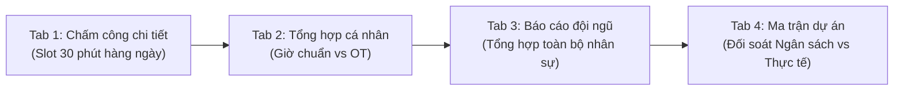

# SÁCH HƯỚNG DẪN SỬ DỤNG HỆ THỐNG
**HỆ THỐNG QUẢN LÝ DỰ ÁN & QUẢN LÝ THỜI GIAN v3.0 (BIM/PM & TIMESHEET)**

---

Chào mừng bạn đến với **Hệ thống Quản lý Dự án & Quản lý Thời gian v3.0**!  
Đây là giải pháp Web App toàn diện được xây dựng trên nền tảng **Google Sheets + Google Apps Script (Serverless)**, giúp doanh nghiệp và đội ngũ kỹ thuật quản lý dự án, tiến độ công việc, sơ đồ Gantt và chấm công chi tiết theo từng slot 30 phút mà **không tốn chi phí máy chủ, không phụ thuộc bên thứ ba và bảo mật dữ liệu độc lập 100% trên Google Drive của bạn**.

---

## 📑 MỤC LỤC
1. [Khởi tạo & Kích hoạt Web App (Chỉ làm 1 lần - 2 phút)](#1-khởi-tạo--kích-hoạt-web-app-chỉ-làm-1-lần---2-phút)
2. [Thiết lập Dữ liệu Ban đầu (Dành cho Quản trị viên)](#2-thiết-lập-dữ-liệu-ban-đầu-dành-cho-quản-trị-viên)
3. [Hướng dẫn Sử dụng các Phân hệ Nghiệp vụ](#3-hướng-dẫn-sử-dụng-các-phân-hệ-nghiệp-vụ)
   - [Phân hệ 1: Quản lý Dự án (Projects)](#31-quản-lý-dự-án-projects)
   - [Phân hệ 2: Quản lý Công việc & Kanban (Tasks)](#32-quản-lý-công-việc--kanban-tasks)
   - [Phân hệ 3: Sơ đồ Tiến độ Trực quan (Gantt Chart)](#33-sơ-đồ-tiến-độ-trực-quan-gantt-chart)
   - [Phân hệ 4: Quản lý Thời gian & Chấm công (Timesheet 4 Tab)](#34-quản-lý-thời-gian--chấm-công-timesheet-4-tab)
   - [Phân hệ 5: Danh mục Tiêu chuẩn (Taxonomy 46 Tác nghiệp)](#35-danh-mục-tiêu-chuẩn-taxonomy-46-tác-nghiệp)
4. [Ma trận Phân quyền 4 Cấp độ (RBAC Matrix)](#4-ma-trận-phân-quyền-4-cấp-độ-rbac-matrix)
5. [Câu hỏi Thường gặp & Khắc phục Lỗi (FAQ)](#5-câu-hỏi-thường-gặp--khắc-phục-lỗi-faq)

---

## 1. KHỞI TẠO & KÍCH HOẠT WEB APP (CHỈ LÀM 1 LẦN - 2 PHÚT)

Khi nhận được đường link mẫu (dạng `/copy`), bạn chỉ cần thực hiện 3 bước đơn giản:

### 🔹 Bước 1: Tạo bản sao về Google Drive của bạn
1. Nhấp vào đường link template được chia sẻ.
2. Màn hình Google hiển thị thông báo: **"Bạn có muốn tạo bản sao...?"** ➔ Nhấp vào nút xanh **Tạo bản sao (Make a copy)**.
3. Một file Google Sheet mới sẽ tự động lưu vào **Google Drive cá nhân của bạn**. Bạn có thể đổi tên file thành tên công ty/dự án của bạn (ví dụ: `[PM] Quản Lý Dự Án - Công Ty ABC`).

---

### 🔹 Bước 2: Triển khai Web App (Deploy)
1. Trên file Google Sheet vừa tạo, nhìn lên thanh menu trên cùng ➔ Chọn **Tiện ích mở rộng > Apps Script (Extensions > Apps Script)**.
2. Một tab trình duyệt mới sẽ mở ra. Ở góc trên bên phải màn hình Apps Script, nhấp vào nút xanh:  
   👉 **Triển khai > Triển khai mới (Deploy > New deployment)**.
3. Nhấp vào biểu tượng **Bánh răng ⚙️** (bên cạnh chữ *Chọn loại*) ➔ Chọn **Ứng dụng web (Web app)**.
4. Cài đặt các thông số như sau:
   * **Mô tả (Description):** `v3.0 Production`
   * **Thực thi dưới dạng (Execute as):** Chọn **Tôi / Me (`email của bạn`)**
   * **Ai có quyền truy cập (Who has access):** Chọn **Bất kỳ ai / Anyone** *(⚠️ Bắt buộc chọn `Anyone` để nhân viên trong nhóm có thể truy cập được Web App mà không bị lỗi cấp quyền).*
5. Nhấp nút **Triển khai (Deploy)**.
6. **Ủy quyền cho Google (Nếu được hỏi):**
   * Bấm **Ủy quyền truy cập (Authorize access)** ➔ Chọn tài khoản Gmail của bạn.
   * Khi Google hiện cảnh báo *"Google chưa xác minh ứng dụng này"*, nhấp vào dòng chữ nhỏ: **Nâng cao (Advanced)** ở góc dưới bên trái ➔ Nhấp vào **Đi tới Project Management (không an toàn)** ➔ Nhấp **Cho phép (Allow)**.
7. Google sẽ hiển thị một hộp thoại kèm đường link:  
   👉 **URL ứng dụng web (Web app URL):** Có dạng `https://script.google.com/macros/s/AKfycb.../exec`.  
   👉 Bấm nút **Sao chép (Copy)** đường link này.

---

### 🔹 Bước 3: Kích hoạt nút bấm trên Google Sheet
1. Quay lại tab **Google Sheet** (bảng tính) của bạn.
2. Nhìn lên thanh menu, tìm menu mang tên: **🚀 Project Manager v3**:
   * Nhấp chọn: **`📊 Mở Webapp (Tab mới)`**.
   * Hệ thống sẽ hiện một ô nhắc: *"Vui lòng dán link Web App chính thức của bạn vào đây (chỉ làm 1 lần)"*.
   * Dán đường link bạn vừa copy ở Bước 2 vào ➔ Nhấp **OK**.
3. **Hoàn tất 100%!** Từ nay về sau, bạn chỉ cần bấm nút này là Web App sẽ tự động mở lên trong tab mới.

> [!TIP]
> **Tùy chọn Mở trực tiếp trên Sheet:**  
> Nếu bạn không muốn mở sang tab mới, bạn có thể nhấp vào menu:  
> **🚀 Project Manager v3 > `🖥️ Mở App trực tiếp trên Sheet`**  
> Toàn bộ ứng dụng sẽ mở lên thành một cửa sổ lớn ngay bên trong Google Sheet để bạn thao tác lập tức!

---

## 2. THIẾT LẬP DỮ LIỆU BAN ĐẦU (DÀNH CHO QUẢN TRỊ VIÊN)

Khi mở Web App lần đầu tiên, hệ thống sẽ tự động nhận diện tài khoản Google của bạn là **Root Admin (Quản trị viên Cấp 1)** với toàn quyền quản trị.

### 👥 Bước 1: Thêm nhân sự vào hệ thống
1. Trên thanh điều hướng Web App bên trái, nhấp vào **Danh mục tiêu chuẩn (Taxonomy)**.
2. Nhấp vào tab **Nhân sự (Employees)** ➔ Bấm **+ Thêm nhân sự mới**:
   * **Mã nhân viên:** Gõ mã định danh (ví dụ: `NV001`, `NV002`, `BIM01`...).
   * **Họ và tên:** Tên nhân viên (ví dụ: `Nguyễn Văn A`).
   * **Email Google:** Email Gmail hoặc Google Workspace của nhân viên (dùng để đăng nhập và phân quyền).
   * **Cấp bậc / Vai trò:**
     * `Admin`: Toàn quyền quản trị hệ thống.
     * `Leader`: Trưởng bộ phận (xem tất cả dự án, duyệt công việc).
     * `PJ_Lead`: Quản lý dự án (quản lý phạm vi dự án được giao).
     * `Member`: Kỹ sư / Thành viên (chỉ xem dự án tham gia, chấm công cá nhân).
3. Bấm **Lưu nhân sự**.

---

### 📁 Bước 2: Tạo dự án đầu tiên
1. Nhấp vào mục **Dự án (Projects)** trên menu ➔ Bấm **+ Tạo dự án mới**.
2. Điền thông tin:
   * **Mã dự án & Tên dự án:** (ví dụ: `PRJ01 - Tòa nhà Landmark`).
   * **Quản lý dự án (PM):** Chọn email người phụ trách chính.
   * **Thời gian:** Chọn Ngày bắt đầu và Deadline kết thúc.
   * **Thành viên:** Chọn các nhân viên tham gia dự án.
3. Bấm **Tạo dự án**.

---

### 📋 Bước 3: Tạo nhiệm vụ & Giao việc (Tasks)
1. Trong mục **Công việc (Tasks)**, bấm **+ Thêm công việc**.
2. Chọn Dự án tương ứng, đặt tên công việc, gán Người thực hiện, Hạn chót (Deadline) và Mức độ ưu tiên.
3. Chọn **Giai đoạn (Phase)** và **Tác nghiệp kỹ thuật (Discipline)** trong bộ 46 tác nghiệp chuẩn để chuẩn hóa việc theo dõi.

---

## 3. HƯỚNG DẪN SỬ DỤNG CÁC PHÂN HỆ NGHIỆP VỤ

### 3.1. Quản lý Dự án (Projects)
* **Tổng quan tiến độ:** Hiển thị danh thiếp (Card) từng dự án kèm thanh tiến độ %, số lượng task hoàn thành, số thành viên và số ngày còn lại đến hạn chót.
* **Bộ lọc thông minh:** Lọc nhanh theo Trạng thái (Đang thực hiện, Lên kế hoạch, Hoàn thành, Tạm dừng).

---

### 3.2. Quản lý Công việc & Kanban (Tasks)
* **2 Chế độ hiển thị:**
  * **Chế độ Danh sách (List View):** Xem chi tiết bảng công việc, sắp xếp theo deadline, lọc theo người làm.
  * **Bảng Kanban (Board View):** Kéo thả thẻ công việc trực quan giữa các cột: *Chờ thực hiện ➔ Đang thực hiện ➔ Chờ duyệt ➔ Hoàn thành*.
* **Báo cáo kết quả đầu ra:** Kỹ sư có thể cập nhật % hoàn thành và dán kèm link kết quả (Google Drive, bản vẽ PDF, mô hình 3D Revit, v.v.).

---

### 3.3. Sơ đồ Tiến độ Trực quan (Gantt Chart)
* Hiển thị toàn bộ lịch trình dự án và công việc theo trục thời gian (Timeline).
* Phân màu trực quan theo mức độ ưu tiên và trạng thái.
* Giúp Quản lý dự án phát hiện ngay các công việc bị chậm tiến độ (Overdue) để điều phối nguồn lực kịp thời.

---

### 3.4. Quản lý Thời gian & Chấm công (Timesheet 4 Tab)
Phân hệ Timesheet chuyên sâu được chia làm 4 tab chức năng:

1. **Tab 1 - Chấm công chi tiết hàng ngày (Daily Log):**
   * Kỹ sư chọn ngày, chọn dự án, chọn tác nghiệp.
   * Giao diện lưới thời gian chia sẵn 16 slot 30 phút (từ 08:00 đến 17:00, tự động bỏ qua giờ nghỉ trưa).
   * Nhân viên chỉ cần nhấp chọn các khung giờ đã làm việc ➔ Bấm **Lưu giờ công**.
2. **Tab 2 - Tổng hợp cá nhân (Personal Summary):**
   * Tự động tính toán tổng số giờ làm việc trong tuần/tháng, số giờ chuẩn (Official) và số giờ làm thêm (OT).
3. **Tab 3 - Báo cáo đội ngũ (Team Report - Dành cho Quản lý):**
   * Tổng hợp ma trận số giờ công của toàn bộ nhân viên theo từng ngày và từng dự án.
4. **Tab 4 - Ma trận dự án (Project Matrix):**
   * Đối chiếu trực tiếp giữa **Số giờ dự toán ngân sách (Budget Hours)** và **Số giờ thực tế đã làm (Actual Hours)** để cảnh báo nguy cơ vượt ngân sách.

---

### 3.5. Danh mục Tiêu chuẩn (Taxonomy 46 Tác nghiệp)
Hệ thống được tích hợp sẵn bộ **46 Danh mục tác nghiệp kỹ thuật chuẩn hóa** (hỗ trợ song ngữ Nhật - Việt) bao gồm:
* **Nhóm PC/PN:** Xử lý dữ liệu Point Cloud quét 3D, ảnh Panorama Memo.
* **Nhóm MD:** Dựng mô hình 3D BIM (Kết cấu, Thiết bị máy móc, Đường ống MEP, Ghép mô hình tổng thể).
* **Nhóm SD:** Xuất bản vẽ thi công 2D (Shop Drawing).
* **Nhóm MC:** Kiểm tra va chạm (Clash Detection) & Báo cáo sai khác.
* **Nhóm MTG / PM / MJ / RD:** Họp hành, quản lý tiến độ, báo cáo nội bộ, nghiên cứu & đào tạo script.

> [!NOTE]
> Bạn có thể tùy chỉnh thêm, sửa, đổi màu hoặc tắt/bật các mã tác nghiệp này trong tab *Danh mục tiêu chuẩn* để phù hợp với quy trình riêng của công ty bạn.

---

### 🌐 Tính năng Đổi Ngôn ngữ 1-Click (i18n)
Ở góc trên bên phải màn hình Web App có nút chuyển đổi ngôn ngữ:
* 🇻🇳 **Tiếng Việt (VI)**
* 🇬🇧 **Tiếng Anh (EN)**
* 🇯🇵 **Tiếng Nhật (JA)**  
Chỉ cần bấm chọn là toàn bộ giao diện, trạng thái và tiêu đề cột sẽ tự động chuyển đổi tức thì!

---

## 4. MA TRẬN PHÂN QUYỀN 4 CẤP ĐỘ (RBAC MATRIX)

Hệ thống bảo vệ dữ liệu bằng cơ chế kiểm soát truy cập dựa trên vai trò (Role-Based Access Control):

| Tính năng / Nghiệp vụ | Admin (Quản trị) | Leader (Trưởng bộ phận) | PJ_Lead (Quản lý dự án) | Member (Kỹ sư) |
| :--- | :---: | :---: | :---: | :---: |
| **Xem Dashboard tổng quan** | ✅ Toàn quyền | ✅ Toàn quyền | ✅ Toàn quyền | 🔒 Chỉ dự án của mình |
| **Tạo / Sửa / Xóa Dự án** | ✅ Toàn quyền | ✅ Toàn quyền | 🔒 Dự án được giao | ❌ Không có quyền |
| **Giao việc / Phân công Task** | ✅ Toàn quyền | ✅ Toàn quyền | 🔒 Dự án được giao | ❌ Không có quyền |
| **Cập nhật % Task & Link bài** | ✅ Có | ✅ Có | ✅ Có | ✅ Task của mình |
| **Duyệt hoàn thành Task** | ✅ Toàn quyền | ✅ Toàn quyền | 🔒 Dự án được giao | ❌ Không có quyền |
| **Xem Sơ đồ Gantt Chart** | ✅ Toàn quyền | ✅ Toàn quyền | 🔒 Dự án được giao | ❌ Không có quyền |
| **Chấm công Timesheet cá nhân** | ✅ Có | ✅ Có | ✅ Có | ✅ Có |
| **Xem Báo cáo giờ công cả đội** | ✅ Có | ✅ Có | 🔒 Nhân sự dự án mình | ❌ Không có quyền |
| **Quản trị Nhân sự & Danh mục** | ✅ Toàn quyền | ❌ Không có quyền | ❌ Không có quyền | ❌ Không có quyền |

---

## 5. CÂU HỎI THƯỜNG GẶP & KHẮC PHỤC LỖI (FAQ)

### ❓ Câu hỏi 1: Nhân viên trong nhóm có cần quyền truy cập Google Sheet không?
* **Trả lời:** **KHÔNG CẦN!** Bạn chỉ cần giữ file Google Sheet cho riêng bạn. Khi cấp quyền cho nhân viên, bạn chỉ cần gửi cho họ **Đường link Web App**. Nhân viên chỉ thao tác trên giao diện Web App, dữ liệu sẽ tự động ghi về Google Sheet của bạn một cách an toàn tuyệt đối.

### ❓ Câu hỏi 2: Tại sao khi bấm link Web App trình duyệt báo lỗi "Sorry, unable to open the file at this time"?
* **Nguyên nhân:** Do trình duyệt Chrome của bạn đang đăng nhập đồng thời **nhiều tài khoản Gmail cùng lúc**, Google bị nhầm lẫn tài khoản mặc định.
* **Cách xử lý:** 
  1. Mở một **Cửa sổ ẩn danh (Ctrl + Shift + N)** ➔ Dán link Web App vào ➔ Đăng nhập đúng tài khoản Google của bạn là sẽ vào được ngay!
  2. Hoặc tạo một **Chrome Profile riêng** cho tài khoản làm việc của bạn.

### ❓ Câu hỏi 3: Tôi sửa code hoặc cập nhật tính năng mới thì Web App có tự nhận không?
* **Trả lời:** Sau khi sửa code trong Apps Script và bấm Lưu (`Ctrl + S`), bạn cần tạo phiên bản mới:
  1. Vào **Deploy > Manage deployments**.
  2. Bấm vào biểu tượng **Cây bút ✏️** bên cạnh bản Web App.
  3. Tại ô Version, chọn **New version (Phiên bản mới)** ➔ Bấm **Deploy**. Link Web App vẫn giữ nguyên không đổi!

### ❓ Câu hỏi 4: Người chia sẻ template gốc có xem được dữ liệu của công ty tôi không?
* **Trả lời:** **TUYỆT ĐỐI KHÔNG!** Khi bạn đã bấm "Tạo bản sao" (Make a copy), file Google Sheet và mã nguồn này đã thuộc về quyền sở hữu độc lập 100% trong Google Drive của bạn. Người chia sẻ template ban đầu không có bất kỳ quyền truy cập nào vào dữ liệu dự án hay giờ công của bạn.

---

🎉 **CHÚC BẠN VÀ ĐỘI NGŨ QUẢN LÝ DỰ ÁN THÀNH CÔNG VÀ HIỆU QUẢ VỚI HỆ THỐNG NÀY!**

