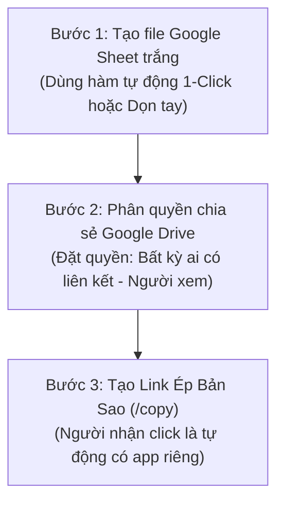

# HƯỚNG DẪN TẠO VÀ CHIA SẺ TEMPLATE APP TRẮNG (BLANK TEMPLATE)
**Hệ thống Quản lý Dự án & Quản lý Thời gian (BIM/Project Management & Timesheet Web App v3.0)**

---

## 1. TỔNG QUAN & NGUYÊN TẮC BẢO MẬT (ZERO DATA LEAKAGE)

Khi muốn chuyển giao hoặc chia sẻ ứng dụng Web App cho đối tác, khách hàng hoặc các phòng ban/công ty khác sử dụng độc lập, bạn cần cung cấp một **Bản Template Trắng (Blank Template)**.

### 🛡️ Nguyên tắc an toàn dữ liệu:
| Thành phần | Trạng thái xử lý | Mục đích |
| :--- | :---: | :--- |
| **Mã nguồn Apps Script (Backend & Frontend)** | **Giữ nguyên 100%** | Giữ nguyên toàn bộ tính năng: Quản lý dự án, Task, Gantt Chart, Timesheet 4 tab, Đa ngôn ngữ (VI-EN-JA), Phân quyền RBAC. |
| **Cấu trúc Bảng & Tiêu đề cột (Headers)** | **Giữ nguyên 100%** | Đảm bảo các hàm CRUD và Web App đọc/ghi đúng cột, không bị lệch dữ liệu. |
| **Bộ 46 Danh mục Tiêu chuẩn (Taxonomy)** | **Giữ nguyên 100%** | Giữ lại 8 Nhóm (Category), 3 Giai đoạn (Phase), và 46 Tác nghiệp chuẩn (Discipline) song ngữ Nhật - Việt để người dùng mới không phải tạo lại từ đầu. |
| **Dữ liệu Dự án & Nhiệm vụ cũ** | **XÓA SẠCH (Clear)** | Bảo mật thông tin kinh doanh, các dự án thực tế nội bộ (MUR01, JUJ01, AMA01, TES01,...). |
| **Dữ liệu Giờ chấm công (Timesheet)** | **XÓA SẠCH (Clear)** | Bảo mật thông tin chấm công, 712+ giờ công và lịch sử làm việc của nhân viên cũ. |
| **Lịch sử Nhật ký (Activity Log)** | **XÓA SẠCH (Clear)** | Xóa toàn bộ vết thao tác, địa chỉ IP, lịch sử hệ thống cũ. |
| **Danh sách Nhân sự (Users/Employees)** | **RESET về 1 Admin** | Xóa toàn bộ nhân viên cũ của bạn. Chỉ để lại 1 tài khoản Quản trị viên (Root Admin) đại diện cho người sở hữu mới. |

---

## 2. QUY TRÌNH 3 BƯỚC THỰC HIỆN



---

### BƯỚC 1: TẠO FILE GOOGLE SHEET MẪU VÀ DỌN SẠCH DỮ LIỆU

> [!TIP]
> **ĐỂ KHÔNG LÀM HỎNG FILE GỐC CỦA BẠN:**
> Luôn luôn thao tác trên **Bản sao** của Google Sheet, tuyệt đối không chạy lệnh xóa trên file đang chạy thật của công ty!

1. Trên file Google Sheet đang sử dụng, vào menu **Tệp > Tạo bản sao (File > Make a copy)**.
2. Đặt tên cho file mới: `[TEMPLATE] WebApp Quan Ly Du An & Gio Cong v3.0`.
3. Mở file bản sao vừa tạo. Để dọn sạch dữ liệu, bạn có **2 cách**:

#### ⚡ CÁCH 1: Dọn sạch tự động 1-Click bằng hàm `createCleanBlankTemplate` (KHUYẾN NGHỊ - 3 GIÂY)
Trong mã nguồn hệ thống đã được tích hợp sẵn hàm dọn dẹp an toàn tuyệt đối:
1. Trên file Google Sheet bản sao, vào menu **Tiện ích mở rộng > Apps Script (Extensions > Apps Script)**.
2. Tại thanh công cụ phía trên, nhìn vào ô dropdown chọn hàm (đang hiển thị `doGet` hoặc `seedActualProjects...`):
   * Bấm vào dropdown và chọn hàm: **`createCleanBlankTemplate`**.
3. Bấm nút **▶ Chạy (Run)**.
4. Khi chạy xong (chỉ mất ~2 giây), hộp thoại Execution Log sẽ báo:
   ```text
   =================================================================
   🎉 HOÀN TẤT TẠO BẢN TEMPLATE TRẮNG SẠCH 100%!
      - Giữ nguyên: Toàn bộ cấu trúc Sheet, công thức, mã code Apps Script.
      - Giữ nguyên: 8 Nhóm Category, 3 Giai đoạn Phase, 46 Tác nghiệp Discipline chuẩn.
      - Đã xóa sạch: 100% Dự án, Nhiệm vụ, Giờ công, Nhật ký, Nhân viên cũ.
   =================================================================
   ```
*Toàn bộ dữ liệu nhạy cảm đã biến mất, chỉ còn khung chuẩn sạch bóng!*

---

#### 🖐️ CÁCH 2: Dọn sạch thủ công bằng tay (Nếu không muốn chạy script)
Nếu bạn muốn tự tay kiểm tra từng tab, hãy mở từng sheet và xóa dữ liệu theo bảng sau:

| Tên Sheet | Thao tác dọn dẹp dữ liệu |
| :--- | :--- |
| **`PROJECTS`** | **Giữ nguyên Dòng 1 (Tiêu đề)**. Bôi đen từ **Dòng 2 đến hết** ➔ Nhấn phím `Delete` (hoặc chuột phải chọn *Xóa hàng 2 - n*). |
| **`TASKS`** | **Giữ nguyên Dòng 1 (Tiêu đề)**. Bôi đen từ **Dòng 2 đến hết** ➔ Nhấn phím `Delete`. |
| **`TIMESHEET_2026`** (hoặc các năm khác) | **Giữ nguyên Dòng 1 (Tiêu đề)**. Bôi đen từ **Dòng 2 đến hết** ➔ Nhấn phím `Delete`. |
| **`TIMESHEET_DAILY_ROLLUP`** | **Giữ nguyên Dòng 1 (Tiêu đề)**. Bôi đen từ **Dòng 2 đến hết** ➔ Nhấn phím `Delete`. |
| **`TIMESHEET_YEARLY_SUMMARY`** | **Giữ nguyên Dòng 1 (Tiêu đề)**. Bôi đen từ **Dòng 2 đến hết** ➔ Nhấn phím `Delete`. |
| **`ACTIVITY_LOG`** | **Giữ nguyên Dòng 1 (Tiêu đề)**. Bôi đen từ **Dòng 2 đến hết** ➔ Nhấn phím `Delete`. |
| **`TAXONOMY`** | 1. **GIỮ NGUYÊN** các dòng có Cột B (Type) là `CATEGORY`, `PHASE`, `DISCIPLINE` (46 dòng tác nghiệp).<br/>2. **XÓA HẾT** các dòng có Cột B là `PROJECT` (Dự án cũ).<br/>3. **XÓA HẾT** các dòng có Cột B là `EMPLOYEE` của nhân viên cũ, chỉ giữ 1 dòng Admin mẫu. |
| **`USERS`** | **Giữ nguyên Dòng 1 (Tiêu đề)**. Xóa toàn bộ các nhân viên cũ, chỉ để lại 1 dòng Quản trị viên:<br/>`NV001 | admin@example.com | Quản trị viên | Admin | Active | ...` |

---

### BƯỚC 2: CÀI ĐẶT QUYỀN CHIA SẺ TRÊN GOOGLE DRIVE

Để người nhận có thể copy mà **không thể can thiệp làm hỏng file mẫu gốc của bạn**:

1. Trên file Google Sheet Template vừa làm sạch, bấm nút xanh **Chia sẻ (Share)** ở góc trên bên phải màn hình.
2. Tại mục **Quyền truy cập chung (General access)**:
   * Chọn: **Bất kỳ ai có đường liên kết (Anyone with the link)**.
   * Quyền hạn: Chọn **Người xem (Viewer)**.
3. Bấm **Sao chép đường liên kết (Copy link)** ➔ Bấm **Xong (Done)**.

> [!CAUTION]
> **TUYỆT ĐỐI KHÔNG CHỌN QUYỀN "NGƯỜI CHỈNH SỬA (EDITOR)":**
> Nếu bạn chọn quyền "Người chỉnh sửa", người khác vào file mẫu có thể vô tình xóa công thức, sửa code hoặc nạp dữ liệu của họ đè lên template gốc!

---

### BƯỚC 3: TẠO "LINK ÉP BẢN SAO" (FORCE COPY LINK)

Đây là kỹ thuật chuyên nghiệp nhất khi phân phối template trên Google Sheets:

1. Đường link bạn vừa sao chép ở Bước 2 thường có dạng:
   ```text
   https://docs.google.com/spreadsheets/d/1A2B3C4D5E6F7G8H9J_XYZ12345/edit?usp=sharing
   ```
2. Bạn hãy **xóa bỏ toàn bộ phần đuôi** từ dấu gạch chéo `/edit...` trở đi.
3. Thay thế bằng chữ **`/copy`**.
4. Đường link hoàn chỉnh sẽ có dạng:
   👉 **`https://docs.google.com/spreadsheets/d/1A2B3C4D5E6F7G8H9J_XYZ12345/copy`**

---

## 3. TRẢI NGHIỆM CỦA NGƯỜI NHẬN TEMPLATE

Khi bạn gửi đường link `/copy` này cho bất kỳ ai:
1. Khi họ bấm vào link, trình duyệt Google của họ sẽ hiện ngay màn hình:
   > **"Bạn có muốn tạo bản sao của [TEMPLATE] WebApp Quan Ly Du An & Gio Cong v3.0?"**  
   > *(Có nút xanh: **Tạo bản sao / Make a copy**)*
2. Khi họ bấm **"Tạo bản sao"**:
   * Google sẽ tự động nhân bản 1 file Google Sheet hoàn toàn mới nằm riêng biệt trong Google Drive của họ.
   * Toàn bộ mã nguồn Google Apps Script được tự động sao chép theo file đó.
   * File đó thuộc quyền sở hữu cá nhân của họ, **tách biệt 100%** và không liên quan gì đến Google Drive hay dữ liệu của bạn!

---

## 4. MẪU TIN NHẮN / EMAIL BÀN GIAO CHO NGƯỜI DÙNG MỚI

Bạn chỉ cần sao chép (copy) đoạn văn bản dưới đây gửi kèm cho người nhận template:

```markdown
Chào bạn,

Dưới đây là link nhận bản Template Hệ Thống Quản Lý Dự Án & Quản Lý Thời Gian (BIM/Timesheet Web App v3.0):

👉 LINK NHẬN TEMPLATE: 
[DÁN ĐƯỜNG LINK /copy CỦA BẠN VÀO ĐÂY]

HƯỚNG DẪN 3 BƯỚC ĐỂ BẮT ĐẦU SỬ DỤNG:

1. BƯỚC 1 - TẠO BẢN SAO VỀ DRIVE CỦA BẠN:
   - Click vào link trên, sau đó bấm nút "Tạo bản sao" (Make a copy).
   - File Google Sheet sẽ tự động lưu vào Google Drive của bạn.

2. BƯỚC 2 - KÍCH HOẠT WEB APP (CHỈ LÀM 1 LẦN):
   - Trên file Google Sheet vừa tạo, vào menu: "Tiện ích mở rộng" > "Apps Script" (Extensions > Apps Script).
   - Ở góc trên bên phải màn hình Apps Script, bấm nút "Triển khai" (Deploy) > Chọn "Triển khai mới" (New deployment).
   - Bấm vào biểu tượng bánh răng bên cạnh chữ "Chọn loại", chọn "Ứng dụng web" (Web app).
   - Điền thông tin:
     + Mô tả: Phiên bản v3.0
     + Thực thi dưới dạng (Execute as): Tôi (tài khoản Google của bạn)
     + Ai có quyền truy cập (Who has access): Bất kỳ ai (Anyone) hoặc Trong tổ chức của bạn.
   - Bấm "Triển khai" (Deploy) -> Cấp quyền truy cập nếu Google yêu cầu.
   - Sao chép đường link "Ứng dụng web" (URL kết thúc bằng /exec) để sử dụng và gửi cho nhân viên trong nhóm.

3. BƯỚC 3 - BẮT ĐẦU SỬ DỤNG:
   - Mở link Web App vừa tạo. Hệ thống sẽ tự động nhận diện tài khoản Google của bạn là "Quản trị viên (Admin)" cấp cao nhất.
   - Bạn có thể vào tab "Danh mục tiêu chuẩn" để thêm nhân sự mới, tạo dự án và bắt đầu chấm công!
```

---

## 5. CƠ CHẾ TỰ ĐỘNG THÍCH ỨNG CỦA HỆ THỐNG ĐÃ ĐƯỢC TỐI ƯU

Hệ thống mã nguồn của bạn đã được lập trình sẵn các cơ chế thông minh:
1. **Tự động nhận diện Chủ sở hữu (Auto Owner Detection):**
   * Trong `Code.gs`, hàm `getCurrentUser()` sẽ tự động kiểm tra `SpreadsheetApp.getActiveSpreadsheet().getOwner()`.
   * Bất kỳ ai thực hiện copy file về Drive của họ đều là Owner của bảng tính đó, do đó họ **nghiễm nhiên nhận toàn quyền Root Admin (Level 1)** mà không cần sửa code.
2. **Tự động đăng ký Quản trị viên mới (Auto Admin Provisioning):**
   * Khi người dùng mới mở Web App lần đầu, hàm `ensureAdminPersistence()` sẽ tự động thêm email và tên của họ vào bảng `USERS` với quyền `Admin`.
3. **Bảo toàn 46 tác nghiệp chuẩn (Taxonomy Integrity):**
   * 46 Tác nghiệp chuyên sâu song ngữ (Nhật - Việt) cho thiết kế BIM, Point Cloud, Shop Drawing, Họp hành, Báo cáo... luôn có sẵn để đội ngũ mới dùng được ngay lập tức.

---

## 6. CHECKLIST KIỂM TRA NHANH TRƯỚC KHI GỬI (QA CHECKLIST)

Trước khi gửi link cho khách hàng/đối tác, bạn hãy tự kiểm tra 4 điểm sau:
- [ ] Mở file Template ở tab ẩn danh (Incognito Window) bằng link `/copy` xem có hiện nút "Tạo bản sao" không.
- [ ] Bấm tạo thử bản sao trên một tài khoản Google phụ khác xem có bị lộ dự án cũ nào không.
- [ ] Kiểm tra các tab `PROJECTS`, `TASKS`, `TIMESHEET_2026`: Dòng 2 trở xuống đã trống hoàn toàn chưa.
- [ ] Kiểm tra tab `TAXONOMY`: 46 mã tác nghiệp chuẩn (PN01, PC01, MD01,...) còn nguyên vẹn.

