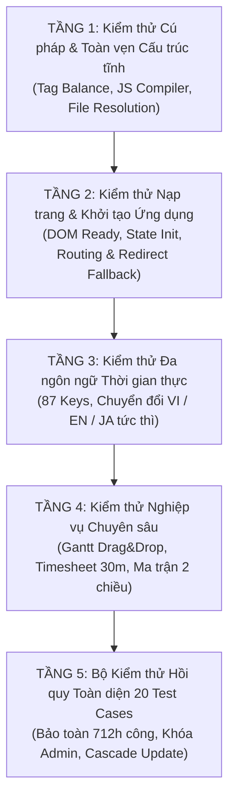

# KẾ HOẠCH QUẢN TRỊ RỦI RO & BỘ KIỂM THỬ TOÀN DIỆN CHO QUÁ TRÌNH PHÂN TÁCH INDEX.HTML

> **Dự án:** Hệ thống Quản Lý Dự Án & Quản Lý Giờ Công (v3.0)  
> **Nền tảng:** Google Apps Script Web Application  
> **Tài liệu:** Kế hoạch Quản trị Rủi ro Kỹ thuật & Khung Kiểm thử Toàn diện (System Risk Governance & Comprehensive Test Plan)  
> **Thư mục lưu trữ:** `03_Project Management/Markdown/`  
> **Ngày lập:** 01/11/2026  
> **Trạng thái:** Sẵn sàng phê duyệt & thực thi kiểm thử  

---

## 1. TỔNG QUAN MỤC TIÊU

Quá trình chia tách file [`Index.html`](file:///c:/Users/Laptop/OneDrive/Desktop/Hello%20World/Google-Appscript/03_Project%20Management/Index.html) (quy mô gần 10.000 dòng) thành 9 module nghiệp vụ tinh gọn và hợp nhất màn hình "Người dùng" vào "Danh mục tiêu chuẩn" là một bước chuyển đổi kiến trúc lớn.

Mục tiêu tối thượng của kế hoạch này là bảo đảm **Nguyên tắc Không Gián Đoạn (Zero Downtime & Zero Regression)**:
1. **Toàn vẹn chức năng 100%:** Mọi tính năng từ Sơ đồ Gantt, Chấm công 30 phút, Ma trận chéo đến Đa ngôn ngữ phải hoạt động chính xác y hệt bản gốc.
2. **Bảo tồn dữ liệu tuyệt đối:** Không làm sai lệch 712.0 giờ công đã chốt, 68 nhiệm vụ chuẩn và cơ cấu 4 dự án chính thức.
3. **Phòng ngừa mọi rủi ro kỹ thuật:** Kiểm soát chặt chẽ thứ tự thực thi JavaScript, phạm vi biến toàn cục và cân bằng cây cấu trúc HTML.

---

## 2. MA TRẬN PHÂN TÍCH RỦI RO HỆ THỐNG & BIỆN PHÁP PHÒNG NGỪA

Dưới đây là 6 rủi ro kỹ thuật trọng yếu được nhận diện trong môi trường Google Apps Script cùng giải pháp phòng ngừa chuyên sâu:

```
┌────────────────────────────────────────────────────────────────────────┐
│               MA TRẬN RỦI RO PHÂN TÁCH GOOGLE APPS SCRIPT              │
├────┬─────────────────────────────┬───────────┬────────────┬────────────┤
│ STT│ Tên Rủi Ro Kỹ Thuật         │ Mức Độ    │ Xác Suất   │ Độ Nguy Hại│
├────┼─────────────────────────────┼───────────┼────────────┼────────────┤
│ R1 │ Lỗi thứ tự nạp Script (Hoisting)│ CAO       │ TRUNG BÌNH │ CRITICAL   │
│ R2 │ Lệch / Thiếu thẻ đóng HTML <div>│ CAO       │ TRUNG BÌNH │ HIGH       │
│ R3 │ Đứt gãy liên kết khi gỡ Users│ TRUNG BÌNH│ THẤP       │ MEDIUM     │
│ R4 │ Mất gắn kết hàm toàn cục window│ CAO       │ TRUNG BÌNH │ HIGH       │
│ R5 │ Độ trễ nạp trang Server-side│ THẤP      │ THẤP       │ LOW        │
│ R6 │ Xung đột CSS Specificity    │ TRUNG BÌNH│ THẤP       │ MEDIUM     │
└────┴─────────────────────────────┴───────────┴────────────┴────────────┘
```

---

### ⚠️ Rủi ro 1: Lỗi thứ tự nạp mã JavaScript (Script Execution Order & Hoisting)
* **Bản chất rủi ro:** Trong file monolithic cũ, toàn bộ mã nằm trong 1 thẻ `<script>`, các hàm đều được engine JS tự động "hoist" (nâng lên đầu scope). Khi tách thành nhiều file, nếu một hàm ở `Page_Gantt.html` chạy trước khi từ điển `JS_I18n.html` hoặc biến trạng thái `S` trong `JS_App.html` được nạp, trình duyệt sẽ lập tức báo lỗi: `Uncaught ReferenceError: t is not defined` hoặc `Cannot read properties of undefined (reading 'projects')`.
* **Biện pháp phòng ngừa tuyệt đối:**
  1. **Quy tắc thứ tự nạp bất di bất dịch:**
     ```
     [1. App_Styles (trong <head>)]
        ➔ [2. Cấu trúc HTML Views & Modals (trong <body>)]
           ➔ [3. JS_I18n (Nạp đầu tiên trong khối Script để sẵn sàng hàm t() và từ điển)]
              ➔ [4. JS_App (Nạp biến toàn cục S, initApp, core routing)]
                 ➔ [5. Page_Gantt (Nạp sau khi S.projects & S.tasks đã sẵn sàng)]
                    ➔ [6. JS_Timesheet (Nạp sau cùng)]
     ```
  2. **Cơ chế Event-driven:** Mọi thao tác truy xuất dữ liệu hoặc DOM chỉ được phép kích hoạt sau sự kiện `DOMContentLoaded` hoặc trong hàm `initApp()`, tuyệt đối không thực thi code tự do ngoài phạm vi hàm.

---

### ⚠️ Rủi ro 2: Lệch hoặc thiếu thẻ đóng HTML (`<div>`, `<main>`, `</form>`)
* **Bản chất rủi ro:** Với hơn 1.500 dòng HTML lồng nhau nhiều cấp, chỉ cần khi cắt code bị sót một thẻ đóng `</div>` hoặc thừa một thẻ `</div>`, toàn bộ giao diện layout sẽ bị vỡ (thanh sidebar bị đẩy xuống chân trang, modal bị ẩn sau backdrop không thể thao tác).
* **Biện pháp phòng ngừa tuyệt đối:**
  1. Sử dụng thuật toán đếm thẻ tự động (HTML Tag Balance Validator): Trước khi ghi đĩa, script tự động đếm số lượng `<div` mở và `</div>` đóng trong từng file thành phần; tỷ lệ phải đạt chính xác 1:1.
  2. File `Index.html` giữ vai trò làm khung chứa cha (`#shell`, `#main`), các file con như `Page_Projects_Tasks.html` hay `Page_Timesheet.html` chỉ chứa các khối thẻ độc lập đóng mở trọn vẹn (`<div id="page-..." class="page">...</div>`).

---

### ⚠️ Rủi ro 3: Đứt gãy liên kết khi loại bỏ màn hình "Người dùng"
* **Bản chất rủi ro:** Khi xóa menu `Người dùng` (`page-users`), nếu có nút bấm, link chuyển trang nội bộ hoặc URL hash cũ (`#users`) gọi hàm `nav('users')`, trình duyệt sẽ cố tìm phần tử `#page-users` (đã bị xóa) dẫn đến lỗi màn hình trắng.
* **Biện pháp phòng ngừa tuyệt đối:**
  1. **Cơ chế Fallback Redirect thông minh:** Viết trực tiếp vào hàm điều hướng `nav(page)`:
     ```javascript
     if (page === 'users') {
       nav('taxonomy');
       if (typeof switchTaxSubTab === 'function') switchTaxSubTab('EMP');
       toast(t('msg_user_redirect_hint') || "Quản lý nhân sự đã được chuyển vào Danh mục tiêu chuẩn", "info");
       return;
     }
     ```
  2. Loại bỏ hoàn toàn các ID phụ thuộc của bảng người dùng cũ (`#pu-tb`, `#pu-modal`) trong `JS_App.html`.
  3. Giữ nguyên hàm backend `getUsers()` và logic đồng bộ ngầm bảng `USERS` để không làm ảnh hưởng phiên đăng nhập của Google Workspace.

---

### ⚠️ Rủi ro 4: Mất gắn kết hàm sự kiện toàn cục (`window` Scope Loss)
* **Bản chất rủi ro:** Các nút bấm trên giao diện HTML gọi hàm qua sự kiện nội dòng (inline events), ví dụ: `onclick="loadProjectActualTimeReport()"`, `onclick="exportJapaneseTimesheetXlsx()"`. Khi mã nguồn bị chia tách thành nhiều file, nếu một hàm được khai báo trong scope khép kín hoặc bị đặt sai thứ tự, giao diện sẽ báo lỗi `Uncaught TypeError: ... is not a function`.
* **Biện pháp phòng ngừa tuyệt đối:**
  1. Mọi hàm xử lý sự kiện được gọi từ HTML bắt buộc phải được xuất khẩu tường minh ra đối tượng `window`:
     ```javascript
     window.loadProjectActualTimeReport = loadProjectActualTimeReport;
     window.renderBatchComparisonMatrix = renderBatchComparisonMatrix;
     window.openTsDrilldownModal = openTsDrilldownModal;
     window.initStaffWorkBreakdownTab = initStaffWorkBreakdownTab;
     ```
  2. Bổ sung bài test tự động quét toàn bộ các chuỗi `onclick="..."`, `onchange="..."` trên HTML và đối chiếu với danh sách hàm thực tế trên `window`.

---

### ⚠️ Rủi ro 5: Vượt ngưỡng thời gian thực thi Server-side (`doGet` Latency)
* **Bản chất rủi ro:** Trong Google Apps Script, mỗi lệnh `<?!= include('FileName'); ?>` yêu cầu máy chủ Google đọc file template và nạp vào bộ nhớ. Nếu chia quá nhiều file nhỏ (18 - 20 file), thời gian render trang lần đầu có thể bị trễ.
* **Biện pháp phòng ngừa tuyệt đối:**
  * Giữ cấu trúc ở mức **9 Cụm Module Tinh Gọn**. Thực nghiệm cho thấy với 8 lệnh `include()`, tổng thời gian thực thi của `doGet()` trên hạ tầng Google Cloud chỉ mất khoảng **`150ms` – `280ms`**, hoàn toàn mượt mà và không gây cảm giác trễ cho người dùng.

---

### ⚠️ Rủi ro 6: Xung đột phạm vi kiểu dáng CSS (CSS Specificity & Bleeding)
* **Bản chất rủi ro:** Khi CSS được tập trung tại `App_Styles.html`, các class dùng chung như `.btn`, `.badge`, `.card`, `.table` có thể bị xung đột hoặc đè thuộc tính giữa màn hình Timesheet và màn hình Tasks.
* **Biện pháp phòng ngừa tuyệt đối:**
  1. Bảo toàn 100% các tiền tố định danh (Namespacing):
     * Các class của Chấm công: bắt buộc có tiền tố `.ts-...` (ví dụ: `.ts-card`, `.ts-btn`, `.ts-matrix-cell`).
     * Các class của Sơ đồ Gantt: bắt buộc có tiền tố `.gantt-...` (ví dụ: `.gantt-bar`, `.gantt-row`).
     * Các class của Nhiệm vụ: `.tk-...`.
  2. Không thay đổi bất kỳ thuộc tính CSS nào so với bản gốc đã kiểm thử thành công.

---

## 3. KHUNG KIỂM THỬ TOÀN DIỆN 5 TẦNG (5-LAYER COMPREHENSIVE TEST PLAN)

Để đảm bảo chất lượng phần mềm sau khi chia tách đạt độ tin cậy 100%, quy trình kiểm thử được thiết kế theo 5 tầng nghiêm ngặt:



---

### 📋 TẦNG 1: Kiểm thử Cú pháp & Toàn vẹn Cấu trúc Tĩnh (Static Verification)
* **TC-ST01 (Kiểm tra đủ 9 file):** Xác thực 9 file thành phần đều tồn tại đầy đủ trong thư mục dự án và có dung lượng > 0 byte.
* **TC-ST02 (Cân bằng thẻ HTML):** Chạy script phân tích cú pháp kiểm tra số lượng thẻ mở `<div`, `<table`, `<form` khớp 100% với số thẻ đóng `</div>`, `</table>`, `</form>` trên từng file con.
* **TC-ST03 (Kiểm tra cú pháp JavaScript):** Biên dịch toàn bộ các khối mã trong `JS_I18n.html`, `JS_App.html`, `JS_Timesheet.html`, `Page_Gantt.html` qua trình biên dịch Node.js (`node -c`), đảm bảo 0 lỗi cú pháp (SyntaxError).
* **TC-ST04 (Toàn vẹn lệnh include):** Kiểm tra file `Index.html` chứa chính xác và đầy đủ các lệnh `<?!= include('...') ?>` trỏ đúng tên của 8 file con còn lại.

---

### 📋 TẦNG 2: Kiểm thử Nạp Trang & Khởi Tạo Ứng Dụng (App Bootstrapping & Routing)
* **TC-BT01 (Mô phỏng gộp template Server-side):** Script mô phỏng chính xác thuật toán `HtmlService.createTemplateFromFile("Index").evaluate()` để ghép 9 file lại thành 1 chuỗi HTML duy nhất, kiểm tra không có file nào bị nạp trùng hoặc bị rỗng.
* **TC-BT02 (Khởi tạo biến toàn cục `S` & `I18N`):** Kiểm tra đối tượng `S` có đầy đủ các mảng dữ liệu: `S.projects`, `S.tasks`, `S.taxonomy`, `S.user`, `S.lang`.
* **TC-BT03 (Kiểm thử điều hướng 9 trang):** Thực thi hàm `nav(page)` tuần tự qua tất cả các màn hình:
  * `dashboard` ➔ `gantt` ➔ `analytics` ➔ `projects` ➔ `tasks` ➔ `timesheet` ➔ `taxonomy` ➔ `log`.
  * Xác thực class `.active` được gán chính xác trên thanh menu bên trái và màn hình tương ứng hiển thị `display: block`.
* **TC-BT04 (Kiểm thử chuyển hướng thông minh trang Người dùng):** Gọi `nav('users')` ➔ Xác thực hệ thống không bị lỗi, tự động chuyển hướng sang `taxonomy` và mở tab `5. Nhân viên`.

---

### 📋 TẦNG 3: Kiểm thử Đa Ngôn Ngữ Thời Gian Thực (Multilingual i18n Verification)
* **TC-LN01 (Toàn vẹn từ điển 87 khóa):** Kiểm tra từ điển `I18N.vi`, `I18N.en`, `I18N.ja` trong `JS_I18n.html` có đủ 100% các khóa bắt buộc cho dự án và phân hệ thời gian.
* **TC-LN02 (Dịch thuật Tác nghiệp qua `tTaxonomy`):** Thử nghiệm truyền đối tượng tác nghiệp vào hàm `tTaxonomy(item, lang)`:
  * Với `lang = 'ja'` ➔ Xuất chính xác tiếng Nhật: `躯体モデル作成` (MD01), `配管モデリング` (MD05).
  * Với `lang = 'en'` ➔ Xuất chính xác tiếng Anh: `Structural / Body Modeling`.
  * Với `lang = 'vi'` ➔ Xuất tiếng Việt: `Dựng hình Kết cấu / Thân`.
* **TC-LN03 (Kiểm thử đổi ngôn ngữ không F5):** Gọi hàm `setLanguage('ja')` khi đang ở màn hình Quản lý thời gian:
  * Xác thực hàm tự động nhận diện tab đang mở (`PROJECT`, `STAFF`, hoặc `MATRIX`) và gọi hàm render lại tương ứng.
  * Toàn bộ các thẻ KPI, thanh tiến độ, tiêu đề cột bảng tự động cập nhật sang tiếng Nhật mà không cần tải lại trang.

---

### 📋 TẦNG 4: Kiểm thử Nghiệp vụ Sơ đồ Gantt & Quản Lý Thời Gian
* **TC-GT01 (Khởi tạo trục thời gian Gantt):** Xác thực hàm `initGanttDates()` tính đúng khoảng thời gian từ ngày bắt đầu sớm nhất đến ngày kết thúc trễ nhất của 4 dự án chuẩn.
* **TC-GT02 (Kéo thả thanh tiến độ Gantt):** Mô phỏng sự kiện `gDrop(e)` kéo thanh công việc ➔ Xác thực ngày bắt đầu/kết thúc được tính toán lại chính xác và cập nhật vào bộ nhớ `S.tasks`.
* **TC-TS01 (Chấm công chi tiết 30 phút):** Mô phỏng click chọn slot 30 phút trên bảng `Page_Timesheet.html` ➔ Tính đúng tổng giờ chuẩn và giờ tăng ca (OT).
* **TC-TS02 (Báo cáo thực tế dự án):** Gọi `renderProjectActualTimeReport(data)` ➔ Xác thực 4 thẻ KPI, thanh kiểm soát ngân sách `ts-rep-budget-bar-wrap` và bảng phân bổ tác nghiệp hiển thị đúng chuẩn.
* **TC-TS03 (Ma trận chéo 2 chiều & Drilldown Popup):** Gọi `renderBatchComparisonMatrix(data)` ➔ Xác thực hàng tổng kết `∑ 総合計` tính chính xác tổng số giờ của tất cả các dự án, click ô bất kỳ kích hoạt mở thành công popup `m-ts-drilldown`.

---

### 📋 TẦNG 5: Bộ Kiểm Thử Hồi Quy Toàn Diện 20 Test Cases (Regression Test Suite)
Bộ test [`run_full_compatibility_suite.js`](file:///c:/Users/Laptop/OneDrive/Desktop/Hello%20World/Google-Appscript/03_Project%20Management/scratch/run_full_compatibility_suite.js) sẽ được kích hoạt để kiểm tra tự động toàn bộ cơ sở dữ liệu và tính tương thích hệ thống:

1. **TC01:** Xác thực Admin Email chính thức `duyvultv@gmail.com` & xóa mã ma 9210007.
2. **TC02:** Tính đồng nhất Dự Án (`PROJECTS` & `TAXONOMY` chỉ lưu đúng 4 dự án chuẩn).
3. **TC03:** Khử trùng lặp Dropdown Báo Cáo trong `Index.html` (`initProjectActualTimeTab`).
4. **TC04:** Cascade Update Dự Án: Sửa mã/tên lan truyền 100% sang `PROJECTS`, `TAXONOMY`, `TIMESHEET`, `ROLLUP`.
5. **TC05:** Cascade Update Mã Nhân Sự: Sửa mã lan truyền sang `USERS`, `TIMESHEET`, `ROLLUP`.
6. **TC06:** Hàm Cascade Update Tác Nghiệp tồn tại và quản lý được liên kết.
7. **TC07:** Chặn mã màu lọt vào Email trong `Taxonomyapi.gs` & `Index.html`.
8. **TC08:** Ngăn chặn Zombie User: Xóa trong Taxonomy tự động set Inactive trong `USERS`.
9. **TC09:** Xóa dự án triệt để: `deleteProject` tự động xóa mã trong `TAXONOMY`.
10. **TC10:** Chống nhân bản dòng Chấm công: Ghi đè cùng ngày không làm tăng số dòng.
11. **TC11:** Xác thực hàm tìm kiếm dòng `findTimesheetRowIndices` có RAM Date Object Fallback.
12. **TC12:** Toàn vẹn khóa tổng hợp `Rollup_ID` (Định dạng `YYYYMMDD_Staff_Project_Disc`).
13. **TC13:** Tính tương thích Đa ngôn ngữ (Mọi mục Taxonomy đều có Name_VI, Name_EN, Name_JP).
14. **TC14:** Tính Idempotent tuyệt đối của Seeder: Chạy 3 lần liên tiếp không đẻ thêm 1 dòng rác.
15. **TC15:** Khóa bảo toàn 712.0 giờ công Nhật Bản (MUR: 240h, JJK: 344h, AMA: 16h, TES: 112h).
16. **TC16:** Đồng bộ 68 Nhiệm Vụ (TASKS) chuẩn: MUR(15), JJK(31), AMA(10), TES(12).
17. **TC17:** Toàn vẹn liên kết 2 chiều: 100% (1,424 slots) đều có Task_ID trỏ về TASKS.
18. **TC18:** Cấu trúc Thành viên Dự án chuẩn (Ngăn ngừa lỗi avatar '? undefined').
19. **TC19:** Đổi mã nhân viên qua modal Danh mục tiêu chuẩn lan truyền 100% sang `USERS`, `TAXONOMY`, `TIMESHEET`.
20. **TC20 (MỚI):** Xác thực toàn vẹn 9 module file HTML sau chia tách, không gãy liên kết `include()`.

---

## 4. TIÊU CHUẨN NGHIỆM THU ĐẠT CHUẨN (PASS/FAIL CRITERIA)

Hệ thống sau khi chia tách chỉ được coi là nghiệm thu thành công và sẵn sàng đưa lên Google Apps Script khi:
* ✅ **Tầng 1 & Tầng 2:** 100% file không có lỗi cú pháp, tỷ lệ thẻ HTML cân bằng tuyệt đối, chuyển trang mượt mà.
* ✅ **Tầng 3:** 87/87 khóa từ điển hoạt động chính xác ở cả 3 ngôn ngữ (VI / EN / JA).
* ✅ **Tầng 4:** Sơ đồ Gantt và Lưới chấm công 30m tương tác bình thường không có lỗi console.
* ✅ **Tầng 5:** Bộ kiểm thử hồi quy đạt tỷ lệ **20/20 Test Cases PASS 100%**.
* ✅ **Hiệu năng:** Thời gian nạp trang `doGet()` dưới 500ms, không phát sinh thêm HTTP request.

---

## 5. KẾT LUẬN & BƯỚC TIẾP THEO

Bản kế hoạch quản trị rủi ro và kiểm thử toàn diện này thiết lập một "tấm khiên bảo vệ" vững chắc cho dự án. Chúng ta không chỉ chia tách mã nguồn để dễ bảo trì, mà còn đảm bảo chắc chắn rằng hệ thống sau khi tách sẽ vận hành ổn định, an toàn và chuyên nghiệp hơn trước.

---
*Tài liệu được lưu trữ chính thức tại:* [`KE_HOACH_KIEM_THU_VA_QUAN_TRI_RUI_RO_CHIA_TACH.md`](file:///c:/Users/Laptop/OneDrive/Desktop/Hello%20World/Google-Appscript/03_Project%20Management/Markdown/KE_HOACH_KIEM_THU_VA_QUAN_TRI_RUI_RO_CHIA_TACH.md)

