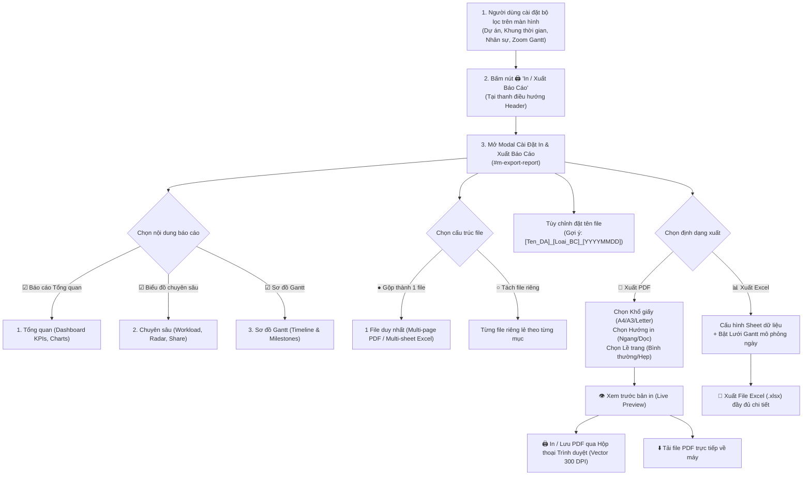
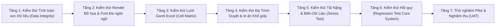

# Kế Hoạch Triển Khai Tính Năng In & Xuất Báo Cáo Đa Định Dạng (PDF / Excel)
## Phiên bản v2.0 - Hoàn thiện theo phản hồi tham vấn & Bổ sung ma trận kiểm thử nghiêm ngặt

> **Dự án:** Hệ Thống Quản Lý Dự Án & Nhiệm Vụ Thông Minh (Google Apps Script)  
> **Tài liệu:** Kế hoạch đặc tả & kiến trúc kỹ thuật module In & Xuất báo cáo  
> **Ngày cập nhật:** 10/11/2026  
> **Trạng thái:** Bản hoàn thiện chờ phê duyệt (Chưa can thiệp code)

---

## 1. Tổng Quan & Các Quyết Định Đã Thống Nhất

Dựa trên phản hồi tham vấn từ người dùng, kế hoạch được chuẩn hóa với các quyết định kiến trúc cụ thể sau:

1. **Tùy chọn Khổ giấy & Hướng giấy:** 
   * Cho phép người dùng trực tiếp lựa chọn khổ giấy (**A4, A3, Letter**) và hướng xoay (**Ngang - Landscape / Dọc - Portrait**) ngay trên giao diện hộp thoại trước khi xuất.
   * Hệ thống tự động co dãn (Scale & Fit to Page) tương thích với khổ giấy đã chọn.
2. **Giải pháp PDF kết hợp:**
   * **Chế độ 1 (Khuyên dùng):** *Hộp thoại In trình duyệt chuẩn (Native Print Engine)* với CSS `@media print` và `@page` chuẩn W3C, cho phép in ra máy in vật lý hoặc Lưu PDF vector siêu nét (300 DPI, văn bản có thể bôi đen tìm kiếm, không vỡ hạt font tiếng Việt).
   * **Chế độ 2:** *Nút Tải file PDF trực tiếp* (thông qua engine client-side `html2pdf.js`/`jspdf`) để tự động lưu file về máy mà không cần qua hộp thoại in.
3. **Xuất Excel chi tiết toàn bộ (Full Gantt Grid Simulation):**
   * Không chỉ xuất bảng dữ liệu thô mà xuất chi tiết toàn bộ cấu trúc:
     * **Bảng tiến độ tổng hợp:** Mã, Tên nhiệm vụ, Người phụ trách, Bắt đầu, Hạn chót, Tiến độ %, Trạng thái, Ưu tiên, Số ngày công.
     * **Lưới mô phỏng Gantt theo ngày:** Các cột ngày liên tục trên Excel được tự động tô màu theo dải thời gian làm việc của từng công việc (Xanh lá: Hoàn thành, Xanh dương: Đang làm, Đỏ: Quá hạn, Vàng: Tạm dừng), kèm đánh dấu mốc deadline bằng biểu tượng `[X]`.
4. **Tương thích Đa Ngôn Ngữ Hoàn Toàn (VI / EN / JA):**
   * Toàn bộ nhãn trên Modal, nút bấm, thông báo, tiêu đề báo cáo, thẻ KPI, tên cột và tên Sheet trong file Excel sẽ tự động dịch tương ứng theo ngôn ngữ người dùng đang chọn (`S.lang` là `vi`, `en`, hoặc `ja`).
5. **Chưa can thiệp code:** Bản kế hoạch này tập trung vào thiết kế chi tiết, kiến trúc và lộ trình kiểm thử; việc viết mã nguồn sẽ chỉ tiến hành sau khi được bạn xác nhận thông qua.

---

## 2. Quy Trình Trải Nghiệm Người Dùng (Workflow)



---

## 3. Kiến Trúc Kỹ Thuật Chi Tiết

### 3.1. Hộp thoại Cấu hình In (#m-export-report)
* Thiết kế dạng giao diện 2 cột responsive, hỗ trợ Live Preview:
  * **Cột trái:** Cấu hình phạm vi (3 checkbox), Cấu hình đóng gói (Gộp 1 file / Tách file), Đặt tên file, Chọn định dạng (PDF / Excel), Cấu hình thông số trang in (Khổ giấy & Hướng in).
  * **Cột phải:** Khung Xem trước bản in (Live Preview Frame) thể hiện chính xác tỷ lệ và bố cục trang khi in ra.

### 3.2. Module Xuất Excel Chi Tiết Toàn Bộ (Full Gantt Grid Simulation)
Sử dụng thư viện `SheetJS (xlsx.full.min.js)` tải từ CDN chính thức của Cloudflare:
* **Sheet 1 - Tổng Quan (Overview):**
  * Khối thông tin dự án, ngày xuất, người xuất, trạng thái.
  * Bảng tổng hợp KPI (Tổng số, Hoàn thành, Đang làm, Quá hạn, Tỷ lệ đúng hạn %).
  * Danh sách phân bổ mức độ ưu tiên và trạng thái.
* **Sheet 2 - Biểu Đồ Chuyên Sâu (Analytics):**
  * Bảng phân tích chi tiết từng nhân sự: Số task, Đã xong, Đang làm, Quá hạn, Tỷ lệ hoàn thành %, Điểm năng lực.
  * Bảng phân bổ khối lượng của nhân sự theo từng dự án.
* **Sheet 3 - Sơ Đồ Tiến Độ Gantt (Gantt Schedule & Timeline Grid):**
  * **Cột 1 đến 8 (Thông tin nhiệm vụ):** STT, Mã task, Tên nhiệm vụ, Người phụ trách, Trạng thái, Bắt đầu, Deadline, Tiến độ (%).
  * **Cột 9 trở đi (Lưới thời gian theo ngày):** 
    * Header gồm dòng Tháng/Năm và dòng Số ngày (`01`, `02`, ..., `30`, `31`).
    * Tự động highlight màu các ngày Thứ 7, Chủ Nhật.
    * Với mỗi nhiệm vụ, các ô trong khoảng `StartDate` đến `Deadline` được tô màu tương ứng với trạng thái (màu nền nhạt + viền đậm); ô ngày Deadline được ký hiệu mốc `[🏁]`.

### 3.3. Module Xuất PDF & In Vector (Dual Engine)
* **Khổ giấy & Hướng giấy tùy chỉnh:**
  * Khổ giấy: **A4** (210 × 297mm), **A3** (297 × 420mm - lý tưởng cho dự án lớn/Gantt dài), **Letter** (8.5 × 11 in).
  * Hướng in: **Landscape (Khổ ngang)** hoặc **Portrait (Khổ dọc)**.
  * Khi người dùng thay đổi trên UI, hệ thống tự động cập nhật style động:
    ```css
    @page {
      size: var(--print-page-size) var(--print-page-orientation);
      margin: var(--print-page-margin);
    }
    ```
* **Chuyển đổi đồ họa Chart.js:**
  * Trước khi mở bản in hoặc tạo PDF, các biểu đồ Chart.js tự động được clone với tỷ lệ phân giải cao (`devicePixelRatio: 2.5`) sang dạng ảnh tĩnh Base64, chống tuyệt đối hiện tượng mờ nhòe biểu đồ khi in ấn.
* **Tự động ngắt trang thông minh:**
  * Tùy chọn gộp 1 file sẽ có cơ chế `page-break-before: always` ngăn cách rõ ràng giữa Trang Tổng quan, Trang Biểu đồ phân tích và Trang Sơ đồ Gantt.

### 3.4. Module Đa Ngôn Ngữ (I18n Compatibility)
Bổ sung bộ từ khóa hoàn chỉnh vào `I18N_DICTS` trong cả 3 thứ tiếng:
* **Tiếng Việt (`vi`):** *In / Xuất Báo Cáo, Báo cáo tổng quan, Báo cáo chuyên sâu, Sơ đồ Gantt, Gộp thành 1 file, Khổ giấy, Khổ ngang, Khổ dọc...*
* **English (`en`):** *Print / Export Report, Overview Report, Deep Analytics, Gantt Chart, Merge into single file, Paper size, Landscape, Portrait...*
* **日本語 (`ja`):** *レポート印刷・出力, 概要レポート, 詳細分析レポート, ガントチャート, 1ファイルに統合, 用紙サイズ, 横向き, 縦向き...*
Toàn bộ tên Sheet Excel, tiêu đề bảng, nhãn trạng thái khi xuất file sẽ tự động render theo ngôn ngữ hiện hành của tài khoản.

---

## 4. Lộ Trình Kiểm Thử Nghiêm Ngặt & Bảo Đảm Toàn Vẹn Dữ Liệu

Để đảm bảo công cụ hoạt động mượt mà, **tuyệt đối không gây lỗi cho các chức năng sẵn có** và **đảm bảo tính toàn vẹn 100% của số liệu xuất ra**, lộ trình kiểm thử 7 tầng nghiêm ngặt được thiết lập như sau:



### 4.1. Ma trận kiểm thử chi tiết (Test Matrix)

| Tầng kiểm thử | Mục tiêu kiểm tra | Kịch bản & Tiêu chí nghiệm thu (Acceptance Criteria) |
| :--- | :--- | :--- |
| **Tầng 1: Kiểm thử Toàn vẹn Dữ liệu** | Đảm bảo dữ liệu xuất ra file khớp 100% với dữ liệu hiển thị trên màn hình | • So sánh đối chiếu 1:1 các chỉ số KPI: Tổng task, hoàn thành, quá hạn giữa màn hình và file in/Excel.<br/>• Kiểm tra đối chiếu danh sách nhân sự, phân bổ giờ công, tỷ lệ hoàn thành giữa Dashboard và báo cáo.<br/>• Không bị mất dữ liệu khi lọc theo từng dự án hoặc khi chọn "Tất cả dự án". |
| **Tầng 2: Kiểm thử Đa ngôn ngữ & Font chữ** | Đảm bảo tính tương thích hiển thị tiếng Việt có dấu, tiếng Anh và tiếng Nhật | • Xuất file trong cả 3 chế độ ngôn ngữ: `vi`, `en`, `ja`.<br/>• Kiểm tra tiếng Việt có dấu trong PDF và Excel không bị lỗi font (UTF-8 encoding chuẩn).<br/>• Tiếng Nhật (Kanji, Katakana) hiển thị sắc nét trong file xuất và tên sheet Excel. |
| **Tầng 3: Kiểm thử Lưới Gantt Excel** | Xác thực thuật toán tô màu dải thời gian trên Excel | • Kiểm tra dải ngày: Task kéo dài qua nhiều tuần, nhiều tháng có được tô màu đúng từ ngày bắt đầu đến hạn chót không.<br/>• Kiểm tra mốc deadline `[🏁]` rơi đúng cột ngày quy định.<br/>• Kiểm tra màu sắc tương ứng chuẩn với trạng thái công việc. |
| **Tầng 4: Kiểm thử Đa Trình duyệt & Khổ giấy** | Đảm bảo in ấn chuẩn xác trên mọi thiết bị và trình duyệt | • Test in ấn và lưu PDF trên **Google Chrome**, **Microsoft Edge**, **Mozilla Firefox**, **Safari**.<br/>• Test chuyển đổi giữa **A4**, **A3**, **Letter** và hướng **Ngang/Dọc**.<br/>• Đảm bảo không bị tràn viền (overflow) hay cắt cụt nội dung ở mép trang. |
| **Tầng 5: Kiểm thử Tải nặng & Biên dữ liệu (Edge Cases)** | Đảm bảo hệ thống ổn định trước các tình huống dữ liệu đặc biệt | • Test dự án lớn với **hơn 100 nhiệm vụ**: file Excel và PDF xuất ra đầy đủ, không bị đơ trình duyệt.<br/>• Test các nhiệm vụ thiếu ngày bắt đầu hoặc thiếu deadline: hệ thống xử lý fallback mượt mà, không báo lỗi JS.<br/>• Test nhiệm vụ chưa gán người phụ trách (`Chưa gán`): bảng phân tích vẫn tính toán chính xác.<br/>• Test tên dự án có ký tự đặc biệt (`/`, `\`, `:`, `*`, `?`, `"`, `<`, `>`, `|`): hệ thống tự động làm sạch tên file để tránh lỗi hệ điều hành. |
| **Tầng 6: Kiểm thử Hồi quy (Zero Regression)** | Đảm bảo 100% không ảnh hưởng đến các tính năng cốt lõi đang chạy | • Kiểm tra các tính năng sẵn có: Thêm/Sửa dự án, Thêm/Sửa nhiệm vụ, Bảng phân công người phụ trách, Timesheet, Quản lý người dùng, Danh mục tiêu chuẩn.<br/>• Đảm bảo không có xung đột biến toàn cục (`S.tasks`, `S.projects`) hay ghi đè bộ nhớ. |
| **Tầng 7: Kiểm thử Nghiệm thu Người dùng (UAT)** | Người dùng trực tiếp thao tác thực tế | • Người dùng thử nghiệm quy trình thực tế: Lọc dự án -> Bấm In -> Chọn gộp/tách -> Tải PDF/Excel -> Kiểm tra file thành phẩm. |

### 4.2. Cơ chế Bảo vệ & An toàn Mã nguồn
* **Cô lập module (Sandbox Isolation):** Toàn bộ logic in ấn và xuất file được đóng gói trong một namespace độc lập `AppExportManager`. Module này chỉ đọc dữ liệu (`read-only`) từ `S.projects`, `S.tasks`, `S.taxonomy` và không ghi đè hay thay đổi bất kỳ trường dữ liệu nào của hệ thống.
* **Không làm phình to bộ nhớ (Memory Cleanup):** Các đối tượng Canvas clone, ảnh Base64 tạm thời và URL blob được giải phóng bộ nhớ (`URL.revokeObjectURL`) ngay sau khi tải xong.

---

## 5. Kế Hoạch Triển Khai Sau Khi Được Phê Duyệt

```
[ Giai đoạn 1 ] Thiết kế Modal UI & Bộ từ điển I18n đa ngôn ngữ
      │
[ Giai đoạn 2 ] Tích hợp Engine xuất Excel đa sheet + Lưới Gantt mô phỏng ngày
      │
[ Giai đoạn 3 ] Xây dựng CSS @media print, Engine PDF Vector 300 DPI đa khổ giấy
      │
[ Giai đoạn 4 ] Tích hợp Live Preview & Nút tải PDF trực tiếp
      │
[ Giai đoạn 5 ] Thực thi toàn diện Ma trận kiểm thử 7 tầng & Tối ưu hóa
      │
[ Giai đoạn 6 ] Đồng bộ mã nguồn sang thư mục Modular & Nghiệm thu
```

---

> [!NOTE]
> Bản kế hoạch này đã cập nhật đầy đủ các điểm bạn yêu cầu: **chọn khổ giấy & hướng xoay**, **xuất Excel chi tiết lưới Gantt**, **tương thích đa ngôn ngữ**, và **lộ trình kiểm thử nghiêm ngặt**.  
> Hiện tại **chưa có dòng code nào được thay đổi**. Vui lòng xem xét bản kế hoạch và bấm **Proceed** hoặc gửi phản hồi khi bạn sẵn sàng để tôi bắt đầu tiến hành triển khai mã nguồn.
