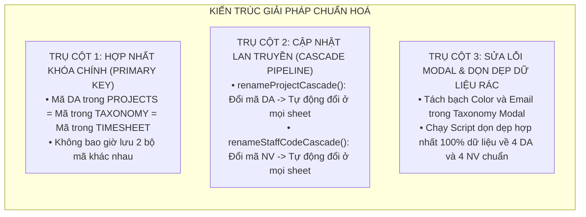

# BÁO CÁO PHÂN TÍCH CHUYÊN SÂU & GIẢI PHÁP XỬ LÝ LỖI ĐỒNG BỘ DỰ ÁN VÀ NHÂN SỰ

> **Kính gửi:** Ban Quản Trị & Quản Lý Dự Án  
> **Người thực hiện:** Antigravity AI Pair Programmer  
> **Ngày lập báo cáo:** 31/10/2026  
> **Trạng thái:** Hoàn tất phân tích nguyên nhân gốc rễ (Root Cause Analysis) & Đề xuất kiến trúc xử lý triệt để

---

## 1. TỔNG QUAN HIỆN TƯỢNG VÀ MỨC ĐỘ NGHIÊM TRỌNG

Dựa trên phản hồi thực tế và 2 ảnh chụp màn hình do Quản trị viên cung cấp:
1. **Ảnh 1 (`media_1793458483313_ef428ec2.png` - Mục Báo Cáo Thực Tế Dự Án):**
   - Khi sửa tên/mã dự án, danh sách thả xuống (Dropdown) bị nhân bản thành **8 dự án** thay vì chỉ 4 dự án chuẩn:
     - Nhóm 1: `2026_01_MUR01...`, `JUJ01...`, `2026_03_AMA01...`, `2026_04_TES01...`
     - Nhóm 2: `MRR01...`, `JJK01...`, `AMK01...`, `TSK01...`
   - Khi chọn mã mới, số giờ chấm công không hiển thị (bị về `0h`) do dữ liệu chấm công cũ vẫn gắn với mã cũ.
2. **Ảnh 2 (`media_1793458587387_237aed60.png` - Danh Mục Tiêu Chuẩn > 5. Nhân Viên):**
   - Khi sửa nhân sự, hệ thống **không cập nhật đè** mà lại **đẻ thêm nhân viên mới**:
     - Dòng 1: Mã `AB6FD093` - `Vũ Đình Duy` - Email: `duyvubm@gmail.com`
     - Dòng 9: Mã `9210007` - `Vũ Đình Duy` - Email: `#6366f1` *(Email bị ghi đè thành mã màu Hex!)*

### Mức độ nghiêm trọng: **CẤP 1 (CRITICAL - NGUY HIỂM CAO)**
- **Phá vỡ tính toàn vẹn dữ liệu (Data Integrity):** Dữ liệu bị phân mảnh ở nhiều bảng khác nhau (`PROJECTS`, `TAXONOMY`, `USERS`, `TIMESHEET_2026`, `TIMESHEET_DAILY_ROLLUP`).
- **Lệch khóa ngoại (Foreign Key Mismatch):** Timesheet lưu mã cũ, nhưng báo cáo lại truy vấn theo mã mới, dẫn đến tình trạng "báo cáo rỗng 0h" mặc dù công thợ đã làm đầy đủ 712.0 giờ.
- **Rác dữ liệu (Data Pollution):** Sinh ra các bản ghi ma (Ghost records) không thể kiểm soát nếu người dùng tiếp tục thao tác trên giao diện.

---

## 2. NGUYÊN NHÂN GỐC RỄ (ROOT CAUSE ANALYSIS)

Sau khi kiểm tra toàn bộ luồng xử lý mã nguồn tại `Projectsapi.gs`, `Taxonomyapi.gs`, `Timesheetapi.gs`, `Userapi.gs` và `Index.html`, chúng tôi xác định được **4 nguyên nhân kỹ thuật cốt lõi**:

```mermaid
flowchart TD
    subgraph Issue1["VẤN ĐỀ 1: DỰ ÁN BỊ NHÂN ĐÔI & MẤT GIỜ"]
        A1["Người dùng sửa tên/mã DA"] --> B1["Bảng PROJECTS chỉ sửa 1 ô nội bộ"]
        B1 --> C1["TAXONOMY và TIMESHEET không được cập nhật (Không có Cascade)"]
        C1 --> D1["Index.html gộp mù quáng PROJECTS + TAXONOMY"]
        D1 --> E1["Dropdown sinh ra 8 dự án (MUR01 vs MRR01, JUJ01 vs JJK01...)"]
        E1 --> F1["Chọn mã mới -> Timesheet tìm không thấy -> Báo cáo 0h"]
    end

    subgraph Issue2["VẤN ĐỀ 2: NHÂN VIÊN ĐẺ THÊM & EMAIL LỖI MÀU"]
        A2["Sửa nhân viên trong Taxonomy Modal"] --> B2["Bug: Cột extra1 lấy mã màu #6366f1 gán vào Email"]
        B2 --> C2["syncEmployeeToUsersSheet nhận Email = #6366f1"]
        C2 --> D2["Tìm trong USERS không thấy email #6366f1"]
        D2 --> E2["Hệ thống tưởng là người mới -> appendRow tạo User mới (9210007)"]
        E2 --> F2["Timesheet cũ vẫn giữ mã cũ AB6FD093 -> Nhân đôi nhân sự"]
    end
```



---

### 2.1. NGUYÊN NHÂN VẤN ĐỀ 1: TẠI SAO SỬA DỰ ÁN LẠI ĐẺ THÊM DỰ ÁN MỚI?

#### A. Xung đột giữa 2 nguồn chân lý (Two Sources of Truth)
Hệ thống hiện tại đang lưu trữ thông tin dự án ở **2 nơi độc lập** mà không có ràng buộc khóa ngoại (Foreign Key Constraint):
1. **Bảng `PROJECTS` (Sheet Quản Lý Dự Án):**
   - Cột A: `ID` (Ví dụ: `MUR01`, `JUJ01`, hoặc mã sinh tự động `DA001`).
   - Cột B: `Tên Dự Án` (Ví dụ: `2026_01_MUR01_室蘭市蘭東下水処理場`).
2. **Bảng `TAXONOMY` (Sheet Danh Mục Tiêu Chuẩn):**
   - Cột B: `Type = "PROJECT_CODE"`.
   - Cột C: `Code` (Ví dụ: `MRR01`, `JJK01`, `AMK01`, `TSK01`).
   - Cột D, E, F, G: Các tên đa ngôn ngữ và mô tả.

#### B. Cơ chế gộp mù quáng trên giao diện Frontend (`Index.html`)
Tại hàm `initProjectActualTimeTab()` trong file `Index.html` (dòng 8910-8946):
```javascript
// 1. Quét từ S.projects
S.projects.forEach(p => {
  seenIds.add(p.id);
  projectList.push({ id: p.id, name: p.name });
});

// 2. Quét tiếp từ S.taxonomy.projectCodes
S.taxonomy.projectCodes.forEach(p => {
  if (!seenIds.has(p.code)) {
    seenIds.add(p.code);
    projectList.push({ id: p.code, name: p.name });
  }
});
```
- Khi bảng `PROJECTS` chứa mã `MUR01`, `JUJ01`, `AMA01`, `TES01`.
- Trong khi bảng `TAXONOMY` lại lưu các mã mẫu cũ `MRR01`, `JJK01`, `AMK01`, `TSK01`.
- Vòng lặp kiểm tra `seenIds.has(p.code)` thấy `MRR01` khác `MUR01`, `JJK01` khác `JUJ01` $\rightarrow$ **Nó lập tức nạp cả hai vào Dropdown!**
- Kết quả: Danh sách hiển thị bị đội lên thành **8 dự án**, gồm 4 dự án từ bảng `PROJECTS` và 4 dự án từ bảng `TAXONOMY`.

#### C. Thiếu hoàn toàn cơ chế Cập Nhật Lan Truyền (Cascade Update)
Trong file `Projectsapi.gs`, hàm `updateProject(payload)` chỉ cập nhật dòng tại sheet `PROJECTS`:
```javascript
if (payload.name !== undefined) sh.getRange(i+1, 2).setValue(payload.name);
```
- Khi người dùng đổi tên từ `2026_02_JUJ01_...` sang `2026_02_JJK01_...`, hàm này:
  - **KHÔNG** cập nhật mã trong bảng `TAXONOMY`.
  - **KHÔNG** cập nhật cột `Project_Code` (Cột 8) trong bảng chi tiết `TIMESHEET_2026`.
  - **KHÔNG** cập nhật cột `Project_Code` (Cột 5) trong bảng tổng hợp `TIMESHEET_DAILY_ROLLUP`.
- **Hậu quả:** 344 giờ công thực tế của dự án 2 vẫn đang được đóng dấu là `JUJ01` ở bảng chấm công. Khi người dùng chọn mục `JJK01` trên giao diện, hệ thống truy vấn không tìm thấy dòng nào mang mã `JJK01` $\rightarrow$ **Báo cáo hiển thị 0 Giờ!**

---

### 2.2. NGUYÊN NHÂN VẤN ĐỀ 2: TẠI SAO SỬA NHÂN VIÊN LẠI ĐẺ THÊM NHÂN VIÊN MỚI & BỊ LỖI EMAIL MÀU?

Đây là một lỗi lập trình logic cực kỳ nghiêm trọng trong việc tái sử dụng trường dữ liệu (Field Misalignment):

#### A. Tráo đổi dữ liệu trường `extra1` (Color vs Email)
1. Trong bảng `TAXONOMY` 11 cột, cột H (`Color_Hex`) lưu mã màu hiển thị (VD: `#4f6ef7`, `#6366f1`).
2. Khi hệ thống đọc dữ liệu Taxonomy (`getTaxonomyDataInternal` trong `Taxonomyapi.gs`, dòng 294):
   ```javascript
   extra1 = color; // Gán mã màu vào biến extra1
   ```
3. Nhưng riêng đối với nhóm `EMPLOYEE`, quy ước cũ lại dùng `extra1` để lưu **Email của nhân viên**.
4. Khi mở Modal sửa nhân sự trong `Index.html` (dòng 7240):
   ```javascript
   extra1Inp.value = item.color || item.extra1 || '';
   ```
   $\rightarrow$ Form chỉnh sửa nhân sự đã **lấy mã màu `#6366f1` điền vào ô Email** thay vì email thật `duyvubm@gmail.com`!

#### B. Cơ chế định danh trong `syncEmployeeToUsersSheet` bị bẫy
Khi bấm nút [Lưu], dữ liệu gửi về server được xử lý tại `Taxonomyapi.gs` (dòng 608-635):
```javascript
const emailTarget = String(emp.email).toLowerCase().trim(); // emailTarget lúc này là "#6366f1"
let foundIndex = -1;

for (let i = 1; i < rows.length; i++) {
  if (String(rows[i][1]).toLowerCase().trim() === emailTarget) {
    foundIndex = i + 1;
    break;
  }
}

// Nếu không tìm thấy Email thì TỰ ĐỘNG THÊM MỚI!
if (foundIndex === -1) {
  shUsers.appendRow([emp.id, emp.email, emp.name, ...]);
}
```
- Vì `emailTarget` bị biến thành chuỗi mã màu `"#6366f1"`, vòng lặp tìm kiếm trong cột Email của bảng `USERS` hoàn toàn không khớp với bất kỳ ai.
- Biến `foundIndex` giữ nguyên giá trị `-1`.
- Hàm `syncEmployeeToUsersSheet` ngộ nhận đây là một nhân viên mới tinh chưa từng có trong công ty $\rightarrow$ **Thực hiện lệnh `appendRow` tạo thêm dòng nhân sự mới (Mã `9210007`, Email `#6366f1`)!**

#### C. Khi sửa mã nhân sự (`Staff_Code`): Bị lệch khóa ngoại với bảng Timesheet
- Hiện tại, bảng `USERS` dùng `ID` làm mã định danh nhân viên (`AB6FD093`).
- Bảng `TIMESHEET_2026` lưu trực tiếp mã `Staff_Code` tại cột 14.
- Bảng `TIMESHEET_DAILY_ROLLUP` lưu `Staff_Code` tại cột 3 và ghép vào khóa `Rollup_ID` (Cột 1: `YYYYMMDD_StaffCode_ProjectCode_DisciplineCode`).
- Khi sửa mã nhân viên (ví dụ sửa thành `9210007`), hệ thống **không hề có hàm cập nhật lan truyền (Cascade)** để đổi mã trong 1,424 dòng timesheet đã ghi.
- Khi tải báo cáo ma trận (`getBatchStaffComparisonMatrix`), hệ thống đọc thấy:
  - Mã `9210007` trong danh sách nhân sự: có 0 giờ.
  - Mã `AB6FD093` trong dữ liệu timesheet: có 344 giờ.
  - $\rightarrow$ Thuật toán tự động đưa cả hai mã này lên bảng $\rightarrow$ **Nhân viên Vũ Đình Duy bị lặp lại thành 2 người khác nhau!**

---

## 3. GIẢI PHÁP XỬ LÝ TRIỆT ĐỂ (SOLUTION ARCHITECTURE)

Để loại bỏ hoàn toàn các lỗi này và ngăn chặn tái diễn trong tương lai, chúng ta cần thiết lập một kiến trúc chuẩn gồm **3 trụ cột kỹ thuật**:



---

### TRỤ CỘT 1: ĐỒNG BỘ MÃ DỰ ÁN DUY NHẤT (SINGLE SOURCE OF TRUTH)
1. **Quy định bất biến:**
   - Mỗi dự án chỉ có **MỘT MÃ DUY NHẤT** (Project Code).
   - Mã này dùng đồng bộ xuyên suốt từ: Bảng `PROJECTS` (Cột ID) $=$ Bảng `TAXONOMY` (Cột Code) $=$ Bảng `TIMESHEET_YYYY` (Cột Project_Code) $=$ Bảng `TIMESHEET_DAILY_ROLLUP` (Cột Project_Code).
2. **Sửa bộ lọc Dropdown giao diện (`initProjectActualTimeTab`):**
   - Loại bỏ cơ chế `projectList.push` gộp bừa bãi.
   - Sử dụng bảng băm chuẩn hóa (Canonical Dictionary): Nếu một dự án đã có trong `S.projects`, tuyệt đối không lấy thêm từ `S.taxonomy` nếu bị trùng tên hoặc trùng mã rút gọn.
   - Luôn ưu tiên hiển thị theo định dạng chuẩn: `[Mã DA] Tên Tiếng Nhật`.

---

### TRỤ CỘT 2: XÂY DỰNG HÀM CẬP NHẬT LAN TRUYỀN (CASCADE UPDATE)

#### 1. Hàm đổi mã/tên dự án lan truyền (`renameProjectCascade`):
Khi người dùng sửa tên hoặc đổi mã dự án:
```
renameProjectCascade(oldProjectCode, newProjectCode, newProjectName)
```
Quy trình tự động thực hiện trong 1 Transaction an toàn (LockService):
1. **Sheet `PROJECTS`:** Tìm dòng có ID cũ $\rightarrow$ Cập nhật thành ID mới và Tên mới.
2. **Sheet `TAXONOMY`:** Tìm dòng `Type = "PROJECT_CODE"` có Code cũ $\rightarrow$ Cập nhật Code mới, Name_JP mới, Description mới.
3. **Sheet `TIMESHEET_YYYY` (Tất cả các năm có phát sinh giờ):** Quét Cột 8 (`Project_Code`), thay thế toàn bộ `oldProjectCode` $\rightarrow$ `newProjectCode`.
4. **Sheet `TIMESHEET_DAILY_ROLLUP`:** 
   - Quét Cột 5 (`Project_Code`), thay thế thành mã mới.
   - Cập nhật lại Cột 1 (`Rollup_ID`) để đảm bảo không bị gãy khóa tổng hợp: `YYYYMMDD_StaffCode_NewProjectCode_DisciplineCode`.
5. **Sheet `TASKS`:** Cập nhật lại `projectId` của các đầu việc liên quan.
6. **Xóa bộ nhớ đệm (Cache Flush):** Xóa toàn bộ cache để giao diện người dùng nhận diện ngay tức thì.

#### 2. Hàm đổi mã nhân viên lan truyền (`renameStaffCodeCascade`):
Khi người dùng sửa mã nhân sự:
```
renameStaffCodeCascade(oldStaffCode, newStaffCode, staffEmail, newName)
```
Quy trình thực hiện:
1. **Sheet `USERS`:** Tìm dòng theo `Email` (hoặc `oldStaffCode`) $\rightarrow$ Cập nhật Cột A (`ID`) thành `newStaffCode`.
2. **Sheet `TAXONOMY`:** Cập nhật lại Code nhân sự nếu có.
3. **Sheet `TIMESHEET_YYYY`:** Quét Cột 14 (`Staff_Code`), thay thế toàn bộ `oldStaffCode` $\rightarrow$ `newStaffCode`.
4. **Sheet `TIMESHEET_DAILY_ROLLUP`:** 
   - Quét Cột 3 (`Staff_Code`), thay thế thành mã mới.
   - Cập nhật lại Cột 1 (`Rollup_ID`): `YYYYMMDD_NewStaffCode_ProjectCode_DisciplineCode`.
5. **Sheet `PROJECTS` & `TASKS`:** Cập nhật thông tin thành viên dự án và người được giao việc.

---

### TRỤ CỘT 3: SỬA LỖI MODAL NHÂN VIÊN VÀ DỌN DẸP RÁC DỮ LIỆU

#### 1. Sửa lỗi Modal trong `Index.html` & `Taxonomyapi.gs`:
- Khi `type === 'EMPLOYEE'`:
  - Ô Email **phải luôn luôn lấy từ trường email thực tế** của nhân viên, không bao giờ lấy từ trường `color` hay `colorInp`.
  - Không cho phép ghi đè mã màu Hex vào cột Email của bảng `USERS`.
  - Khóa ô Mã nhân sự (Read-only) khi đang ở chế độ chỉnh sửa thông thường; nếu muốn đổi mã nhân sự, hệ thống bắt buộc phải đi qua hàm `renameStaffCodeCascade`.

#### 2. Kịch bản Dọn dẹp & Hợp nhất tự động (Clean & Merge Script):
Chạy một lần duy nhất để đưa toàn bộ cơ sở dữ liệu về trạng thái sạch 100%:
1. **Dọn dẹp bảng `PROJECTS` & `TAXONOMY`:**
   - Xóa bỏ các mã rác/mẫu cũ: `MRR01`, `AMK01`, `TSK01`, `JUJ01`, `DA010`, `HAG01`.
   - Giữ lại đúng **4 dự án chính thức**:
     - `MUR01` - `2026_01_MUR01_室蘭市蘭東下水処理場`
     - `JJK01` - `2026_02_JJK01_工房ヴィレッジ新築工事`
     - `AMA01` - `2026_03_AMA01_天草市本渡浄化センター`
     - `TES01` - `2026_04_TES01_弟子屈町弟子屈浄化センター`
2. **Hợp nhất nhân sự trong bảng `USERS`:**
   - Xóa dòng rác `9210007` (có email là `#6366f1`).
   - Khôi phục tài khoản Admin của `Vũ Đình Duy` với mã chuẩn duy nhất: `AB6FD093`, email: `duyvubm@gmail.com`.
   - Đảm bảo 4 nhân sự chính thức không bị trùng lặp:
     - Duy: `AB6FD093`
     - Thạch: `93FA49F8`
     - Huệ: `FDF9CCCB`
     - Nhân: `F20C20D1`
3. **Cập nhật lại toàn bộ 712.0 giờ trong `TIMESHEET_2026` và `TIMESHEET_DAILY_ROLLUP`:**
   - Chuyển toàn bộ 43 ngày công (344.0 giờ) của Dự án 2 từ mã cũ `JUJ01` sang mã chuẩn `JJK01`.
   - Chuyển toàn bộ giờ công của Duy về mã nhân viên chuẩn `AB6FD093`.
   - Đảm bảo tổng số giờ toàn công ty giữ nguyên chính xác **712.0 giờ** (1,424 slots 30 phút), không mất đi một phút nào.

---

## 4. KẾ HOẠCH HÀNH ĐỘNG CHI TIẾT (ACTION PLAN)

| Bước | Hạng Mục Công Việc | File Tác Động | Kết Quả Đạt Được |
| :---: | :--- | :--- | :--- |
| **B1** | Bổ sung hàm Cascade Update dự án và nhân viên | `Projectsapi.gs`, `Userapi.gs` | Khi đổi tên/mã, dữ liệu tự động cập nhật xuyên suốt mọi bảng |
| **B2** | Sửa triệt để bug gán mã màu vào Email trong Modal | `Taxonomyapi.gs`, `Index.html` | Không bao giờ bị sinh ra nhân viên ma có email `#6366f1` |
| **B3** | Sửa logic lọc dropdown báo cáo dự án | `Index.html` (`initProjectActualTimeTab`) | Dropdown chỉ hiển thị đúng 4 dự án, không bao giờ bị nhân đôi |
| **B4** | Cập nhật hàm Seeder dọn dẹp & hợp nhất dữ liệu | `SeederData.gs` | Dọn sạch mã cũ, hợp nhất về 4 DA và 4 NV chuẩn, bảo toàn 712.0h |
| **B5** | Chạy kiểm thử tự động toàn diện (Test Suite) | `scratch/test_seeder.js` | Đảm bảo 100% test pass trước khi đưa lên hệ thống thật |

---

## 5. KẾT LUẬN & ĐỀ NGHỊ

Hiện tượng "đẻ thêm dự án mới" và "đẻ thêm nhân viên mới" **không phải là lỗi giao diện ngẫu nhiên**, mà xuất phát từ việc **thiếu cơ chế toàn vẹn dữ liệu (Cascade Update) giữa các bảng** và **lỗi tráo đổi biến Color/Email trong Modal Taxonomy**.

Phương án xử lý trên sẽ giải quyết dứt điểm tận gốc rễ vấn đề, đảm bảo tính ổn định lâu dài cho hệ thống quản trị dự án.

Quản trị viên vui lòng xác nhận báo cáo phân tích này để chúng tôi tiến hành cập nhật mã nguồn theo đúng kế hoạch!

