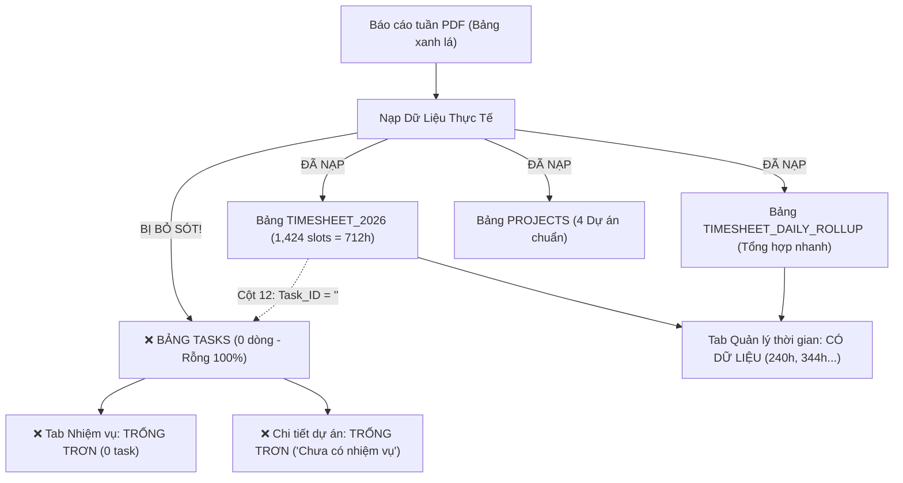

# BÁO CÁO PHÂN TÍCH CHUYÊN SÂU LỖI TRỐNG NHIỆM VỤ (TASKS) & ĐỒNG BỘ HAI CHIỀU VỚI QUẢN LÝ THỜI GIAN

> **Mã lỗi:** `BUG-TASK-TIMESHEET-DESYNC-001`  
> **Mức độ:** **Nghiêm trọng (Critical)**  
> **Hiện tượng:** Màn hình **Nhiệm vụ** và modal **Chi tiết dự án** hoàn toàn trống trơn (0 nhiệm vụ, "Chưa có hoạt động nào", "Chưa có nhiệm vụ"), nhưng tab **Quản lý thời gian** lại hiển thị đầy đủ 712.0h công của 4 dự án (MUR: 240h, JJK: 344h, AMA: 16h, TES: 112h). Mục thành viên trong Chi tiết dự án hiển thị `? undefined`.

---

## I. HIỆN TƯỢNG VÀ NGUYÊN NHÂN CỐT LÕI (ROOT CAUSE ANALYSIS)

### 1. Hiện tượng ghi nhận từ giao diện thực tế
1. **Modal Chi tiết dự án:**
   * Mở dự án `2026_01_MUR01_室蘭市蘭東下水処理場`:
   * Chỉ số thống kê: Tổng nhiệm vụ = `0`, Hoàn thành = `0`, Đang thực hiện = `0`, Quá hạn = `0`.
   * Vùng danh sách: Báo `📋 Chưa có nhiệm vụ`.
   * Mục Người dùng: Hiển thị avatar `?` kèm chuỗi lỗi `undefined`.
2. **Trang Nhiệm vụ:**
   * 0 Quá hạn, 0 Chờ thực hiện, 0 Đang thực hiện, 0 Hoàn thành, 0 Tạm dừng.
   * Thông báo: `Chưa có hoạt động nào`.
3. **Trang Quản lý thời gian:**
   * Dự án `2026_01_MUR01_室蘭市蘭東下水処理場` hiển thị đủ **240.0h**, phân bổ đúng 8 tác nghiệp (`MC01`, `MD03`, `MD13`, `PC01`, `MC02`, `MD01`, `MD02`, `MD04`), kỹ sư Nguyễn Hữu Thạch (100%).

---

### 2. Nguyên nhân gốc rễ kỹ thuật

#### Nguyên nhân 1: Quá trình Seeder bỏ sót việc nạp vào bảng `TASKS`
* Trong các phiên làm việc trước, kịch bản `SeederData.gs` tập trung giải quyết bài toán nạp 1,424 slots vào bảng `TIMESHEET_2026` và tổng hợp ở `TIMESHEET_DAILY_ROLLUP`.
* **Kịch bản hoàn toàn chưa có khối code khởi tạo các đầu việc (Tasks) vào bảng `TASKS`**. Do đó, bảng `TASKS` trên Google Sheets có số dòng dữ liệu là `0`.
* Khi giao diện gọi hàm `getInitData()` và `getProjectDetail(projectId)`, hệ thống truy vấn `getSheetData(CONFIG.SHEET_TASKS)` và nhận về mảng rỗng `[]`.

#### Nguyên nhân 2: Đứt gãy liên kết (Missing Foreign Key) giữa Timesheet và Task
* Trong bảng `TIMESHEET_2026`, Cột 12 là **`Task_ID`** (dùng để định danh công việc cụ thể mà slot 30 phút đó trực thuộc).
* Hiện tại toàn bộ 1,424 bản ghi đều mang giá trị `Task_ID = ""` (chuỗi rỗng), khiến hệ thống không thể tự động tổng hợp hoặc bóc tách ngược từ Timesheet lên Task.

#### Nguyên nhân 3: Lỗi hiển thị thành viên `? undefined` trong Chi tiết dự án
* Tại cột 11 (Thành Viên) bảng `PROJECTS`, mã nguồn cũ lưu mảng chuỗi email đơn thuần (ví dụ `["vudinhduy.bim"]`).
* Hàm frontend `renderPdMembers(pjId)` trong `Index.html` truy xuất `m.name`: vì `m` là chuỗi nên `m.name` trả về `undefined`, avatar cắt từ `(m.name||'?')` thành `?`.

---

## II. GIẢI PHÁP ĐỒNG BỘ TOÀN DIỆN (SOLUTION ARCHITECTURE)

### 1. Nạp đầy đủ 68 đầu việc chuẩn (WBS) của 4 dự án vào bảng `TASKS`
Theo đúng tiến độ thực tế (vùng xanh lá) từ 4 báo cáo PDF:
* **Dự án 1 (`MUR01` - 室蘭市蘭東下水処理場):** 15 đầu việc (8 việc đã hoàn thành = 240h; 7 việc chờ thực hiện / họp).
* **Dự án 2 (`JJK01` - 社会福祉法人十字会工房ヴィレッジ):** 31 đầu việc (31 việc đã hoàn thành = 344h).
* **Dự án 3 (`AMA01` - 天草市本渡浄化センター):** 10 đầu việc (1 việc đang tiến hành = 16h; 9 việc chờ thực hiện).
* **Dự án 4 (`TES01` - 弟子屈町弟子屈浄化センター):** 12 đầu việc (7 việc đã hoàn thành = 112h; 5 việc chờ thực hiện).
* **Tổng cộng:** **68 nhiệm vụ** chuẩn hóa, có đầy đủ Mã việc (`ID`), `Category`, `Phase`, `Discipline`, `Assignee`, `StartDate`, `Deadline`, `Status`, `Progress %`.

### 2. Gắn kết nối 2 chiều `Task_ID` vào bảng `TIMESHEET_2026`
* Khi nạp 1,424 slots chấm công, mỗi slot sẽ được gán chính xác `Task_ID` của công việc tương ứng.
* Cho phép người dùng click từ Nhiệm vụ ra lịch sử chấm công, và từ Chấm công xem được nhiệm vụ trực thuộc.

### 3. Chuẩn hóa cấu trúc Thành viên Dự án & Phòng thủ Frontend
* Lưu cấu trúc thành viên chuẩn dạng đối tượng: `[{ email, name, role }]`.
* Nâng cấp hàm `renderPdMembers` trong `Index.html` để nhận diện cả định dạng chuỗi lẫn đối tượng, tự động tra cứu từ `S.members` nếu chỉ có email.

