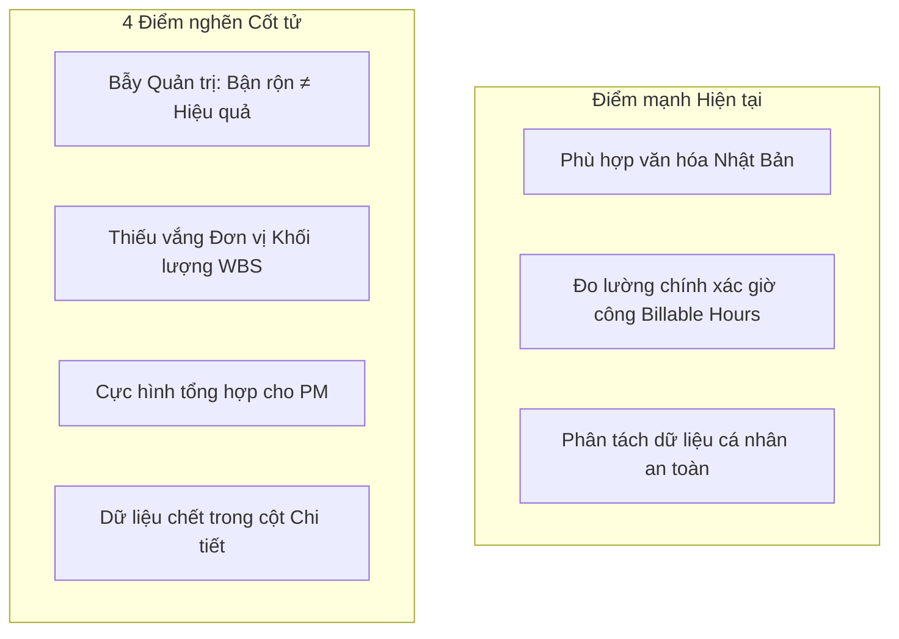
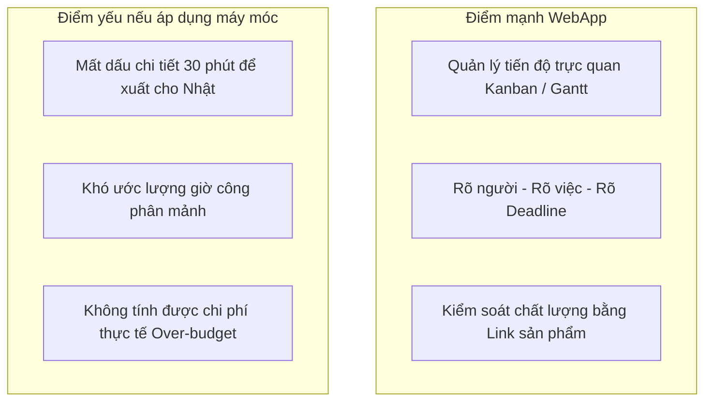
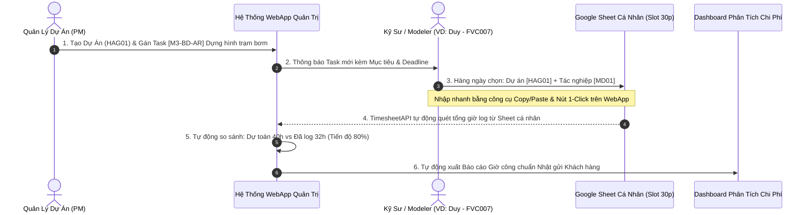

# BÁO CÁO PHÂN TÍCH & PHẢN BIỆN CHUYÊN SÂU: PHƯƠNG THỨC QUẢN LÝ ĐẦU VIỆC DỰ ÁN
## SO SÁNH GIỮA MÔ HÌNH LOG THỜI GIAN 30 PHÚT TRÊN GOOGLE SHEETS CÁ NHÂN VÀ MÔ HÌNH TASK-CENTRIC TRÊN WEBAPP

> **Tài liệu:** Báo cáo Phản biện Kiến trúc & Đề xuất Hợp nhất Quản trị  
> **Tác giả:** Đội ngũ Kỹ thuật & Quản trị Hệ thống Antigravity  
> **Đối tượng:** Ban Quản lý Dự án & Kỹ sư triển khai (BIM / Civil Engineering)  
> **Ngôn ngữ tham chiếu:** 🇻🇳 Tiếng Việt & 🇯🇵 日本語 (Thuật ngữ chuyên ngành Nhật Bản)  
> **Trạng thái:** Báo cáo đối chiếu chuyên sâu hoàn chỉnh

---

## I. TỔNG QUAN & BỐI CẢNH BÀI TOÁN

Dựa trên hình ảnh thực tế bạn đang vận hành tại doanh nghiệp:
1. **Mỗi nhân viên sở hữu 1 Google Sheet riêng:**
   - Thông tin nhận diện: `名前 (Họ tên): VU DINH DUY`, `社員番号 (Mã NV): FVC007`, `日付 (Ngày): 2026/10/26`.
2. **Khung thời gian cố định từng block 30 phút (Slot-based Time Tracking):**
   - Phân bổ liên tục từ `08:00 - 08:30` đến `21:30 - 22:00` (khoảng 28 block/ngày).
3. **Quy chuẩn mã hóa dropdown 2 tầng nghiêm ngặt:**
   - **Cột `プロジェクトコード` (Mã dự án):** Dropdown chọn từ danh sách mã dự án chuẩn (`1GE00`, `SOJ01`, `NSY01`, `HAG01`, `JJK01`, `NGS01`...).
   - **Cột `作業` (Mã tác nghiệp / Activity Code):** Dropdown phân loại chi tiết theo bộ từ điển tác nghiệp Nhật Bản (`PNxx`, `PCxx`, `MDxx`, `MCxx`, `SDxx`, `MTxx`, `PMxx`, `MJxx`, `DExx`, `LNxx`...).
   - **Cột `詳細・気付き` (Chi tiết & Phát hiện):** Nhân viên tự ghi chú cụ thể nội dung công việc hoặc phát sinh lỗi/cải tiến.

Cùng lúc đó, hệ thống **WebApp Quản Lý Dự Án** đang đề xuất cách tiếp cận quản lý theo **Task / WBS / Kanban / Gantt** với tiền tố Taxonomy `[Category - Phase - Discipline]`.

Dưới đây là bản **so sánh, phản biện chi tiết từ gốc rễ triết lý quản trị đến tính khả thi vận hành thực tế**.

---

## II. BẢNG SO SÁNH ĐỐI ĐẦU TOÀN DIỆN (HEAD-TO-HEAD COMPARISON)

| Tiêu chí Đánh giá | Cách làm Hiện tại của Bạn (Log 30 phút trên Sheet cá nhân) | Cách làm Đề xuất của WebApp (Task-Centric / Kanban / Gantt) |
| :--- | :--- | :--- |
| **Triết lý Cốt lõi (Core Philosophy)** | **Quản trị Đầu vào (Input-driven / Time-driven):** Đo lường nhân viên đã dùng bao nhiêu thời gian vào từng loại hành vi kỹ thuật. | **Quản trị Đầu ra (Outcome-driven / Deliverable-driven):** Đo lường mục tiêu công việc, thời hạn hoàn thành (Deadline) và sản phẩm bàn giao. |
| **Đơn vị Quản lý (Atomic Unit)** | **Block thời gian (Time-slot):** 1 block = 30 phút của một cá nhân cụ thể. | **Đầu việc (Task):** 1 task = Một gói công việc có kết quả bàn giao cụ thể (có thể kéo dài vài giờ đến vài ngày). |
| **Cơ chế Phân loại** | **Mã Tác Nghiệp phẳng (Flat Operation Code):** `MD01`, `PC01`, `MC01`, `SD01`... kết hợp với Mã Dự án (`HAG01`). | **Taxonomy Cấu trúc 3 cấp:** `[Category - Phase - Discipline]` (VD: `[M3-BD-AR] Dựng hình kiến trúc`). |
| **Góc nhìn Quản lý (Visibility)** | Thấy rất rõ **Nhân viên đang làm gì trong từng giờ của ngày hôm nay**. Rất khó thấy tiến độ tổng thể của toàn dự án. | Thấy rất rõ **Dự án đang đạt bao nhiêu %, task nào bị chậm deadline, ai đang quá tải**. Khó thấy chi tiết từng khung giờ vụn vặt. |
| **Nỗ lực Nhập liệu (Friction)** | **Rất cao (High friction):** Nhân viên phải click chọn dropdown từ 16 - 28 lần mỗi ngày trên từng dòng bảng tính. Dễ sinh tâm lý đối phó (Timesheet fatigue). | **Thấp - Trung bình:** Kéo thả thẻ Kanban hoặc cập nhật % tiến độ 1-2 lần/ngày khi có kết quả mới. |
| **Khả năng Tổng hợp Dữ liệu** | **Phân tán & Phức tạp:** Dữ liệu nằm ở 30-40 file riêng rẽ. Muốn tổng hợp báo cáo tổng cần hệ thống backend quét từng file hoặc hàm `IMPORTRANGE` nặng nề. | **Tập trung 100%:** Dữ liệu nằm tại một cơ sở dữ liệu duy nhất, Dashboard vẽ biểu đồ phân tích (Chart.js) theo thời gian thực trong 1 giây. |
| **Tính tương thích Khách hàng Nhật** | **Rất cao (Chuẩn văn hóa Nhật):** Đối tác và khách hàng Nhật Bản cực kỳ coi trọng log chi tiết đến 30 phút theo chuẩn mã tác nghiệp để nghiệm thu chi phí giờ công. | **Trung bình:** Khách hàng Nhật thích xem Gantt chart ở cấp quản lý, nhưng khi thanh toán chi phí (Cost/Hour billing) họ vẫn đòi hỏi bảng chấm công chi tiết. |
| **Kiểm soát Chất lượng & Trách nhiệm** | Nhân viên tự giác ghi, khó phát hiện việc "chấm công khống" hoặc làm việc không hiệu quả nếu chỉ nhìn vào mã `MD01` mà không gắn với khối lượng đo đếm được. | Gắn liền với **Link kết quả, sản phẩm đầu ra (Deliverable link)** và quy trình duyệt (Review workflow: Chờ duyệt ➔ Hoàn thành). |

---

## III. PHẢN BIỆN CHI TIẾT CÁCH LÀM HIỆN TẠI CỦA BẠN



### 1. Điểm mạnh vượt trội (Không được phép phủ nhận)
1. **Tuân thủ xuất sắc chuẩn mực Báo cáo Kỹ thuật Nhật Bản:**
   - Bộ mã tác nghiệp của bạn (`MD01: 躯体作成`, `PC01: 点群処理`, `MC01: 干渉チェック`, `SD01: 図面取りまとめ`...) là một bộ từ điển nghiệp vụ cực kỳ chuẩn mực trong ngành BIM/Cơ điện/Xây dựng tại Nhật. Khách hàng nhìn vào bảng này là hiểu ngay cơ cấu chi phí.
2. **Minh bạch hóa chi phí giờ công (Cost Accounting & Billing):**
   - Biết chính xác dự án `NSY01` đã tiêu tốn bao nhiêu giờ công cho việc dựng mô hình (`MD`), bao nhiêu giờ cho việc xử lý đám mây điểm (`PC`), và bao nhiêu giờ cho họp hành (`MT`).
3. **Tránh xung đột đồng thời (Concurrency Lock):**
   - Mỗi nhân viên 1 sheet riêng giúp không bao giờ bị đơ lag hay ghi đè dữ liệu lên nhau như khi 40 người cùng nhảy vào 1 bảng tính.

### 2. Bốn (4) Điểm nghẽn cốt tử & Rủi ro quản trị

#### 🔴 Điểm nghẽn 1: Bẫy "Bận rộn nhưng không ra kết quả" (Activity Trap)
- Nhân viên có thể điền kín 16 block từ 08:30 đến 17:30 với mã `MD01_【モデル】躯体作成` cho dự án `HAG01`.
- Nhìn vào bảng, người quản lý thấy nhân viên *"rất chăm chỉ, làm việc 8 tiếng/ngày"*.
- **Nhưng câu hỏi cốt lõi không trả lời được:** *"Hôm nay anh dựng được bao nhiêu m² sàn? Dựng xong block A chưa? Bao giờ bàn giao cho đội MEP phối hợp?"* 
- ➔ **Hệ thống hiện tại theo dõi sự nỗ lực (Effort/Time spent), chứ không đo lường được tiến độ hoàn thành sản phẩm (Progress/Deliverable).**

#### 🔴 Điểm nghẽn 2: Thiếu vắng ranh giới gói việc (Scope & Work Breakdown Structure)
- Cùng một mã `MD03_【モデル】配管作成` (Dựng ống công nghệ) của dự án `HAG01`, cả 3 kỹ sư Duy, Tuấn, Nam cùng chọn mã này trong ngày.
- Người quản lý không thể phân định ranh giới trách nhiệm: Ai chịu trách nhiệm đường ống phòng bơm? Ai chịu trách nhiệm tuyến ống ngoài sân? 
- Mọi thông tin phân chia công việc lại bị đẩy vào cột tự do `詳細・気付き` (Ghi chú), khiến máy móc không thể phân tích tự động được.

#### 🔴 Điểm nghẽn 3: "Cực hình" tổng hợp của Quản lý Dự án (PM Aggregation Nightmare)
- Khi Giám đốc hoặc Đối tác hỏi: *"Dự án Hanamigawa tuần này đã làm được những gì và tiến độ thực tế đạt bao nhiêu % so với kế hoạch?"*.
- Người quản lý dự án (PM) phải làm thủ công:
  1. Mở lần lượt 10 - 20 file Google Sheet của các thành viên.
  2. Đọc từng dòng ghi chú chữ tiếng Nhật / tiếng Việt ở cột `詳細・気付き`.
  3. Tự cộng dồn giờ và tự ước lượng tiến độ trong đầu.
- Quá trình này tiêu tốn hàng giờ đồng hồ mỗi tuần của PM chỉ để làm công việc tổng hợp dữ liệu thụ động!

#### 🔴 Điểm nghẽn 4: Nguy cơ "Điền đối phó" cuối tuần (Timesheet Fatigue)
- Thao tác chọn dropdown 20 - 30 lần mỗi ngày là một gánh nặng tâm lý lớn.
- Thực tế ở nhiều dự án: Nhân viên quên điền trong ngày, đến chiều thứ Sáu mới ngồi nhớ lại cả tuần để điền một loạt. Khi đó, tính chuẩn xác của từng block 30 phút gần như biến mất, trở thành số liệu đối phó.

---

## IV. PHẢN BIỆN CÁCH LÀM ĐỀ XUẤT CỦA WEBAPP (TASK-CENTRIC)



### 1. Điểm mạnh vượt trội của WebApp
1. **Rõ ràng tuyệt đối về Trách nhiệm & Thời hạn:**
   - Mỗi task là một đầu việc có chủ nhân cụ thể (`Assignee: VU DINH DUY`), có hạn chót (`Deadline: 28/10/2026`), có trạng thái rõ ràng (`Đang thực hiện`, `Chờ duyệt`, `Hoàn thành`).
2. **Kiểm soát chất lượng bàn giao (Deliverable-centric):**
   - Task bắt buộc gắn liền với trường `Link Kết Quả` (Link file Revit, file Navisworks, bản vẽ PDF trên Google Drive/BIM360) và `Kết quả đầu ra`. Người duyệt (PM/Leader) mở link ra nghiệm thu mới bấm duyệt hoàn thành.
3. **Bức tranh toàn cảnh tức thì (Real-time Project Dashboard):**
   - PM nhìn vào màn hình Kanban hoặc Gantt Chart là biết ngay: Dự án có 45 task, 30 task đã xong, 5 task trễ hạn, 10 task đang làm. Tiến độ tự động tính ra `72%` mà không cần hỏi từng người.

### 2. Điểm yếu nếu WebApp chỉ quản lý Task mà bỏ qua Sheet 30 phút
1. **Không có số liệu vi mô để giải trình giờ công cho đối tác Nhật:**
   - Khách hàng Nhật không chấp nhận hóa đơn thanh toán chỉ ghi: *"Làm task Dựng hình kiến trúc hết 5 ngày = 40 giờ"*. Họ cần bảng chi tiết: Ngày nào, từ mấy giờ đến mấy giờ, làm thao tác gì (`MD01`, `MD10`, `MC01`).
2. **Bỏ sót các công việc "vụn vặt nhưng ngốn nhiều thời gian":**
   - Các tác vụ như: Họp giao ban 15 phút (`MT00`), check mail khách hàng 30 phút (`PM02`), sửa lỗi bản vẽ nhỏ 30 phút (`MD11`)... thường không ai tạo thành một "Task" riêng trên WebApp vì quá vụn vặt. Nếu không có bảng ghi nhận thời gian 30 phút, những giờ công này sẽ bị "bốc hơi", dẫn đến việc công ty bị thất thoát chi phí nhân công thực tế.

---

## V. PHÁT HIỆN KIẾN TRÚC ĐỘT PHÁ: MỐI TƯƠNG QUAN GIỮA TAXONOMY VÀ 作業コード

Khi đối chiếu bảng `作業コード` trong ảnh thứ 3 của bạn với bảng `TAXONOMY` chúng ta vừa chuẩn hóa, một sự trùng khớp hoàn hảo lộ diện:

```
┌───────────────────────────────────────┐          ┌───────────────────────────────────────────────┐
│  TAXONOMY VĨ MÔ (Trên WebApp)         │          │  BỘ MÃ TÁC NGHIỆP VI MÔ (Trên Sheet của Bạn)   │
├───────────────────────────────────────┤          ├───────────────────────────────────────────────┤
│ CAT_PC (Point Cloud)                  │ ───────> │ PC01, PC02, PC10, PC11, PC12 (Xử lý Point)    │
│ CAT_M3 (3D Modeling)                  │ ───────> │ MD01..MD05 (Tạo mô hình), MD10..MD16 (Sửa/Check)│
│ CAT_RP (Report & Clash Check)         │ ───────> │ MC01..MC07 (Báo cáo, Check va chạm, Đo đạc)   │
│ CAT_MTG (Meeting)                     │ ───────> │ MT00..MT04 (Họp nội bộ, họp khách hàng)       │
│ CAT_DE (Develop & Automation)         │ ───────> │ DE01 (Phát triển tool, Dynamo, Script API)    │
│ CAT_GE (General & Improvement)        │ ───────> │ PM01..PM02, MJ01..MJ02 (Quản trị, Báo cáo ngày)│
│ DISC_STR, AR, MP, ELE (Bộ môn MEP/BIM)│ ───────> │ 躯体 (K.Cấu), 機械 (Thiết bị), 配管 (Ống)...    │
└───────────────────────────────────────┘          └───────────────────────────────────────────────┘
```

> 💡 **Kết luận cốt lõi:**  
> **Cách làm hiện tại của bạn và cách làm của WebApp KHÔNG HỀ MÂU THUẪN NHAU!**  
> Bản chất chúng là **2 mặt của cùng một đồng xu:**
> - WebApp quản lý ở tầng **Mục tiêu & Kế hoạch (Vĩ mô - Macro)**.
> - Google Sheet 30 phút quản lý ở tầng **Thao tác & Nhật ký Giờ công (Vi mô - Micro)**.
> 
> Nếu chỉ dùng Sheet cá nhân: Bạn có số giờ làm chi tiết nhưng **mù về tiến độ dự án**.  
> Nếu chỉ dùng WebApp Task: Bạn có tiến độ task nhưng **mù về chi phí giờ công thực tế**.

---

## VI. MÔ HÌNH HỢP NHẤT TỐI ƯU (THE DUAL-ENGINE ARCHITECTURE)

Giải pháp tốt nhất là **xây dựng cây cầu đồng bộ 2 chiều (Bridge)** giữa WebApp và Google Sheet cá nhân của từng nhân viên:



### 1. Phân vai rõ ràng giữa 2 công cụ:
1. **Trên WebApp (Màn hình Quản trị & Điều phối):**
   - PM tạo dự án theo chuẩn `2026-01-HAG01_花見川終末処理場`.
   - Phân bổ các Task chính (Milestones).
   - Thiết lập số giờ dự toán cho task (Budgeted Hours, ví dụ: 40 giờ).
2. **Trên Google Sheet cá nhân (Hoặc Tab Timesheet WebApp):**
   - Nhân viên giữ nguyên thói quen điền khung giờ 30 phút: Chọn mã dự án (`HAG01`), chọn mã tác nghiệp (`MD01_躯体作成`).
   - Sử dụng các tính năng thông minh đã code trong [Timesheetapi.gs](file:///c:/Users/95053/Desktop/Hello%20World/Google-Appscript/03_Project%20Management/Timesheetapi.gs): Nút **Sao chép từ hôm qua**, **Điền nhanh cả buổi sáng**, **Điền nhanh cả buổi chiều** để giảm thời gian thao tác từ 15 phút xuống chỉ còn **15 giây**!
3. **Cơ chế Tự động tính toán (The Automated Intelligence):**
   - Hệ thống tự động tổng hợp số block 30 phút mà anh Duy log cho dự án `HAG01` và mã `MD01`.
   - Cập nhật thẳng vào thẻ Task trên WebApp:
     `Dự kiến: 40h | Đã làm thực tế: 32h (80%) | Trạng thái: Đúng tiến độ`.
   - Nếu thực tế vượt quá 40h mà task chưa hoàn thành: Hệ thống gắn cảnh báo đỏ **`VƯỢT GIỜ DỰ TOÁN (OVER-BUDGET)`** cho PM biết ngay để điều chỉnh!

---

## VII. LỘ TRÌNH ĐỀ XUẤT NÂNG CẤP TỪNG BƯỚC

### Giai đoạn 1: Chuẩn hóa Đồng bộ Danh mục (Taxonomy Mapping)
- Đưa toàn bộ danh sách `作業コード` (`PN01..11`, `PC01..12`, `MD01..16`, `MC01..07`, `SD01..08`...) vào làm danh mục con chi tiết của `TAXONOMY` trên hệ thống.
- Khi người dùng ở giao diện WebApp hay trên Sheet đều nhìn thấy chung một bộ từ điển chuẩn xác 100%.

### Giai đoạn 2: Tối ưu Trải nghiệm Điền Timesheet (Zero-Friction Logging)
- Khuyến khích nhân viên dùng giao diện Tab **Quản lý thời gian (Timesheet)** ngay trên WebApp:
  - Tích hợp phím tắt `Ctrl+C` / `Ctrl+V`.
  - Nút sao chép 1-click.
  - Tự động ghi ngược dữ liệu về đúng file Google Sheet cá nhân của nhân viên đó để lưu trữ bản quyền riêng tư.

### Giai đoạn 3: Dashboard So Sánh Năng Suất Thực Tế (Variance Analytics)
- Bổ sung biểu đồ phân tích tương quan:
  - **Giờ dự toán (Estimated) vs Giờ thực tế (Actual)** theo từng Dự án và từng Kỹ sư.
  - Phân tích cơ cấu thời gian: Team đang dành bao nhiêu % thời gian cho việc tạo mới (`MD01`), bao nhiêu % cho việc sửa lỗi (`MD11 - MD14`), và bao nhiêu % cho họp hành (`MT`). Nếu tỷ lệ sửa lỗi quá cao, PM biết ngay chất lượng mô hình đang có vấn đề để can thiệp sớm.

---

## VIII. KẾT LUẬN

Cách làm hiện tại của bạn bằng Google Sheet 30 phút **là một tài sản vô giá về mặt dữ liệu thao tác và cực kỳ đúng đắn đối với các dự án hợp tác với Nhật Bản**. 

Cách làm của WebApp không sinh ra để thay thế hay xóa bỏ bảng tính đó, mà sinh ra để **nâng tầm dữ liệu đó thành công cụ quản trị vĩ mô**:
* **Sheet cá nhân 30 phút** là **"Đôi chân"** — ghi nhận từng bước đi chi tiết hàng ngày.
* **WebApp Task/Kanban/Gantt** là **"Đôi mắt"** — nhìn thấy đích đến của dự án, hạn chế lạc đường và chậm deadline.

Kết hợp cả hai theo mô hình lai trên sẽ giúp doanh nghiệp của bạn vừa đáp ứng khắt khe tiêu chuẩn nghiệm thu của khách hàng Nhật, vừa nâng cao năng lực quản trị dự án ngang tầm các phần mềm SaaS hiện đại!
